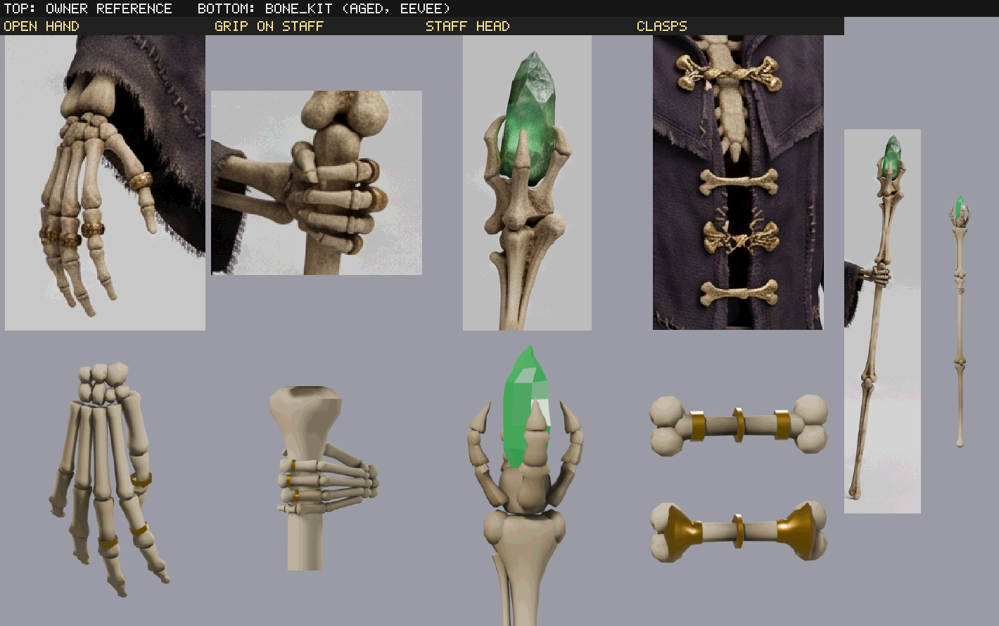
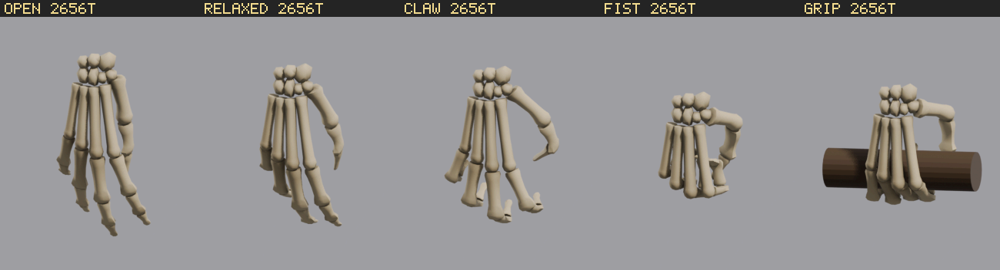
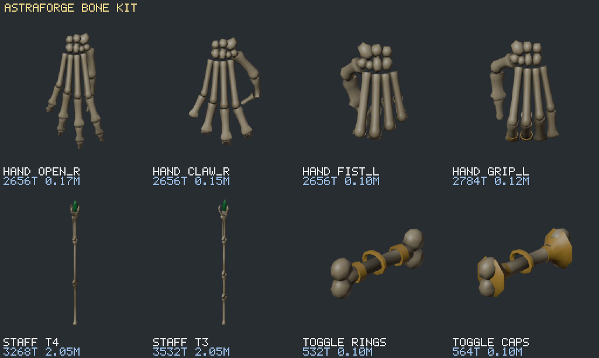

# Модуль «костяной набор» (bone_kit): кисти скелета, костяной посох, застёжки-«бочонки»

Шаг Blender: `bone_kit` (`scripts/blender/steps/bone_kit.py`, общий код — `steps/_bone_kit_lib.py`, от модуля
предметов не зависит). Самопроверка: `scripts/blender/tests/test_bone_kit.py` — 19 тестов, все проходят, ~80 с.
Назначение: детальные игровые костяные части для нежити. Первое применение — исправить ИИ-некроманта (у него кисти —
слитые «лопаты» с нарисованными костями, неверное навершие посоха, застёжки только в текстуре); дальше — скелеты,
личи и костяные юниты «Врат Героев». Образец дизайна — `outputs/Necromancer/Reference-original.jpg`.
Все числа и картинки ниже получены одним прогоном `test_bone_kit.make_evidence()` на текущем коде (10.10.2026).

## Запуск

```
"C:/Program Files/Blender Foundation/Blender 5.0/blender.exe" -b --factory-startup ^
    --python scripts/blender/af_run.py -- bone_kit request.json
"C:/Program Files/Blender Foundation/Blender 5.0/blender.exe" -b --factory-startup ^
    --python scripts/blender/tests/run_tests.py -- bone_kit
```
Картинки и числа этого документа (~35 с, временная папка ОС + `docs/forge/img/bone_kit/`):
```
"C:/Program Files/Blender Foundation/Blender 5.0/blender.exe" -b --factory-startup --python-expr ^
  "import sys;sys.path[:0]=[r'<repo>/scripts/blender',r'<repo>/scripts/blender/tests'];import test_bone_kit as t;t.make_evidence(None, r'<repo>/docs/forge/img/bone_kit')"
```

```json
{"step": "bone_kit", "params": {"part": "skeleton_hand", "side": "l", "pose": "grip",
  "grip_radius_m": 0.018, "rings": ["index", "middle", "ring"], "style": "aged", "seed": 0},
 "out_dir": "abs/out"}
```
Выходы одной части: `part.glb`, `part.blend`, `part.json` (габариты, треугольники, сокеты с мировыми рамками, кости,
список деталей, веса, контакт хвата, материалы, сводка GLB), `preview.png` (`af.render_views`, `color='MATERIAL'`;
для стиля `aged` — `VERTEX`, чтобы были видны вершинные цвета). `result.json` / `AFRESULT` — по контракту §3.

Общие параметры: `part` (`skeleton_hand | bone_staff | bone_toggle`), `style` (`clean | aged`), `seed`,
`palette` (`bone`, `gold`, `crystal`, `crystal_glow` — `#rrggbb`; `crystal_emission` — число), `budget_tris`,
`preview` (true), `preview_size` (384).

`params.batch` — список словарей (каждый поверх общих параметров, части можно смешивать) или число N (N соседних
seed той же части): подпапка на вариант (имя очищается до `[A-Za-z0-9_-]` и проверяется, что она внутри `out_dir`),
`contact_sheet.png`, `batch.json`; `glb` и `blend` в ответе — списки. Лист: `sheet_cols` (4), `sheet_tile` (256),
`sheet_title`.

## 1. skeleton_hand — кисть скелета

| параметр | по умолчанию | что делает |
|---|---|---|
| `side` | `r` | `l` / `r` |
| `pose` | `open` | `open`, `relaxed`, `claw`, `fist`, `grip` |
| `length_m` | 0.19 | от складки запястья до кончика среднего пальца (фигура 1,8 м); всё масштабируется от него |
| `finger_spread_deg` | по позе (9 / 4 / 15 / 2) | развод пальцев (указательный +1, средний +0,15, безымянный −0,55, мизинец −1,1 доли) |
| `curl` | по позе | 0..1: число, список из 5 (`thumb..pinky`) или `{палец: c}`; MCP = 85°·c, PIP = 100°·c, DIP = 70°·c (у `claw` свой закон) |
| `grip_radius_m` | 0.018 | радиус цилиндра хвата; поза `grip` обхватывает его, сокет у всех поз лежит на его оси |
| `grip_tilt_deg` | 0 | наклон оси хвата к линии костяшек (0 = древко перпендикулярно кисти, как на референсе) |
| `rings` | `[]` | пальцы с золотым кольцом (`"thumb"`, `"index"`, …), кольцо на основной фаланге, соседние смещены вдоль кости |
| `ring_at` | 0.66 | положение кольца вдоль основной фаланги |
| `origin` | `wrist` | `wrist` — центр запястного сустава в нуле; `ground` — низ на z = 0, центр X/Y в нуле |

**Анатомия.** 27 костей отдельными замкнутыми сетками: 8 костей запястья (ладья, полулунная, трёхгранная,
гороховидная, трапеция, трапециевидная, головчатая, крючковидная — неровные эллипсоиды плотным блоком), 5 пястных,
14 фаланг (большой палец — основная и ногтевая, остальные — основная, средняя, ногтевая). Кости — тела вращения по
профилю с эпифизами: широкое основание с вогнутой суставной чашей, уплощённый с ладонной стороны диафиз, лёгкий
дорсальный изгиб, на головках фаланг — два мыщелка, головка пястной кости — сфера вокруг центра вращения MCP, у
ногтевой фаланги — бугристость. Длины — средние взрослые (на кисти 19 см: пястные 6,6 / 6,4 / 5,7 / 5,1 и 4,5 см
у большого; основные фаланги 3,9 / 4,4 / 4,1 / 3,2 и 3,1; средние 2,3 / 2,8 / 2,7 / 1,9; ногтевые 1,7 / 1,9 /
1,85 / 1,6 и 2,3), веер пястных 7 / 1,5 / −5 / −11°, поперечная дуга ладони. Цепочка среднего пальца ровно равна
`length_m` (масштаб подгоняется после seed-разброса длин ±1,5 %). Суставы: центр вращения внутри головки
проксимальной кости, зазор 1,2 мм, чаша следующей кости охватывает головку — при сгибании кости не пересекаются.
Большой палец с оппозицией: отведение лучевое и ладонное, пронация (64–117° в зависимости от позы), сгибание
CMC / MCP / IP.

**Позы.** `open` — висящая раскрытая кисть с чуть согнутыми разведёнными пальцами (как правая рука на референсе),
`relaxed` — сгибание нарастает к мизинцу, `claw` — разогнутые MCP и согнутые PIP/DIP, `fist` — кулак, большой палец
подбирается оптимизацией на средние фаланги указательного и среднего. `grip`: цилиндр ставится поиском (сетка +
уточнение) так, чтобы ладонь (головки пястных) почти касалась его, а каждая фаланга по очереди сгибалась до касания
(касательная навивка по реальным сечениям костей и колец); большой палец обходит цилиндр с лучевой стороны навстречу
пальцам (сетка по CMC + координатный спуск, штраф за пересечения с пальцами). Пересечения деталей проверяются BVH во
всех позах.

**Арматура.** Кости Mixamo для своей стороны: `mixamorig:<Left|Right>Hand` и
`mixamorig:<Left|Right>Hand{Thumb,Index,Middle,Ring,Pinky}{1..4}` — 21 кость (Hand + 20 пальцевых, как в контракте
§5; в задании было «20 вместе с Hand» — это расходится с §5, где у каждого пальца 1..4). Покой = сгенерированная
поза. Головы костей — центры вращения суставов, Hand: запястье → MCP среднего пальца; Thumb1 = пястная большого;
`*4` — концевые кости без веса. Локальная Z кости — тыльная сторона её сегмента. Каждая деталь целиком (вес 1.0)
привязана ровно к одной кости: запястье и пястные II–V → Hand, пястная I → Thumb1, фаланги → своим костям, кольцо —
к кости своей фаланги. Сетка — ребёнок арматуры + модификатор Armature; в GLB — один skin с 21 суставом.

**Рамка кисти.** Запястье в нуле, пальцы висят вдоль −Z, большой палец к −Y (вперёд персонажа, §4), ладонь к телу:
+X у правой, −X у левой. Левая кисть — точное зеркало правой (тест сверяет вершины).

**Сокет `socket_mount_hand_<side>`** (§6) — ребёнок кости Hand, лежит на оси цилиндра хвата между плоскостями
среднего и безымянного пальцев; +Z — вдоль оси, из кулака со стороны большого пальца (в рамке кисти −Y), −Y — вдоль
костяшек к пальцам (вниз), X = Y × Z. Положение не зависит от позы: в `grip` пальцы обхватывают именно предмет на
этом сокете; extras: `game_socket`, `kind`, `frame`, `grip_radius_m`. Совмещение `socket_grip_main` посоха с этим
сокетом даёт ошибку 0,0 мм (проверено в evidence).

### Замеры (правая кисть, seed 0)

| поза | треуг. / бюджет | габарит, м (X×Y×Z) | пересечения | заметки |
|---|---|---|---|---|
| open | 2 656 / 3 000 | 0.070×0.087×0.173 | 0 | цепочка 0,1900 м; с 3 кольцами 2 848 |
| relaxed | 2 656 | — | 0 | MCP/PIP/DIP мизинца 41 / 48 / 33° |
| claw | 2 656 | — | 0 | PIP 69–76°, DIP 56–60° |
| fist | 2 656 | — | 0 | MCP 85, PIP 100, DIP 70° |
| grip (R 18 мм) | 2 656 | — | 0 | ногтевые фаланги в 0,7–0,85 мм от цилиндра, ни одна кость не врезается |
| grip + 3 кольца, левая | 2 784 | 0.072×0.074×0.115 | 0 | кольца касаются цилиндра с заходом до 0,46 мм |

Кольцо = 64 треугольника, кольца на всех пяти пальцах — 2 976 треуг. Сборка кисти внутри Blender 2,5–4 с (поиск
цилиндра и большого пальца); 1 380–1 480 вершин; GLB 160–210 КБ (skin, UV, у `aged` — цвета вершин).

## 2. bone_staff — костяной посох

| параметр | по умолчанию | что делает |
|---|---|---|
| `length_m` | 2.05 | полная длина до вершины кристалла |
| `grip_fraction` | 0.62 | `socket_grip_main` на этой доле длины снизу (по референсу) |
| `grip_off_fraction` | 0.45 | `socket_grip_off` (вторая рука) |
| `segments` | 3 | 3 или 4 длинные кости |
| `shaft_radius_m` | 0.018 | радиус ствола у хвата (= радиусу хвата кисти по умолчанию) |
| `crystal_height_m` | 0.21 | высота кристалла, зажимается в 0,18–0,24 |
| `crystal_radius_m` | 0.038 | |
| `talons` | 4 | 3 или 4 когтя навершия |
| `talon_length_m` | 0,82 × высоты кристалла | |
| `bend` | 1 | множитель изгиба костей (0..2) |
| `origin` | `bbox` | `bbox` — центр габарита X/Y в нуле (§4); `axis` — ось ствола в нуле |

Как на референсе: ствол из трёх длинных костей встык — нижняя «большеберцовая» (трёхгранное сечение с гребнем
спереди, луковица-«лодыжка» на земле, плато сверху), средняя «бедренная» (мыщелки внизу, шероховатая линия сзади,
круглый эпифиз сверху), верхняя — с тонкой «малоберцовой» костью вдоль (тёмный желобок референса) и широким
мыщелковым расширением наверху. Суставы шишковатые, перед каждым — «надколенник»; кости слегка изогнуты в
seed-направлениях (у кости хвата изгиб вдвое меньше, касательная у хвата отклоняется от +Z меньше чем на 0,6°).
Суставы раздвигаются, если попадают в зону руки (±5 см от хвата плюс эпифиз): над хватом остаётся шишка, как у
референса. Навершие: «колено» из двух боковых мыщелков, лепестковая «ладонь» и 3–4 когтя из трёх фаланг каждый
(шишковатые суставы, последняя фаланга — острый коготь), отведены наружу и загнуты внутрь над кристаллом; передний
коготь стоит прямо перед кристаллом. Когти держат зазор ≥ 3 мм до кристалла (наклон увеличивается, пока не
разойдутся). Кристалл — неровная семигранная призма с сужением снизу и двухступенчатой гранёной вершиной, плоское
затенение, отдельный слот материала `Crystal`: Principled, base #227A42, излучение #38C060 × 0,4, roughness 0,18.

Рамка предмета (§6): стоит на z = 0, ствол +Z, передний коготь −Y. `socket_grip_main` / `socket_grip_off` — на осевой
линии ствола, +Z = касательная ствола, −Y — вперёд (общая рамка хвата); `socket_fx_tip` — в центре кристалла,
+Z — вверх (направление выброса эффекта).

Замеры (seed 0): 3 268 треуг. / 4 500 (3 когтя и 4 кости, seed 4 — 3 532); габарит 0.18×0.18×2.05 м; суставы на
0,677 и 1,381 м; `socket_grip_main` на 1,271 м (0,620 L), радиус ствола там 18,0 мм; `socket_grip_off` на 0,923 м;
`socket_fx_tip` на 1,945 м; кристалл 0,21 м; 1 680 вершин, GLB ~125 КБ. Сборка < 1 с.

## 3. bone_toggle — застёжка-«бочонок» с золотом

| параметр | по умолчанию | что делает |
|---|---|---|
| `length_m` | 0.10 | длина кости |
| `gold` | `rings` | `rings` — два золотых кольца на стволе; `caps` — золотые гильзы на внутренней половине шишек (как у двух застёжек референса с золотой обвязкой); `none` |
| `loop` | true | золотая петля вокруг середины, вытянутая назад (то, чем застёжку пришивают) |
| `bone_radius_m` | 0,056 × длины | |

Короткая горизонтальная кость вдоль X с раздвоенными шишками на концах (силуэт «собачьей косточки» спереди), материал
`Gold` — металл 1,0, roughness 0,32. **Начало координат — центр задней грани** (max Y = 0, по X и Z по центру),
локальная −Y — наружная нормаль поверхности: ставится на робу совмещением начала с точкой поверхности и −Y с её
нормалью. Замеры: `rings` — 532 треуг. / 600, `caps` — 564, `none` без петли — 304; габарит 0.102×0.026×0.034 м,
276 вершин, GLB 25 КБ.

## Материалы и стиль

Все материалы — Principled BSDF → Material Output (в glTF — PBR metallic-roughness): `Bone` #CDBE9C, roughness 0,7;
`Gold` #C9A04A, metallic 1; `Crystal` с излучением. Развёртка `UVMap` (smart project). Стиль `aged`: материал
`Bone_aged` берёт Base Color из атрибута цвета вершин `Color` (в GLB — `COLOR_0`, baseColorFactor = 1; проверено
чтением GLB): слоновая кость × затенение (AO лучами по BVH) × пятна (3D-шум). Так как glTF умножает `COLOR_0` на
цвет всех примитивов сетки, у золота и кристалла цвета вершин белые; превью Workbench подкрашивает их только на время
рендера.

## Сравнение с референсом

Верх — кадры из `Reference-original.jpg`, низ — bone_kit (стиль `aged`, EEVEE, ортокамера): раскрытая правая кисть с
кольцами на большом, указательном и среднем; левая кисть в позе `grip`, поставленная на посох только совмещением
сокетов (`socket_mount_hand_l` → `socket_grip_main`, ракурс зеркален: предплечье уходит вправо); навершие; две
застёжки (кольца и гильзы); справа — посох целиком рядом с референсом.



Пять поз правой кисти (EEVEE; у `grip` показан цилиндр 18 мм):



Пакет из 8 вариантов одним вызовом (Workbench, вершинные цвета `aged`):



## Тесты

`test_bone_kit.py`: 21 кость Mixamo и иерархия у обеих сторон; каждая деталь — ровно одна кость с весом 1.0, 14 фаланг
на 14 костях, концевые `*4` без веса; поворот `Index2` двигает только среднюю и ногтевую фаланги указательного;
длина «запястье — кончик» = `length_m` (±1,5 %), масштаб от `length_m`, бюджет 3 000 во всех позах и с пятью
кольцами; рамка сокета ортонормирована, правая, +Z к большому пальцу, −Y вдоль пальцев, на ладонной стороне; хват
R 18 и 25 мм — ничего не врезается глубже 0,6 мм, ногтевые фаланги ≤ 4 мм от цилиндра, сокет на оси; позы без
пересечений и различимы; зеркальность левой/правой и детерминизм seed. Посох: длина ±0,5 %, ≤ 4 500 треуг., доля хвата
±0,003, рамка, ствол 18 мм у хвата и суставы дальше 6 см от него, `socket_fx_tip` в центре кристалла, слот `Crystal`
с излучением и roughness ≤ 0,2, кость #CDBE9C / 0,7, варианты (доля 0,5, 4 кости и 3 когтя, зажим высоты кристалла).
Застёжка: ≤ 600 треуг. во всех режимах, длина, начало в центре задней грани, металлическое золото. Протокол `run`:
файлы, skin с 21 суставом, сокет — ребёнок сустава Hand в GLB, сокеты посоха в extras; `COLOR_0` только у `aged`,
белые цвета у золота; UV и Principled у всех частей, 0 несвязных рёбер; пакет (смешанные части, имя `../../escape`
остаётся внутри `out_dir`, пакет числом); ошибки параметров; `test_real_reference_crops` (пропускается без файла).

## Честные ограничения

- **Большой палец в хвате** — результат оптимизации, упирающийся в границы (лучевое отведение 50°, CMC −10°):
  палец заходит на древко сверху «крюком» рядом с указательным, а не противопоставлен по-анатомически. Касание есть
  (0,7 мм), пересечений нет.
- **Хват жёсткими костями реальной длины** даёт угловатую навивку: у мизинца и указательного DIP почти прямой
  (2–16°), мизинец обхватывает цилиндр «крючком». Ось хвата по умолчанию перпендикулярна кисти; у живой руки она
  косая 15–20° (`grip_tilt_deg`).
- **Сокет одинаков для всех поз**: в `open`/`claw` предмет на нём висел бы в ладони, сжимает его только `grip`.
- **Кольца** в хвате касаются цилиндра с заходом до 0,5 мм (допуск проверки 0,6 мм); кольца — простые ленты без
  орнамента референса.
- **Кости процедурные** (тела вращения и лофты), не скульпт: нет отверстий, бороздок, сколов; запястье — блок из
  неровных эллипсоидов; основания пястных II–V и основание пястной I касаются / заходят друг в друга (они на одной
  кости или у сустава CMC — в проверке пересечений исключены, при деформации не видны).
- (10.10, ночь) Кисть ставится на персонажа `place_parts`, и её `socket_mount_hand_<side>` идёт вместе с ней.
  `rig_humanoid` оставляет этот сокет как сокет кисти рига (`docs/forge/humanoid.md`, «Сокеты из входа»), поэтому
  посох набора садится совмещением сокетов без offset (некромант v2).
- **Слияние с ригом персонажа не делается этим шагом.** Имена совпадают с Mixamo, но покой — сгенерированная поза, а
  крены костей свои (Z — тыльная сторона): чтобы вливать кисть в `mixamorig`-риг и проигрывать клипы Mixamo, нужно
  совместить `<Side>Hand` и учесть разницу поз покоя (§7) — это работа гуманоидного модуля / интегратора.
- **Начало кисти — запястье**, а не «низ на z = 0» из §4 (так удобнее крепить к ригу); `origin: ground` даёт §4.
- **«Старение» — только цвет вершин**: разрешение равно плотности сетки (кисть ≈ 1 400 вершин, посох ≈ 1 700),
  текстура не запекается; рельеф износа не моделируется.
- **Навершие**: когти — ломаные из трёх прямых фаланг, а не плавные дуги, держат кристалл с зазором 3 мм и не
  касаются его; кристалл непрозрачный (излучение + низкая шероховатость, без transmission ради совместимости glTF).
- **Превью** Workbench смягчает металл и не светит излучением; сравнение рендерится в EEVEE (только для документа).
- Время: кисть 2,5–4 с внутри Blender из-за поиска хвата; тесты ~80 с.
