# Модуль cloth_sim — настоящая ткань на одежде персонажей (12.10.2026)

Требование владельца: робы, плащи, табарды, юбки и полотнища знамён должны двигаться как ткань. До этого шага
вся одежда сгенерированных персонажей скинилась к костям как тело: в шаге, атаке и смерти она растягивалась,
скользила вместе с бёдрами и «плыла» (текстура плыла вместе с ней), а лежащий в смерти персонаж оставлял стоящий
колокол робы (корректирующая форма `af_death_settle` из `motion_style` прятала только конец смерти).

Шаг `cloth_sim` идёт сразу после `motion_style`: находит свободную одежду, отделяет её от тела, симулирует каждый клип
настоящей тканью Blender (столкновения с телом, древками и полом), запекает кэш по клипам, который `render_sprites`
переключает вместе с клипом, а для GLB (Godot, любой движок) переносит то же движение на вторичные кости ткани.

Файлы: `scripts/blender/steps/cloth_sim.py` (шаг), `steps/_cloth_lib.py` (ядро), `steps/_export_lib.py`
(`bind_cloth_cache`) и `steps/render_sprites.py` (переключение кэша), тесты `scripts/blender/tests/test_cloth_sim.py`
(10 тестов, 82 с, все PASS 12.10) и `test_export.py::test_render_sprites_plays_cloth_cache`.

## Место в конвейере

```
cleanup → paint_from_concept → rig_humanoid → retarget → motion_style → cloth_sim → render_sprites → godot_package
```

Вход — `styled.blend` шага `motion_style` (слот `blend`), `clips.json` рядом с ним даёт петли и категории. Выходы:

| ключ | файл | что |
|---|---|---|
| `blend` | `cloth.blend` | тело без одежды (`Body`), одежда `Body_cloth_<группа>` с модификатором Armature и кэшем ткани по клипам; скрытый `Body_glb` (всё тело с весами костей ткани) |
| `glb` | `cloth.glb` | риг + кости `cloth_<группа>_<цепь>_<сустав>`, те же имена клипов, морф `af_cloth_settle` для конца смерти |
| `clips` | `clips.json` | `clips.json` шага `motion_style` + у каждого клипа `cloth` (режим, время, проверки по группам) |
| `report` | `cloth.json` | сегментация, группы и пресеты, проверки «ткань / исходный скин» по клипам и группам, кости ткани, тайминг |
| `preview` | `preview.png` | строки «скин / ткань» для шага, атаки/каста и смерти |
| `segmentation` | `segmentation.png` | поза покоя: области ткани цветом, прикреплённое — светлее |

Дальше всё работает без изменений: `render_sprites` берёт `cloth.blend` (слот `blend`), `godot_package` — `cloth.glb`
(слот `glb`).

## Как это устроено

### 1. Сегментация (`_cloth_lib.segment`)

Работает на позе покоя по геометрии и скину, рост H:

- **Ноги** — горизонтальные сечения от лодыжек до бёдер (`leg_slices`, слои 3 % H, связность — по окну ±3,5 % H):
  сечение вокруг одной ноги не шире 2,4 радиуса антропометрической капсулы — это нога (латы, сапоги, штаны), не
  ткань; сечение вокруг обеих ног — роба/юбка; свободное сечение без ноги шире 8 % H — висящая пола. По собственным
  сечениям меряется толщина каждой ноги (`leg_bulk.k`), капсулы ног растягиваются на неё.
- **Низ** (роба, юбка, табард, задняя пола): ниже тазобедренных суставов, дальше от (подогнанных) капсул ног больше
  2 % H (если нога измерена) или `leg_margin` (3,5 % H; 2,5 % у `build: robed`; 5 % у `armored`/`heavy`). Не ткань:
  сапоги и поножи (вес ≥ 0,5 на голени/стопе и зона 6,5 % H вокруг стопы), то, что скинено к руке (хвосты рукавов),
  плиты пола (подставка генератора: грани вверх у пола и их кромка до 3 % H), реквизит в руке. Кусок должен висеть от
  выше колен до ниже середины бедра. Роба/юбка — если кольцо на высоте колен закрывает ≥ 75 % оборота, иначе табард
  (перед) с задней полой или задняя пола (хвост плаща).
- **Плащ** — растёт вверх от низа за спиной, пока отстоит от корпуса больше 3 % H (плащ, лежащий на спине, едет со
  спиной).
- **Капюшон** — отстоит от капсулы головы > 3 % H над шеей (≥ 300 вершин). **Рукава** (только у робы или `robed`;
  `sleeves: true` — всегда) — скинены к плечу/предплечью и шире предплечья на 3,5 % H.
- **Знамя** — `find_pole`: самая длинная прямая труба через кулак (900 направлений до 50° от вертикали, кольцо
  вершин вокруг оси по большей части длины); полотнище растёт от вершин на этой кисти по своей плоскости вне тела и
  вне древка; принимается, если не меньше 25 × 20 см, тонкое, плоскость содержит древко и полотно висит от древка
  вдали от кулака или от его верха. Древко тоже уходит в группу (жёстко на кисть).
- **Прикрепление** (`attachment_weights`): геодезические рампы от шва с телом выше колен, пояса, шеи капюшона, шва
  рукава, кромки древка и верха знамени (7–12 % H). Всё выше тазобедренных — 1 (пояс), шов ниже колен не держит.
- `params.cloth` — ручные коробки `[{kind, min, max, only}]` (поза покоя, метры), `false` — без ткани.

Группы симуляции: `lower` (низ + плащ), `hood`, `sleeve_l/r`, `banner_l/r` — у каждой свой объект и пресет.

### 2. Разделение и сетка симуляции

Грани группы уходят в объект `Body_cloth_<группа>` (копия тела: UV, материал, веса, Armature), из тела удаляются;
вершины шва есть в обоих объектах и всегда прикреплены — шва нет. Диск/исподнее, закрывающее подол робы
(грани вниз ниже 20 % H), по умолчанию удаляется (`caps: delete`): при движущемся подоле он вставал бы крышкой.
Симулируется сама одежда (без лишних вершин; сварка дублей, ремонт неманифолдных рёбер); одежда больше 12 000 вершин —
через прокси QuadriFlow (`remesh: auto`), который переносится на одежду вложенной деформацией (`bind_embedded`:
вершина едет за углами ближайшего треугольника прокси с поворотами их колец). Свободная часть низа висит от таза
(`pelvis_follow`: веса ног переносятся на Hips пропорционально свободе) — ноги толкают робу столкновением, а не рвут
её весами. Куски без прикреплённых вершин (внутренние слои, лоскуты) получают мягкое прикрепление 0,6.

### 3. Симуляция (`setup_cloth`, `simulate`)

- Коллайдеры: капсулы тела на костях (антропометрия, ноги растянуты по замеру, +6 мм, трение 1), капсулы древок
  в руке (`collide_props`; полотнище не сталкивается со своим древком), пол. Капсулы, в которые одежда входит уже
  в покое, сужаются (`fit_capsules`, тощий лич в робе).
- Каждый клип: удержание первой позы 20 кадров (`preroll`); петля — разгон в целый цикл до кадра 0, потом цикл,
  последние кадры (P/3, 6–15) сшиваются с кадрами на период раньше (`clip_window`) — петля без шва. Шаг ткани
  Blender — 1/30 с на кадр при любом fps (`time_scale` = 30 / fps).
- **Удержание формы** (`shape_hold`, по пресету): свободная ткань слегка тянется к своей «тазовой» форме — так
  сохраняется силуэт, который нарисовал генератор, а ткань всё равно отстаёт, качается и толкается ногами. У пола
  (0,2 м) удержание гаснет, в смертях выключено — роба падает и ложится свободно.
- Взрыв (точка дальше 1,2 м от капсул или NaN) — один повтор с удвоенными шагами и демпфированием, потом клип
  остаётся на скине с предупреждением.

| пресет | для | масса / вершина | натяжение / сжатие / сдвиг | изгиб | удержание | шаги | заметка |
|---|---|---|---|---|---|---|---|
| `wool_robe` | роба, юбка, полы, капюшон, рукава | 0,30 | 15 / 15 / 8 | 8 | 0,45 | 5 | шерсть/хлопок |
| `heavy_cape` | плащ, задняя пола | 0,55 | 30 / 30 / 15 | 6 | 0,30 | 5 | тяжёлый плащ |
| `tabard` | табард | 0,40 | 30 / 30 / 15 | 10 | 0,35 | 5 | жёсткий геральдический |
| `light_silk` | знамя | 0,15 | 8 / 8 / 4 | 0,3 | 0,10 | 5 | шёлк + внутренние пружины |

`presets: {"lower": "heavy_cape"}` или `{"banner_l": {"base": "light_silk", "mass": 0.1}}` меняет группу.

### 4. Кэш по клипам и спрайты

Результат каждого клипа (ткань, вне узкой полосы шва — чистая симуляция) запекается в ключи формы одежды: ключ на
кадр клипа с абсолютными позициями и действие ключей формы на клип с ключами 0/1 (между кадрами — линейно). Свойство
`af_cloth_cache` = `{действие арматуры: действие ключей}`. `render_sprites` в `_bind` зовёт
`_export_lib.bind_cloth_cache(действия клипа)`: у одежды включается действие клипа, модификатор Armature выключается;
ключи прошлого клипа обнуляются. Клип без кэша (`clips` не все) и замер позы покоя идут на скиннинге. См.
`docs/forge/export.md` → «Кэш ткани cloth_sim».

### 5. GLB: кости ткани

Для движков, где нет запечённой симуляции: по каждой группе — цепи костей от линии прикрепления (по одной на
~20 см, до 16 цепей, 4 сустава), корень цепи — дочь кости тела, на которой висит. Ключи в каждом клипе: суставы цепи
= центры полос ткани на равных геодезических уровнях из симуляции этого клипа (без симуляции — пружинная цепь
Верле с гравитацией, демпфированием и столкновением с капсулами); кость ставит голову на свой сустав (ключи
перемещения) и поворачивается к следующему (только поворот без кручения). Веса тела `Body_glb`: сначала
«прикрепление × скин тела + свобода × цепи», потом подгонка наименьшими квадратами к симулированной одежде по всем
кадрам всех клипов (4 влияния, `fit_weights`). Конец смерти: кости не могут положить конус робы на пол (качают его
веером), поэтому корректирующий морф `af_cloth_settle` ставит одежду точно туда, где её оставила симуляция; его ведёт
свойство кости Hips, которое смерть поднимает 0 → 1 после удара (остальные клипы держат 0). GLB экспортируется из
перечитанного `cloth.blend`: драйверы, созданные в этой же сессии, экспортёр glTF запекает в веса морфа только после
перечитывания (замер: до — константа 0, после — 0 → 1).

### 6. Проверки (`cloth.json` → `clips.<клип>.groups.<группа>`)

На каждом 2-м кадре клипа, по видимой одежде, «ткань» против «исходного скина» (копия одежды до изменений):

- `penetration_frac` — доля свободных точек глубже 1 см в капсулах тела (худший кадр), `depth_max_cm`;
  проверка `cloth_penetration_<клип>_<группа>`: ≤ 3 % или не хуже скина + 1 %;
- `stretch_p99` — 99-й перцентиль длины ребра / покоя по свободным рёбрам, `torn_frac` — доля площади, выросшей > 3×
  (мера `motion_style`), `torn_frac_garment` — то же по всей одежде; проверка `cloth_stretch_*`: ≤ 1,6 или не хуже
  скина + 0,05;
- смерть: `death_floor_min_cm` (одежда на полу, не под ним, проверка `cloth_death_floor_*` ≥ −2 см),
  `death_lying_height_cm` против скина;
- `proxy.far_from_body_m` — устойчивость (`cloth_stable_*`), `sim_s`, `s_per_frame`;
- GLB: `gltf_animations`, `gltf_skin`, `gltf_no_nan` (ошибки), `cloth_bones`, `gltf_death_morph` (пик веса морфа: смерть
  1, остальные 0), `cloth_time_budget` (по умолчанию 300 с).

Проверки ткани по умолчанию — предупреждения (`qa_gate: warning`); `error` делает их порогом шага.

## Параметры

```json
{"step": "cloth_sim",
 "inputs": {"blend": "abs/05_motion_style/styled.blend"},
 "params": {"cloth": "auto", "build": "robed", "leg_margin": null, "hood": true, "sleeves": "auto", "banners": true,
            "presets": null, "clips": "all", "remesh": "auto", "remesh_above": 12000, "proxy_edge_m": 0.045,
            "quality": null, "preroll": 20, "from_bind": 0, "caps": "delete", "pelvis_follow": true,
            "inflate_m": 0.006, "collider_friction": 1.0, "collide_props": true, "shape_hold": null,
            "max_disp_m": 1.2, "qa_every": 2, "qa_gate": "warning", "penetration_limit": 0.03, "stretch_limit": 1.6,
            "cloth_bones": true, "bone_spacing_m": 0.2, "bone_joints": 4, "bone_chains_max": 16,
            "fit_weights": true, "death_morph": true, "time_budget_s": 300, "preview": true},
 "out_dir": "abs/06_cloth_sim"}
```

Запуск: `blender -b --factory-startup --python scripts/blender/af_run.py -- cloth_sim request.json`.
Тесты: `blender -b --factory-startup --python scripts/blender/tests/run_tests.py -- cloth_sim` (10 PASS, 82 с: тайминг петли и шов, капсулы и подгонка, перенос вложенной деформацией, кэш переключается с клипом, сегментация робы манекена, сквозной прогон на манекене с GLB, проход без одежды, реальный лич; последний тест убирает временные папки).

## Пилот на персонажах пакета (12.10)

Четыре персонажа пакета «Врат» (статус `failed_qa` = полностью собраны; клипы и манера — из пакета), вход —
`05_motion_style/styled.blend` из `C:\AstraForge\library\assets\<id>\v001\`, `build` из `roles.json`. Пилот —
`C:\AstraForge\incoming\cloth_pilot\<имя>\` (`out/` — выход шага, `sprites/` — спрайты «Врат» из `cloth.blend` в той же
ячейке, что исходные, `godot4/` — пакет Godot), листы до/после — `C:\AstraForge\incoming\cloth_pilot\sheets\`.
Blender 5.0.1, CPU (симуляция) — время всего шага на все 5 клипов вместе с GLB и превью:

| персонаж | группы ткани (пресет, вершин) | шаг, с (из них симуляция) | кости ткани | GLB: ошибка весов до → после подгонки | морф смерти снимает (p90) |
|---|---|---|---|---|---|
| Lich sorcerer (`e91bad4d`, скелет в робе) | lower: роба 5 830 | 69 (51) | 40 | 6,1 → 4,5 см | 25 см |
| Mage holding staff and spellbook (`5a60870e`) | lower: роба 5 643, рукава 824 + 388 | 65 (45) | 56 | 4,8 → 3,1 см | 10 см |
| Hierophant holding banner and staff (`ba2526b9`) | lower: роба 6 590, 2 знамени 2 988 + 3 145, рукав 264 | 97 (56) | 84 | роба 9,2 → 6,8, знамёна 0,6 / 2,2 → 0,5 / 1,9 см | 14 см |
| Knight holding sword and shield #3 (`b0de2731`) | lower: табард 608 | 15 (7) | 4 | 2,5 → 2,4 см | 10 см |

Скорость симуляции: 0,03–0,08 с на кадр симуляции на группу из 5–6 тыс. вершин (5 шагов, качество столкновений 2);
клип с разгоном и удержанием — 80–190 кадров.

Проверки на видимой одежде, «ткань / исходный скин» (худший из каждого 2-го кадра; свободная часть — `af_cloth_free`
≥ 0,8): доля точек глубже 1 см в теле, %; глубина, см; растяжение рёбер p99; доля «порванной» площади, %:

| персонаж, клип | в теле, % | глубина, см | растяжение p99 | порвано, % | смерть: низ одежды, см / высота лежащей одежды, см (скин) |
|---|---|---|---|---|---|
| лич, walk | 0,1 / 2,6 | 6,7 / 6,5 | 3,1 / 1,7 | 8,3 / 0 | — |
| лич, cast | 0,1 / 3,8 | 5,9 / 7,5 | 3,3 / 1,8 | 7,0 / 0,1 | — |
| лич, death | 0,1 / 2,2 | 6,8 / 6,0 | 2,1 / 1,5 | 4,9 / 0 | 0,4 / 51 (83) |
| маг, walk (роба) | 0,2 / 6,5 | 5,3 / 6,6 | 4,0 / 1,7 | 20 / 0,4 | — |
| маг, cast (роба) | 0,1 / 9,0 | 4,6 / 7,3 | 2,8 / 2,3 | 6,4 / 1,0 | — |
| маг, death (роба) | 0,2 / 5,9 | 4,6 / 6,0 | 3,0 / 2,1 | 15 / 1,0 | 0,9 / 56 (58) |
| иерофант, walk (роба / правое знамя) | 0,1 / 1,6; 0 / 0 | 3,7 / 4,7 | 3,8 / 3,1; 1,1 / 36,9 | 15 / 4,4; 0,1 / 76 | — |
| иерофант, cast (роба / левое знамя) | 0,4 / 4,5; 0,2 / 12,3 | 6,4 / 7,4 | 3,6 / 3,8; 2,3 / 5,9 | 14 / 5,1; 2,5 / 25 | — |
| иерофант, death (роба) | 1,2 / 3,3 | 7,2 / 7,3 | 3,4 / 4,1 | 10 / 7,2 | 24 / 96 (114) — тело лежит на древках знамён |
| рыцарь #3, walk (табард) | 13 / 88 | 3,5 / 11,3 | 3,4 / 1,0 | 13 / 0 | — |
| рыцарь #3, attack | 0 / 30 | 0 / 6,9 | 1,6 / 1,0 | 0,8 / 0 | — |
| рыцарь #3, death | 0 / 0 | 0 / 0 | 1,6 / 1,0 | 0,2 / 0 | 0,4 / 26 (29) |

Что это значит. **Проникновение** ткани в тело упало в 3–30 раз у всех (табард рыцаря в шаге — 88 % → 13 %: под
скином он проходил сквозь бёдра). **Знамёна** под скином рвались (растяжение 37–59, «порвано» 76–86 %: генератор
скинил полотнище наполовину к голове или стопе) — теперь висят на древке целыми (1,0–1,5). **Смерть**: одежда лежит на
полу (низ 0,4–0,9 см), лежащая роба лича на 32 см ниже, чем под скином (без корректирующей формы `motion_style`). Обратная сторона: **локальное растяжение**
ткани выше скина (p99 2–4 против 1–2, «порвано» 5–20 %) — ткань сминается и тянется там, где ноги толкают внутренний
край робы и у тонких полос сетки Hunyuan; на спрайте 100 px/м это видно как рваный подол в отдельных кадрах.

GLB в Godot 4.5.1 (`godot_package` + свой headless-скрипт, проигрыш каждого клипа, 8 точек): все четыре пакета
загружаются, петли `idle`/`walk` = 1, 9 сокетов, ошибок движка нет; кости ткани есть (лич 40, маг 56, иерофант 84,
рыцарь 4), концы цепей двигаются относительно таза (шаг лича 0,37 м, каст 0,63 м; рыцарь — 0,11 м), вес морфа
`af_cloth_settle` в конце `death` = 1, в остальных клипах 0.

Сегментация (поза покоя; роба — красная, табард — синий, знамя — розовое, рукав — жёлтый, светлее — прикреплено):

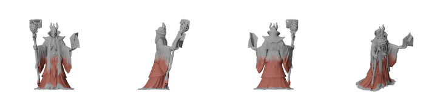
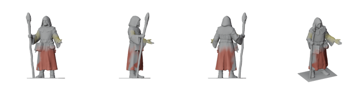
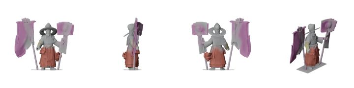
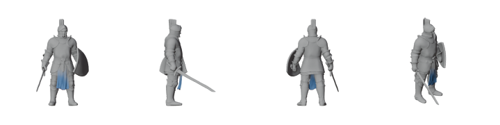

Листы до/после (спрайты «Врат», Cycles, ячейка исходного рендера; строки: до/после для вида base, 3/4 спереди
`se`, 3/4 сзади `nw`; кадры 0, 2, 4, 6, 8, 10 из 12). Все листы — `C:\AstraForge\incoming\cloth_pilot\sheets\<имя>_<клип>.png`
(`lich`, `mage`, `hiero`, `knight3` × `walk`, `cast`/`attack`, `death`):

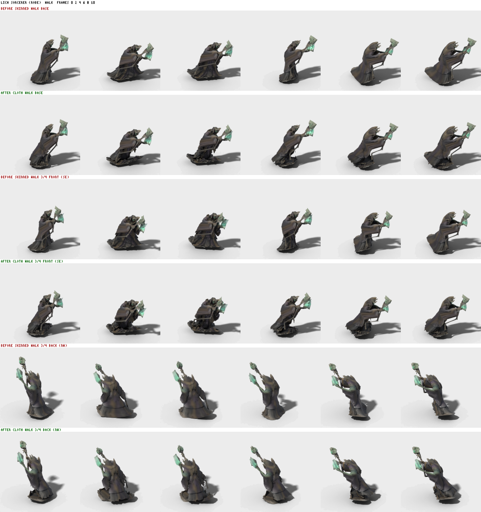
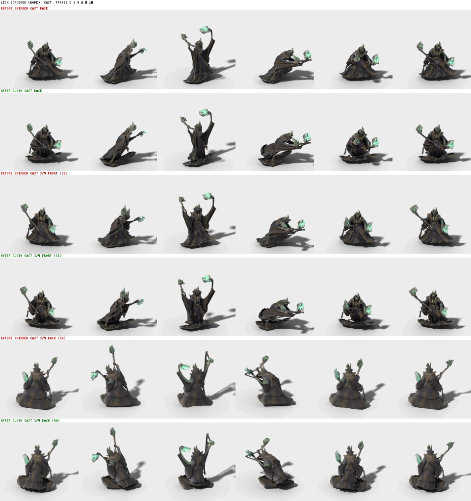
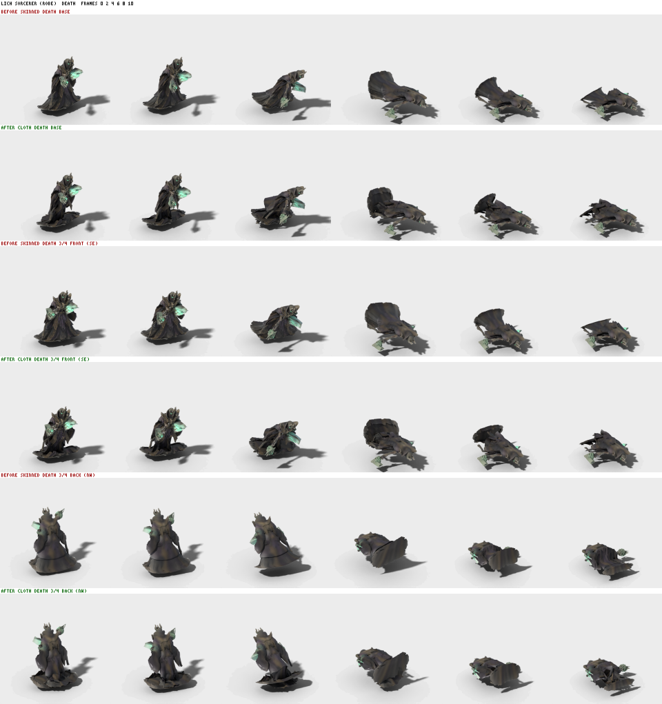
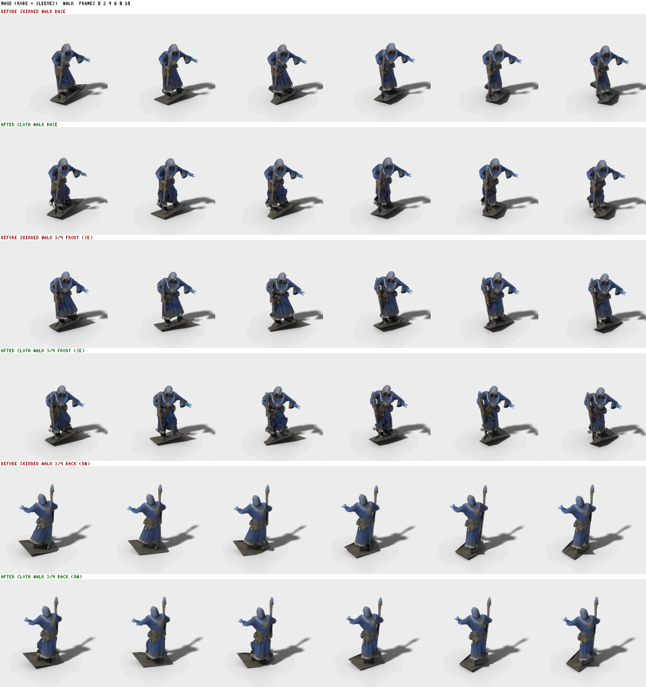
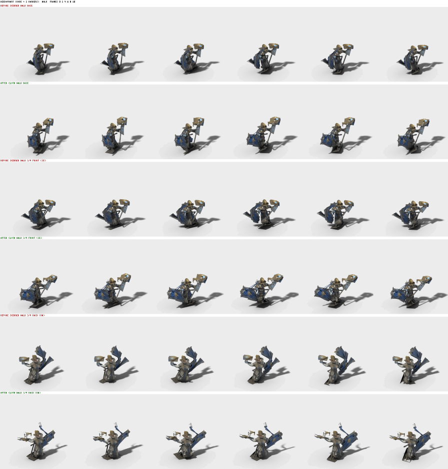
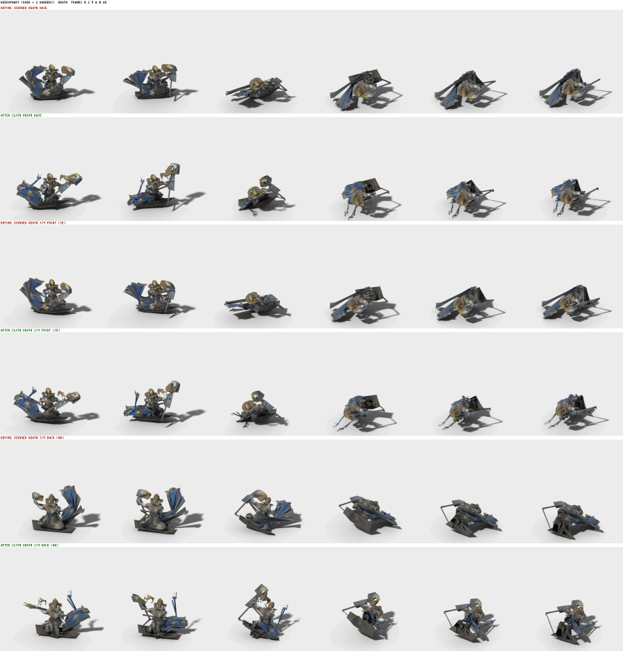
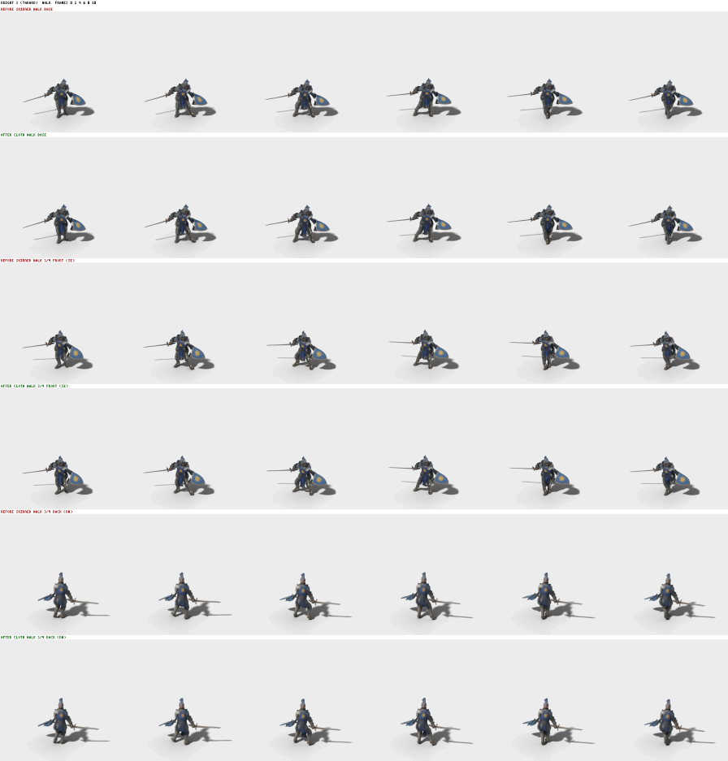

Взгляд арт-лида. **Лич**: подол отстаёт и волочится в шаге, в касте роба висит и сминается у пола вместо жёсткого
колокола, в смерти после удара роба ещё кадр стоит трубой, потом ложится; подол местами рваный (сетка генератора),
у пола лужица смятого подола. **Маг**: роба слегка толкается ногами и складывается, рукава качаются; разница на спрайте
небольшая (роба узкая, ноги её заполняют); у основания посоха в паре кадров виден тёмный клочок. **Иерофант**:
полотнища висят на древках под своим весом и колышутся, а не рвутся, как под скином (под скином правое знамя
растягивалось в 37–59 раз); в смерти синее знамя сминается в ком у тела — читается, но хаотично. **Рыцарь #3**:
табард больше не проходит сквозь бёдра в шаге и атаке, качается едва заметно; задняя пола сюрко лежит на ногах и
осталась на скине. Хуже, чем было: силуэт робы мягче нарисованного, отдельные кадры с рваным подолом, пояс и сумки не
сталкиваются. Итог: смерти и знамёна — явное улучшение, робы в шаге — умеренное, табард — исправлена ошибка
прохождения сквозь тело.

## Подключение (для интегратора)

Шаг не трогает файлы интегратора; правки ниже применяет интегратор (`server/forge-steps.mjs`,
`scripts/forge-concepts.mjs`, тесты реестра). Студию после правки реестра нужно перезапустить (она читает реестр при
старте); пакет с `--direct` работает сразу.

**1. Реестр `server/forge-steps.mjs`** — новая запись сразу после `motion_style`:

```js
  {
    step: 'cloth_sim', module: 'mixamo', title: 'Ткань (симуляция одежды)',
    help: 'Робы, юбки, табарды, плащи, капюшоны, широкие рукава и полотнища знамён перестают скиниться как тело: шаг находит свободную одежду, отделяет её, симулирует каждый клип тканью Blender (столкновения с телом, древками и полом, петли без шва, смерть ложится на пол) и запекает кэш по клипам для спрайтов; в GLB — кости ткани с запечённым движением и морф конца смерти.',
    kinds: ['humanoid'], inputs: { slots: ['blend'], required: true, formats: ['blend'] },
    outputs: ['glb', 'blend', 'clips', 'report', 'preview', 'segmentation'], timeoutSec: 30 * 60,
    params: {
      cloth: { type: 'any', default: 'auto', title: 'Области ткани', help: "'auto' — найти самому; false — без ткани (сцена проходит насквозь); [{kind, min, max, only}] — коробки в позе покоя (м), kind: robe | skirt | tabard | back_panel | cape | hood | sleeve | banner | none.", alt: [{ type: 'array' }, { type: 'boolean' }] },
      build: oneOf(['heavy', 'armored', 'robed', 'light', 'skeleton', 'zombie', null], null, 'Сложение', 'robed — смелее находит робу и рукава; armored/heavy — больший зазор от ног.'),
      leg_margin: num(null, 0.01, 0.1, 'Зазор от ног, доля роста', 'Сколько ткань должна отстоять от капсулы ноги, если нога не измерена (по умолчанию 0,035; robed 0,025; armored 0,05).', opt),
      hood: bool(true, 'Капюшон', 'Искать капюшон.'),
      sleeves: oneOf(['auto', true, false], 'auto', 'Рукава', "auto — только у робы; true — всегда; false — нет."),
      banners: bool(true, 'Знамёна', 'Искать полотнища на древке в руке.'),
      presets: obj(null, 'Пресеты', '{группа | вид: пресет | {base, mass, bending, shape_hold, ...}}; группы lower, hood, sleeve_l, sleeve_r, banner_l, banner_r; пресеты wool_robe, heavy_cape, tabard, light_silk.'),
      clips: { type: 'any', default: 'all', title: 'Клипы', help: "'all' или список имён: остальные клипы остаются на скине (в GLB — пружинные цепи).", alt: [{ type: 'array', items: { type: 'string' } }] },
      remesh: oneOf(['auto', true, false], 'auto', 'Прокси', 'auto — QuadriFlow-прокси у одежды больше remesh_above вершин; false — симулировать саму одежду.'),
      remesh_above: int(12000, 1000, 200000, 'Порог прокси, вершин', ''),
      proxy_edge_m: num(0.045, 0.02, 0.15, 'Ребро прокси, м', ''),
      quality: int(null, 2, 20, 'Шагов на кадр', 'Вместо шагов пресета.', opt),
      preroll: int(20, 0, 120, 'Удержание первой позы, кадров', ''),
      from_bind: int(0, 0, 60, 'Переход из позы покоя, кадров', ''),
      caps: oneOf(['delete', 'ride'], 'delete', 'Донце подола', 'delete — удалить диск, закрывающий подол; ride — оставить.'),
      pelvis_follow: bool(true, 'Низ висит от таза', 'Ноги толкают робу столкновением, а не рвут её весами.'),
      inflate_m: num(0.006, 0, 0.05, 'Запас капсул, м', ''),
      collider_friction: num(1, 0, 20, 'Трение о тело', ''),
      collide_props: bool(true, 'Столкновения с древками', ''),
      shape_hold: num(null, 0, 0.9, 'Удержание формы', 'Мягкая тяга свободной ткани к своей форме (пресет: роба 0,45, плащ 0,3, табард 0,35, шёлк 0,1); у пола гаснет, в смертях выключено.', opt),
      max_disp_m: num(1.2, 0.2, 5, 'Предел разлёта, м', 'Дальше от тела — повтор с удвоенными шагами, потом клип на скине.'),
      qa_every: int(2, 1, 30, 'Проверка: каждый N-й кадр', ''),
      qa_gate: oneOf(['warning', 'error'], 'warning', 'Порог проверок ткани', ''),
      penetration_limit: num(0.03, 0, 1, 'Доля ткани в теле', 'Свободные точки глубже 1 см в капсулах тела (или не хуже скина + 1 %).'),
      stretch_limit: num(1.6, 1, 10, 'Растяжение рёбер (p99)', 'Или не хуже скина + 0,05.'),
      cloth_bones: bool(true, 'Кости ткани в GLB', ''),
      bone_spacing_m: num(0.2, 0.05, 1, 'Шаг цепей, м', ''),
      bone_joints: int(4, 2, 8, 'Суставов в цепи', ''),
      bone_chains_max: int(16, 1, 64, 'Цепей на одежду', ''),
      fit_weights: bool(true, 'Подгонка весов GLB', 'Наименьшие квадраты к симуляции, 4 влияния.'),
      death_morph: bool(true, 'Морф конца смерти', 'af_cloth_settle: одежда GLB ложится туда, где её оставила симуляция.'),
      time_budget_s: num(300, 10, 3600, 'Бюджет времени, с', 'Предупреждение cloth_time_budget.'),
      preview: bool(true, 'Превью', 'preview.png и segmentation.png.'),
    },
  },
```

По желанию — в пресет `humanoid_hg_sprites` после `retarget` (шаг работает и на `animated.blend`):
`{ step: 'cloth_sim', params: {} },` перед `render_sprites`.

**2. Пакет `scripts/forge-concepts.mjs`:**

- флаг рядом с `PROPS_QA` (строка ~100): `const CLOTH = !args['no-cloth'];` и строка в справке: `--no-cloth` — без
  симуляции ткани (прежний конвейер);
- `roleInfo()`: в объект для записи `roles.json` добавить
  `cloth: r.cloth !== undefined ? r.cloth : null, cloth_presets: r.cloth_presets && typeof r.cloth_presets === 'object' ? r.cloth_presets : null,`;
- при сборке `combo` (после `if (info.rig) combo.rig = info.rig;`):
  `if (info.cloth !== undefined && info.cloth !== null) combo.cloth = info.cloth;`
  `if (info.cloth_presets) combo.cloth_presets = info.cloth_presets;`
- в списке шагов между `motion_style` и `render_sprites`:

```js
    { step: 'motion_style', params: style },
    ...(CLOTH ? [{ step: 'cloth_sim', params: {
      ...(combo.hints?.build ? { build: combo.hints.build } : {}),
      ...(combo.cloth !== undefined ? { cloth: combo.cloth } : {}),
      ...(combo.cloth_presets ? { presets: combo.cloth_presets } : {}),
      qa_gate: 'warning' } }] : []),
    { step: 'render_sprites', params: { profile, kind: 'unit', in_place: 'drift' } },
```

`render_sprites` и `godot_package` берут из цепочки `cloth.blend` и `cloth.glb` сами (слоты `blend`, `glb`).
В `roles.json` у персонажа можно задать `"cloth": false` (без ткани), `"cloth": [{"kind": "cape", "min": [...],
"max": [...]}]` или `"cloth_presets": {"lower": "heavy_cape"}`. В отчёт пакета стоит вынести из
`outputs.cloth_sim.report` (`cloth.json`) группы и `timing.total_s`.

**3. Тесты реестра** (`tests/forge-steps.test.mjs`): шаг `cloth_sim` есть в реестре, модуль `scripts/blender/steps/cloth_sim.py`
существует, слоты `['blend']`, выходы содержат `glb` и `blend`.

## Честные ограничения

- **Сетка генератора — не выкройка.** Hunyuan даёт одну оболочку с вылепленными складками, наложенными слоями и
  тонкими полосами; ткань симулируется по этой сетке. Отсюда локальные растяжения (p99 2–4, «порвано» 5–20 % у роб)
  и рваный подол в отдельных кадрах; самостолкновения выключены (по заданию; с ними складки не проходили бы друг через
  друга, но шаг медленнее в 3–5 раз).
- **Силуэт держится тягой.** Робы, нарисованные жёстким колоколом, под честной гравитацией обвисают; удержание формы
  (0,45 у робы) сохраняет силуэт ценой части свободы. В смертях удержание выключено. `shape_hold` настраивается.
- **Тело для столкновений — капсулы**, антропометрия с подгонкой толщины ног по сечениям и сужением под одежду.
  Пояс, сумки, наплечники не сталкиваются; глубина проникновения в худшем кадре всё ещё 3–7 см (почти всегда — у пояса
  и в паху, где ткань прикреплена).
- **Сегментация — эвристика.** Проверена на 5 персонажах пакета и манекене: робы, табард, знамёна, рукава находятся;
  ошибки бывают — вторая «пола» у пола (подставка) теперь отсекается, ложное «древко» вдоль рукава не считается
  предметом (проверка жёсткости у кулака). Плащ на спине, лежащий на теле, остаётся на скине (едет со спиной).
  Ручные коробки `params.cloth` и `roles.json` → `cloth` — запасной путь.
- **Знамя** висит под гравитацией: если генератор нарисовал полотнище, развёрнутое ветром, оно опускается. Ветра нет.
- **GLB — приближение.** Кости ткани (4 влияния, подгонка к симуляции) повторяют ткань со средней ошибкой 2–7 см;
  мелкие складки не передаются. Конец смерти точный (морф), середина падения — нет. В Blender импортёр glTF не
  показывает анимацию морфа на арматурном действии (Godot показывает).
- **Блок только для клипов, что есть в `.blend`.** Новый клип — новый прогон шага. Кэш хранится ключами формы:
  `cloth.blend` — 10–62 МБ (у `styled.blend` ~6 МБ), GLB почти не растёт (кости + один морф: 4,9–6,7 МБ).
- **Повтор сброса.** Взорвавшийся клип (не встречался на пилоте) пересчитывается один раз, потом остаётся на скине.
- Цифры «до» — исходный скин одежды без корректирующей формы `af_death_settle` (в `cloth.blend` тело без одежды её
  сохраняет, одежда — нет: её конец смерти даёт симуляция).
