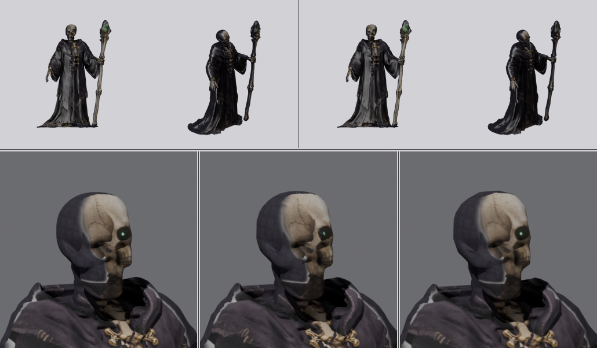
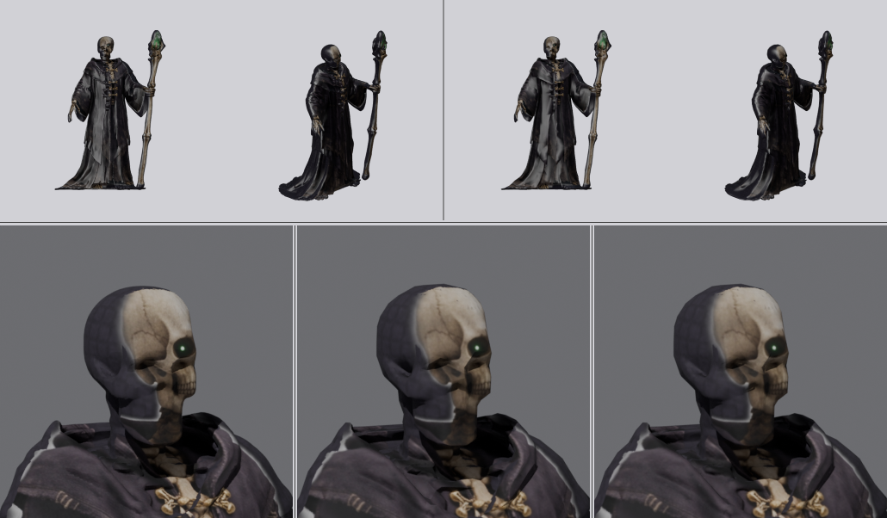
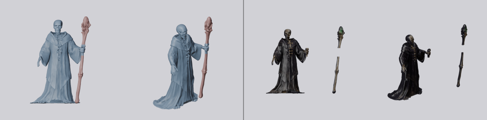
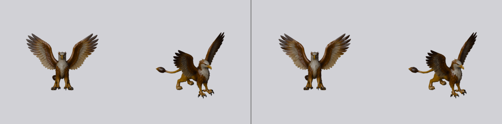

# Модуль core — подготовка сетки и общий прогон тестов

Шаги Blender `cleanup`, `convert`, `separate` (контракт §3–4), их общие помощники
`scripts/blender/steps/_mesh_lib.py`, общий прогон самопроверок `scripts/blender/tests/run_tests.py`
и обёртка для Node `tests/integration/blender.test.mjs`.

Файлы: `steps/cleanup.py`, `steps/convert.py`, `steps/separate.py`, `steps/_mesh_lib.py`,
`tests/run_tests.py`, `tests/test_core.py`, `tests/integration/blender.test.mjs`, картинки в
`docs/forge/img/core/`.

## Входы (общее для трёх шагов)

- Источник — `inputs.mesh` **или** `inputs.blend` (.glb/.gltf/.fbx/.obj/.stl/.blend). Конвейер после
  шага, записавшего .blend, передаёт только `{blend}` — цепочка «чистка → разделение» и
  «… → конвертация» работает через `af_run.py`. Если заданы оба, берётся `mesh`.
- Нет ни того ни другого — `ValueError: inputs.mesh or inputs.blend is required`; файла нет —
  `FileNotFoundError: inputs.mesh not found: <путь>`.
- Сразу после импорта удаляются служебные объекты импортёра: формы костей и всё из коллекции
  `glTF_not_exported` (у GLB со скелетом это `Icosphere` шириной 2 м — раньше она попадала в
  габарит: высота 2.7 м вместо 1.7, лишний меш в FBX, ложная часть `small`). Удалённые имена — в
  `stats.import_helpers_removed`.
- Риг: `cleanup` и `separate` работают со статикой — арматура и веса отбрасываются
  (предупреждение); `convert` риг и анимацию сохраняет (кроме OBJ и Mixamo).
- Перед сохранением .blend неиспользуемые данные вычищаются (`orphans_purge`): после remesh в
  `clean.blend` больше нет исходной 4K-карты (7.7 МБ вместо ~26 МБ).

## cleanup — из ИИ-сетки рабочая

Порядок: импорт → удаление служебных объектов → иерархия сплющивается (меши в мировых
координатах, пустышки и риг удаляются, трансформы применены) → объединение в один объект `Body` →
поворот, масштаб по росту, низ на `z=0`, центр X/Y → снимок «до» → сброс custom normals, сварка,
удаление проволочных рёбер, одиночных вершин и мелких островов → **либо** децимация, **либо**
voxel remesh + запекание → нормали и сглаживание (при remesh — **до** запекания) → повторная
нормализация (рост и `z=0` точно) → экспорт.

| Параметр | По умолчанию | Что делает |
|---|---|---|
| `height_m` | нет (размер как есть) | масштаб, чтобы высота габарита стала равна значению |
| `rotate_z_deg` | 0 | поворот вокруг Z до всего остального (грифон Tripo смотрит в +X → `-90`) |
| `ground`, `center` | true, true | низ на `z=0`, центр габарита в X=Y=0 |
| `join`, `name` | true, `Body` | объединить все меши. При `join:false` бюджет делится пропорционально треугольникам каждого объекта (при remesh — **после** ремеша); объект получает не меньше min(свои тр., 64), поэтому мелкие низкополигональные куски не трогаются |
| `merge_distance` | `1e-5 × рост` | сварка (glTF режет сетку по UV-швам); 0 — без сварки |
| `remove_islands_below` | 0 | удалить куски, где вершин меньше этой доли от всех |
| `target_tris` | нет | децимация до ≤ значения: плоский проход (`planar_angle_deg`, 0.5°) + коллапс ступенями (каждая ступень оставляет не меньше `decimate_stage_ratio` = 0.3) |
| `symmetry` | null | `'X'|'Y'|'Z'` — симметричный коллапс |
| `seam_weight` | выкл. | доп. защита швов через группу вершин (замер — хуже, поэтому выключено) |
| `voxel_remesh_m` | 0 | voxel remesh; рекомендуемо ≈ `0.0033 × рост`, выше `0.004 × рост` — предупреждение |
| `bake_size`, `bake_device`, `bake_samples` | 2048, `CPU`, 4 | запекание Cycles selected-to-active |
| `bake_normal`, `bake_emission` | false, false | карта нормалей (tangent) с исходной сетки — и после ремеша, и **после одной децимации** (`target_tris` без `voxel_remesh_m`), в том числе для сеток **без цвета** (Pixal3D, Hunyuan — одна форма). Упрощённая сетка затеняется **полностью гладко** (складки несёт карта), `shade_auto_smooth_deg` к ней не применяется; карта подключена через узел Normal Map → в GLB это `normalTexture`. Emission без ремеша печётся только вместе с перезапеканием цвета (см. ниже) |
| `bake_extrusion_m`, `bake_ray_m` | `max(2·voxel, 0.005·рост)`, `2·extrusion` | клетка и длина луча |
| `shade_auto_smooth_deg` | 40 | гладкое затенение с острыми рёбрами выше угла; 0 — плоское; null — как было |
| `recalc_normals` | true | согласовать направление граней наружу |
| `preview`, `preview_size` | true, 512 | лист «до | после» (спереди и 3/4, одинаковое кадрирование) |

Когда запекается цвет после remesh (`stats.bake.colour_source`): `texture` — карта Base Color;
`linked` — в Base Color идёт любой узел (атрибут цвета вершин, рампа…; модификатор Remesh
атрибуты цвета теряет); `materials` — у граней несколько разных базовых цветов (ремеш оставляет
один слот); `attribute` — материала нет, но есть цвета вершин (для запекания ставится временный
материал). Один плоский материал — запекать нечего, материал остаётся. Атрибут цвета, который не
использует ни один материал, не запекается: glTF и Godot его тоже не покажут.

При remesh порядок такой: ремеш всех объектов → деление бюджета по новым числам треугольников →
децимация → триангуляция → `recalc_normals` и затенение → Smart UV → запекание. Так отгружаемая
сетка затеняется ровно как та, на которую пеклась карта нормалей (раньше острые рёбра 40°
появлялись уже после запекания — фасетки на черепе и капюшоне, см. картинку ниже).
Без цвета у исходника (один плоский материал или никакого) с `bake_normal` материал остаётся, в
него добавляется только карта нормалей (до 01.11 при remesh без цвета не пеклось ничего).

### `bake_normal` без remesh (01.11)

Voxel remesh рвёт незамкнутые сетки Pixal3D (у Гробовщика 675 тыс. треуг. при 0.0063 и 0.0025 м
пропадали сюртук и тело, `silhouette_iou_min` падал), поэтому рельеф теперь можно перенести
одной децимацией: `{"height_m": 1.9, "target_tris": 40000, "bake_normal": true}`.

Порядок: сварка → **копия исходника** (свои копии материалов, затенение по углу
`shade_auto_smooth_deg` — настоящие жёсткие рёбра остаются в карте) → децимация → триангуляция →
`recalc_normals` → полностью гладкое затенение → UV → копия делается **двусторонней**
(`ml.two_sided`: Solidify без бортиков, толщина `min(0.0005 × рост, клетка / 4)`) → запекание
normal (Cycles selected-to-active с копии; клетка `0.005 × рост`, луч `2 × клетка`) → копия
удаляется.

Зачем двусторонняя копия. Cycles при selected-to-active берёт нормаль исходника как есть, без
разворота к лучу, а у незамкнутой сетки ИИ нет общего «снаружи»: на Гробовщике `recalc_normals`
развернул 355 тыс. из 675 тыс. граней исходника против упрощённой сетки, карта вышла вывернутой
(чёрные пятна). Ориентация по ближайшей грани и голосование лучами запекания оставляли пятна на
тонких одиночных листах (полы сюртука, поля шляпы): упрощённая сетка видит их с двух сторон, и
одной ориентации листа для обеих нет. У двусторонней копии луч с любой стороны первым встречает
грань, смотрящую на него, — крапин нет, стоит 0,15 с. Тот же приём — у исходника при remesh.
Smart UV после децимации переупаковывается (AABB, зазор 0.002, как у покраски): без этого на
ИИ-сетке занята малая часть квадрата — у Гробовщика площадь UV 0,039, покраска (`uv_report` хочет
≥ 0,05) такие UV не берёт и карту теряет; после упаковки 0,257. Зазор шире не окупается: тысячи
мелких островов с зазором 8 px оставили 0,045.

UV (`stats.bake.uv`):
- `kept` — материалы берут картинки через UV, а развёртка годится для уникального запекания (один
  слой, всё в 0..1, острова не перекрываются — тот же `uv_report`, что у покраски). Карта цвета
  остаётся исходной (`base_color_texture_kept`), нормаль печётся на те же UV в тот же материал;
- `smart_uv+pack_aabb` — картинок нет (Pixal3D, плоские цвета, цвета вершин — децимация их
  сохраняет): новая Smart UV с переупаковкой, материалы остаются, добавляется только нормаль;
- `smart_uv (<причина>)` — картинки есть, но UV непригодны: цвет перезапекается вместе с
  нормалью (материал собирается заново, как после ремеша; можно и `bake_emission`).

Проверка `normal_map_baked` (ошибка): у каждого материала есть карта нормалей. Без `target_tris`
и без ремеша переносить нечего — предупреждение, запекания нет.

Дальше по цепочке карта живёт на UV чистки: `paint_from_concept` (по умолчанию `uv: auto`)
оставляет пригодные UV и переносит карту в покрашенный материал (`keep_normal`, по умолчанию
true; `stats.uv.<объект>.normal_map`); при новой развёртке (`uv: smart` или непригодные UV) карта
отбрасывается с предупреждением — UV у неё другие. Риг, ретаргет и пакеты материал не трогают:
`godot_package` копирует GLB байт-в-байт, `unity_package` берёт `normal_map` из узла Normal Map.

Превью Workbench выбирает режим цвета сам: `TEXTURE` (есть карта цвета), `VERTEX` (цвета вершин,
которые использует материал или меш без материала), иначе `MATERIAL` (плоский цвет берётся из
Principled на время рендера). Поэтому потеря цветов вершин теперь видна в `render_color_mae`.
Кадр листа «после» сдвигается вместе с моделью при повторной центровке: раньше удаление острова
сдвигало модель, и IoU синтетической сферы был 0.668 при неизменной форме, сейчас 0.99+.

Выходы: `clean.glb`, `clean.blend`, `preview.png`, при запекании — `baked_base_color.png`,
`baked_normal.png`, `baked_emission.png` (что пеклось; при нескольких объектах — `baked_<i>_…`).
`stats`: `before` (как пришло), `welded` (после сварки), `after` — треугольники, вершины, связные
куски, граничные и не-многообразные рёбра, NaN, габарит; `decimation` (ступени с временем),
`budgets`, `textures_before/after`, `render_compare`, `bake`, `shading`, `sharp_edges`,
`import_helpers_removed`, `orphans_purged`, `timings_s`.
`checks` — ошибки: `tris_within_target`, `no_nan_verts`, `height_matches`, `grounded`,
`base_color_texture_kept`, `uv_kept` (без remesh и без перезапекания цвета), `normal_map_baked`
(с `bake_normal`), `silhouette_iou_min` (IoU ≥ 0.85 — форма развалилась); предупреждения: `centered`, `bake_coverage`, `silhouette_iou ≥ 0.97`,
`render_color_mae ≤ 0.08`.

Remesh + bake — это **перезапекание имеющегося цвета** на новую развёртку, а не восстановление
PBR: шероховатость и металл не переносятся (постоянная шероховатость 0.8), проекция фото остаётся
проекцией.

## convert — в GLB / FBX / OBJ и FBX для Mixamo

| Параметр | По умолчанию | Что делает |
|---|---|---|
| `format` | `glb` | `glb`, `fbx`, `obj` |
| `name` | `model` | имя выходного файла |
| `height_m`, `rotate_z_deg` | нет, 0 | масштаб и поворот |
| `ground`, `center` | true, если задан рост или Mixamo, иначе false | обычная конвертация не двигает модель |
| `mixamo` | false | FBX для загрузки в Mixamo (перенос `hg_to_mixamo.py` из «Врат Героев») |
| `mixamo_max_tris` | 50000 | бюджет треугольников |
| `mixamo_weld_m` | 1e-4 | сварка швов (автоскиннер Mixamo падает на сетке, разрезанной по UV) |
| `mixamo_center` | `bbox` | `head` — ось X по середине головы (посох/щит сбоку не сдвигают ось Mixamo) |
| `texture_max` | 2048 | предел стороны текстуры; если FBX > 10 МБ, текстуры уменьшаются вдвое до 512 |

Mixamo-FBX: один меш `Body` без рига, лицом в −Y Blender (FBX +Z), ноги на нуле, рост по умолчанию
1.8 м, единицы FBX — сантиметры (`FBX_SCALE_ALL`), в материале только карта цвета, текстура внутри
файла. Иерархия и пустышки (сокеты) при обычной конвертации сохраняются; OBJ пишет только меши и
кладёт карты в `textures/`. FBX-экспортёр Blender не встраивает упакованные картинки без пути
(так приходят текстуры из glTF), поэтому шаг пишет карты в `out_dir/textures/` и перепривязывает
узлы. Проверки повторным импортом записанного файла: `roundtrip_tris`, `roundtrip_meshes` (столько
же мешей — ловит лишнюю `Icosphere`), `roundtrip_height`, `no_nan_verts`, `roundtrip_base_color`,
`roundtrip_armature` (если был риг); при `height_m` (и для Mixamo, 1.8 м) — `height_matches`
(рост после импорта против `params.height_m`, допуск 1e-3) и `grounded` (низ на нуле); для Mixamo —
один меш и ≤ 10 МБ.

## separate — разделить на именованные части

| Параметр | По умолчанию | Что делает |
|---|---|---|
| `mode` | `loose` | `loose` — связные куски; `material` — по материалам; `regions` — по коробкам |
| `height_m`, `rotate_z_deg`, `ground`, `center` | нет, 0, true, true | нормализация ДО разделения; коробки задаются в итоговых метрах |
| `merge_distance` | `1e-5 × рост` | сварка, иначе `loose` разваливает сетку на UV-острова |
| `min_fraction`, `drop_small`, `names` | 0.01, false, — | (`loose`) мелочь собирается в часть `small` или выбрасывается |
| `regions` | — | `[{"name","min":[x,y,z],"max":[x,y,z]}]` **в метрах**; одинаковые имена = объединение коробок |
| `rest_name` | `body` | имя остатка |
| `origin` | `world` | `center` / `bottom` — точка объекта в центре / внизу части |
| `caps` | true | крышки на разрезах регионов `part`/`delete`; у региона свой `caps` |
| `slit_gap_m` | 0.001 × рост | развод краёв разрыва (`slit`, `width_m: 0`) |
| `regions[].kind` | `part` | `part` / `delete` / `slit`, подробности ниже |

Регионы: сетка режется плоскостями коробки (bisect только там, где грани касаются коробки), грани
внутри уходят в часть, разрезы с обеих сторон закрываются крышками (`holes_fill` + триангуляция;
крышка берёт UV соседнего края и его материал, плоское затенение, нормаль наружу). Края, которые
были открыты в исходнике, крышками не закрываются: **часть замкнута, только если исходник был
замкнут** в этой области. Выходы `parts.glb` (по объекту на часть), `parts.blend`, `preview.png`
(части в случайных цветах | «взрыв» с текстурой); в `stats.parts` — треугольники, габарит, куски,
граничные и не-многообразные рёбра, `closed` и объём (только для замкнутых).

### Виды регионов: часть, удаление, разрез без крышек (10.10, вечер)

У каждого региона есть `kind`; одинаковые имя и вид — одно объединение коробок.

| `kind` | Что делает | Параметры региона |
|---|---|---|
| `part` (по умолчанию) | как раньше: грани уходят в отдельную часть | `caps`, `facing` |
| `delete` | грани удаляются, части нет (старый посох, «лопаты», скрытое дно робы) | `caps`, `facing` |
| `slit` | **открытый разрез**: ничего не сшивает две стороны обратно | `plane` или `curve`, `width_m`, `gap_m`, `caps` |

- `caps` (по умолчанию `params.caps = true`). `false` оставляет края разреза открытыми с обеих сторон.
  Так открывается подол робы: `{"kind": "delete", "caps": false, "facing": [0, 0, -1]}`.
- `facing` + `facing_min` (0,5): внутренними считаются только грани, у которых нормаль · `facing` ≥
  `facing_min`. Это смотрящее вниз дно робы без боковой стенки подола.
- `slit`, `width_m: 0` (по умолчанию) — **разрыв**. Грани, которые касаются коробки и пересекают
  поверхность разреза, рассекаются. Новые рёбра на поверхности внутри коробки расщепляются
  (`split_edges`): ничего не удаляется, у двух сторон остаются совпадающие открытые края. Там, где разрез
  выходит из коробки, сетка остаётся целой, там конец щели. `gap_m` (по умолчанию `params.slit_gap_m =
  0.001 × рост`) отводит каждую копию края на `gap/2` внутрь её граней. Без этого прокси рига со сваркой
  1e-4 × рост зашил бы щель обратно.
- `slit`, `width_m > 0` — **слэб**. Удаляется полоса граней шириной `width_m` вокруг поверхности, края режутся
  точно по смещённым поверхностям. Так разрезается сросшаяся перемычка, у которой линии защемления уходят на
  несколько миллиметров от плоскости: у рукава некроманта они гуляют на 2–7 мм. С `caps: true` каждая
  сторона закрывается **своей** крышкой. Краевые цепочки стороны (передняя и задняя складка) сшиваются полосой
  треугольников по высоте разреза, U-образная цепочка режется в дальнем конце и сшивается так же. Длинных
  косых треугольников, которые тянулись бы между локтем и плечом, нет. Две стороны не соединяются, открытыми
  остаются только торцы слэба.
- Поверхность разреза: `plane` — `{"axis": "x", "value": v}` или `{"point", "normal"}`, по умолчанию
  `x` = центр коробки. `curve` — `{"axis": "x", "along": "z", "points": [[z0, x0], [z1, x1], …]}`,
  кусочно-линейная `x = f(z)`, вытянутая по третьей оси. Сначала сетка режется по границам полос,
  потом каждая полоса — своей плоскостью, и разрез получается непрерывным.
- `mode: "slit"` — то же, что `regions`, но вид по умолчанию `slit`.
- Отчёт: `stats.regions` по ключам `<имя>`, `delete_<имя>`, `slit_<имя>` — рассечённые грани,
  разорванные рёбра или удалённые грани, длина краёв, крышки по сторонам (`caps["+"/"-"]`, длины
  цепочек), открытые края. Проверки: `slit_<имя>_cut` (ошибка, если ничего не разрезано),
  `slit_<имя>_capped` и `delete_<имя>_capped` (предупреждения), `delete_<имя>_nonempty`.

**Сокеты сохраняются.** `cleanup`, `separate` (и `place_parts`, `replace_part`) больше не выбрасывают пустышки
`socket_*` / с `game_socket` (например, `socket_fx_eye_l/r` от `replace_part`). Они записываются до
сплющивания иерархии (`_mesh_lib.socket_records`), возвращаются корневыми пустышками
(`restore_sockets`), проходят ту же нормализацию, что и сетка, без масштаба, и экспортируются вместе с
частями. В `stats.sockets_kept` — их имена.

Некромант v2 (`docs/forge/necromancer.md`, раздел v2): сросшиеся рукава режутся слэбами 12 мм по кривой,
подол открывается удалением дна. Риг впервые проходит проверку разрывов.

## Запуск

```
"C:/Program Files/Blender Foundation/Blender 5.0/blender.exe" -b --factory-startup \
    --python scripts/blender/af_run.py -- cleanup request.json
```
```json
{"inputs": {"mesh": "C:/.../Corrected-necromancer.glb"},
 "params": {"height_m": 1.8, "target_tris": 30000},
 "out_dir": "C:/.../out"}
```
Следующий шаг по .blend: `{"inputs": {"blend": "C:/.../out/clean.blend"}, "params": {...}}`.
Посох некроманта (коробки найдены срезами сетки по 5 см, см. `STAFF_REGIONS` в `test_core.py`):
```json
{"mode": "regions", "height_m": 1.8, "regions": [
  {"name": "staff", "min": [0.285, -0.37, -0.01], "max": [0.52, -0.17, 0.70]},
  {"name": "staff", "min": [0.285, -0.37, 0.70],  "max": [0.52, -0.21, 0.99]},
  {"name": "staff", "min": [0.38, -0.38, 1.22],   "max": [0.66, -0.16, 1.81]}]}
```
Тесты:
```
blender -b --factory-startup --python scripts/blender/tests/run_tests.py -- core [-k real] [--list]
node --test tests/integration/blender.test.mjs          # все модули; FORGE_TEST_MODULE=core — один
```
`run_tests.py` находит `test_*.py`, перед каждым `test_*` вызывает `af_common.reset_scene()`,
печатает `PASS/FAIL/SKIP имя секунды`, в конце `TESTRESULT {json}`, код выхода 1 при любом
падении (и при модуле, который не импортируется). SKIP — `unittest.SkipTest` или возврат строки,
начинающейся с `skip`. Обёртка Node ищет Blender (`ASTRA_BLENDER` или путь по умолчанию),
пропускается без него, таймаут 40 минут, фильтры `FORGE_TEST_MODULE`, `FORGE_TEST_FILTER`; лежит в
`tests/integration/`, поэтому `npm test` (`tests/*.test.mjs`) её не трогает.

## Замеры (Blender 5.0.1, CPU 32 потока, RTX 4070; 10.10, раунд исправлений)

Время: «свежий процесс» — `timings_s.total` из `result.json` отдельного запуска `af_run.py`
(без старта Blender ~1–2 с); «тёплый» — тот же прогон внутри `run_tests.py`.


Сверху: до | после 30k (спереди, 3/4, Workbench). Снизу голова, Cycles: оригинал 120k |
децимация 30k | remesh 6 мм → 12k + bake цвета и нормалей.

| Прогон | Результат |
|---|---|
| Некромант, децимация 120k → 30k | 119 997 → 29 939 тр.; свежий процесс 3.9 с (децимация 1.1 с), тёплый 3.0 с; сварка 26 835 вершин: 2447 кусков → 4, граничных рёбер 49 646 → 22, не-многообразных 1 → 12; карта цвета 4096² и карты normal/roughness/metallic/emission сохранены; IoU силуэта 0.998, разница цвета 0.031 |
| То же, защита швов группой вершин | хуже: разница цвета 0.035–0.038 против 0.025 без неё (30k); при весе 0 коллапс застревает на 52 659 тр. (замер прошлого раунда) |
| Некромант, 1.1 млн тр. (`Corrected-MC-high.glb`) → 30k | свежий процесс 21.3 с, тёплый 20.0 с: сварка 3.0, плоский проход 5.1 (1 107 672 → 952 284), коллапс 7.0 + 1.9 + 0.5 с (952 284 → 285 684 → 85 704 → 29 940); 3 острова (140 вершин) удалены; IoU 0.998 |
| Некромант, voxel 6 мм → 12k + bake 2048 (цвет + normal) | свежий процесс 10.2 с: remesh 0.2, децимация 3.0 (385 180 → 115 554 → 34 666 → 11 976), Smart UV 0.1, запекание 1.8 + 1.5 с (CPU); промахи лучей 0.15 %; 11 976 тр., граничных и не-многообразных рёбер 0, 5 кусков; нормали выровнены до запекания (развёрнуто 4 грани), острых рёбер 0; IoU 0.994, разница цвета 0.058; `clean.blend` 7.7 МБ |
| То же без `bake_normal` | острые рёбра 40° (3385), разница цвета 0.045: рост до 0.058 выше — только от полностью гладкого затенения, карту нормалей Workbench не показывает |
| То же, voxel 12 мм (прошлый раунд) | дыры и рваные края на тонкой кисти, IoU 0.980, разница 0.060 — отсюда предупреждение выше 0.4 % роста |
| Грифон Tripo 19 988 → 7 984, поворот −90°, рост 1.6 м | свежий процесс 1.6 с, тёплый 1.1 с; 220 кусков (UV-разрезы) → 1; граничных рёбер 5 806 → 34, не-многообразных 0 → 34 — это рёбра самого исходника, которые видно только после сварки UV-разрезов; карта 2048² сохранена; IoU 0.989, разница цвета 0.034 |
| Посох (separate, 3 коробки) | свежий процесс 4.0 с, тёплый 3.5 с; часть `staff` 14 265 тр., 2 куска (ниже и выше кулака), 0.33 × 0.17 × 1.80 м, крышки по 136 граней с каждой стороны, открытых рёбер разреза 0. Но `closed:false`: 6 граничных и 3 не-многообразных ребра унаследованы от исходника. Остаток `body` 106 398 тр. (16 граничных, 9 не-многообразных, тоже из исходника) |
| Цепочка по .blend | `separate {blend: clean.blend 30k}` → `staff` 3 559 / `body` 26 752 тр., крышки 63/63; `convert {blend: clean.blend}` → FBX 21.7 МБ, повторный импорт 29 939 тр., 1.8 м, 1 меш |
| GLB со скелетом (зомби Mixamo → GLB) | служебная `Icosphere` удалена во всех шагах: `convert` FBX — 1 меш, 1 арматура, 1.7 м, низ 0; GLB c `height_m 1.8` — 1.8 м, низ 0, `height_matches`/`grounded` ok; `cleanup join:false` — 1 объект, 1.7 м; `separate loose` — 1 часть `part_00` (17 358 тр.), ложной `small` нет |
| `join:false`, три объекта (синтетика) | децимация до 3000: бюджеты [2170, 12, 817] — куб 12 тр. оставлен целым; voxel 4 см → 3000: бюджеты по числам после ремеша [1881, 719, 398], объём куба в пределах 15 % (тетраэдр дал бы треть), IoU 0.965 |
| Цвета вершин (синтетика) | децимация: атрибут цвета остаётся, превью `VERTEX`, разница 0.015; remesh: запекание через узел атрибута (`linked`), разница 0.006, 100 % проб красное/синее на своих сторонах; меш без материала (`attribute`) — то же |
| Тесты `core` | 32 теста, все PASS, 59 с (10.10, вечер: + разрыв/слэб/кривая, `delete` с `facing`, сокеты в `cleanup`/`separate`); раньше 28 тестов, 44–45 с в трёх прогонах (из них 20 с — миллион треугольников); обёртка Node `FORGE_TEST_MODULE=core` — pass, 46 с; `npm test` 87/87 |


Сверху: до | voxel 6 мм → 12k + bake (Workbench, карта нормалей не видна). Снизу голова, Cycles с
картой нормалей: оригинал 120k | старый порядок (острые рёбра 40° выставлены после запекания —
фасетки на своде черепа, челюсти и краю капюшона) | новый порядок (затенение как при запекании).


Части в случайных цветах | «взрыв» с текстурой: посох вынут выше и ниже кулака, кусок древка в
кулаке остался с телом.


Грифон до | после 8k, уже лицом в −Y.

## Честные ограничения

- Децимация — встроенный коллапс Blender: UV он интерполирует сам, отдельного учёта швов в
  квадриках нет. При 120k → 30k текстура держится (разница цвета 0.03), при 120k → 10k — 0.056,
  тонкие детали лица смягчаются. Опция `symmetry` на ИИ-сетках почти ничего не даёт (они
  несимметричны), шаг об этом предупреждает.
- Сварка соединяет соприкасающиеся слои ткани: у некроманта не-многообразных рёбер стало 1 → 12,
  у грифона после сварки видно 34 (из исходника); шаг это сообщает, но не чинит. `recalc_normals`
  развернул 58 граней некроманта и 14 у грифона — эвристика; для односторонних карточек (волосы,
  плащ без толщины) её лучше выключать.
- Remesh + bake: тонкие части рвутся при вокселе крупнее ~0.4 % роста; voxel remesh оставляет
  мелкие плавающие куски (у некроманта после 6 мм — 5 кусков); переносится только цвет (и по
  желанию normal/emission), шероховатость и металл — нет; клетка запекания постоянная, в глубоких
  складках луч может взять соседнюю поверхность; по краям UV-островов возможны тонкие тёмные линии.
  С `bake_normal` сетка всегда полностью гладкая — жёсткие грани передаёт только карта.
- Разделение по регионам — только осевые коробки. Всё, что сплавлено внутри кулака, остаётся с
  телом: у некроманта в кулаке остался отрезок древка ~23 см, посох вышел двумя кусками. Часть
  замкнута, только если замкнут исходник: у посоха 6 граничных и 3 не-многообразных ребра из
  исходной сетки, поэтому `closed:false` и объём не считается. Крышки плоские, их UV растянуты с
  края разреза (это не текстура среза). Разрезы и триангуляция добавляют треугольники
  (106 398 + 14 265 = 120 663 против 119 949 после сварки).
- `render_compare` — грубая замена глазу: Workbench без PBR и карт нормалей, два ракурса; он ловит
  потерю силуэта и сдвиг цвета, но не оценивает топологию. Порог ошибки `silhouette_iou_min` 0.85
  проверен на тонком предмете (бугристое древко 4 см × 1.8 м, ~11 пикселей на превью, 5 804 тр.):
  1500 тр. — IoU 0.984, 600 — 0.965, 300 — 0.955 (предупреждение), 150 — 0.873 (бугры частично
  сглажены, проходит), 80 — 0.788 (бугры исчезли, древко плоское и перекрученное — шаг падает).
  На тонких предметах предупреждение `silhouette_iou` срабатывает раньше, чем видна потеря.
- Mixamo-FBX шаг только готовит: загрузка и скачивание — руками владельца (контракт §7). Лицом в
  −Y модель должна смотреть до этого (`rotate_z_deg`), автоматически направление не определяется.
- `convert` без нормализации сохраняет иерархию как есть (трансформы родителей не применяются);
  OBJ теряет риг и анимацию (предупреждение). `cleanup`/`separate` риг отбрасывают.
- Отсутствующий `inputs.blend` до шага не доходит: `af_run.py` открывает .blend сам и падает с
  `RuntimeError: Cannot read file "<путь>"` (путь в сообщении есть).
