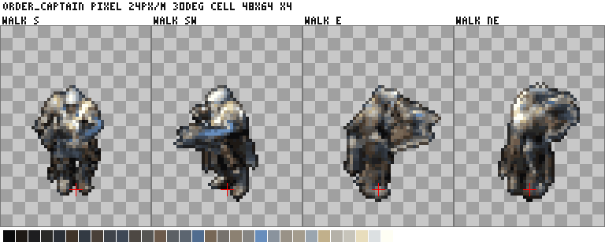
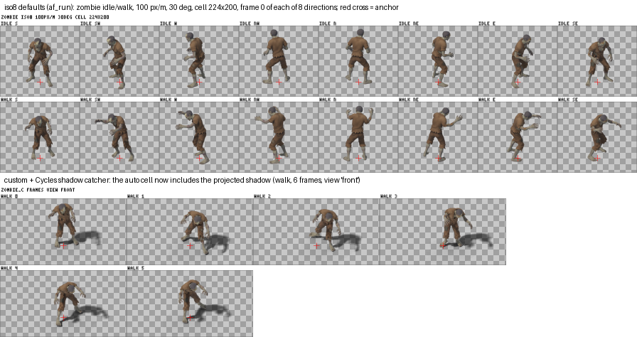
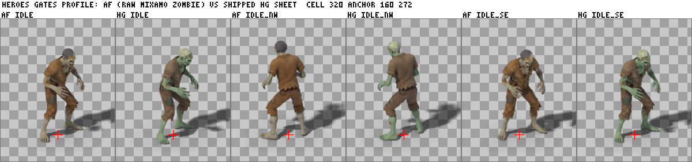
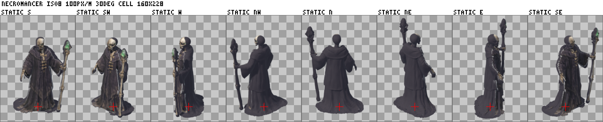
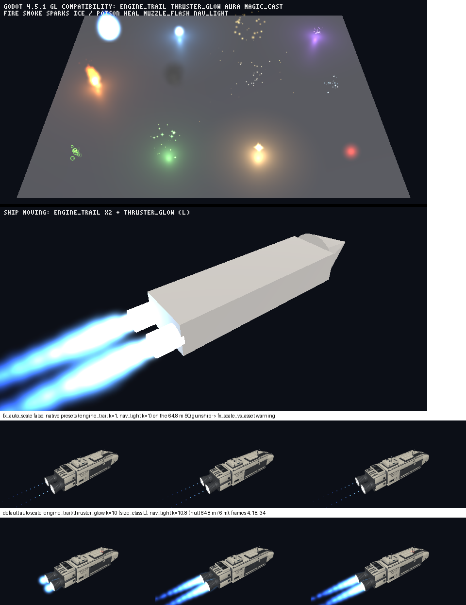

# Модуль «export»: спрайты и пакеты Godot

Два шага Blender-воркера (контракт `docs/FORGE-CONTRACT.md`):

- `render_sprites` — листы спрайтов из (анимированной) модели: 8 направлений изометрии (`iso8`),
  профиль «Врат Героев» (`heroes_gates`), свой набор направлений (`custom`) или пиксель-арт (`pixel`, см. ниже);
- `godot_package` — папка-пакет для Godot 4.5: GLB + сцена `.tscn` с эффектами на сокетах + README +
  запись реестра Space Quest или «Врат Героев»; пакет проверяется настоящим Godot 4.5.1 без окна.

Файлы модуля: `scripts/blender/steps/{render_sprites,godot_package,_export_lib}.py`,
`scripts/blender/data/fx_presets.json`, `scripts/blender/godot/{validate_package,ima_fx_mount,imaginarium_preview}.gd`,
`scripts/blender/tests/test_export.py`. В проекты «Врат Героев» и Space Quest ничего не пишется.

## Запуск

```
"C:/Program Files/Blender Foundation/Blender 5.0/blender.exe" -b --factory-startup ^
    --python scripts/blender/imaginarium_run.py -- render_sprites request.json
```

```json
{"step": "render_sprites",
 "inputs": {"mesh": "C:/abs/zombie.glb"},
 "params": {"profile": "heroes_gates", "asset_id": "zombie", "clips": ["idle", "walk"],
            "height_m": 1.7, "shadow_alpha_max": 0.55, "shadow_edge_fade_px": 24},
 "out_dir": "C:/abs/out"}
```

Пакет корабля Space Quest (64.8 м, сопла `size_class: "L"`). Пресеты метрические; без `params.scale`
шаг сам масштабирует их под сокет и ассет — здесь `engine_trail`/`thruster_glow` получат k = 10, `nav_light`
k = 10.8. Явный `scale` перекрывает автомасштаб. `fit_units`/`min_units` — единицы рендера игры, не метры
(см. «Единицы Space Quest» ниже), задаются по соседям роли в `models.json`:

```json
{"step": "godot_package",
 "inputs": {"glb": "C:/Dorn/Dops media/space_quest/3d/source/blender/ship_sq03_gunship_flat.glb"},
 "params": {"asset_id": "ship_sq03_gunship", "profile": "space_quest", "kind": "ship",
            "fit_units": 3.4, "min_units": 0.6,
            "fx": [{"preset": "engine_trail", "socket": "socket_thruster_main_port"},
                   {"preset": "engine_trail", "socket": "socket_thruster_main_starboard"},
                   {"preset": "thruster_glow", "socket": "socket_thruster_main_port"},
                   {"preset": "nav_light", "socket": "socket_utility_mast_01", "params": {"scale": 6}}]},
 "out_dir": "C:/abs/out"}
```

Тесты: `blender -b --factory-startup --python scripts/blender/tests/run_tests.py -- export`.

Экспорт в **Unity** (шаг `unity_package`, профиль `unity`, импортёр `dev.imaginarium3d.unity`, проверка в Unity без окна) — [unity.md](unity.md).

## render_sprites

Камера ортогональная, на риге-пустышке в начале координат; свет (солнце сверху-слева-спереди экрана,
холодный контровой сзади-справа, небо — как в `hg_scene.setup_lights`) — дети того же рига. Направление
получается поворотом рига вокруг Z, поэтому свет одинаков во всех направлениях, а корневое движение
скелета не трогается. Мировое начало координат (точка опоры под ногами) проецируется ровно в якорь ячейки;
1 м = `pixels_per_meter` пикселей по горизонтали, вертикальный метр — `ppm·cos(elev)`.

| Параметр | По умолчанию | Что |
|---|---|---|
| `profile` | `iso8` | `iso8`, `heroes_gates`, `custom`, `pixel` (раздел «Профиль pixel») |
| `asset_id` | имя файла | snake_case; имя вроде `01_pathfinder` становится `a_01_pathfinder` (с предупреждением) |
| `forward` | `-Y`; `+Y`, если `inputs.manifest` → `kind` корабль/реквизит/турель | `+Y` добавляет 180° ко всем видам: S показывает нос корабля |
| `clips` | `all` | список имён (`idle`) или имён действий (`idle-loop`) |
| `loop` | по суффиксу `-loop`/`_loop`, иначе idle/walk/run | `{clip: bool}` |
| `frames` | iso8: длина клипа × fps (≤ `max_frames`=48); HG: 12, hit 6, герой idle/cast 16 | число или `{clip: n}` |
| `fps` | 12 | у HG всегда 12 |
| `ranges`, `ranges_fps` | диапазон действия | `{clip: [start, end]}` в кадрах при `ranges_fps` |
| `in_place` | `auto` | `auto` (петли: снять чистый снос корня, разовые: как есть), `lock` (XY бёдер = первый кадр), `drift`, `none` |
| `pixels_per_meter` | 100 | фиксированный масштаб профиля |
| `elevation_deg` | iso8 30 (2:1), HG 25 | наклон камеры |
| `directions` | `S,SW,W,NW,N,NE,E,SE` | подмножество; `custom`: `[[имя, yaw°], …]` |
| `padding_px` | 6 | поле вокруг максимального габарита всех кадров всех клипов и направлений |
| `cell`, `anchor` | вычисляются | принудительная ячейка (одинаковая для разных ассетов) |
| `height_m`, `center`, `normalize_pose` | —, `feet`, iso8 `rest` / HG `first_frame` | масштаб под рост; опора = середина нижних 12 % вершин (`hg_scene.normalize`) |
| `max_cell_px`, `min_body_px` | 2048, 24 | сторона ячейки больше или проекция тела (макс. из ширины/высоты) меньше — ошибка **до рендера** |
| `max_sheet_px` | 8192 | мягкий предел стороны листа; > 16384 (предел текстуры Godot) — ошибка до рендера |
| `engine`, `samples` | iso8 `EEVEE` 32, HG `CYCLES` 64 | `EEVEE`, `CYCLES` (OptiX/CUDA), `WORKBENCH` |
| `shadow` | HG true (только Cycles) | ловец теней + контровой без своей тени (`rim_off_catcher`); в iso8/custom авто-ячейка включает проекцию тени |
| `grade`, `grade_materials` | HG true | `hg_sheets.grade` (насыщенность ×1.1, контраст ×1.05) и `hg_scene.grade_materials` |
| `shadow_alpha_max`, `shadow_edge_fade_px`, `alpha_floor` | 0; 0 (iso8/custom с тенью 4, с принудительной ячейкой 16); 6 | как `hg_sheets.pack` (у зомби в спеке 0.55 и 24) |
| `cols` | HG 4; iso8 — строка на направление, если влезает в `max_sheet_px`, иначе ровные строки | столбцов в листе |
| `kind` | `unit` | HG: `unit` 320×320 якорь (160,272), `hero` 448×448 (224,384) |
| `adaptive_cell` | HG `unit`: true | модель, вылезающая из 320 px, получает следующую ячейку `HG_CELL_STEPS`: 384 (якорь 192, 328), затем 448 (224, 384 — ячейка героя); см. «Ячейка по размеру» |
| `event_frames` | HG unit: attack 6, cast 6, shoot 8 (с предупреждением); герой cast — без умолчания | `{clip: кадр}` |
| `validate_godot` | true | загрузить `.tres` в Godot 4.5.1 |

Направления iso8 — поворот персонажа (смотрит в −Y по §4): S 0° (лицом к камере), SW −45°, W −90°,
NW −135°, N 180°, NE 135°, E 90°, SE 45°; при `forward: "+Y"` ко всем прибавляется 180°. Профиль HG
воспроизводит `hg_render_directions.py`: курс base −25° (модель развёрнута к камере на −25°), `nw` 135°,
`se` −45°, остальное игра отражает.

Защита от неверных единиц: если `height_m` не задан и рост в покое вне 0.3…15 м — предупреждение с
подсказкой `height_m`; ячейка больше `max_cell_px`, тело меньше `min_body_px`, вылет за фиксированную ячейку
больше половины ячейки или лист больше 16384 px — `ValueError` с подсказкой ещё до рендера (замок GPU не
занимается впустую).

Выходы: листы PNG (iso8 — `<clip>.png` со всеми направлениями по строкам; если стопка выше `max_sheet_px` —
`<clip>_<DIR>.png` на каждое направление; HG — `<clip>.png`, `<clip>_nw.png`, `<clip>_se.png` по 4 столбца),
`sprites.json` (ячейка, якорь, `godot_offset` для `AnimatedSprite2D`, `forward`, `layout` клипа, прямоугольники
кадров, опоры каждого кадра: `root_px` — проекция точки под бёдрами, `feet_px` — точки под костями стоп
(порядок `feet_bones`), `feet_mid_px` — их середина; fps, петли, `time_scale`), `<asset_id>_frames.tres`
(`SpriteFrames`, анимации `<clip>_<DIR>`; у HG — их ключи `idle`, `idle_nw`, `idle_se`; пути относительные),
`heroes_gates_sprites_entry.json` (запись `data/sprites.json` в их формате), `preview.png` (кадр 0 каждого
направления), `preview_frames.png` (все кадры первого направления), `godot_check.json`.

Проверки: `cell_fit` (вершины в ячейке, у HG с полем 4 px — как в их `correct_fit`), `body_scale_px_per_m`
(масштаб тела на отрендеренных кадрах — см. ниже), `sprite_size_sane`,
`sheet_size`, `frames_body_inside_cell` (нет пустых кадров, тело не ближе 2 px к краю — `pixel_support` из
`hg_pack_directions.py`), `alpha_residue_px`, `feet_on_ground_<clip>` (мин. z деформированной сетки в петлях),
`lighting_spread`, `godot_spriteframes`.

### Профиль pixel (27.10)

Спрайты в настоящем пиксель-арте: геометрия как у `iso8`, но рендер без сглаживания, а после него — детерминированная
постобработка (`scripts/pixel/pixelize.py`, чистый numpy; тот же модуль превращает в пиксель-арт любую картинку,
см. [pixel.md](pixel.md)). Цвета берутся только из палитры, альфа только 0 или 255.

```json
{"step": "render_sprites",
 "inputs": {"mesh": "C:/abs/knight.glb"},
 "params": {"profile": "pixel", "asset_id": "knight", "height_m": 2.0, "clips": ["idle", "walk"],
            "colors": 32, "outline": "auto", "supersample": 2},
 "out_dir": "C:/abs/out"}
```

| Параметр | По умолчанию | Что |
|---|---|---|
| `pixels_per_meter` | 24 | масштаб ГОТОВОГО спрайта: человек 2 м при наклоне 30° — около 42 px по высоте |
| `directions` | `S,SW,W,NW,N,NE,E,SE` | как в `iso8` |
| `frames`, `fps` | 8 кадров на клип, 8 | цикл из 8 кадров идёт ровно секунду |
| `engine`, `samples` | `EEVEE`, 1 | фильтр плёнки 0 (без сглаживания); тени отключены: нет ловца теней (`shadow` игнорируется с предупреждением), у ламп `use_shadow=false`; `self_shadow: true` возвращает тени ламп |
| `supersample` | 1 | 2…4: рендер в k раз крупнее, затем среднее по блоку (premultiplied alpha) и только потом квантование |
| `downscale` | 1 | 2…8: рендер в k раз крупнее и nearest (центральный пиксель блока); с `supersample` одновременно не задаётся |
| `palette` | `auto` | `auto` — median cut (вес цвета — корень из числа пикселей) по ВСЕМ кадрам ассета сразу, чтобы цвет не мигал от кадра к кадру; путь к `.png` (любая картинка или полоса 1 px на цвет), `.gpl` (GIMP) или `.hex` (Lospec); `none` — без квантования |
| `colors` | 32 | размер авто-палитры; при контуре один цвет резервируется под него, если в теле нет достаточно тёмного |
| `levels`, `saturation` | `true`, 1.2 | растянуть яркость всех кадров вместе (перцентили 2…98 → 14…240, оттенок сохраняется) и поднять насыщенность до палитры: тёмные тусклые текстуры иначе дают грязную палитру |
| `dither`, `dither_strength` | `false`, 0.5 | упорядоченный Bayer 4×4 по координатам ячейки (узор одинаков во всех кадрах) |
| `outline` | `none` | `dark` — самый тёмный цвет палитры; `auto` — цвет соседнего тела, затемнённый до ближайшего более тёмного цвета палитры; 1 px снаружи тела, 4-соседство |
| `alpha_threshold` | 128 | альфа ≥ порога → 255, иначе 0 |
| `padding_px`, `min_body_px` | 4, 16 | поле вокруг тела (в готовых пикселях) и минимальный размер тела |
| `cell`, `anchor` | вычисляются | в ГОТОВЫХ пикселях; якорь всегда на целом пикселе, поэтому точка опоры стабильна во всех кадрах |
| `preview_zoom` | 4 | `preview.png` и `preview_frames.png` увеличены nearest |

Дополнительные выходы: `palette` (`palette.png`, 1 px на цвет) и `palette_gpl` (`palette.gpl` для Pixelorama и GIMP);
в `sprites.json` — блок `pixel` (палитра, контур, дизеринг, `texture_filter: "nearest"`). Проверки: `pixel_palette_only`
(все различные цвета видимых пикселей всех кадров, включая контур, входят в палитру) и `pixel_alpha_binary`;
`body_scale_px_per_m` здесь только предупреждение: острие копья тоньше пикселя без сглаживания пропадает, и тело
законно ниже проекции вершин. В Godot узлу со спрайтами задайте `texture_filter = Nearest`.



### Ячейка по размеру (heroes_gates, 11.10)

Фиксированная ячейка отряда 320 px (якорь 160, 272) мала для широкой стойки и длинного оружия: Healing monk
(булава и щит в стороны) вылезал из неё уже в покое и шаге — `cell_fit`, шаг падал. Игра читает ячейку и якорь
каждой записи `data/sprites.json` (`game/sprites/hg_sprite_lib.gd`: кадры режутся по `cell` записи,
`frame_region(i, cols, cell)`; смещение спрайта `-anchor`; масштаб у всех отрядов один — `display_scale`),
у героев уже стоит 448 (224, 384). Поэтому `render_sprites` для `kind: unit` берёт **наименьшую ячейку
`HG_CELL_STEPS` = 320 → 384 → 448, в которую влезают все кадры всех клипов и видов**, с якорем этой ячейки
(земля в 48 px от низа у 320 и в 64 px у 448, у 384 — 56: якорь 192, 328). Если что-то лежит ниже линии
земли на экране (тело после смерти, упавшее к камере), якорь внутри ячейки поднимается ровно настолько,
сколько нужно (игра принимает любой якорь записи). Масштаб не меняется: 100 px/м. Его проверяет
`body_scale_px_per_m` на отрендеренных кадрах — высота тела по альфе против высоты проекции вершин при
100 px/м (медиана по всем кадрам, допуск 3 %) и верх тела против проекции через якорь (≤ 3 px). Выбранная
ячейка и якорь — в `sprites.json` (`cell`, `anchor`, `cell_adapted`) и в записи
`heroes_gates_sprites_entry.json`; предупреждение называет, на сколько px модель вылезала из 320.
Больше 448 ячейка не растёт: модель, не влезающая и туда, получает `cell_fit` как раньше.
`adaptive_cell: false` — прежняя фиксированная ячейка; явные `cell`/`anchor` теперь работают и в HG.

| персонаж (пилот 11.10, `pilot2d`) | вылет из 320 / 384 / 448, px | ячейка, якорь | масштаб по кадрам |
|---|---|---|---|
| Healing monk (булава + щит) | 22 / 0 | 384, (192, 314) — якорь поднят на 14 px (тело падает к камере) | 100,9 px/м |
| Bone swordsman (два меча) | 53 / 21 / 0 | 448, (224, 384) | 100,8 px/м |
| Knight #3 (меч 0,93 м) | 64 / 32 / 0 | 448, (224, 384) | 100,9 px/м |
| Knight #5 (меч 1,11 м в широком замахе) | 89 / 57 / 25 | не влезает и в 448: `cell_fit` | 100,8 px/м |
| Lich sorcerer (роба ложится после смерти) | 0 | 320, (160, 272) | 100,9 px/м |

Тест: `test_hg_adaptive_unit_cell` (фигура с шестом 5 м → 384, запись с ячейкой, 100 px/м; `adaptive_cell:
false` → `cell_fit`; диск радиусом 2 м на высоте колен → 448 с якорем выше стандартного).

### Кэш ткани `cloth_sim` (12.10)

Если `.blend` пришёл из шага `cloth_sim` (`docs/forge/cloth_sim.md`), одежда персонажа (`Body_cloth_<группа>`) несёт
запечённую симуляцию: по ключу формы на каждый кадр клипа и по действию ключей формы на клип; свойство объекта
`imaginarium_cloth_cache` = `{действие арматуры: действие ключей}`. `render_sprites` при каждом переключении клипа (`_bind`)
зовёт `_export_lib.bind_cloth_cache(действия клипа)`: у одежды включается действие этого клипа и выключается её
модификатор Armature (ключи хранят готовые позиции), значения ключей прошлого клипа обнуляются (иначе ключ, который
анимировало прошлое действие, сохраняет последнее значение). Клип без кэша и замер позы покоя (`_rest_points`,
нормировка iso8) идут на обычном скиннинге (ключи 0, Armature включён). Ячейка и проверки первого прохода считаются по
симулированной ткани. Тест: `test_render_sprites_plays_cloth_cache` (плоскость с кэшем «влево/вправо» на 0,6 м у
двух клипов: в листе каждого клипа ткань на своей стороне, ячейка вмещает обе).

## godot_package

GLB из `cloth_sim` (`cloth.glb`) — обычный GLB персонажа: та же арматура плюс кости `cloth_<группа>_<цепь>_<сустав>`,
те же имена клипов; пакет и проверка Godot 4.5.1 работают без изменений (пилот: лич, иерофант — сцена загружена, петли
`idle`/`walk`, 9 сокетов, ошибок движка нет).

| Параметр | По умолчанию | Что |
|---|---|---|
| `asset_id` | обязателен | `^[a-z][a-z0-9]*(_[a-z0-9]+)*$` |
| `profile` | `godot` | `godot`, `space_quest` (запись `models.json`), `heroes_gates` (запись `sprites.json`) |
| `forward_axis` | как у GLB | `-Z`: узел `model` в сцене повёрнут на 180° вокруг Y под `look_at`; GLB не трогается |
| `source_forward` | из `kind` паспорта / `params.kind`; иначе догадка с предупреждением | нос GLB: корабли/реквизит/турели `-Z`, персонажи/существа/предметы `+Z`; догадка: сокеты thruster/turret/launcher/muzzle или профиль `space_quest` → `-Z`, иначе `+Z` |
| `kind` | — | вид ассета без паспорта (`ship`, `humanoid`, …) |
| `fx` | `manifest.fx` | `[{preset, socket, params}]`; params: `scale`, `color`, `amount`, `lifetime`, любое поле пресета |
| `fx_auto_scale` | true | false — пресеты в родном размере, если нет `params.scale` |
| `autoplay` | — | анимация на `_ready` (`idle-loop` или `idle`; `ima_fx_mount.play_animation` пробует имя как есть и без одного суффикса `-loop`/`_loop`/`-cycle`/`_cycle`) |
| `sq_type`, `comment` | `ships`, имя паспорта | поля записи Space Quest |
| `fit_units`, `min_units` | по роли (`sq_class`, иначе `kind`): корабль 3,4 / 0,6, турель 1,5 / 0,12, модуль 0,3 / 0,05, станция 20 / 0, дрон 2 / 0,15, банк 1 / 0, прочее 1 / 0; умолчание `min_units` не больше `fit_units` | **единицы рендера** записи `models.json`, не метры; `min_units` от 0 (схема сервера до 17.10 требовала ≥ 0,001) |
| `sq_class` | — (по `kind`) | роль для умолчаний: `ship`, `turret`, `module`, `station`, `drone`, `bank` или класс бюджета (`ship_s/m/l`, `hull_module`, `station_core`, `station_module`, `structure_kit`, `drone_kit`, `asteroid_kit`, `debris_kit`) |
| `inputs.sprites` | — | `sprites.json` из `render_sprites`: листы и `.tres` кладутся в `sprites/` и проверяются |
| `fx_preview`, `fx_preview_frames` | false, `[14, 30, 46]` | кадры Movie Maker в `fx_preview.png` (окно Godot на ~3 с, поэтому не по умолчанию) |

**Масштаб эффектов.** Пресеты метрические: каждый настроен под эталон — `reference_socket_m` (диаметр
посадки/сопла: `engine_trail`, `thruster_glow` 0.45 м, `muzzle_flash` 1 м) и `reference_size_m` (длинная ось
ассета: корабельные 6 м, человеческие 1.8 м, `smoke` 3 м, `muzzle_flash` 1 м). Без `params.scale` k берётся так:
1) диаметр сокета (`diameter_m` / `mount_d_m` / `nozzle_d_m`) ÷ `reference_socket_m`; 2) `size_class` сокета или
его родителя (риг турели `socket_mount → … → socket_muzzle_*`) — середина диапазона Space Quest: S 1.0, M 2.25,
L 4.5 м ÷ `reference_socket_m` (у сопел S ≈ 2.2, M 5, L 10); 3) длинная ось ассета в позе покоя ÷
`reference_size_m`; 4) иначе 1. k умножает все длины: `quad_size`, скорости, затухание, ускорения, гравитацию,
форму излучателя, радиус света и `visibility_aabb` (иначе эффект отсекается, когда коробка уходит из кадра).
Использованный k и его источник пишутся в `ima_package.json` (`fx[].scale`, `scale_source`, `quad_size_m`,
`visibility_aabb`) и README. Проверка-предупреждение `fx_scale_vs_asset`: частица меньше 1 % длинной оси ассета
или отношение «частица/ассет» дальше чем в 4 раза от расчётного у пресета (второе правило не применяется, когда
k взят из диаметра или `size_class` сокета: такой эффект подогнан под своё дуло или сопло, а не под весь
корабль). `ima_fx_mount.gd` снимает масштаб
сокета относительно корня пакета (сокет под узлом 0.01 из сантиметрового FBX), а масштаб самого корня
(`fit_units` Space Quest) по-прежнему масштабирует эффекты вместе с моделью.

**Единицы Space Quest (17.10.2026).** `fit_units`/`min_units` записи `models.json` — единицы рендера:
`SQModelLibrary._instance` (`sq_model_library.gd`) масштабирует модель под число единиц, которое просит вид, и
отдаёт `null` (вид рисует примитив), если оно меньше `min_units`. Виды просят 10 (ангар, `sq_hangar_backdrop.gd`),
14 (полёт и бой, `sq_space_view_3d.gd`, `sq_combat_scene.gd`), 20 (станции). До 17.10 умолчание было в метрах —
длинная ось и 15 % от неё: корабль 117 м получал 117 / 17,6 и не рисовался ни в ангаре, ни в полёте, станция 300 м
(`min_units` 45) — нигде. Теперь без параметров берутся единицы роли (соседи в `models.json` на 17.10: SQ-03 и
`asset_pack/ships` 3,4 / 0,6, `asset_pack/turrets` 1,5 / 0,12, `modules/` 0,3 / 0,05, станция кузницы 20 / 0,
`asset_pack/drones` 2 / 0,15, банки `forge/` 1 / 0) с предупреждением «render units, not metres»; итог и откуда он
взят — `ima_package.json` и `stats` → `sq_units`. Проверки профиля `space_quest`: `sq_min_units_visible` —
`min_units` > 10 предупреждение (модель пропадёт в ангаре; в `value.hidden_in` — какие виды её теряют), > 20 ошибка
(ни один вид её не нарисует); `sq_fit_not_below_min` — `fit_units` < `min_units` ошибка (вызов без единиц модель не
рисует никогда). Числа всё равно лучше задавать явно, по соседям той же роли.

Пакет `<asset_id>/`: `<asset_id>.glb` (байт-в-байт), `<asset_id>.tscn` (`Node3D` + экземпляр GLB `model` +
`ima_fx_mount.gd`), `ima_fx_mount.gd` (на `_ready` ищет сокеты по `extras.game_socket`, затем по имени с заменой
`: . @ / " %` на `_`, ставит FX; `trigger(сокет)` перезапускает разовые), `fx/<preset>.tscn`
(`GPUParticles3D` + `ParticleProcessMaterial` + `QuadMesh`/`StandardMaterial3D`, опц. `OmniLight3D`),
`fx/textures/*.png` (процедурные), `README.md`, `ima_package.json`, запись реестра. Все пути внутри относительные:
папку можно положить в любой каталог проекта (проверено размещением в `res://packages/<id>/`).

**Сокеты и пивоты.** Сокет — узел с `extras.game_socket` или с именем `socket_*`; проверка
`socket_names_snake_ascii` (в профилях `space_quest` и `heroes_gates` — ошибка) и поиск сокетов в Godot идут
только по ним. Узлы рига турели `pivot_yaw` / `pivot_pitch` (`_export_lib.is_rig_pivot`) сокетами не считаются,
даже если старый GLB несёт на них `game_socket`: они пишутся отдельно в `ima_package.json` → `pivots` (ось,
диапазон) и в README; проверка-предупреждение `rig_pivots` требует `axis` + `range_degrees` и отсутствие
`game_socket` (контракт §6). До этой правки `pivot_yaw` не проходил шаблон `socket_*` и пакет турели в профиле
`space_quest` падал с ошибкой.

**Оси FX.** Эффект излучает вдоль своей локальной **+Y**. У обычных сокетов это **+Y Godot = +Z сокета в Blender**
(«наружу»: нормаль посадки турели, клинок/древко у `socket_mount_hand_*`); `muzzle_flash` — вдоль **−Z Godot = +Y
Blender** (вперёд дула Space Quest). Сокеты сопел (`kind: thruster` или `socket_thruster_*`) — исключение: рамка
сопла у кораблей Forge не одна (`extras.frame`, `_ship_lib.THRUSTER_FRAMES`, `docs/forge/ships.md`), и локальная +Y
бывает «вверх». Так и было: у рамок `thrust` (по умолчанию) и `exhaust` трейлы `engine_trail` / `thruster_glow`
летели вверх — `+Y` сокета `socket_thruster_main_port` в Godot 4.5.1 равнялась `[0, 1, 0]`, работала только
`sq_legacy` и старые GLB Space Quest. Теперь для каждого сокета сопла шаг находит **ось выхлопа в осях самого
сокета** (glTF/Godot):

| `extras.frame` сокета | ось выхлопа | смысл рамки |
|---|---|---|
| `thrust` (умолчание `ship_gen`) | +Z | glTF −Z — тяга (вперёд по кораблю), выхлоп в обратную сторону |
| `exhaust` | −Z | glTF −Z — направление выхлопа, как у дула |
| `sq_legacy` | +Y | glTF +Y — выхлоп (`out` из `ship_sq03_gunship.json`) |
| нет (старые GLB Space Quest, `build_ship` теста) | по геометрии | обычно +Y |

Документированная ось сверяется с геометрией: после импорта в Blender направление этой оси в мире (локальные +X, +Y,
+Z glTF = +X, +Z, −Y Blender) должно смотреть назад — скалярное произведение с кормой ≥ 0.5 (корма — −Y Blender у GLB
с носом −Z, +Y у носа +Z; берётся тот же `source_forward`, что и для осей сцены). Если рамки нет, имя незнакомое или
рамка противоречит геометрии, берётся та из шести локальных осей (±X, ±Y, ±Z), что смотрит назад точнее всего;
причина пишется в `emit_axis_from` (`extras.frame thrust` / `inferred: most aft-pointing local axis +Y` /
`extras.frame thrust contradicts geometry; inferred: …`), а противоречие документированной рамки — ещё и
предупреждением. Ось получает каждая привязка FX на таком сокете, чей пресет излучает вдоль +Y (в
`fx_presets.json` это все, кроме `muzzle_flash` — он и пресеты с другим `direction` не трогаются): `fx[].emit_axis` и
`emit_axis_from`, `emit_aft_dot` в `ima_package.json` (в `sockets[]` — `frame`, `exhaust_axis`, `exhaust_axis_from`),
фраза в README, ключ `"emit_axis": Vector3(x, y, z)` в словаре `fx_bindings` сцены. `ima_fx_mount.gd` поворачивает
экземпляр FX так, чтобы его +Y легла на `emit_axis` (`Quaternion(Vector3.UP, ось)`, для −Y — поворот на 180° вокруг X)
и после этого, как раньше, снимает масштаб сокета; `Node3D.scale` поворот не сбрасывает — проверено на сокете
под узлом 0.01. Для `+Y` поворот тождественный, поведение для `sq_legacy` и старых GLB не изменилось.

Проверки оси. `fx_thruster_axis` (ошибка): у каждой такой привязки есть ось выхлопа, мировое направление которой
смотрит назад (≥ 0.5). Это страховка от потери данных, а не от косого сокета: среди шести осей всегда найдётся
одна не дальше ~55° от кормы, поэтому сокет, повёрнутый так, что ни одна ось не совпадает с реальным выхлопом, пройдёт
проверку, а эффект пойдёт вдоль ближайшей оси (до ~55° от кормы) — для кораблей Forge рамки точные, у
`ship_from_mesh` стоит смотреть `emit_aft_dot`. `godot_fx_thruster_aft` (ошибка): `validate_package.gd` считает ось +Y
узла FX в осях корня пакета (`axis_y_root`, из `global_transform`) и сравнивает с кормой пакета, `expect_axis`: +Z для
GLB с носом −Z, −Z для носа +Z, x и z с обратным знаком, если сцена повернула модель на 180° (`forward_axis` не равен
носу GLB); `axis_ok` — скалярное произведение ≥ 0.9, для сопла, наклонённого самой моделью, порог `expect_dot` ниже
на 0.05 от измеренного наклона (не ниже 0.5), иначе честно наклонённое сопло проваливало бы проверку. Корму задаёт
`source_forward`: если он угадан (нет `kind`/паспорта), предупреждение об этом уже есть, а ось выхлопа проверена
относительно угаданной кормы.

Пресеты `fx_presets.json`: `engine_trail`, `thruster_glow`, `aura`, `magic_cast`, `fire`, `smoke`, `sparks`,
`ice`, `poison`, `heal`, `muzzle_flash`, `nav_light`.

Проверка: в `out_dir/_godot_check` собирается одноразовый проект (`config_version=5`, `4.5`,
GL Compatibility, журнал в файл и кэш шейдеров выключены), пакет копируется в `res://packages/<id>/`, затем
`--headless --import` и `--headless --script res://validate_package.gd`. Процесс Godot запускается с
`APPDATA`/`LOCALAPPDATA` = `out_dir/_godot_check/_home` (с `.gdignore`): настройки редактора и `user://`
остаются внутри `out_dir`, в `%APPDATA%/Godot` ничего не пишется (контракт §3). Скрипт печатает строку
`AFGODOT {json}`: сцена загружена и инстанцирована, анимации и `loop_mode`, сокеты (узел, родитель, мировая
позиция и ось +Y), FX под сокетами (масштаб относительно корня `scale_rel`, ось излучения в осях корня
`axis_y_root`, а при `expect_axis` ещё `axis_dot` / `axis_ok`, `visibility_aabb`, размер частицы), каждая FX-сцена
отдельно, `SpriteFrames` (кадры, петли, скорость, размер кадра). Этот JSON целиком лежит в проверке
`godot_validation`; по нему же `godot_scene_loads`, `godot_animation_loops`, `godot_sockets_found`,
`godot_fx_attached`, `godot_fx_thruster_aft` (только если есть FX на соплах), `godot_engine_errors` (строки
`ERROR`/`SCRIPT ERROR` журнала).

**Имена клипов для импорта Godot.** Импортёр сцен Godot 4.5 (`resource_importer_scene.cpp`, `_pre_fix_node`) по очереди
проверяет у имени анимации метки `loop_mode`, `loop`, `cycle` (`-метка`/`_метка` в конце или `$метка`), ставит петлю,
снимает метку и зовёт `rename_animation(ИСХОДНОЕ_имя, новое)`. Если совпали две метки (`pitch_cycle-loop`: сначала `-loop`,
потом `_cycle`), второе переименование ищет уже несуществующее исходное имя — `ERROR: Animation not found: pitch_cycle-loop`,
клип остаётся `pitch_cycle` с петлёй. Ссылок на имя с суффиксом в `ima_fx_mount.gd`/`imaginarium_preview.gd`/`.tscn` нет — ошибку
даёт сам импорт. `godot_package` моделирует это правило (`_export_lib.godot_import_name`) и в GLB пакета переименовывает
такие клипы в имя, которое импортируется в то же `clip_base` без повторного переименования (`godot_safe_clip_name`:
`pitch_cycle-loop` → `pitch_cycle-cycle` → в Godot `pitch_cycle`, `loop_mode = 1`). Остальные клипы и бинарная часть GLB не
меняются (правится только JSON-блок, `rename_glb_animations`). Переименования — в `stats.clip_renames`, в `ima_package.json`
(`clips[].package_name`) и в README пакета; проверка `godot_animation_loops` ждёт имя из пакета.

## Замеры (10.10.2026, RTX 4070, Blender 5.0.1, Godot 4.5.1)

Тесты модуля (17.10): **26 PASS** — + `test_sq_units_defaults_by_role` (умолчания по роли, проверки видов 10 / 14 / 20) и `test_sq_package_big_ship_units_not_metres` (корабль 117 м → запись 3,4 / 0,6 вместо 117 / 17,6; станция через `sq_class` → 20 / 0; `min_units` 25 — ошибка); общий прогон `export,ships,kitbash` 61 PASS, 0 FAIL, 201 с; сервер 299 из 299.

Тесты модуля (12.10): **25 тестов** — + `test_render_sprites_plays_cloth_cache` (кэш ткани `cloth_sim` переключается с клипом); прогон 12.10: 24 прежних PASS, новый PASS отдельно. Раньше: **23 PASS, 0 FAIL, 118 с** (11.10, ночь: + `test_hg_adaptive_unit_cell`; проверка `body_scale_px_per_m` во всех
тестах рендера). Раньше 22 PASS, 0 FAIL, 79 с (`run_tests.py -- export`; 10.10, вечер: `test_godot_import_names_and_glb_rename`,
а тест турели требует `clip_renames`, `pitch_cycle` с `loop_mode = 1` и пустой `godot_engine_errors`; затем три теста
оси выхлопа, +25 с), временных папок не остаётся. Новый
`test_turret_package_pivots_are_not_sockets`: `turret_gen` → `godot_package` (`space_quest`) с проверкой в Godot,
та же турель с устаревшими `game_socket` на пивотах (предупреждение `rig_pivots`, без ошибок) и `mount_d_m` сопла
`ship_gen` как источник масштаба `engine_trail` («socket diameter …»).

**Ось выхлопа сопел (10.10, вечер).** Три теста: `test_thruster_frames_fx_aft_godot` (`ship_gen` fighter seed 1 во всех
рамках `thrust` / `exhaust` / `sq_legacy` → `godot_package` с `engine_trail` + `thruster_glow` на каждом
`socket_thruster_*`: `emit_axis` = +Z / −Z / +Y, в Godot 4.5.1 `axis_y_root` каждого FX = `[0, 0, 1]`, то есть назад;
собственная +Y сокета при этом `[0, 1, 0]` (вверх) у `thrust` и `exhaust` и `[0, 0, 1]` у `sq_legacy`),
`test_thruster_axis_legacy_inferred_and_rotated_model` (GLB без `extras.frame` → ось +Y «inferred»; `muzzle_flash` и
несопловые сокеты без оси; сокет рамки `thrust` под узлом 0.01 — масштаб снят, поворот сохранён; модель, повёрнутая
`forward_axis: "+Z"`, ждёт `axis_y_root` = −Z) и `test_thruster_axis_contradicting_frame_and_canted_nozzle` (рамка
`thrust` на сокетах с геометрией «+Y» и `sq_legacy` на сокете с геометрией «+Z» — выигрывает геометрия, одно
предупреждение; незнакомая рамка; сопло, наклонённое на 30°, — `axis_dot` 0.866 принимается). Без поворота в
`ima_fx_mount.gd` оба первых теста падают на `godot_fx_thruster_aft`. На реальных GLB: `ship_sq03_gunship_hy21.glb`
из `ShipSQ03Forge` (сопла `sq_legacy`, ось +Y) и ship_gen-корабль с четырьмя соплами `thrust` из библиотеки —
`axis_y_root` всех FX `[0, 0, 1]`, `axis_ok` везде, ошибок движка нет.

**Турель Space Quest** (`turret_gen` M, 2 ствола, military, seed 1 → `turret_m_military_b2_001`, профиль
`space_quest`, `kind: turret`, `muzzle_flash` на обоих дулах): Godot 4.5.1 headless — сцена загружена и
инстанцирована, сокетов найдено **3 из 3** (`socket_mount`, `socket_muzzle_01/02`), пивотов 2 (вне списка
сокетов), FX 2 из 2, петли `yaw_sweep`/`pitch_cycle` = 1, `fire_recoil` = 0; все проверки-ошибки зелёные, 4.3 с
на шаг (Godot 2.9 с). Предупреждение `godot_engine_errors` («Animation not found: pitch_cycle-loop» при импорте) снято
10.10 вечером: клип в GLB пакета называется `pitch_cycle-cycle` (см. «Имена клипов для импорта Godot»), журнал Godot 4.5.1
чист, `pitch_cycle`/`yaw_sweep` с петлёй, `fire_recoil` без. Инспектор Space Quest
`glb_inspect.py --class turret --strict` (только чтение) на исходном и на упакованном GLB: PASS, сокетов 3.

**iso8, зомби «Врат Героев», параметры по умолчанию** (сырой Mixamo: `idle.fbx` со скином + `walk.fbx`,
клипы `idle-loop`/`walk-loop`, 100 px/м, 48 кадров на клип): 2 × 48 × 8 = 768 кадров, EEVEE, рендер 68.6 с
(0.089 с/кадр), шаг 81.7 с вместе с проверкой Godot. Ячейка 224×200, якорь (112, 158). Листы теперь
**5376×3200** (24 столбца × 2 ровные строки на направление; было 8064×3200 с полупустой второй строкой),
5.5 и 6.1 МБ. Разброс яркости тела по направлениям 1.08. Мин. z стоп: idle 0…0.002 м, walk −0.028…0.035 м.
Отклонение опор от якоря: бёдра idle 4.9 px / walk 30.3 px, середина стоп idle 2.6 px / walk 30.7 px —
боковое раскачивание самого клипа (в спеке HG: «hips sway sideways up to 0.28 m»); `drift` его сохраняет,
`lock` убирает ценой скольжения стоп. Godot загрузил все 16 анимаций `SpriteFrames`.

**custom + тень Cycles** (тот же walk, 6 кадров, виды 0° и −60°): ячейка 356×188 включает проекцию тени,
12 кадров за 6.4 с (0.53 с/кадр, OptiX); кадров с альфой на 2 px от края — **0 из 12** (до правки тень
обрезалась краем ячейки прямой линией).



**Защита от единиц** (через `imaginarium_run`): маркер 1.7 см → `IMAGINARIUM_ERROR … projected model is only 1.6 px
(min_body_px=24; … fix the units with params.height_m …)`, код 1; маркер 170 м (сантиметры как метры) →
`sprite cell 4412x15972 px exceeds max_cell_px=2048`, код 1, за 1.4 с — до рендера. Маркер 17 м при 10 px/м
рендерится с предупреждением про `height_m`.

**heroes_gates, тот же зомби**, idle + walk, Cycles OptiX 64 spp с ловцом теней: 72 кадра за 44.2 с
(0.61 с/кадр), шаг 49.7 с. Нормировка по первому кадру idle до 1.7 м дала масштаб **1.0936** — в их
`zombie.blend` `UNIT_ROOT` = **1.094**; рост в позе покоя 1.859 м против 1.858 м. Сверка кадра 0 с
отгруженными `assets/units/zombie/idle*.png`: верх тела совпадает в пределах 1–3 px во всех трёх видах,
площадь тени — в пределах 1 %. Отличия — художественные правки HG под этот юнит, которые модуль не повторяет:
перекрашенная текстура `zombie_color_fix`, доворот скелета на 15°, поднятые плечи из `zombie_fix.py`.



**iso8 статичный некромант** (Hunyuan, 119 997 тр., 3.0 м → `height_m` 1.8, масштаб 0.6): 8 кадров за 1.5 с,
ячейка 160×228 при 100 px/м; имя по умолчанию `corrected_necromancer`. Опора по стопам сдвинула модель на
14.6 см: центр габарита смещён посохом, якорь теперь под телом. S — лицом, посох в левой руке персонажа справа
на экране, N — спина.



**godot_package, корабль Space Quest `ship_sq03_gunship_flat.glb`** (64.8 м, 36 676 тр., 17 сокетов, сопла
`size_class L`, диаметр раструба 6.4 м): без `params.scale` `engine_trail` и `thruster_glow` получили k = 10
(L: 4.5 м / 0.45 м), `nav_light` на мачте — k = 10.8 (64.8 м / 6 м); частица следа 9.5 м,
`visibility_aabb` (−80, −20, −80, 160, 160, 160) — те же значения вернул Godot, `scale_rel` = 1.0;
`fx_scale_vs_asset` ок; шаг 7.3 с вместе с превью Movie Maker, из них импорт и проверка Godot 3.4 с. С `fx_auto_scale: false` (старое поведение) — пунктир из
бусин и невидимый огонь, `fx_scale_vs_asset` даёт 4 предупреждения. Нос GLB `-Z` угадан по сокетам — с
предупреждением (в примере выше `kind: "ship"` его снимает).

**Зомби** (`profile: godot`, `forward_axis: -Z`, спрайты iso8): длинная ось в позе покоя 1.70 м, `aura` и
`poison` получили k = 0.944, `fire` — явный 0.5; `idle-loop`/`walk-loop` → `idle`/`walk` с `loop_mode = 1`,
`socket_fx_chest`/`socket_mount_hand_r` под `BoneAttachment3D`, все FX `scale_rel` = 1.0, ось `model` −Z,
16 анимаций `SpriteFrames` без расхождений, ошибок движка 0. Тестовый корабль 5.85 м с соплами 0.44 м
(`mount_d_m`) остаётся в родном размере (k = 0.978); сокет под узлом масштаба 0.01 даёт FX с `scale_rel` = 1.0.

Эффекты в Godot 4.5.1 (GL Compatibility, кадры Movie Maker): доска со всеми 12 пресетами, летящий тестовый
корабль, ниже — канонерка Space Quest без автомасштаба и с ним (кадры 4, 18, 34: след разгоняется,
красный навигационный огонь на мачте виден).



## Ограничения (честно)

- Автомасштаб FX — эвристика. Посадка класса берётся серединой диапазона (S 1.0, M 2.25, L 4.5 м); L → 10
  подобрано по виду канонерки (раструб 6.4 м, точное отношение дало бы 14). Модуль кораблей пишет у сопел
  только `size_class`, поэтому точный размер появится, когда в сокет пишут `mount_d_m`. Запасное правило по
  длинной оси ассета грубое для мелких деталей (вспышка дула на целом корабле выйдет крупной) — там нужен
  `params.scale`; `fx_scale_vs_asset` ловит только явные промахи.
- EEVEE в Blender 5.0 не умеет ловец теней, поэтому iso8 по умолчанию без тени на земле; тень есть только
  с `engine: CYCLES`. Профиль HG по умолчанию рендерит Cycles (как оригинал), ~0.6 с/кадр. Ячейка
  симметрична относительно якоря, поэтому тень, падающая в одну сторону, расширяет её в обе (у зомби 356×188).
  Cycles оставляет по краю кадра бледную линию (альфа ~10) — по умолчанию её снимает затухание тени 4 px.
- Позовые подгонки HG (`correct_fit`: подъём клинка над землёй, складывание крыльев ангела, сдвиг трупа в
  ячейку) специфичны для юнитов и не перенесены. Вместо них отряд берёт ячейку 384 или 448 (с якорем, поднятым
  для тела, лежащего к камере); модель, не влезающая в 448, — ошибка `cell_fit`, а не автоматическая правка. Палитровое сжатие листов (`hg_sheets --palette`) тоже не перенесено — листы RGBA
  (iso8 зомби по умолчанию — 5.5–6.1 МБ на клип).
- Художественные правки конкретного юнита (перекраска текстуры, доворот, починка плеч) — вне модуля;
  тестовый зомби взят сырым из загрузки в Mixamo, деформации плеч такие, какие дал этот риг.
- GL Compatibility (оба целевых проекта) не поддерживает следы частиц (`trail_enabled`, проверено: Godot
  пишет предупреждение). `engine_trail` — крупные полупрозрачные частицы в мировых координатах: в движении
  сливаются в сплошной след, на месте собираются в яркое пятно у сопла (для стоянки — `thruster_glow`);
  на очень быстрых кораблях снова может проступить «бусинами».
- Пресеты эффектов проверены структурно в Godot (загрузка, класс, материал, прикрепление, масштаб) и просмотрены
  глазами на сценах Movie Maker; под арт-дирекцию конкретной игры они не настраивались, текстуры процедурные.
  Визуальное превью требует оконного запуска игры Godot (`fx_preview`).
- Направление FX зависит от того, как сокет развёрнут модулем-источником; модуль экспорта рамку сокета
  не исправляет. Без паспорта и `kind` нос GLB угадывается (с предупреждением).
- `forward_axis: -Z` разворачивает узел `model` в `.tscn`; сам GLB остаётся `+Z`, и запись Space Quest честно
  пишет ось GLB.
- `in_place: auto` для петель снимает только чистый снос корня; раскачивание бёдер остаётся в кадре.
  Кость корня ищется эвристикой (`mixamorig:Hips`, `Hips`, `root`, `pelvis`, иначе первая без родителя),
  стопы — `mixamorig:LeftFoot/RightFoot`, иначе кости с `foot`/`paw_` в имени.
- iso8 без `frames` берёт длину клипа (idle зомби 4.4 с → 52 кадра) и режет до `max_frames`; фактическое
  ускорение пишется в `time_scale`. Профиль HG, как и оригинал, сжимает любой клип в 12 кадров по 12 fps.
- `event_frame` по умолчанию у юнитов HG — самое частое значение в их `sprites.json` (attack 6 при разбросе
  4…9); для точного кадра удара нужен `params.event_frames`.
- Связки «всадник + конь» (действия `<clip>|<скелет>`) поддержаны по соглашению HG, но на реальных
  ассетах не проверялись.
- Проверка Godot — без окна: она не оценивает картинку, только загрузку, имена, режимы петель, масштаб и
  прикрепление. Прошлые прогоны (до этой правки) оставили `%APPDATA%/Godot/app_userdata/imaginarium_godot_check`
  (журналы, кэш шейдеров) — папку можно удалить вручную.
