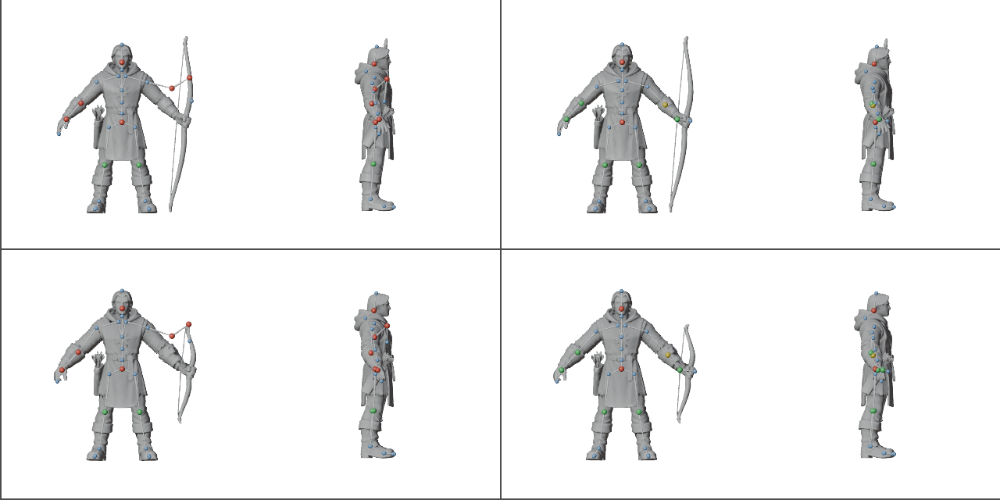
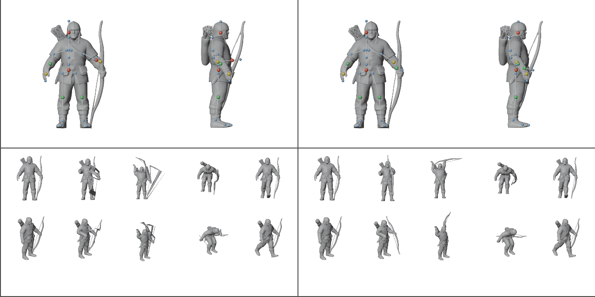
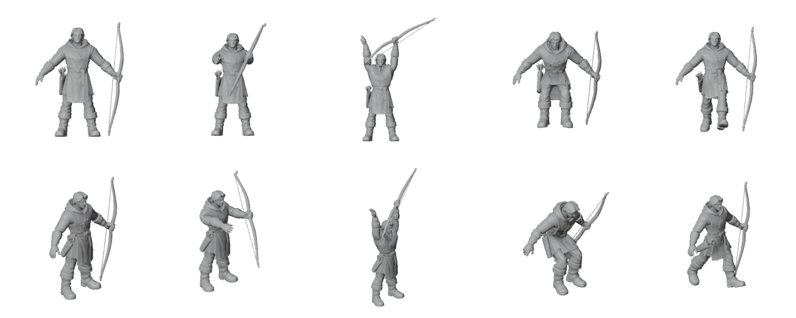
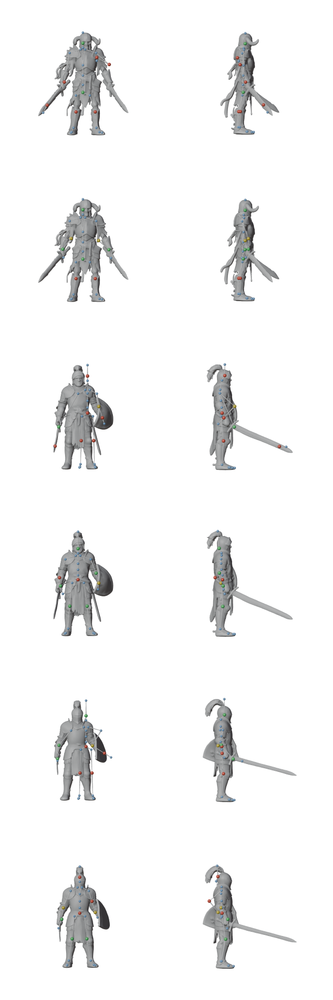
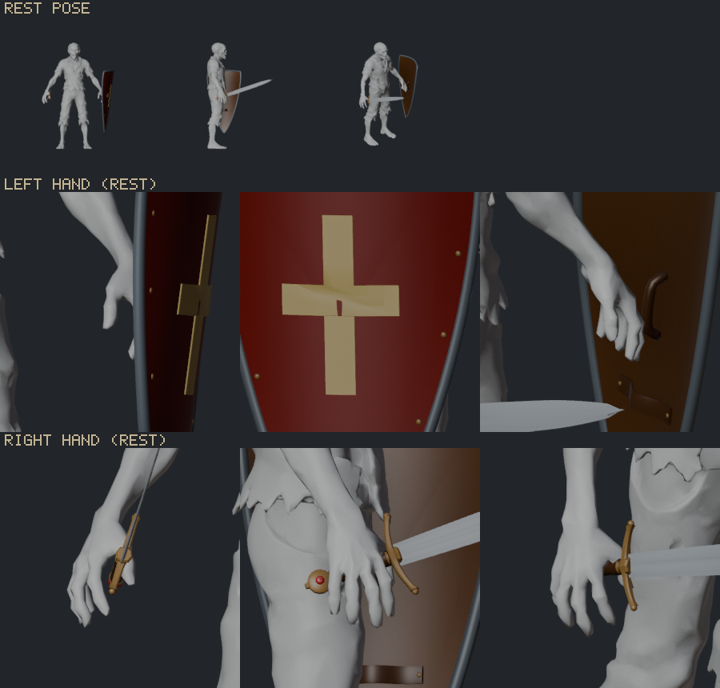
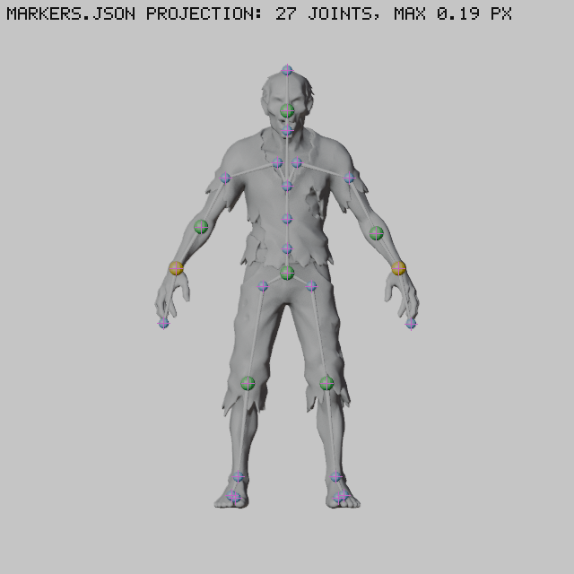
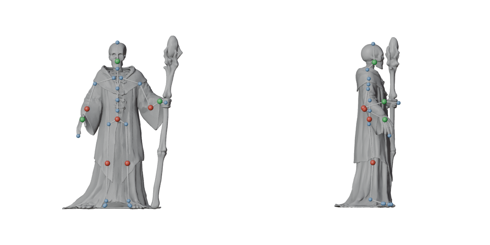
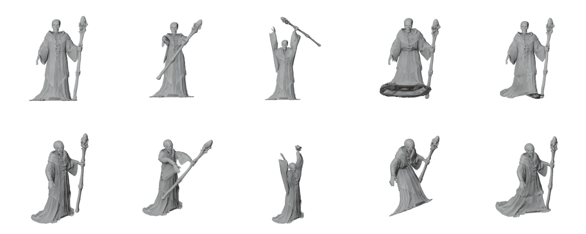
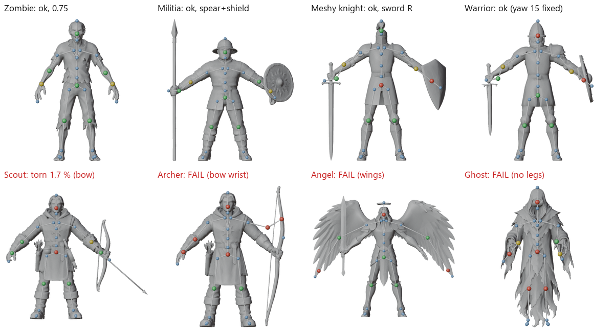
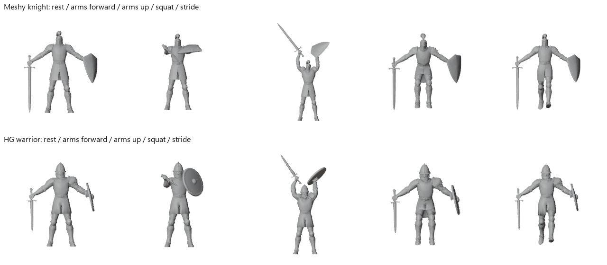

# Модуль humanoid — локальный авториг под Mixamo

Три шага Blender (контракт: `docs/FORGE-CONTRACT.md`, §3–§7):

| Шаг | Что делает |
|---|---|
| `rig_humanoid` | любая человекоподобная сетка → скелет из 25 костей `mixamorig:*` (65 с пальцами), веса, жёсткий реквизит, сокеты, проверки, превью |
| `prepare_mixamo` | FBX для ручной загрузки на mixamo.com (перенос `hg_to_mixamo.py`), по желанию — уже заскиненный FBX, чтобы Mixamo пропустил свой авториг |
| `import_mixamo_rig` | FBX, скачанный с Mixamo (см, `mixamorig:`) → метры/рост, исходные текстуры из GLB, сокеты, клип с именем по контракту §7, `rigged.glb/.blend` |

Код: `scripts/blender/steps/{rig_humanoid,prepare_mixamo,import_mixamo_rig,_humanoid_lib}.py`,
тесты: `scripts/blender/tests/test_humanoid.py`.

## Как работает rig_humanoid

1. **Загрузка и чистка.** Все сетки входа объединяются в одну `Body`; арматуры, Multires/Subsurf и shape keys
   выбрасываются (с предупреждением), остальные модификаторы запекаются.
2. **Куда смотрит.** Широкая ось в поясе плеч — поперечная; знак — по стопам, голове и кистям. Tripo-модели HG
   смотрят в +X — детектор это видит. `params.front` отменяет авто.
3. **Остаточный поворот (yaw).** После поворота на кратный 90° угол меряется наклон поперечной оси: PCA точек
   корпуса в поясе плеч (XY) и линия между стопами (учитывается, только если согласна с плечами — в шаге стопы
   стоят по диагонали). Больше 5° (`max_yaw_deg`) — фигура доворачивается лицом в −Y с предупреждением
   (`fix_yaw: false` — не трогать). Шум на 11 «ровных» ассетах ≤ 2.4°. Нашлось, что в .blend HG воин повёрнут
   на 15.0°, разведчик на −11.6°, послушник на −21.5° — раньше это давало кривые руки.
4. **Нормализация.** Ноги на z = 0, рост по **макушке** (посох выше головы рост не уменьшает), x = 0 — ось
   симметрии головы/корпуса, y = 0 — середина корпуса. Если полный детектор (без щитов и реквизита) находит
   ось не в нуле, тело сдвигается и ориентиры пересчитываются (раньше щит воина уводил Hips на 10 см).
5. **Авто-ориентиры** (`Landmarks`). Поверхность → 200 000 точек; горизонтальные срезы 0.5 % роста; в срезе —
   связные компоненты, соседние срезы связаны. Отсюда:
   - **реквизит**: цепочки тонких компонент с прямой осью, рост на концах (навершие, гарда/рукоять).
     **Прямизна устойчива к упрощению сетки** (`_chain_axis`): одно сечение на срез — самая крупная компонента
     (мелкие обрывки ближе 0.03 H — кончики пальцев у хвата, сечение, разорванное крупными треугольниками, — не
     в счёт), прямая подгоняется с отбрасыванием до 15 % срезов (`PROP_TRIM`); порог rms 0.006 H прежний. Если
     на > 25 % срезов цепочки есть вторая настоящая компонента (плечо лука и тетива, `PROP_SPLIT_MAX`), это не
     одно древко — она проверяется строго, по всем центроидам, как раньше (лучник и разведчик не получают лук
     «посохом»). Причина (дымовой прогон 10.10): после `cleanup` до 40 000 треуг. rms центроидов посоха
     некроманта вырос 0.005 → 0.007, посох терялся, руки «расходились» на 0.231 H и риг не строился.
     **Хват** — масса тела, прилипшая к древку; за концом прямой части (кулак на рукояти над гардой) хват
     засчитывается, только если это низ свободной цепочки руки. **Ни один найденный предмет не остаётся на
     bone heat**: держащая кисть; иначе кисть, если ось проходит ближе 0.08 H от неё; иначе ближайшая кость
     корпуса (Hips/Spine) — с предупреждением. Проверка `props_rigid`;
   - **щиты**: «тарелки» (RANSAC-плоскость, диск) у руки. Плоскость **за спиной или выше плеч** (крылья, плащ)
     щитом не считается. Кисть за щитом ставится за центр щита (предплечье по спинке щита, длина по пропорции);
   - **ноги/пах**: компоненты от пола; слияние ног — пах. Если ноги выше слияния ещё разделены тонкой
     перемычкой, а потом сечение скачком становится полным кольцом — это **подол кафтана/туники**: пах скрыт,
     ставится по пропорции 0.46 H (раньше пах лучника/разведчика попадал на подол, ноги 0.30 H);
   - **шея** — минимум сечения под макушкой;
   - **плечевой сустав (голова Arm) — по самой руке**: высота = верх свободной цепочки руки (подмышка) + сдвиг,
     растущий, чем ближе рука к телу (0.035 H при отведении ≥ 43°, до 0.11 H у висящей руки); по X —
     боковой край дельты на этой высоте минус радиус руки, в пределах 0.09–0.15 H. Калибровка: риг зомби HG
     (`mixamo_rigged.fbx`), суставы Human Base Mesh, авториг Mixamo для лучника HG, манекен. Если рука скрыта
     (рукав, посох), — пропорция под шеей; плечо, измеренное на одной стороне, зеркалится на другую;
   - **локоть** — излом осевой линии руки, ищется только там, где плечо:предплечье ≈ 0.8–1.5 (раструб
     рукавицы у запястья больше не становится локтем); T-поза — срезы вдоль X;
   - **колени/голеностопы/стопы** — по трекам ног.
6. **Грубые ошибки ориентиров останавливают шаг** (`ok:false`, `rigged.glb` нет, `markers.json/png` есть,
   уверенность ≤ 0.25): плечо:предплечье вне 0.6–2.0, предплечье < 0.09 H, нога < 0.33 H, зеркальные
   ForeArm/Hand дальше 0.10 H друг от друга, если ни одна кисть не держит найденный предмет/лук/щит
   (проверки `landmark_proportions`, `arm_symmetry`); а также нет опоры (призрак) и не человеческие пропорции.
7. **Скелет**, симметричные плечи и тазобедренные суставы.
8. **Веса**: bone heat на сваренной/прореженной копии (откаты ½, ¼, воксельный ремеш), Data Transfer на полную
   сетку, гашение рук вне «трубы», рука/нога не вместе, роба (Hips + бёдра с плавным переходом), жёсткий
   реквизит 100 % на кость (вершины внутри капсулы древка добираются, даже если на длинных треугольниках
   клинка нет выборки — иначе кончик меча оставался на полу полосой), не больше 4 влияний.
9. **Сокеты** §6 (9 штук, со щитовыми), проверки, превью, экспорт.

### Веса на разрезанной одежде и мелких островах (10.10, вечер)

Найдено при пересборке некроманта (v2, `docs/forge/necromancer.md`). Всё работает по умолчанию, пороги
QA не менялись.

1. **Мелкие острова не попадают в тепловую карту.** Кисть bone_kit (27 отдельных костей), застёжки,
   бусины, сферы глаз — куски меньше `island_max_frac` (1 %) вершин. Решатель Blender отказывал на
   **всей** сетке (100 % вершин без весов на всех запасных прокси). Такие куски убираются из прокси,
   куски ближе 0,006 H друг к другу объединяются в кластер (кисть — один кластер). После переноса
   весов каждый кластер жёстко садится на кость, ближайшую к его центру: кисть на `Hand`, застёжка на
   `Spine*`, глаз на `Head`. Отчёт: `stats.skin.small_islands`.
2. **Ремонт прокси.** Рёбра с тремя и больше гранями и вырожденные грани (сварка слоёв ткани ИИ, концы
   разрезов) тоже обрушивали решатель. `repair_for_heat` удаляет грани вокруг таких рёбер (до 3 проходов),
   растворяет вырожденные и одиночные вершины. Прокси нужен только для переноса весов. Отчёт:
   `attempts[].repair`.
3. **Чистка весов с учётом поверхности** (`surface_aware`, по умолчанию true). Рукав, отрезанный от робы
   (`separate` `slit`), висит рядом с бедром, но связан с ним по поверхности только через плечо.
   `limb_surface_distances` считает геодезические расстояния (Дейкстра по сваренному графу вершин) до
   каждой руки, торса и ног. Затравки — вершины, явно принадлежащие цепи: ближе 0,6 × расстояния до
   любой другой цепи и не дальше 0,15 H. Подрезка рук трубой сохраняет вес руки, если вершина по поверхности
   ближе к руке, чем к торсу, на `surface_margin_h` (0,05 H): это колокольный рукав. Вес руки
   срезается, если вершина по поверхности заметно ближе к торсу: бок робы у скрытой руки. Разделение
   рука/нога сравнивает геодезические расстояния вместо прямых. Для сросшихся сеток пути по поверхности
   короткие, и всё работает как раньше.
4. **Подавление утечки руки в торс** (`arm_bleed`, [0,10; 0,35]). Остаточный вес руки `a` на вершинах, где
   вес торса больше, умножается на `smoothstep(0,10; 0,35; a)`. Плечевой переход (a > 0,35) не трогается,
   рампа непрерывна, снятый вес уходит костям торса при нормализации.

Влияние на некроманта, «руки вперёд / вверх / присед / шаг», %:

| вход | v1 | без п. 1–4 | с п. 1–4 |
|---|---|---|---|
| сросшиеся рукава (v1) | 14,3 / 19,7 / 0,90 / 1,21 | — | — |
| рукава разрезаны, крышки ngon, подол открыт | — | 14,3 / 19,9 / 0,66 / 0,83 | 1,64 / 5,3 / 0,22 / 0,73 |
| то же, крышки полосой по высоте (финал v2) | — | — | **0,88 / 5,4 / 0,21 / 0,74** |

На наборе ассетов HG проверено, что регресса нет, см. таблицу «Без регресса после чистки весов».

### Сокеты из входа, `grip_dirs` (10.10, вечер)

- **Сокеты входа сохраняются** (`keep_input_sockets`, по умолчанию true). Пустышки `socket_*` / с
  `game_socket` записываются до чистки (`load_body`) и проходят ту же матрицу вход → рамка рига, что и
  тело (`prep["matrix"]`, с повторной центровкой). Сокет с именем, которое риг строит сам (кисти, бёдра,
  спина, голова, грудь), берёт рамку и extras из входа вместо пересчёта: у кисти bone_kit, поставленной
  `place_parts`, это ось её хвата. Остальные становятся детьми кости, чей вес преобладает у 8 ближайших
  вершин: `socket_fx_eye_l/r` → `Head`. `params.socket_bones {имя: кость}` переопределяет выбор,
  `replace_sockets [имена]` строит сокет заново. Отчёт: `stats.input_sockets`, `stats.sockets_from_input`,
  `hand_socket_frame.*.source = "input"`.
- **`grip_dirs`**: `{"l"|"r": [x, y, z] | "up" | "down" | "forward" | "back" | "out" | "in"}` в рамке рига.
  +Z перестраиваемого `socket_mount_hand_<side>` идёт ровно по этому направлению. Используется та же
  `_items_lib.hand_socket_frame` (`grip_dir`), реализация одна. Предмет, который потом меняют
  совмещением `socket_grip_main`, смотрит в нужную сторону: посох, который держат вертикально, — `"up"`.
- Тесты: `test_input_sockets_survive_rig_and_grip_dirs`, `test_small_islands_kept_out_of_bone_heat_and_bound_rigidly`,
  `test_repair_for_heat_drops_nonmanifold_faces`, `test_real_necromancer_v2_tear_gate`.

### Луки и изогнутый реквизит в руке (11.10)

Лук (и изогнутый клинок), который держат одной рукой, раньше ломал риг: плечо лука становилось
продолжением руки, запястье ставилось на плечо лука, и риг получал отказ по асимметрии рук (лучник HG —
0,26 H, разведчик HG — 0,28 H). Теперь его находит `Landmarks.find_bows` (сразу после туловища, до щитов —
лук больше не может стать «тарелкой» и утянуть рукав):

1. **Кандидаты** — тонкие компоненты горизонтальных срезов (сечение < `BOW_THIN` 0,042 H) **сбоку от тела**:
   центр дальше 0,12 H от оси, ни одна точка не ближе 0,10 H; **не за спиной** (колчан на спине, плащ):
   центр впереди задней поверхности туловища (ниже профиля туловища — впереди Y0 + 0,05 H).
2. Кандидаты связываются по соседним срезам в цепочки (кисть на рукояти рвёт лук на верхнее и нижнее
   плечо). На каждой стороне цепочки, не лежащие в одной плоскости с остальными, отбрасываются по одной.
3. **Это изогнутый предмет**, если: вертикальный размах ≥ 0,35 H, плоскость почти вертикальна
   (|n·Z| < 0,5) и держит центры (rms ≤ 0,012 H), и он изогнут — прямая через главные сечения уровней даёт
   rms > 0,008 H **или** на ≥ 30 % уровней рядом с плечом идёт тетива.
4. **Его держат**: кулак — плотнейший отрезок 0,08 H вдоль дуги, где к ней прилипла масса тела ниже плеча
   (дуга, проходящая мимо плеча, хватом не считается), выше колен, в стороне от туловища; ≥ 25 точек
   выборки и в пределах досягаемости плеча (≤ 0,42 H). Иначе (лук стоит рядом, как у капитана лучников)
   ничего не меняется.
5. Точки лука уходят из ориентиров (рука ищется по руке), кисть получает хват «как на посохе» вдоль хорды
   лука; лук целиком жёстко на кость этой кисти (`rigid_bow_<кисть>`, `props_rigid`); +Z сокета кисти идёт
   вверх по рукояти (`bow_riser_up`; у изогнутого клинка, взятого за конец, — к дальнему концу); проверка
   симметрии рук знает, что эта рука держит предмет. Пороги симметрии не менялись.

`markers.json` → `bows` (вид, рука, концы, длина, прогиб, плоскость, хват), `detector.bows` (почему
кандидат принят или нет), `stats.bows`, `stats.rigid` (`kind: "bow"`).

| ассет | было | стало |
|---|---|---|
| лучник HG (`archer/model.glb`) | отказ: запястье на плече лука, симметрия 0,260 H | ok, симметрия 0,017 H; лук 1,82 м, прогиб 12 см → LeftHand (527 верш.); порвано 0,01 / 0,64 / 0,07 / 0 % |
| разведчик HG (`scout.blend`, Body) | отказ: симметрия 0,277 H (в 10.10 — лук как «тарелка», рукав рвался 1,7 %) | ok, симметрия 0,032 H; лук 1,05 м → LeftHand (324 верш.), тарелок 0; порвано 0 / 0,75 / 0,03 / 0 % |
| генерация «Archer holding tall longbow» | симметрия 0,139 H, лук на весах тепла: порвано 19,2 / 35,4 / 13,3 / 0,06 % | симметрия 0,090 H, верхнее плечо — лук, нижнее (прижато к ноге) — прямой предмет, оба жёстко на LeftHand: 0,15 / 3,5 / **1,30** / 0,09 % — риг не принят только из-за приседа (нижнее плечо срослось со стопой) |
| генерация «Archer captain holding grand bow» | ошибка разрывов | без изменений: лук стоит рядом (так на концепте), кулак вне досягаемости — не берётся |
| генерация «Arcane archer», «Huntsman» | отказ по руке | без изменений: лук горизонтально (выстрел) — не вертикальная плоскость, за пределами `find_bows` |
| генерация «Inquisitor» (арбалет в правой руке) | — | арбалет `find_bows` не берёт (короткий, 0,13 H); его ложе с дугой ловит `find_plates` как жёсткую «тарелку» правой кисти, ориентиры в порядке; риг не принят из-за разрывов плаща |





Тесты: `test_bow_held_beside_body_rigid_quiver_ignored` (манекен с луком 1,3 м и колчаном на спине; мутация:
без `find_bows` — отказ по асимметрии), `test_real_archer_bow_rigid_to_left_hand`,
`test_real_scout_short_bow_rigid_to_left_hand` (вместо прежнего `test_real_archer_bow_fails`).

### Мечи, булавы и древки под углом (11.10, ночь: `find_blades`)

На пакете концептов «Врат» (11.10) мечники не проходили авториг: меч, который держат вперёд, по диагонали или
вниз-в-сторону, пересекает горизонтальные и вертикальные срезы `find_props` наискосок, там он шире их порога
(0,045 H по Z, 0,032 H по X/Y) и становится частью руки — «рука» 0,6–0,95 H, отказ. Теперь:

1. **Диагональные срезы.** `find_props` дополнительно режет облако поперёк 11 направлений (`OBLIQUE_DIRS`:
   6 диагоналей граней, 4 диагонали куба — любая линия не дальше ~27° от одной из них — и ось вперёд −Y для
   булавы/меча, вытянутых прямо вперёд; ось X не берётся — это руки в T-позе). Тонкая компонента среза:
   сечение < 0,055 H или плоское (< 0,08 × < 0,03 H — двуручник шириной 0,06 H). Прямые цепочки
   (`_chain_axis`, rms ≤ 0,006 H) не дальше 37° от нормали среза — кандидаты. Кандидат, совпадающий с уже
   найденным предметом, отбрасывается: поведение прежних осей не меняется.
2. **Это предмет в руке** (`Landmarks.find_blades`, после туловища, до луков и щитов), если: длина ≥ 0,25 H
   (цепочка сначала добирается вдоль своей оси, пока точки лежат на оси и их ничего не окружает — дол клинка или
   обрывок у гарды рвали её); не за спиной; на ней сидит **кулак** — плотнейший отрезок 0,08 H массы тела у оси
   (≥ 30 точек), выше 0,28 H, в досягаемости плеча (≤ 0,47 H) и либо на свободной цепочке руки, либо в стороне
   от ядра туловища/перед ним (рука, прижатая к плащу, сливается с ним в срезах); дальний от кулака конец —
   **свободное остриё** (за ним 0,03–0,09 H пусто) или **навершие** (компактный ком ≤ 0,16 H в 0,2 H за
   концом, не у пола, весь вне досягаемости руки: шар булавы, топор, навершие знамени — входит в предмет),
   не ближе 0,2 H от кулака и **дальше, чем достаёт голая рука** (0,45 H от плеча: плечо + предплечье +
   кисть). Предплечье, слившееся с клинком в одну прямую через кулак, отрезается: часть по ту сторону кулака,
   которая не доходит до плеча или заметно толще клинка, — рука.
3. Точки предмета уходят из ориентиров (запястье на кулаке, а не на острие), хват — у кулака (`end` у рукояти,
   `shaft` в середине древка), предмет целиком жёстко на кость кисти (`props_rigid`), +Z сокета кисти — к
   дальнему концу (`prop_grip_dir`), симметрия рук знает про предмет. `markers.json` → `props[].oblique`,
   `detector.blades` (почему кандидат принят или нет: длина, кулак, остриё, досягаемость).

Попутно найдено на тех же генерациях и исправлено:
- **Ось тела после щита.** Большой щит у туловища тянул медиану пояса и ось тела на 0,09–0,1 H (позвоночник
  шёл по краю щита, голова сбоку). Если после щита/лука/клинка ось без них сдвигается на ≥ 0,03 H, она
  пересчитывается (мелкие сдвиги не трогаются — они качались между проходами центровки); центровка
  `run_landmarks` — до трёх проходов.
- **Поворот по Z.** Слабая ось плеч (PCA < 1,6), которой противоречат стопы (> 20°), больше не «исправляется»:
  башенный щит давал воину 38,7° при стопах −1,5°.
- **«Тарелки», которые не щиты.** Плоская пола плаща/табарда во фронтальной плоскости сбоку от тела
  (|n·Y| > 0,8, не перед туловищем) и пластина дальше 0,15 H от предплечья/кисти своей стороны щитом не
  считаются (жёсткая на кисть, она рвалась у плеча на каждом клипе: костяной мечник — 12–21 % площади).
  Исключение — знамя на древке: пластина у верхней половины вертикального предмета жёстко на кисть, которая
  держит древко (капеллан — как раньше).
- **Минимум ноги 0,31 H** (было 0,33): коренастые латные генерации меряют 0,325–0,33 H; ошибка «пах на
  подоле» даёт ~0,30 H и по-прежнему ловится.
- `params.deform_gate` (`error` | `warning`): в пакете `forge-concepts --qa clips` проверка позами — только
  отчёт, решают настоящие клипы (`motion_style`, см. motion_style.md).

Пакет 11.10, `rig_humanoid` по умолчанию на сетках после `cleanup` 40 000 (было — код HEAD, стало — этот;
порвано в проверке позами, %: руки вперёд / вверх / присед / шаг):

| персонаж | было | стало |
|---|---|---|
| Bone swordsman (два меча вниз-в-стороны) | отказ: правая «рука» 0,62 H | ok по ориентирам; мечи 0,69 / 0,70 м → RightHand / LeftHand; 2,77 / 7,30 / 0,56 / 0,19 |
| Knight #2 (меч вперёд-вниз, щит) | отказ: «рука» 0,86 H; ось тела на щите | меч 1,12 м → RightHand, щит → LeftHand; 27,1 / 36,2 / 13,6 / 3,4 (плащ) |
| Knight #3 | отказ: «рука» 0,64 H | меч 0,93 м → RightHand; 2,47 / 5,05 / 0,03 / 0,01 |
| Knight #4 | отказ: «рука» 0,86 H | меч 1,23 м → RightHand; 27,1 / 26,0 / 13,3 / 3,0 (плащ) |
| Knight #5 | риг строился, но меч был частью руки, ось на щите (0,1 H); 17,7 / 25,9 / 8,5 / 5,8 | меч 1,11 м → RightHand, ось по голове; **2,50 / 5,92 / 0,11 / 0,08** |
| Forest warden (меч и копьё) | отказ: «рука» 0,88 H | меч 1,35 м → RightHand, копьё 1,48 м и клинок 0,80 м → LeftHand; 28,4 / 30,8 / 11,2 / 2,9 |
| Healing monk (булава вперёд) | ok, булава на весах тепла (гнулась); 0,56 / 1,68 / 0,73 / 0,15 | булава 1,20 м с шаром → RightHand; **5,13 / 11,8 / 2,87 / 0,65** — хуже: кулак слит с робой, жёсткая булава тянет её лист |
| Knight #1 | отказ | отказ: плащ, развевающийся вбок, ломает определение лица (front +X вместо −Y); и с `front: -Y, fix_yaw: false` плащ принимается за левую руку |
| Armored warrior (башенный щит до пола) | отказ: «рука» 0,93 H, поворот 38,7° | поворот больше не ломается, меч найден; отказ: башенный щит стоит на полу и считается ногой — ось тела на щите, плечи 0,66 H |
| Necromancer warrior (двуручник прямо вперёд) | отказ: «рука» 0,97 H | отказ: лицо определено задом наперёд (+Y: плащ сзади перетягивает голову/кисти); с `front: -Y` меч находится (1,3 м → RightHand), но ноги 0,30 H < 0,31 |
| Huntsman, Arcane archer (лук горизонтально/по диагонали) | отказ / лук на весах | без изменений: изогнутый предмет не в вертикальной плоскости `find_bows` не берёт |

Без регресса: прежние ассеты (зомби, ополченец, рыцарь Meshy, Meshy `58d6`, воин, разведчик, послушник,
лучник HG, некромант 120 тыс., некромант v2) — тот же ok/отказ, те же реквизит и щиты, суставы на месте до
0,0 см, кроме ополченца (0,39 см, плечо; руки вверх 0,46 → 0,34 %).



Тесты: `test_oblique_sword_held_forward_rigid_to_hand` (манекен с плоским клинком 8 см вперёд-вниз-в-сторону;
мутация: без `find_blades` клинок не предмет и запястье уходит от кулака; на манекене без меча ни одного
клинка), `test_real_batch_swordsmen_blades_rigid` (костяной мечник и рыцарь #3 из пакета, если сетки на диске).

### Предметы вырезаны до рига, жёсткие латы (12.10)

С пакета 12.10 у генераций предметы вырезаются шагом `extract_props` (docs/forge/extract_props.md) до рига: риг
получает тело без меча, щита и знамени и **сокеты мест** `socket_prop_<рука>_<n>` (extras `imaginarium_bone`, `imaginarium_hand`,
`imaginarium_item_kind`, `imaginarium_grip_mode`). Что меняется в `rig_humanoid`:

1. **Сокет места — ребёнок своей кости.** `imaginarium_bone` из extras важнее выбора по весам (`params.socket_bones` важнее
   его). `attach_prop` потом переносит на него сокет кисти или щита.
2. **Кисть решается на хвате вырезанного предмета** (`use_placement_grips`, по умолчанию true): сокеты мест
   оружия, посоха, лука, знамени дают `Landmarks` «известный хват» (`params.known_grips_in` → в рамке рига на
   каждом проходе центровки), и рука идёт в режиме `grip`, как будто предмет на месте. Без этого кулак, поднятый
   вперёд пустым, трассировался в книгу на поясе (маг: уверенность 0,33 → риг не строился) или в подол.
   Щит — только запасной вариант: если без него ориентиры не сошлись, проход повторяется с хватом щита
   (`stats.shield_grip_retry`); на рыцаре №3 хват щита сразу ухудшал позы (0,12 → 3,7 % в «руки вперёд»).
3. **Держащая рука** (`held_hands` из сокетов) не ошибка симметрии рук: поза руки, державшей меч, остаётся
   «держащей».
4. **`front_prior`** (пакет: −Y): ответ определения лица «спиной» (+Y) или неуверенный (< 0,3) уступает
   априорному — генерации по фронтальным концептам смотрят в камеру (`stats.facing.overridden`).
5. **Плечи против «твёрдой» макушки.** Корона, нимб из шипов, гребень или рога над головой входят в макушку, и
   плечи выходили ниже 0,70 H (крестоносец: 0,67–0,69 → «не гуманоид»). Если плечи вне 0,70–0,88, они меряются
   ещё и от верхнего среза, где ширина головы ≥ 0,045 H (`info.solid_head_top`); масштаб не меняется.
6. **`arm_clamp_h`** (пакет после `extract_props`: 0,47, по умолчанию выкл.): цепочка руки, ушедшая за кисть
   в плащ, подол или слитый предмет, длиннее — запястье ставится на типичную длину руки в её направлении,
   уверенность 0,3, предупреждение. Это догадка вместо отказа: капитан ордена с булавой у пояса — «рука 0,54 H».
7. **Короткое оружие с навершием** (`short_headed_min_len`, `belt_items` — их включает только `extract_props`):
   булава или топор с древком 0,17–0,25 H с навершием за пределом руки — тоже предмет; если «кулак» на нём —
   это бедро, предмет висит на поясе и привязывается к `Hips`.

**Жёсткие латы** (`hard_surface`: `auto` | `on` | `off`; `build` из `roles.json`). Маска металла — по карте цвета
`paint_from_concept`: низкая насыщенность (< 0,28) при значении 0,22–0,97 (сталь, серебро — и кость скелета). `auto`
включается у `armored` / `heavy` или если металл > 35 % площади (`robed` / `light` — > 50 %). Пластина — связная
область металла (сваренный граф вершин), где доминирует одна кость из `HARD_BONES` (голова, Spine…Spine2, Hips, плечо,
предплечье, кисть, бедро, голень, стопа) с весом ≥ 0,78: каждая пластина ≥ 30 вершин целиком на эту кость. Стыки
(металл до 8 колец от пластин) релаксируются гармонически при закреплённых пластинах — без скачка веса на краю;
ткань, кожа и остальное — прежние плавные веса; жёсткий реквизит не трогается. Отчёт `stats.hard_surface`: доля
металла, пластины по костям, доля жёсткой площади, и проверка позами **дважды** — с мягкими весами
(`pose_test_soft`) и с латами (`pose_test_hard`): порвано, растянуто (> 1,8×) и **«резина» пластин** — доля площади
жёстких пластин, чьи треугольники изменились больше чем на 25 %.

Пилот 12.10 на настоящих клипах персонажа (motion_style, худший кадр клипа; idle / walk / attack|cast / hit /
death). «Мягко» — тот же риг с `hard_surface: off` (`C:\Imaginarium\incoming\pilot4\soft\`), «латы» — пакет.

| Персонаж | Пластин, жёсткой площади | Порвано в клипах, %: мягко → латы | «Резина» пластин в клипах, %: мягко → латы |
|---|---|---|---|
| Рыцарь №3 | 14, 18 % | 0,26 / 0,20 / 1,47 / 0,23 / 0,17 → 0,47 / 0,39 / 1,96 / 0,41 / 0,47 | 2,9 / 6,4 / 6,6 / 3,2 / 8,9 → 0 |
| Костяной мечник | 16, 21 % | 2,08 / 8,11 / 6,04 / 3,89 / 5,92 → 2,12 / 8,16 / 5,87 / 3,97 / 6,13 | 5,2 / 7,8 / 7,4 / 8,0 / 10,4 → 0,12 |
| Лучник | 16, 25 % | 5,49 / 3,93 / 2,18 / 5,34 / 1,72 → 4,26 / 2,49 / 1,67 / 4,65 / 1,30 | 8,2 / 6,5 / 10,0 / 9,1 / 3,7 → 0,15–0,26 |
| Крестоносец | 9, 7 % | 17,8 / 28,7 / 37,7 / 28,8 / 32,8 → 16,6 / 26,2 / 35,3 / 26,8 / 29,8 | 23,0 / 18,8 / 26,7 / 22,1 / 27,9 → 0–0,26 |
| Капитан ордена | 16, 12 % | 17,7 / 19,5 / 27,7 / 35,1 / 33,4 → 17,9 / 19,6 / 27,9 / 35,8 / 34,0 | 2,0 / 3,9 / 5,1 / 5,9 / 6,0 → 0 |
| Маг | выкл. (`robed`, металл 40 %) | — | — |

Позы (руки вперёд / вверх / присед / шаг), порвано: рыцарь №3 0,12 / 3,27 / 0,03 / 0,03 → 0,23 / 3,67 / 0,19 /
0,07, «резина» 2,9–3,3 → 0; костяной 3,69 / 8,46 / 0,57 / 0,22 → 3,20 / 8,07 / 0,67 / 0,22, «резина» до 4,5 → 0.

Вывод честно: **латы больше не тянутся** — «резина» пластин с 2–28 % площади до ≤ 0,26 % во всех клипах. Общая
доля порванного почти не меняется: у лучника и крестоносца падает (−0,4…−3 п.), у рыцаря №3 и капитана растёт на
0,2–0,6 п. — напряжение уходит из пластины в стык (полоса релаксации), и стык тянется сильнее. Большие проценты
крестоносца и капитана — не латы, а плащ, подол и ноги под ним (robe 25 %, «бёдра»): это задача ткани, а не
жёсткости.

### Оси костей (roll)

Локальная **+Y** — от головы кости к хвосту. **+Z** — вперёд персонажа (−Y) для позвоночника, шеи, головы,
ключиц, рук, кистей и ног (`GLOBAL_NEG_Y`); у `Foot/ToeBase/Toe_End` **+Z вверх**. Это соглашение рига зомби HG.
У родного скелета Mixamo руки повёрнуты иначе (X назад) — перенос клипов по алгоритму `hg_retarget.py`
(мировые приращения + поправка покоя). `import_mixamo_rig` roll Mixamo не меняет.

### Сокеты и хват

Все 9 человеческих сокетов §6: `socket_mount_hand_r/l` и `socket_mount_shield_r/l` (кость кисти),
`socket_mount_back`, `socket_mount_hip_l/r`, `socket_fx_head`, `socket_fx_chest`; extras `game_socket`, `kind`.
Тот же набор ставит `import_mixamo_rig` (общий `add_human_sockets`).

**Рамка кисти — одна на всю кузницу**: `_items_lib.hand_socket_frame`, та же функция, которой `attach_prop` строит
сокет, если у рига его нет. Центр — на стороне ладони от оси кисти, 0,42 длины кисти от запястья (толщина ладони
+ 1,5 см), **+Z** — сторона большого пальца = «вперёд» персонажа, перпендикулярно оси кисти (roll кости не важен),
**−Y** — вдоль костяшек, X = Y × Z. `attach_prop` такие сокеты берёт как есть. Проверено на зомби HG
(`test_real_zombie_hand_socket_is_attach_prop_frame`): сокеты рига и рамка, которую посчитал бы `attach_prop`,
совпадают до 1e-4 и в `rigged.blend`, и после glTF (`rigged.glb`); на мужской базовой сетке и правой кисти
некроманта — тоже 0,0 см / 0,0°. Меч набора на этом риге (`test_real_zombie_rig_takes_kit_sword_and_shield_without_refit`):
`attach_prop` сокет не создаёт, хват в 0,8 см от поверхности кисти и внутри её габарита, остриё ровно на оси +Z
(косинус > 0,995), без пересечений с рукой и телом в покое.

Для кисти с найденным предметом `rig_humanoid` передаёт в ту же функцию `grip_dir` (+Z задаётся прямо по предмету,
не зависит от roll) и маску вершин предмета (`exclude`: они не входят в длину кисти и толщину ладони):
- хват в крайних 35 % предмета короче 0.75 H (меч, топор, булава за рукоять) — **к дальнему концу**: у меча
  клинком вниз +Z смотрит вниз (воин, рыцарь);
- посох, копьё (хват в середине или длинное древко) — вверх по древку; горизонтальное — к длинной части.

`stats.grip_socket_vs_prop_axis_deg` меряет угол +Z сокета к геометрии (хват → дальний конец или ось вверх),
а не к той же подсказке; `stats.grip_socket_rule` — правило и векторы; `stats.hand_socket_frame` — источник +Z
(`character_forward` / `grip_dir`), число вершин кисти и исключённых вершин предмета. У таких кистей сокет рига
отличается от того, что `attach_prop` угадал бы с нуля по «вшитому» предмету (рыцарь: 13 см / 2,7°, воин с щитом
в левой: 128°, посох некроманта: 180° — эвристика `attach_prop` «длинная часть вперёд» направила бы +Z вниз по
посоху), но `attach_prop` сокет рига не пересчитывает. Начало сокета у кисти с предметом лежит в 3,4–9,1 см от оси
предмета (ополченец 3,4, рыцарь 3,8, воин 5,7, некромант 9,1): новое оружие встанет рядом с вшитым, а не точно на его
место.

**Щитовые сокеты** `socket_mount_shield_r/l` (`shield_mounts: true`) — подбор `attach_prop` по каноническому щиту
(§6: +Z вверх, −Y лицо, хват за ручку в центре тыльной стороны) **по позе покоя**: `_items_lib.rest_shield_mounts`
→ `fit_shield_mount`, одна реализация на оба шага. Сокет — ребёнок кости кисти, рамка = сокет кисти × подобранный
поворот и отступ (матрица в extras `socket_space_matrix` и `shield_mount_matrix` сокета кисти, в
`stats.shield_mounts`). `attach_prop` берёт его без изменений; на зомби мировые матрицы щита из сокета рига и из
сокета, который `attach_prop` строит сам с `fit: rest`, совпадают до 1e-4. Дёшево и устойчиво на всех проверенных
ассетах:

| ассет | время подбора, с | отступ L / R, см | канонический щит в покое: верх·Z / лицо·наружу (L; R) |
|---|---|---|---|
| зомби (1,7 м) | 0,12 | 11,3 / 11,3 | 0,991 / 0,991; 0,995 / 0,994 |
| ополченец (щит в левой) | 0,13 | 13,9 / 10,4 | 0,991 / 0,998; 0,997 / 0,998 |
| рыцарь Meshy (щит в левой) | 0,16 | 12,0 / 9,0 | 0,998 / 0,998; 0,997 / 0,998 |
| воин HG | 0,11 | 8,0 / 10,0 | 0,996 / 0,998; 0,996 / 0,993 |
| мужская базовая сетка | 0,13 | 9,0 / 9,0 | 0,996 / 0,995; 0,997 / 0,998 |
| некромант (120 тыс. треуг.) | 0,67 | 12,5 / 9,4 | 0,999 / 0,996; 0,996 / 0,996 |

Если подбор упал, риг остаётся годным без щитовых сокетов (предупреждение `shield mounts not built`).
Настоящий каплевидный щит набора на зомби в покое касается 2 треугольников раскрытой кисти (он толще
канонического) — у `attach_prop` это предупреждение `hand_through_board_rest`.

**Проекция для редактора маркеров.** `markers.json` несёт блок `projection` (его читает
`src/forge/forge-core.js` → `markerProjection`): `image {width, height}` — весь `markers.png` (1280 × 640),
`center [x, z]` — метры в центре переднего тайла, `meters_per_px`, `center_px [u, v]` — эта точка в пикселях PNG
(начало — левый верхний угол, u вправо, v вниз), `front_tile`, формула. Числа берутся из того же габарита и
`margin` 1,08, которыми `ima.render_views` кадрирует передний тайл. Проверка
(`test_real_zombie_markers_projection_matches_png`): каждый из 27 суставов зомби, спроецированный блоком, против
центра своего шарика в контрольных рендерах той же сцены (видна только группа далеко разнесённых шариков, кадр тот
же, центр — по альфе): **максимум 0,19 px, среднее 0,16 px** (порог 2 px).




## Параметры

**rig_humanoid** — `inputs.mesh` (glb/gltf/fbx/obj/stl/blend; для .blend `params.objects`) или `inputs.blend`.

| Параметр | По умолчанию | |
|---|---|---|
| `height_m` / `height_ref` | 1.8 / `head` | рост по макушке или `bbox` |
| `front` | `auto` | `-Y` `+Y` `+X` `-X` |
| `fix_yaw` / `max_yaw_deg` | true / 5 | доворот наклонённого входа |
| `markers` | — | `chin, groin, l/r_wrist, l/r_elbow, l/r_knee` как `[x, z]` или `[x, y, z]` (м, после нормализации); `joints: {Bone: [x,y,z]}` |
| `rigid` | — | правила hg_premixamo (`axis`+`r` или коробка, `merge`) |
| `auto_rigid` | true | предметы и щиты жёстко на кость |
| `robe` / `robe_feet` | `auto` / false | |
| `max_influences` / `proxy_tris` | 4 / 60000 | |
| `fingers` | false | 3+1 кости на палец, если пальцы разделимы |
| `sockets` / `deform_test` / `intersections` | true | |
| `deform_gate` | `error` | `warning` — проверка позами только в отчёте (пакет `--qa clips`: решают настоящие клипы в `motion_style`) |
| `shield_mounts` | true | `socket_mount_shield_l/r` подбором по позе покоя |
| `grip_dirs` | — | `{"l"|"r": [x,y,z] | up/down/forward/back/out/in}`: +Z сокета кисти по направлению |
| `keep_input_sockets` / `socket_bones` / `replace_sockets` | true / — / — | сокеты входа (см. «Сокеты из входа») |
| `island_max_frac` | 0.01 | мелкие острова вне тепловой карты, жёстко на ближайшую кость |
| `surface_aware` / `surface_margin_h` | true / 0.05 | чистка весов рук по геодезическим расстояниям |
| `arm_bleed` | [0.10, 0.35] | подавление остаточного веса руки на торсе; null — выкл. |
| `min_confidence` | 0.35 | |
| `front_prior` | — | `-Y` у генераций: ответ «спиной» или неуверенный уступает ему |
| `use_placement_grips` | true | кисть на хвате вырезанного предмета (сокеты `socket_prop_*`) |
| `hard_surface` / `build` | auto / — | жёсткие латы по металлической покраске |
| `arm_clamp_h` | — | цепочка руки длиннее — запястье на типичной длине (пакет: 0.47) |

Выходы: `rigged.glb`, `rigged.blend`, `markers.json` (формат `params.markers` + все суставы, уверенности,
`props` с `bound_to`/`bind_mode`, `plates`, `arm_symmetry`, `yaw`, `gross_failures`, `fail`, `projection` — пиксели
переднего тайла `markers.png`; пишется и при отказе), `markers.png`,
`poses.png` (покой + 4 позы, спереди и ¾).

**prepare_mixamo** — `inputs.mesh`, `inputs.rigged`. `lite` (≤ 12 000 треуг., 256 px), `tris`/`tex`, `weld`,
`center`, `prerigged`, `rig_params`, `force_prerigged` (false). Заскиненный FBX пишется, **только если свой риг
прошёл проверки**; иначе ошибка `prerigged_rig_ok` и предупреждение (обычный FBX для загрузки пишется всегда).

**import_mixamo_rig** — `inputs.fbx` («With Skin»). `height_m`, `texture_source`, `retex`, `keep_animation`,
`sockets`, **`clip`** (по умолчанию имя файла) и **`loop`** (`auto`: idle/walk/run/loop/breath в имени). Action
Mixamo `Armature|mixamo.com|Layer0` переименовывается в `<clip>` или `<clip>-loop` (контракт §7).

## Запуск

```
"C:/Program Files/Blender Foundation/Blender 5.0/blender.exe" -b --factory-startup ^
  --python scripts/blender/imaginarium_run.py -- rig_humanoid request.json
```
```json
{"step": "rig_humanoid", "inputs": {"mesh": "C:/.../Corrected-necromancer.glb"},
 "params": {"height_m": 1.8}, "out_dir": "C:/.../out"}
```
Тесты: `blender -b --factory-startup --python scripts/blender/tests/run_tests.py -- humanoid` —
**39/39 PASS** (11.10, ночь: + `test_oblique_sword_held_forward_rigid_to_hand`, `test_real_batch_swordsmen_blades_rigid`;
до этого 37/37, 11.10: + луки — `test_bow_held_beside_body_rigid_quiver_ignored`,
`test_real_archer_bow_rigid_to_left_hand`, `test_real_scout_short_bow_rigid_to_left_hand`, прежний
`test_real_archer_bow_fails` заменён). 10.10, ночь — 35/35 PASS, 253 с ( + сокеты входа и `grip_dirs`, мелкие острова, ремонт прокси,
`test_real_necromancer_v2_tear_gate` — v2 проходит проверку разрывов; раньше 31/31, 162 с: 13 синтетических, 18 на ассетах с диска; 10.10, вечер: `test_prop_chain_axis_decimation_fragments_vs_bow`
— древко с обрывками у хвата прямое, лук с тетивой и дуга — нет; `test_real_necromancer_decimated_keeps_staff` —
`cleanup` до 40 000 и 20 000 треуг. → посох найден, → LeftHand, падают только `deform_torn_area*`; раунд интеграции: рамка кисти рига =
рамка `attach_prop`, меч и щит набора на риге зомби без подгонки, проекция `markers.json` против `markers.png`;
сквозной тест манекена проверяет 9 сокетов и стойку щитовых). Числа и картинки раздела «Сокеты и хват»:
`test_humanoid.make_socket_evidence(r'<repo>/docs/forge/img/humanoid')` (как `make_evidence` у предметов).

## Результаты (Blender 5.0.1, 10.10.2026)

«Порвано» — доля **площади позы**, занятая треугольниками, выросшими больше чем в 3 раза (пол-заглушки и
вырожденные исключены). Прежняя метрика взвешивала по площади покоя и занижала тонкие сросшиеся полосы,
ставшие листом, примерно в 8–10 раз. Пороги (ошибка): **> 1 %** в «руки вперёд / присед / шаг»,
**> 8 %** с руками вверх (2–5 % подмышки — норма линейного скиннинга), роба в шаге **> 4 %** своей площади.
На чистых сетках все три основные позы ≤ 0.4 %.

**Проверка позами — заместитель, а не приговор (11.10, ночь).** Позы абстрактные: руки прямо вверх и вперёд
без сгиба в локте, глубокий присед, длинный шаг. В клипах «Врат» таких поз почти нет, зато есть то, чего нет в
позах: сгиб локтя, повороты корпуса и головы, смерти. Поэтому в производственном пакете (`forge-concepts
--qa clips`) шаг идёт с `deform_gate: warning` — числа поз пишутся в отчёт, но не останавливают, — а решает
та же мера на настоящих итоговых клипах персонажа (`motion_style`, `deform_qa`, те же пороги; см.
motion_style.md). Это не послабление: на пилоте клипы оказались строже поз у слитых щитов (Healing monk:
позы 0,56 / 1,68 / 0,73 / 0,15 %, idle — 2,8 %, щит у плеча рвётся при сгибе локтя).

| Ассет | Треуг. | Вход | Уверенн. | Время | Порвано, % (вперёд / вверх / присед / шаг) | Предметы | Итог |
|---|---|---|---|---|---|---|---|
| Зомби (Tripo) | 17 388 | +X | 0.75 | 5 с | 0 / 0.14 / 0.01 / 0 | — | ok |
| Зомби, повёрнут на 30° | 17 388 | +X, yaw 29.9° → исправлен | 0.75 | 5 с | 0 / 0.14 / 0.01 / 0 | — | ok, суставы ≤ 2 см от исходного |
| Ополченец (Tripo) | 17 031 | +X | 0.76 | 6 с | 0 / 0.37 / 0 / 0 | копьё 2.07 м → RightHand (0.0°), щит → LeftHand | ok |
| Рыцарь Meshy (`01a0e2b0…`) | 18 625 | −Y | 0.62 | 6 с | 0 / 0.10 / 0.03 / 0 | меч 0.99 м → RightHand, хват за рукоять, +Z вниз (0.1°); щит → LeftHand | ok |
| Воин HG (`warrior.blend`, Body) | 15 201 | +X, yaw 15.0° → исправлен | 0.64 | 6 с | 0 / 0.64 / 0 / 0 | меч 0.79 м → RightHand, +Z вниз (3.5°); щит → LeftHand; Hips x = 0 | ok |
| Meshy `01a0e2b7-58d6…` | 18 420 | −Y | 0.75 | 5 с | 0 / 0.08 / 0.06 / 0.03 | — | ok |
| GEO-body_male_realistic | 21 160 | −Y | 0.82 | 6 с | 0 / 4.07 / 0 / 0 | 65 костей (пальцы) | ok |
| GEO-body_female_realistic | 21 160 | −Y | 0.82 | 6 с | 0 / 2.75 / 0 / 0 | — | ok |
| Некромант (Hunyuan) | 119 997 | −Y, роба | 0.55 | 14 с | **11.6 / 15.6** / 1.1 / 1.9; роба в шаге 3.0 | посох 1.88 м → LeftHand (11 802 верш., 0.0°) | **ошибка**: рукав сросся с робой |
| Некромант после `cleanup` 40 000, 1.8 м | 39 919 | −Y, роба | 0.55 | 7 с | **10.0 / 13.3**; симметрия рук 0.118 H (посох в руке) | посох → LeftHand (2 613 верш.) | **ошибка** та же (до исправления 10.10: посох не найден, отказ на ориентирах) |
| Некромант после `cleanup` 20 000, 1.8 м | 19 959 | −Y, роба | 0.55 | 6 с | **10.2 / 14.4**; симметрия 0.112 H | посох → LeftHand (1 261 верш.) | **ошибка** та же |
| Разведчик HG (`scout.blend`) | 19 628 | +X, yaw −11.6° → исправлен | 0.61 | 6 с | 0 / 0.75 / 0.03 / 0 (11.10; было **1.73** / 2.21 / 0.34 / 0.07) | лук → LeftHand жёстко (find_bows, 11.10) | ok (11.10; было: перед рукава прирос к луку-«тарелке») |
| Послушник HG (`acolyte.blend`) | 21 402 | +X, yaw −21.5° → исправлен, роба | 0.62 | 7 с | 0.10 / 0.03 / **3.50 / 2.55**; роба 3.98 | посох не в руке → Hips | **ошибка**: короб робы мнётся в приседе |
| Лучник HG | 17 846 | +X | 0.61 | 8 с | 0.01 / 0.64 / 0.07 / 0 (11.10) | лук 1,82 м → LeftHand жёстко (find_bows, 11.10) | ok (11.10; было: **отказ**, запястье на плече лука, руки несимметричны на 0.26 H) |
| Ангел Meshy (`01a0e2b7-6121…`) | 18 521 | −Y | 0.20 | 6 с | — | — | **отказ**: руки ушли в крылья (0.61 H) |
| Призрак (Tripo) | 19 226 | +X | 0.15 | 4 с | — | — | **отказ**: нет опоры |

**Без регресса после `_chain_axis` (10.10, вечер).** Тот же `rig_humanoid` старым (HEAD) и новым кодом: зомби (1.7 м),
ополченец, рыцарь Meshy, воин HG (`Body`), Meshy `01a0e2b7-58d6…`, разведчик и послушник HG (`Body`), некромант
120 тыс. — `ok`, уверенность, симметрия рук, порванная площадь, жёсткий реквизит (кость и число вершин) и угол сокета
хвата совпадают; суставы сдвинулись не больше чем на **0.06 см** (кончик кисти воина). Лучник и призрак по-прежнему
получают отказ (`test_real_archer_bow_fails`, `test_real_ghost_fails`).

**Без регресса после чистки весов (10.10, ночь).** Сравнивались прежние числа таблицы (код HEAD) и текущий
код: мелкие острова, ремонт прокси, геодезическая чистка, подавление утечки (только для скрытых рук).
Порвано, % (вперёд / вверх / присед / шаг):

| ассет | было | стало |
|---|---|---|
| зомби (1,7 м) | 0 / 0,14 / 0,01 / 0 | 0 / 0,14 / 0,01 / 0 |
| ополченец | 0 / 0,37 / 0 / 0 | 0 / 0,46 / 0,01 / 0 |
| рыцарь Meshy | 0 / 0,10 / 0,03 / 0 | 0 / 0,10 / 0,03 / 0 |
| воин HG (`Body`) | 0 / 0,64 / 0 / 0 | 0 / 0,03 / 0 / 0 (12 мелких островов теперь жёсткие) |
| Meshy `01a0e2b7-58d6…` | 0 / 0,08 / 0,06 / 0,03 | 0 / 0,08 / 0,06 / 0,03 |
| мужская базовая сетка (пальцы) | 0 / 4,07 / 0 / 0 | 0 / 3,78 / 0 / 0 |
| женская базовая сетка | 0 / 2,75 / 0 / 0 | 0 / 2,32 / 0 / 0 |
| некромант 120 тыс., рукав сросся | 11,6 / 15,6 / 1,1 / 1,9 | 6,56 / 10,26 / 1,70 / 2,28 (по-прежнему ошибка: без разреза весами не лечится) |

Подавление утечки в первом варианте работало и на видимых руках. У зомби «руки вверх» тогда выросло
с 0,14 до 0,96 %, поэтому теперь оно включается только для рук без видимого плеча.

Отказы и ошибки — честный результат: риг либо не строится (маркеры для правки пишутся), либо строится, но шаг
`ok:false` с указанием, где рвётся (`deform_*` с `torn_by_bone_m2`, `torn_rest_centroid` в статистике).

**Плечи.** Зомби против рига HG `art/raw/zombie/mixamo_rigged.fbx` (рост 1.7 м, вид спереди): **3.2 см** с каждой
стороны (до исправления ~13.5 см ближе к шее и на 10 см выше). Мужская базовая сетка против суставов HG:
плечо 1.2 см, локоть 1.3, запястье 0.8, колено 1.3, голеностоп 3.8, тазобедренный 6.6, Hips 7.1 (наш таз ниже:
пах сетки по смыканию бёдер). Плечо:предплечье: зомби 1.33/1.02, ополченец 1.19/1.25, рыцарь 1.05/1.28,
воин 1.19/1.36, разведчик 1.37/1.35, мужчина 1.17/1.36, женщина 0.99/0.85 (раньше 1.9–2.8 на HG/Meshy).
С руками вверх подмышка зомби рвётся на 0.14 % (раньше 1.65 % по старой метрике).

**Зомби против ручных маркеров HG** (см): запястья 0.4/0.9, локти 2.2/1.8, колени 0.6/0.8.

**prepare_mixamo**: зомби lite + prerigged — 12 000 треуг., 563 КБ, заскиненный 762 КБ (25 костей, риг прошёл
проверки). Некромант lite + prerigged — заскиненный **не записан**: риг не прошёл `deform_torn_area`,
ошибка `prerigged_rig_ok`; обычный FBX (785 КБ) есть. **import_mixamo_rig**: лучник HG `anims/idle.fbx` — 1.8 м,
−Y, клип `idle-loop` (из `Armature|mixamo.com|Layer0`, кадры 1–154), исходный материал из `model.glb`,
9 сокетов (со щитовыми, тот же `add_human_sockets`), 2,3 с; `zombie/anims/walk.fbx` без кожи — понятная ошибка «no skinned mesh… (download 'With Skin')».






## Честные ограничения

- Ориентиры — **анализ силуэта и сечений, а не анатомия**. Под робой, подолом кафтана или широким рукавом
  пах, колени, локти и плечи ставятся по пропорциям (уверенность 0.3–0.4).
- Поддерживаются T, A и «руки вниз» у стоящей фигуры; поворот вокруг Z исправляется, наклоны вперёд/вбок — нет.
  Руки вперёд/вверх, сидячие позы, чиби — отказ или низкая уверенность.
- **Прямой предмет под углом** (меч, булава, копьё, древко знамени) распознаётся, если на нём кулак и его
  дальний конец уходит дальше, чем достаёт рука (раздел «Мечи… под углом»). Не берутся: кинжал короче 0,25 H,
  клинок шире 0,08 H, предмет, чей кулак слит с плащом и лежит на ядре туловища. Лицо модели с плащом,
  развевающимся вбок или назад, может определиться неверно — тогда `params.front` (в пакете —
  `roles.json` → `rig`). Башенный щит, стоящий на полу, считается ногой.
- **Лук в руке** распознаётся, если он стоит почти вертикально сбоку от тела (раздел «Луки…»). Лук,
  поднятый горизонтально для выстрела, арбалет, кнут, крылья, хвосты, плащи — нет: риг получает отказ по
  асимметрии или длине рук. Для таких — `params.rigid` или `markers`. Плечо лука, сросшееся со стопой или
  ногой, рвётся в приседе (весами не лечится, нужен разрез).
- Предмет, который не держат (посох послушника стоит рядом), жёстко крепится к Hips: не гнётся, но в приседе
  уходит в пол вместе с тазом.
- Хват двумя руками не различается; меч длиннее 0.75 H, взятый у самого конца, считается древком (+Z вверх).
- Сросшиеся сетки ИИ рвутся в местах сращения: рукав некроманта, приросший к робе, в «руках вперёд»
  превращается в лист 0.72 м² (11.6 % позы). Весами это не лечится, нужен разрез до рига: `separate` с
  `kind: "slit"` (слэб с крышками по сторонам, см. `core.md`) — так v2 некроманта проходит проверку.
  Закрытое «дно» робы видно в приседе. Робу не симулируем.
- Веса — bone heat + эвристики, линейное смешивание, без корректирующих форм и twist-костей. Решатель Blender
  на части ассетов отказывает: у некроманта сработал только воксельный прокси, у воина и разведчика ¼-прокси
  оставил 5–6 % вершин без весов (добраны от соседей) — это в предупреждениях шага.
- В тестовых позах кисти не доворачиваются отдельно, а сохраняют угол покоя к предплечью (иначе кулак на
  рукояти ломался бы на 90°); запястье тестами не проверяется.
- Пальцы — только у разделимых расслабленных пальцев (базовые сетки), сгибание вокруг локальной Z.
- `prepare_mixamo` не загружает на сайт и не проверяет, примет ли Mixamo файл; `import_mixamo_rig` проверен на
  клипах HG «with skin» и синтетическом FBX в сантиметрах.
