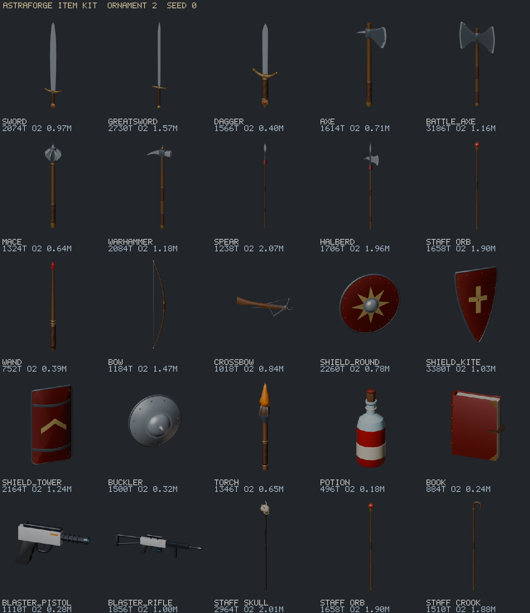
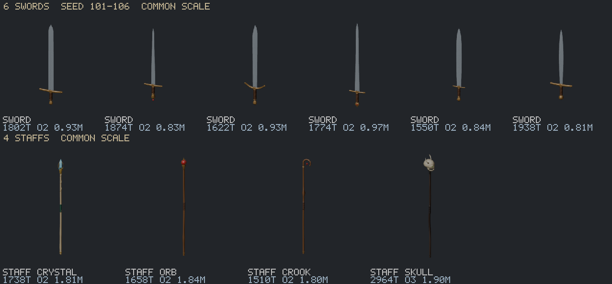
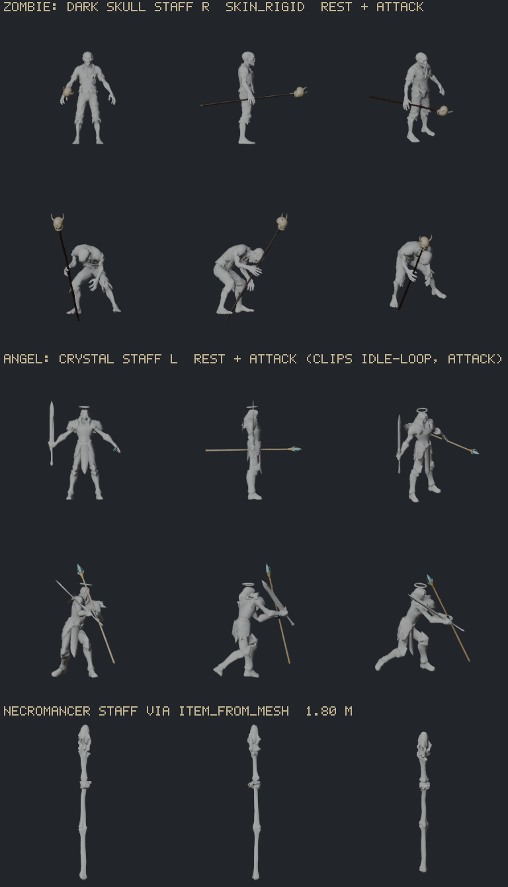
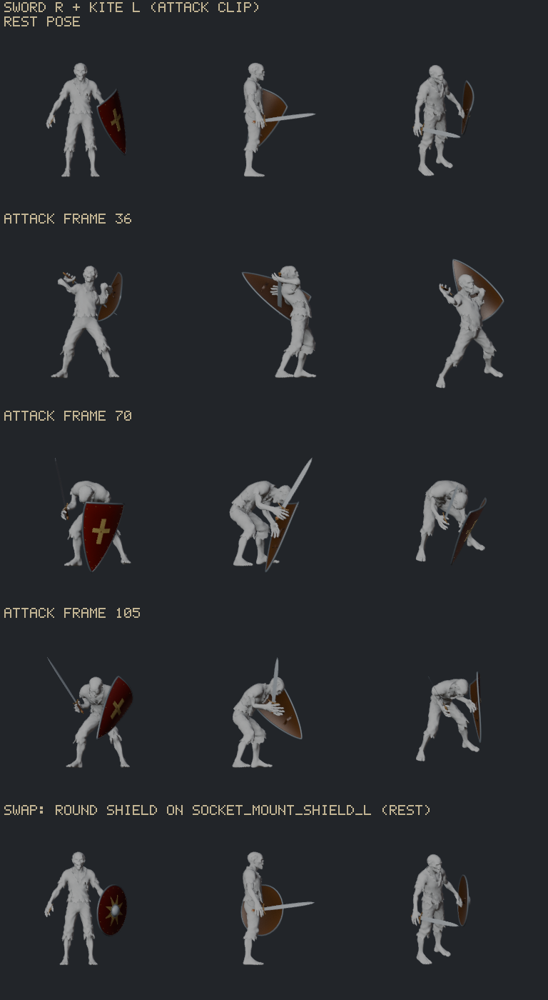

# Модуль «предметы» (items): набор оружия и реквизита, предметы из сгенерированных сеток, крепление к персонажу

Шаги Blender: `item_kit`, `item_from_mesh`, `attach_prop` (общий код — `scripts/blender/steps/_items_lib.py`).
Самопроверка: `scripts/blender/tests/test_items.py` — 23 теста, все проходят, ~41 с (10.10, вечер: + `refit_socket`, `grip_dir`).
Все числа и картинки этого документа получены одним прогоном `test_items.make_evidence()` на текущем коде
(10.10.2026, 17:10). Как его запустить — в разделе «Как запускать».
Совместимость с `server/forge-steps.mjs`: `item_kit` принимает `batch` числом (N соседних зёрен) или списком,
`dims` объектом; `item_from_mesh` — `budget` и `grip: [x, y, z]`.

## Оси и рамка хвата (контракт §4, §6)

- Предмет стоит на `z = 0`, Z вверх, метры, трансформы применены. Главная ось (клинок, древко, рукоять) — **+Z**,
  лезвие / лицевая сторона — **−Y**. `params.origin`: `bbox` (по умолчанию, центр габарита X/Y в нуле, как в §4) или
  `axis` (в нуле ось рукояти).
- `socket_grip_main` — общая рамка хвата: локальная +Z выходит из кулака со стороны большого пальца (вдоль клинка /
  древка от кисти), −Y — туда, куда смотрят выпрямленные пальцы (к лезвию / лицу), X = Y × Z. У меча, топора, посоха,
  щита рамка совпадает с осями предмета. С поворотом: пистолетные рукояти бластеров (+Z вдоль наклонной рукояти, 16°),
  ложа арбалета (+Z вперёд вдоль ложи), `socket_grip_off` арбалета (левая рука снизу).
- `socket_grip_off` — вторая рука у двуручных; `socket_fx_tip` — точка эффекта, локальная +Z = направление выброса.
  В extras: `game_socket`, `kind`, `frame`.
- Щиты: лицо −Y, ручка-скоба вертикально за центром (хват «центральной рукоятью»), ремень-энарм смоделирован.
- Бластеры по умолчанию смотрят дулом в −Y (рамка предмета). Для реквизита Space Quest (§4: нос +Y) —
  `params.forward: "+Y"`: предмет поворачивается на 180° вокруг Z, сокеты сохраняют рамки относительно геометрии.
  Какой вариант правильный для экипажа Space Quest — вопрос владельцу контракта (см. ограничения).

## 1. item_kit — процедурный набор

22 типа: `sword, greatsword, dagger, axe, battle_axe, mace, warhammer, spear, halberd, staff (head: crystal | skull | orb |
crook), wand, bow (с тетивой), crossbow, shield_round, shield_kite, shield_tower, buckler, torch, potion, book,
blaster_pistol, blaster_rifle`.

```json
{"step": "item_kit", "params": {"type": "sword", "style": "medieval", "seed": 3, "ornament": 2,
  "palette": {"metal": "#c0c4ca", "grip": {"color": "#402818", "roughness": 0.8}},
  "blade_length": 0.8, "guard": "curved", "pommel": "scent"}, "out_dir": "abs/out"}
```
- `style`: `medieval | dark | elven | scifi | random`; палитры по ролям материалов (`metal, metal_dark, trim, grip, wood,
  accent, gem, bone, emit, …`), `palette` переопределяет цвет / metallic / roughness / emission.
- `seed` меняет пропорции и все `auto`-подстили. У мечей разброс расширен: длина клинка ±20 %, ширина ±30 %, рукоять
  ±20 %, гарда ±35 %; профиль клинка (`straight / tapered / broad / leaf / falchion`, фальшион теперь и в medieval),
  изгиб гарды, навершие, длина дола (`fuller_length`, 0,42–0,82 клинка), рикассо (`ricasso`, у medieval/dark с
  вероятностью 50 %, 3,5–6,5 см, сужение и тупая кромка). Тот же seed — та же сетка.
- `ornament` 0–3: 1 — заклёпки, кольца, финиалы, эмблема; 2 — камни, кисти, шип обуха, ремень книги; 3 — руны (эмиссия),
  умбон у каплевидного/башенного щита, «крылья» копья.
- Размеры по типам: `blade_length, blade_width, blade_thickness, grip_length, grip_radius, guard_width, pommel_radius,
  haft_length, haft_radius, head_size, head_radius, flanges, shaft_length, shaft_radius, head_length, head_width,
  length, radius, brace_height, recurve, size, width, height, thickness, flame, shape, emblem`; `budget_tris`.
  `size` — масштаб арбалета / бластеров; размер превью — `preview_size` (раньше превью брало `size` и раздувало
  арбалет до 158 м — исправлено, есть регрессионный тест).
- `params.batch`: список вариантов (каждый поверх общих params) или число соседних зёрен → подпапка на вариант (имя
  очищается до `[A-Za-z0-9_-]` и проверяется, что папка внутри `out_dir`) + `contact_sheet.png` + `batch.json`.
  Выходы пакета: `glb` и `blend` — списки (конвейер берёт первый), `preview` — лист, `json` — `batch.json`.
  Лист: `sheet_cols`, `sheet_tile`, `sheet_title`, `sheet_scale` (`common` — общий масштаб, длины сравнимы; по
  умолчанию, если все варианты одного типа; иначе `fit`). Подпись плитки: треугольники, орнамент, длина.

Моделирование: лофты сечений (клинок с долом, фасками, рикассо, остриём; зубцы у тёмного стиля), токарные тела
(рукояти со спиральной обмоткой, навершия, втулки, флаконы), выдавленные контуры с фаской (головы топоров с отдельной
светлой кромкой, фланцы булав, клевец, перо алебарды), трубки по кривой (тетива, обод щита, скоба рукояти, крюк посоха),
гранёные кристаллы, низкополигональный череп. Одна сетка на предмет, 3–8 материалов Principled BSDF (base color /
metallic / roughness / emission экспортируются в glTF), развёртка `UVMap`, сглаживание по углу.

Исправлено в этом раунде по затенению: щёки топоров и перо алебарды (выдавленные контуры с переменной толщиной) теперь
получают внутренние вершины (ограниченная триангуляция Делоне, `plate(fill=…)`) — радиальные полосы от веерных
треугольников исчезли; заодно найдена и исправлена старая ошибка — контур головы топора замыкался «бантиком» (точки
проушины шли в обратном порядке), отсюда были складки у проушины. Шип обуха — кованый ромб с сужением, толщина у
проушины 2,7 см (был плоский клин). Энарм щита — ремень 7 мм × 36 мм с заклёпками, отстоит от доски. Проверка
`materials_principled` теперь действительно проверяет, что Principled BSDF подключён к Material Output.

Выходы: `item.glb` (сокеты-узлы с extras, `af_item_type` и `af_forward` в extras меша), `item.blend`, `item.json`,
`preview.png`.

### Замеры (все типы, ornament 2, seed 0)

| тип | треуг. / бюджет | габарит, м (X×Y×Z) | тип | треуг. / бюджет | габарит, м |
|---|---|---|---|---|---|
| sword | 2074 / 2500 | 0.04×0.18×0.97 | bow | 1184 / 4000 | 0.04×0.20×1.47 |
| greatsword | 2730 / 4000 | 0.06×0.25×1.57 | crossbow | 1018 / 4000 | 0.64×0.84×0.13 |
| dagger | 1566 / 2500 | 0.03×0.12×0.40 | shield_round | 2260 / 4000 | 0.78×0.13×0.78 |
| axe | 1614 / 2500 | 0.05×0.26×0.71 | shield_kite | 3380 / 4000 | 0.58×0.10×1.03 |
| battle_axe | 3186 / 4000 | 0.05×0.49×1.16 | shield_tower | 2164 / 4000 | 0.66×0.16×1.24 |
| mace | 1324 / 2500 | 0.12×0.12×0.64 | buckler | 1500 / 4000 | 0.32×0.16×0.32 |
| warhammer | 2084 / 4000 | 0.07×0.33×1.18 | torch | 1346 / 2500 | 0.08×0.08×0.65 |
| spear | 1238 / 4000 | 0.07×0.07×2.07 | potion | 496 / 2500 | 0.07×0.07×0.18 |
| halberd | 1706 / 4000 | 0.08×0.33×1.96 | book | 884 / 2500 | 0.08×0.20×0.24 |
| staff (orb) | 1658 / 4000 | 0.10×0.10×1.90 | blaster_pistol | 1110 / 2500 | 0.04×0.28×0.17 |
| wand | 752 / 2500 | 0.02×0.02×0.39 | blaster_rifle | 1856 / 4000 | 0.05×1.00×0.24 |

Посохи: череп (dark) 2964, сфера 1658, крюк 1510. Перебор 176 сборок (22 типа × 4 стиля × seed 1–2, ornament 3):
максимум одноручных 2250 / 2500 (sword medieval s1), двуручных 3664 / 4000 (shield_kite medieval s1); несвязных
(non-manifold) рёбер — 0 во всех. GLB предмета 28–118 КБ. Пакет из 25 вариантов с превью — 6,7 с.

Варианты по seed (общий масштаб): 6 мечей seed 101–106 — длина 0,81–0,97 м; профили broad / tapered / falchion /
tapered / leaf / leaf; гарды cross и curved разной ширины (0,13–0,23 м); навершия scent / teardrop / disc / ball;
1550–1938 треуг. Силуэты теперь различаются длиной, шириной и формой клинка, а не только изгибом гарды. 4 посоха:
кристалл (эльфийский), сфера, крюк, череп с рогами и светящимися глазницами (тёмный, ornament 3 — для некроманта),
1510–2964 треуг.




## 2. item_from_mesh — предмет из сгенерированной сетки

```json
{"step": "item_from_mesh", "inputs": {"mesh": "abs/hunyuan_sword.glb"},
 "params": {"kind": "blade", "length_m": 0.95, "grip": "auto", "texture_max": 1024,
            "crop": {"segment": [[x,y,z],[x,y,z]], "radius": 0.15}}, "out_dir": "abs/out"}
```
Порядок: импорт и слияние → сварка вершин, разрезанных по швам UV → необязательная вырезка (`crop`: коробка или капсула)
→ удаление мелких оторванных кусков → PCA по площадям треугольников → профиль сечений вдоль оси → хват → ось рукояти по
центрам сечений → сторона лезвия по площади головы → поворот в рамку предмета, масштаб `length_m` → децимация Collapse
до бюджета → текстуры > `texture_max` уменьшаются → сокеты, экспорт. Выходы: `item.glb/.blend/.json`, `preview.png`,
`profile.png` (профиль сечений: красная линия — основной хват, зелёная — вторая рука).

Правила хвата (длина > 1,15 м делает клинок / топор / булаву / древковое / посох двуручным, добавляется
`socket_grip_off`):
- клинки: рукоять — самый длинный круглый участок постоянного радиуса в половине со стороны рукояти, по вершинам
  в слоях 6 мм и только в радиусе 4,5 см от оси (дальние концы гарды не мешают; узкое навершие-шип, каплевидное
  навершие, кольцо рикассо — круглые, но короче или другого радиуса). Одноручный хват — середина рукояти; двуручный —
  5 см под гардой, вторая рука на 11 см ниже (не ближе 3 см к навершию и никогда не ближе 9 см к основной);
- топоры / булавы: одноручные — самое тонкое круглое окно у торца; двуручные — 0,41 и 0,115 длины от торца
  (как в `item_kit`);
- древковые / посохи / жезлы / факелы — доля длины (`GRIP_T`), известный тип (`type: spear | halberd`) — пропорции
  набора; вторая рука — 0,14 длины от торца (древковые) или на 0,14 длины ниже основной (посох);
- щиты — центр тыльной плоскости + 3,5 см, лицо — выпуклая сторона;
- `grip.point` / `grip.t` / `edge` задают вручную (нужно для огнестрела, луков и всего неосевого).

Бюджет: по умолчанию бюджет модуля (2500 одноручное / 4000 двуручное, посох, щит); больший `budget_tris` (например,
серверный) урезается до бюджета модуля с предупреждением, если не задан `allow_over_budget`. Проверки:
`tris_within_budget`, `within_module_budget` (ошибка; с `allow_over_budget` — предупреждение), `sockets_in_glb` (по
экспортированному GLB), `grip_section_holdable` (сечение у хвата круглое, радиус 0,5–4,5 см — иначе хват попал на
клинок / голову), `materials_principled`, `length_m`.

Замеры на «сгенерированных» копиях предметов набора (Subdivision ×2, случайный поворот, масштаб 1,7):

| предмет | треуг. до → после | ошибка основного хвата | вторая рука: ошибка / зазор | правило |
|---|---|---|---|---|
| меч | 33 600 → 2 462 | 0,5 см | — | середина рукояти |
| двуручный меч | 43 631 → 3 939 | 0,2 см | 0,2 см / 11 см | 5 см под гардой |
| кинжал | 25 472 → 2 462 | 0,0 см | — | середина рукояти |
| топор | 27 952 → 2 462 | 0,4 см (лезвие на −Y) | — | тонкое окно у торца |
| секира (battle_axe) | 56 896 → 3 938 | 0,5 см | 0,2 см / 34 см | 0,41 / 0,115 длины |
| булава | 22 496 → 2 462 | 1,6 см | — | тонкое окно у торца |
| боевой молот | 34 432 → 3 940 | 0,2 см | 0,3 см / 35 см | 0,41 / 0,115 длины |
| алебарда | 30 048 → 3 940 | 0,5 см (перо на −Y) | 4,0 см / 55 см | доля 0,42 |
| копьё (`type: spear`) | 20 064 → 3 940 | 0,3 см | 0,1 см / 50 см | пропорции набора |
| посох (сфера) | 26 720 → 3 940 | 10,8 см | 7,8 см / 27 см | доля 0,56 |
| каплевидный щит | 58 120 → 3 940 | 3,9 см (2,0 по Y) | — | центр тыльной стороны, лицо по кривизне |

Двуручные хваты, на которые указало ревью (двуручный меч ниже на 17 см, секира — на 22 см), теперь совпадают с
набором в пределах 0,5 см. Устойчивость к форме рукояти: 54 прогона (меч, двуручный меч, кинжал × seed 1–6 ×
medieval / dark / elven) — средняя ошибка 0,68 см, максимум 2,9 см (тёмный меч с навершием-шипом), по стилям:
medieval ≤ 1,1 см, elven ≤ 0,5 см, dark ≤ 2,9 см.

Реальный ассет: посох вырезан из `Corrected-necromancer.glb` (Hunyuan 2.1, 119 947 треуг., 3,0 м в студийных единицах)
капсулой (0.51, −0.38, −0.05)→(0.80, −0.47, 3.05), r = 0.15: 51 289 вершин отрезано, 3 мелких куска удалено, 3 940 треуг.,
длина 1,80 м, череп-навершие наверху, текстуры 4096 и 2048 → 1024, GLB 6,0 МБ. Хват задан `grip.t = 0.65` — там
остался обрубок кисти генерации.



## 3. attach_prop — предмет в руку

```json
{"step": "attach_prop",
 "inputs": {"character": "abs/zombie/mixamo_rigged.fbx",
            "clips": ["abs/zombie/anims/attack.fbx", {"file": "abs/zombie/anims/idle.fbx", "loop": true}]},
 "params": {"attachments": [
   {"item": "abs/sword/item.glb", "hand": "r", "mode": "bone_child"},
   {"item": "abs/kite/item.glb", "hand": "l", "mode": "bone_child", "fit": "auto"}]},
 "out_dir": "abs/out"}
```
Одиночный вариант: `inputs.item` + `params.hand / mode / offset / fit / item_scale`. Прочее: `clips_check` (true),
`frames_per_clip` (12), `preview_clip`, `thumb_hint`, `standoff` (щиты), `refit_shield_mount`, `replace`,
`socket_along` (0.42). Код подбора щитового сокета и QA по позам (`fit_shield_mount`, `fit_rotation`,
`evaluate_pose`, `Body`, `pose_record`) живёт в `_items_lib.py` — его же вызывает `rig_humanoid`.

- Персонаж: `.blend`, `.glb`, `.fbx` с костями `mixamorig:*`. Рост меряется в позе покоя (раньше — в позе клипа:
  повторное крепление к собственному `equipped.glb` давало 1,45 м вместо 1,70 м).
- Клипы: путь или `{"file", "name", "loop"}`; имя действия — имя файла (или `name`); зацикленные получают суффикс
  `-loop` (контракт §7), по умолчанию `loop` = true для имён `idle* / walk* / run*`. Ангел: в GLB `attack` и
  `idle-loop`.
- Сокет кисти: если у рига нет `socket_mount_hand_<r|l>`, он создаётся на кости кисти (0,42 длины кисти от запястья,
  со стороны ладони на толщину ладони + 1,5 см; +Z — сторона большого пальца = «вперёд» персонажа; если в кисть вшит
  предмет — по его оси, с предупреждением). **Это единственная рамка кисти кузницы**: та же функция
  `_items_lib.hand_socket_frame` строит сокеты кистей в `rig_humanoid` и `import_mixamo_rig`
  (`_humanoid_lib.add_human_sockets`), поэтому `attach_prop` берёт их как есть. На зомби HG после `rig_humanoid`
  сокет совпадает с тем, что `attach_prop` посчитал бы сам, до 1e-4 (и в `.blend`, и после glTF), а меч набора
  садится без подгонки: хват 0,8 см от кисти, клинок вдоль +Z сокета (косинус > 0,995) — тест
  `test_humanoid.test_real_zombie_rig_takes_kit_sword_and_shield_without_refit`. Для кисти, держащей найденный
  предмет, `rig_humanoid` передаёт его направление (`grip_dir`: +Z ровно по предмету) и исключает вершины
  предмета (`exclude`) — такой сокет точнее того, что `attach_prop` угадал бы по вшитому предмету.
- **Щиты — отдельный сокет крепления `socket_mount_shield_<r|l>`** (исправление главного замечания ревью). Он дочерний
  кости кисти, его рамка = рамка `socket_mount_hand_<side>` × подобранный поворот + отступ. Подбор делается один раз на
  персонажа и руку по каноническому щиту (рамка хвата щита по §6: +Z вверх, −Y лицо; доска 0,54 × 0,80 м, 16 мм, тыл
  в 3,2 см перед хватом, скоба-рукоять), а не по конкретному щиту: перебор 7 680 поворотов, цель — щит стоит и смотрит
  наружу в покое (вес 0,35) и на кадрах клипов, 8 лучших проверяются на пересечение с телом; затем отступ вдоль лица,
  пока раскрытая кисть не перестанет протыкать доску (до 12 см). Любой щит набора или из `item_from_mesh` крепится
  совмещением своего `socket_grip_main` с этим сокетом — так же, как это сделает Godot. Если сокет у рига уже есть
  (риг `rig_humanoid`/`import_mixamo_rig` или повторный прогон на `equipped.blend`), он используется как есть и не
  меняется; заново подбирается только с `refit_shield_mount: true`. `rig_humanoid` строит `socket_mount_shield_l/r`
  тем же подбором (`_items_lib.rest_shield_mounts` → `fit_shield_mount`, одна реализация) по позе покоя — ровно то,
  что `attach_prop` делает при `fit: rest`: на зомби мировые матрицы щита из сокета рига и из сокета, построенного
  `attach_prop` заново, совпадают до 1e-4. С клипами `attach_prop` подобрал бы сокет и по их кадрам, но сокет рига
  важнее (§6: «один раз на персонажа»). Имя `socket_mount_shield_*` теперь в §6; матрица 4×4 по-прежнему дублируется в
  extras `shield_mount_matrix` сокета кисти для первых читателей.
- `bone_child`: предмет — отдельный объект под своим сокетом крепления (в glTF: сустав кисти → сокет → предмет);
  `skin_rigid`: сетка предмета вливается в сетку персонажа с весом 1.0 на кость кисти. Самопроверка
  `grip_on_mount`: `socket_grip_main` прикреплённого предмета совпадает с сокетом крепления (ошибка 0,0 мм / 0,0°).
  `offset` — тонкая подстройка конкретного предмета в рамке сокета крепления; она живёт на узле предмета и при замене
  по сокетам не воспроизводится (пишется в `attach.json`).
- **`refit_socket` (10.10, вечер).** `offset` живёт на узле предмета, и замена по сокетам его не
  воспроизводит. С `refit_socket: true` (в params или у attachment) смещение запекается в сам сокет:
  `socket_mount_hand_<side>` в позе покоя переносится на `socket_grip_main` предмета (`H_new = H · offset`)
  и остаётся ребёнком кости кисти. Предмет висит под ним с единичным смещением,
  `swap_by_socket_matching: true`. Мировая посадка совпадает с прогоном без refit до 1e-4. Перенос
  записан в `attach.json → socket_refit` (`delta_pos_m`, `delta_angle_deg`, матрицы «до/после») и в extras
  сокета (`refit_offset_matrix`, `refit_by_item`), поэтому следующие замены ставят предмет так же. Другие
  предметы той же руки пересчитываются в новую рамку. Для щитов на щитовом сокете refit не применяется.
  Тест `test_attach_refit_socket_bakes_offset_for_swaps` проверяет совпадение мировых матриц, сокет =
  старый × offset и замену совмещением.
- **`grip_dir`.** Это `[x, y, z]` или `up/down/forward/back/out/in` в рамке персонажа (лицом в −Y,
  `out` — от тела). Работает для сокета, который `attach_prop` создаёт сам, когда у рига его нет:
  +Z ровно по этому направлению (`_items_lib.grip_dir_vector`, тот же `hand_socket_frame`). У `rig_humanoid`
  такой же параметр — `params.grip_dirs`.
- Имена: у прикреплённой копии `socket_grip_main` удаляется (совпадает с сокетом крепления), остальные сокеты
  получают суффикс руки (`socket_grip_off_r`, `socket_fx_tip_l`) — без точек и повторов; одинаковые материалы двух
  предметов набора сливаются (нет `mat_medieval_trim.001`). `replace: true` удаляет предметы, которые прошлый прогон
  положил в ту же руку.
- Проверки (BVH): расстояние оси рукояти до кисти, «охват» (доля радиальных лучей, попавших в кисть в пределах 6 см),
  пересечения предмет↔рука/тело в покое и на кадрах, точки оси клинка внутри предплечья, у щита — вертикальность,
  направление лица и рука сквозь доску; `mount_sockets_in_glb`, `socket_names_clean`, `animations_exported`.
- Выходы: `equipped.glb`, `equipped.blend`, `attach.json` (сокеты кистей и креплений с рамками, матрицы посадки,
  подбор, проверки по каждому кадру), `preview.png` (покой + 3 кадра клипа), `grip_closeup.png`.

### Предметы, вырезанные из персонажа: `extracted` (12.10)

`extract_props` (docs/forge/extract_props.md) вырезает меч, щит, знамя, лук, посох из сгенерированного тела в
отдельные `item.glb` и оставляет на теле сокеты мест `socket_prop_<рука>_<n>`. `attach_prop` с
`params.extracted: true` (серверный флаг: сервер передаёт `props.json` этого прогона в `inputs.extracted`,
персонаж — `.blend` предыдущего шага: рига или `retarget`) ставит каждый предмет туда, откуда он вырезан:

- оружие, посох, лук, знамя — `fit: placement`, смещение = сокет кисти⁻¹ × сокет места, затем `refit_socket`:
  `socket_mount_hand_<рука>` переезжает на `socket_grip_main` предмета (замена по сокету повторит хват, предмет
  набора той же рамки встанет так же);
- щит — по `extracted_shield_fit` (`auto` по умолчанию): `placement` — `socket_mount_shield_<рука>` ставится на
  рамку хвата вырезанного щита (создаётся, если его нет); **`clips`** — канонический сокет щита подгоняется по
  кадрам клипов персонажа (`fit_shield_mount`: смерть не участвует, циклы весят вдвое, покой — 5 %, «наружу»
  наклонено к переду персонажа на `shield_front_bias`, 1), сокет рига с подгонкой по покою заменяется; `auto` —
  `clips`, если у персонажа уже есть клипы (пакет «Врат»: `attach_prop` после `retarget`), иначе `placement`.
  Причина: на месте концепта клипы Mixamo ставят щит ребром и вдавливают в руку (рыцарь №3: 0 из 43 кадров
  «стоит и смотрит наружу», пересечения в 43; с `clips` — 67 % и 3). Для подгонки шаг берёт 8 кадров на клип и
  при `clips_check: false`; `refit_socket` для щита не нужен;
- предмет на поясе (`hand: hip`) — жёстко на `Hips` в своём месте;
- сокеты мест после этого удаляются; нет предметов — персонаж проходит без изменений.

`extracted_mode`: `bone_child` (по умолчанию) | **`skin_separate`** | `skin_rigid`. `skin_separate` (и в
`attachments[].mode`) — предмет остаётся отдельной сеткой, но со скином 100 % на кость кисти: одна группа вершин,
модификатор Armature, родитель — арматура. Жёсткость та же, что у `bone_child`, но `motion_style` видит его как
предмет в руке (по весам ≥ 0,99): посох вертикально в шаге, кончик не под полом, предмет ложится в смерти. Пакет
«Врат» берёт `skin_separate`. Проверка в настоящих клипах — `_props_lib.clip_props_qa` после `motion_style`
(сдвиг хвата, лишнее проникновение в тело), см. extract_props.md.

### item_kit как замена вырезанного

`extract_props` строит предмет набора, когда вырезанный не прошёл проверку качества (`replace: auto`) или всегда
(`always`): `_props_lib.kit_params` переводит тип и замеры в параметры набора (меч — `blade_length` = хват → кончик
− 3 см и `blade_width`, посох/копьё — `shaft_length`, щит — kite / tower / round / buckler по пропорциям с
`width`/`height`/`radius`, лук — `length`), стиль по стороне, `ornament`, `palette` — из доминирующих цветов
вырезанного (k-means цветов текстуры по граням). Сборка — та же `item_kit.build_item`.

### Замеры

| прогон | хват → кисть (покой) | охват | пересечения в покое | кадры с пересечением | прочее |
|---|---|---|---|---|---|
| зомби (1,70 м), меч R, клип attack | 1,2 см | 0,39 | 0 | 2 из 15 (тело, до 28 треуг.) | клинок в предплечье: 0 кадров |
| зомби, каплевидный щит L → `socket_mount_shield_l` | 1,1 см | 0,19 | 0, кисть за доской | 4 из 15 (тело, до 175 треуг.) | отступ 10,4 см; в покое верх·Z = 0,86, лицо·наружу = 0,95; стоит и смотрит наружу в 47 % кадров |
| зомби, посох-череп R, `skin_rigid` | 1,2 см | 0,39 | 0 | 3 из 15 (до 38 треуг.) | одна сетка со скином в GLB; сокеты `socket_fx_tip_r`, `socket_grip_off_r` |
| ангел (2,0 м), кристальный посох L, клипы idle-loop + attack | 0,2 см | 0,61 | 0 | 16 из 27 (до 51 треуг.) | см. ограничения |

Замена щита по сокету (нижний ряд картинки зомби): в сохранённой сцене каплевидный щит удалён, круглый щит поставлен
только совмещением его `socket_grip_main` с `socket_mount_shield_l` — верх·Z = 0,86, лицо·наружу (+X) = 0,82, как у
подобранного. Тест `test_attach_shield_mount_swap_by_socket_matching` проверяет, что такая замена даёт ту же мировую
матрицу (до 1e-4), что и сам шаг, что в glTF сокет — ребёнок сустава кисти, а щит — ребёнок сокета, и что повторный
прогон на `equipped.blend` с `replace` переиспользует сокет.

Время шага с атакой зомби — 2,7 с внутри Blender; `equipped.glb` зомби 1,9 МБ (текстура персонажа), ангела 0,8 МБ.



## Как запускать

```
"C:/Program Files/Blender Foundation/Blender 5.0/blender.exe" -b --factory-startup ^
    --python scripts/blender/af_run.py -- item_kit request.json        (item_from_mesh / attach_prop так же)
"C:/Program Files/Blender Foundation/Blender 5.0/blender.exe" -b --factory-startup ^
    --python scripts/blender/tests/run_tests.py -- items
```
Числа и картинки этого документа (≈50 с, временная папка ОС + `docs/forge/img/items/`):
```
"C:/Program Files/Blender Foundation/Blender 5.0/blender.exe" -b --factory-startup --python-expr ^
  "import sys;sys.path[:0]=[r'<repo>/scripts/blender',r'<repo>/scripts/blender/tests'];import test_items as t;t.make_evidence(None, r'<repo>/docs/forge/img/items')"
```
`make_evidence` печатает путь к `evidence.json` со всеми замерами.

Тесты: все типы набора собираются в бюджет, без несвязных рёбер, экспортируются с сокетами; оси/рамки; детерминизм и
разброс seed; пакет (выходы-списки, очистка имени `../../escape`), регрессия `size`/`preview_size`;
`materials_principled` ловит отключённый BSDF; `forward: +Y`; заполнение контуров; восстановление меча, двуручного
меча, топора, секиры, алебарды и щита из «сгенерированных» копий (вторая рука ≥ 9 см ниже), рукояти по seed/стилям,
урезание бюджета; синтетический риг (`bone_child` / `skin_rigid`), `offset`, замена щита по сокету, имена клипов
`-loop` / чистые сокеты / рост в покое; реальные: зомби меч+щит с attack, зомби посох `skin_rigid`, ангел посох
(idle + attack, и вшитый меч правой руки), посох из некроманта. Реальные тесты возвращают `"skip: …"`, если файла нет.

## Честные ограничения

- **Руки не сжимаются.** У Meshy/Tripo-персонажей без костей пальцев кисть раскрыта (у зомби — «когти»), рукоять лежит
  в ладони/пальцах (охват 0,19–0,39 вместо ≥ 0,5 у кулака). Сжатие кулака — работа модуля гуманоидов.
- **Жёсткая посадка не подстраивается под клип.** В A-позе меч и посох смотрят горизонтально вперёд; в атаке зомби меч
  задевает тело в 2 из 15 кадров, щит — в 4 из 15, щит стоит и смотрит наружу лишь в 47 % кадров (клип машет
  «когтями», а не держит щит). Нужны клипы под предмет или покадровая поправка кисти.
- **Ангел:** правая кисть держит вшитый меч, все клипы держат его двумя руками — посох в левой руке проходит сквозь
  тело в 16 из 27 кадров. Посадка правильная, конфликт в содержании клипов.
- **Щит в раскрытой кисти** отодвинут на 10,4 см (по каноническому щиту), чтобы пальцы не протыкали доску: ручка щита
  не в кулаке. Посадка «на предплечье через энарм» не моделируется, её заменяет подобранный сокет. Щит толще
  канонического может касаться кисти — это ловит проверка `hand_through_board_rest`.
- `socket_mount_shield_<side>` рига подобран **только по позе покоя** (у `rig_humanoid` клипов нет); если щит должен
  стоять и в кадрах конкретного клипа, нужен `refit_shield_mount: true` с этими клипами. `offset` при замене по
  сокетам не переносится.
- **Сторона большого пальца** угадывается по «вперёд» персонажа (верно для Mixamo A/T-поз) или по вшитому предмету;
  для иных поз нужен `thumb_hint`.
- **item_from_mesh угадывает хват геометрически.** Посох — по доле длины (ошибка 10,8 см), вторая рука алебарды —
  4 см, булава 1,6 см, щит 3,9 см, тёмный меч с навершием-шипом — до 2,9 см. Огнестрел, луки и неосевые предметы
  требуют `grip.point` / `edge`. Децимация Collapse съедает тонкие шипы. Вырезанный из персонажа предмет несёт обрубки
  кисти и весь текстурный атлас (посох некроманта — GLB 6,0 МБ).
- **Материалы — константы PBR на роль**, износ не запекается: развёртка есть, текстуры нет. Превью Workbench смягчает
  metallic (только viewport-значения; в GLB — точные) и не показывает текстуру посоха некроманта.
- Мелкая геометрия: у одноручного топора внутренний край светлой кромки слегка зубчатый (смещённая кривая); у секиры у
  углов проушины видны крошечные светлые сколы фаски — заметны только на крупном плане.
- Бластеры по умолчанию дулом в −Y (рамка предмета, §6); для Space Quest есть `forward: "+Y"`, но какой вариант
  обязателен для экипажа — решает владелец контракта.
- Пламя факела — статичная эмиссионная сетка; стекло флакона непрозрачное.
