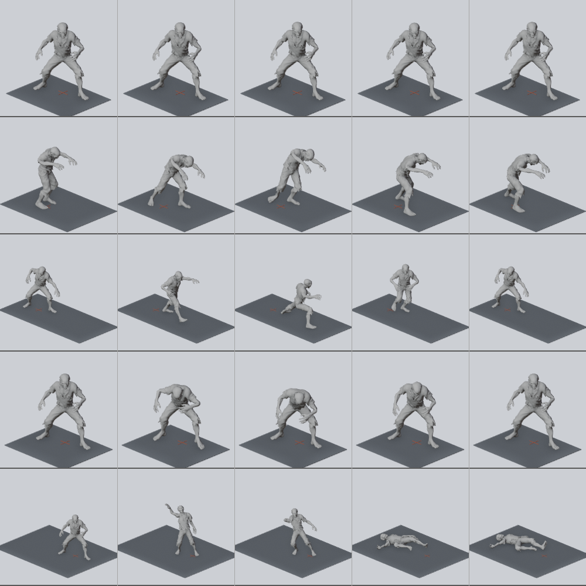
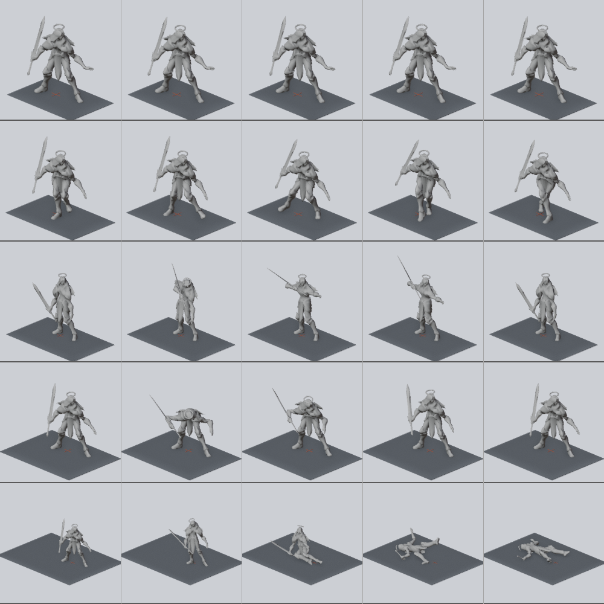
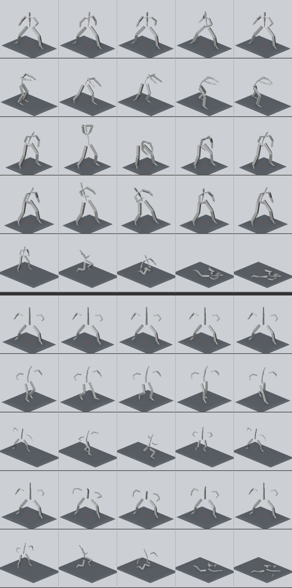
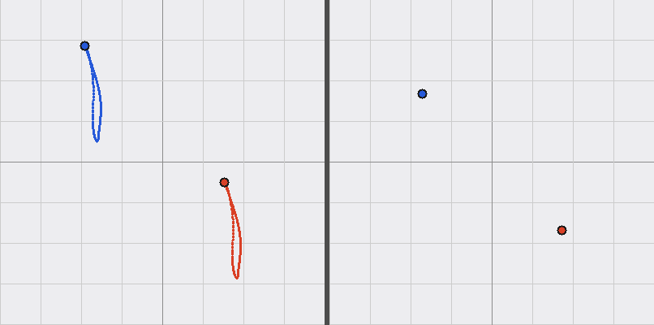

# Модуль «mixamo»: библиотека клипов и перенос на любой гуманоидный риг

Файлы: `scripts/blender/steps/retarget.py`, `steps/clip_library.py`, `steps/_anim_lib.py`,
`scripts/blender/tests/test_mixamo.py`, библиотека `data/library/animations/` (в git не попадает).

## Что делает

**`retarget`** переносит клипы Mixamo (и любые FBX с гуманоидным скелетом) на скиннованный риг. Выходы:
- `animated.glb`: по одной glTF-анимации на клип, у зацикленных суффикс `-loop`, скин сохранён. В файл
  уходит вся иерархия рига: сокеты §6 на костях, реквизит на сокетах, дочерние сетки;
- `animated.blend`;
- `clips.json` с метриками;
- `preview.png`: строка на клип, 5 кадров, вид три четверти, Workbench.

**`clip_library`** ведёт библиотеку клипов: `scan`, `import`, `remove`, `preview`, `list`.
Формат `index.json` соответствует §7 контракта, в нём же лежит лицензионная пометка.

**`_anim_lib`** — ядро, перенесённое из «Врат Героев»: `hg_retarget.py`, помощники `hg_scene.py`,
`retime_action` из `hg_barbarian_unit.py`. Привязки к путям HG убраны.

### Алгоритм переноса

1. Кости обеих сторон приводятся к каноническим коротким именам Mixamo, схема выбирается голосованием.
   Поддерживаются:
   - `mixamorig:`, `mixamorig1:` и имена без префикса;
   - шаблон AstraForge: `Root, Hips, Spine, Chest→Spine2, Neck, Head, HeadEnd→HeadTop_End,
     *UpperArm→*Arm, *LowerArm→*ForeArm, *UpperLeg→*UpLeg, *LowerLeg→*Leg, *Toes→*ToeBase,
     *ToesEnd→*Toe_End`; `Root` и `*HandEnd` не сопоставляются;
   - Rigify `DEF-`/`ORG-`/метариг (`spine`=Hips … `spine.006`=Head, `upper_arm.L` …);
   - UE: `pelvis, spine_01..03` (у UE5 `01/03/05`), `clavicle_l, upperarm_l, lowerarm_l, hand_l,
     thigh_l, calf_l, foot_l, ball_l`, пальцы.
2. Поза покоя поправляется по каждой кости, как в HG. Кратчайший взмах (swing) совмещает кость цели с
   костью источника в покое, собственный roll цели сохраняется. Затем
   `мир_цели = C · Δисточника · C⁻¹ · виртуальный_покой`.
3. Масштаб корня `k` = высота тазобедренных суставов цели / источника. Leg IK аналитический, двухзвенный,
   колено остаётся в плоскости FK-колена.
4. Обработка хода корня (ниже), шов петли и скорость применяются к мировым траекториям до IK. Поэтому
   стопы согласованы с обработанным тазом.

### Движение корня (`root_motion`)

| режим | локомоция (walk/run) | остальные клипы (idle, attack, hit, cast, death, …) |
|---|---|---|
| `lock` (по умолчанию) | на месте: снимается прямой ход «первый → последний кадр», игра двигает персонажа со скоростью `ground_speed_mps` | ход таза **остаётся** на Hips: стопы, стоящие в источнике, стоят и у цели |
| `keep` | ход на Hips | ход на Hips |
| `extract` | ход переносится на недеформирующую кость `root` (root motion Godot) | так же |

- Явный `in_place` в клипе важнее режима.
  - `in_place: true` снимает только прямой ход начало→конец; покачивание и рывки таза вокруг него
    остаются. На клипе, который возвращается в исходную точку (idle, hit), это ничего не меняет.
  - `in_place: "strict"` убирает весь горизонтальный ход таза, XY таза постоянны. Это поведение HG.
    Стопы при этом проскальзывают на величину покачивания, и проверка `foot_skate` об этом сообщает.
- Локомоция определяется по категории (`walk`, `run`). Переопределить можно флагом `locomotion` у клипа
  или у записи библиотеки, либо тегом `locomotion`.
- Стоячие петли (idle) в `keep`/`extract` замыкают и мировой ход на шве: таз и стопы зацикливаются без
  скачка.
- Клип в `lock` с ходом больше 0,25 м (выпад, смерть) остаётся с ходом на Hips. Шаг предупреждает: без
  `extract` Godot вернёт персонажа на место скачком в конце клипа.
- `extract` берёт существующую кость над Hips (`Root` у шаблона, `root` у UE) или добавляет `root` в
  начале координат.

Чем отличается от HG. Каждое изменение найдено на превью или в замерах:

| Было в HG | Стало | Почему |
|---|---|---|
| Направление кости = её хвост | направление к голове дочерней кости по цепи; у листовых костей (кисть без пальцев, носок) — взмах родителя | хвосты листовых костей FBX эвристичны: на T-позе Mixamo кисть «смотрит» на 27° в сторону, запястья ломались |
| `C` по оси Шея−Таз | `C` = только поворот вокруг вертикали | у сутулого A-покоя и прямого T-покоя одного скелета `C` получал наклон, и весь клип заваливался |
| `k` по высоте головы Hips | `k` по тазобедренным суставам (головы UpLeg) | у шаблона AstraForge суставы на 5 см ниже Hips: ноги не доставали |
| IK только на лодыжку | при контакте подушечки прибивается подушечка (ToeBase), иначе лодыжка | при другой длине стопы подушечка скользила на отрыве пятки |
| — | кость источника нулевой длины (у лучника HG `Neck` совпадает с `Head`) не копируется, кость цели следует за родителем | её поворот на источнике ничего не двигает, а на 12-см шее ангела складывал голову в грудь |
| — | шея и голова без годного ориентира сохраняют мировую ориентацию своего покоя | в любом покое голова прямо и смотрит вперёд |
| `lock_root_xy` снимает весь XY таза у всех клипов | `lock`: на месте только локомоция, и снимается только прямой ход | стоячие клипы скользили (удар ангела — 24 см, см. ниже); у ходьбы снятое покачивание давало проскальзывание в 3–10 раз больше источника |

**Дальше по цепочке — `motion_style`** (11.10, `docs/forge/motion_style.md`): своя манера каждого персонажа
поверх перенесённых клипов (темп, шаг, руки, наклон, сутулость, покачивания, хромота, развязность,
скованность; стопы стоят, петли без шва) и процедурные смерти (8 вариантов вместо 5 библиотечных).
Выход `retarget` (`animated.blend` + `clips.json`) — его вход.

## Параметры `retarget`

```json
{"step": "retarget",
 "inputs": {"mesh": "abs/rigged.glb|.fbx"}  /* или {"blend": "abs/file.blend"} */,
 "params": {
   "clips": [{"source": "library:mixamo-zombie-walk | abs/path.fbx | mixamo-zombie-walk",
              "name": "walk", "trim": [1, 60], "loop": true, "in_place": true,
              "locomotion": true, "fps": 30, "speed": 1.0, "mirror": false}],
   "library": "…/data/library/animations",
   "root_motion": "lock|keep|extract",
   "leg_ik": true, "foot_pin": "ball|ankle", "loop_blend": 8,
   "facing": "keep|rest", "hips_drop": 1.0, "hips_height_m": null, "floor": true,
   "hand_floor": {"l": 0.03}, "ground": "feet|mesh", "floor_tolerance_m": 0.02,
   "apply_transforms": false,
   "preview": true, "preview_cols": 5, "preview_tile": 256,
   "keep_existing_actions": false},
 "out_dir": "abs/out"}
```

- `loop` по умолчанию берётся из категории (idle/walk/run → петля). Имя glTF-анимации — `name` или
  `name-loop`. Без `name` берётся id библиотеки без префикса источника (`mixamo-`, `fbx-`).
- Шов петли: разница между последним и первым кадром плавно раскладывается по последним `loop_blend`
  кадрам через slerp дельты. Первый и последний кадр совпадают.
- `fps` один на весь GLB. При разных `fps` в одном запросе берётся fps первого клипа и выдаётся
  предупреждение. `speed` и `trim` пересэмплируют источник по дробным кадрам.
- `apply_transforms: true` запекает поворот и масштаб объекта рига и его сеток в данные. Сокеты и
  реквизит сохраняют мировое положение, у сокета масштаб становится 1 (одного `transform_apply` мало:
  сокет на кости уезжал на 13 см). Без этого флага ненулевой поворот или масштаб рига даёт
  предупреждение `rig_transform_identity` (контракт §4).
- `keep_existing_actions: false` удаляет только действия этого рига: назначенные, из его NLA и
  бесхозные действия с его костями. Действия других объектов (реквизит, второй скелет, shape keys)
  остаются в `.blend`, в GLB не попадают.

### Персонажи в робе и с посохом (10.10, вечер)

В v1 некроманта (`docs/forge/necromancer.md`, раздел 8) было три проблемы. Idle лучника поворачивал
корпус на 62° (стойка лучника). Колени сгибались, таз опускался на 9–12 см, и подол, взвешенный на таз и
бёдра, уходил под пол. Кисть с посохом опускалась ниже покоя, и комель посоха уходил в пол на 26–29 см. В
смерти тело в робе проваливалось под пол на 0,4–0,6 м, и так было у всех пяти смертей библиотеки.
Источник клипа тут ни при чём: у этих клипов те же движения, но у робы толщина, которой нет у источника.
Новые параметры (общие и у клипа):

| параметр | по умолчанию | что делает |
|---|---|---|
| `facing` | `keep` | `rest`: снимается средний поворот вокруг вертикали у `facing_bone` (Hips). Поворот ведётся вокруг вертикали через таз покоя цели, вместе с ним поворачиваются траектории стоп и ход |
| `hips_drop` | 1.0 | доля опускания таза ниже покоя, которая сохраняется. 0 — таз не ниже покоя, ноги выпрямляются IK, подол остаётся на полу. Смерти нужна 1 |
| `hips_height_m` | — | явная высота тазобедренных суставов цели для масштаба корня `k`. Под робой измеренная высота — догадка |
| `floor` | true | цели IK лодыжки и подушечки не ниже их высоты в покое цели |
| `hand_floor` | — | `{"l"|"r": dz}`: двухзвенный IK руки держит запястье не ниже покоя − dz. Кисть сохраняет мировую ориентацию, посох остаётся вертикальным и не уходит в пол |
| `ground` | `feet` | `mesh`: кадр, у которого нижняя точка тела ниже z = 0, поднимает всё тело. Нижняя точка считается линейным скиннингом выборки из `ground_samples` (2000) вершин, подъём сглаживается по ±2 кадрам, допуск `ground_tolerance_m` (0). Лежащая роба ложится на пол |

В `clips.json` у каждого клипа записываются `facing` (снятый угол), `hips_drop` (самое низкое положение
источника и то, что сохранено), `floor_clamped_frames`, `hand_floor_frames`, `ground` (поднятые кадры и
максимальный подъём) и **`floor`**: самая низкая точка скиннованного тела и предметов под ригом по
`floor_samples` (16) кадрам. По ним ставятся предупреждения `floor_body_<клип>` / `floor_props_<клип>`
с допуском `floor_tolerance_m` 2 см. Тест `test_facing_hips_drop_floor_hand_floor_and_ground` на
синтетике проверяет: повёрнутый на 40° клип, присед на 12 см, «лёжа под полом» и опущенную руку.

### Проверки (`checks`) и метрики `clips.json`

**Ошибки** (валят шаг):
- NaN;
- воспроизведённое действие совпадает с расчётом (< 1 мм);
- шов петли ≤ 0,5° и ≤ 1 мм;
- `in_place`: таз в конце там же, где в начале (≤ 1 мм); для `strict` — дрейф таза ≤ 1 мм на всех кадрах;
- имена и число анимаций в GLB;
- NaN в GLB;
- скин;
- `gltf_sockets`: каждый объект входа с `game_socket` есть узлом GLB с `extras.game_socket`.

**Предупреждения:**
- `foot_skate` больше `max(2 см, 1,3 × источник)`;
- скручивание кисти расходится с источником больше чем на 25°;
- трансформ рига не единичный.

**Как считается скольжение стоп (`foot_skate_cm`).** Кадры контакта определяет **источник**. Это кадры,
где подушечка (иначе лодыжка) источника лежит в пределах 2 см от своего минимума и движется медленнее
0,3 м/с в своей системе «земли». У «In Place»-ходьбы земля под стопами едет назад со скоростью беговой
дорожки. На этих кадрах суммируется XY-путь той же точки стопы **цели**, без отсечки по скорости, в той
системе, в которой GLB реально играет. Для локомоции на месте это мир, по которому игра везёт персонажа
с постоянной скоростью `ground_speed_mps`; для остальных клипов — сам экспорт, а для `extract` — с
применённым root motion.

Поля `clips.json`:
- `foot_skate_cm` / `foot_skate_src_cm` — скольжение цели и источника;
- `foot_plant_drift_cm` / `..._src_cm` — наибольший уход стоящей стопы от точки постановки;
- `foot_slide_cm` — прежняя эвристика, оставлена для сравнения;
- `ground_speed_mps` и `ground_velocity_mps`;
- `hips_drift_m` (размах таза по XY), `hips_end_offset_m`, `hips_net_travel_m`, `root_travel_m`;
- `seam_rot_deg/seam_pos_mm`, `k_hip`, `arm_dir_err_deg`, `hand_twist_deg`, `ik_unreached_frames`,
  `ball_pinned_frames`;
- `degenerate_source_bones`, `mapped_bones`, `unmapped_bones`.

На верхнем уровне `clips.json`: `exported_objects`, `sockets`, `rig_transform`.

## Параметры `clip_library`

```json
{"step": "clip_library", "params": {"action": "import",
  "folder": "C:/Dorn/Dops media/heroes-gates_worktrees/art/art/raw", "pattern": "*/anims/**/*.fbx",
  "files": ["abs.fbx", {"path": "abs.fbx", "name": "Sword idle", "category": "idle", "tags": ["sword"],
                        "source": "mixamo"}],
  "ids": ["mixamo-…"], "library": "…/data/library/animations"}, "out_dir": "abs/out"}
```

- **Источник, id и папка задаются одним значением `source`.** Это `files[].source`, если указан. Иначе
  `mixamo` для скелета с именами Mixamo (`mixamorig:` или без префикса) и `fbx` для остальных (UE, Rigify,
  шаблон). Запись получает `source`, id `<source>-<slug>`, файл `<source>/<id>.fbx` и
  `<source>/<id>.poses.json`.
- `import` копирует файл и пишет `poses.json`: 12 моментов, 22 сустава, оси glTF (Y вверх, лицом к +Z),
  связи для «палочек» в интерфейсе.
- Дедупликация в два уровня: одинаковый SHA1 или одинаковое движение (12 сэмплов мировых суставов в
  пределах 3 мм при равном числе кадров). Из группы дублей копируется меньший файл без скина, имя
  берётся у «производственного» файла (не `superseded/_prev`, не `candidates`). Остальные пути
  попадают в `also_found`, их имена — в `aliases`.
- Категория определяется по имени файла и папки (`idle, walk, run, attack, cast, hit, death, jump,
  emote, other`). Теги: `sword, shield, bow, spear, magic, zombie, mounted, torch, unarmed`.
- Поля записи:
  - контрактные: `id, name, category, source, file, skeleton, frames, fps, root_motion, tags,
    imported_from, has_skin, sha1`;
  - дополнительные: `bones, duration, frame_range, hips_travel_m, rest_pose T/A, size, poses, aliases,
    also_found, imported`.
- Лицензия (`index.json → licence`). Клипы Mixamo можно использовать в своих проектах, включая
  коммерческие. Сырые FBX нельзя распространять или продавать как отдельные ассеты, библиотека
  остаётся локальной. С mixamo.com скачивает только владелец, кузница в сеть не ходит.
- Шаг намеренно пишет в `params.library`, то есть вне `out_dir`: библиотека — общее состояние.

## Как запускать

```
"C:/Program Files/Blender Foundation/Blender 5.0/blender.exe" -b --factory-startup ^
  --python scripts/blender/af_run.py -- retarget <request.json>
"…/blender.exe" -b --factory-startup --python scripts/blender/af_run.py -- clip_library <request.json>
"…/blender.exe" -b --factory-startup --python scripts/blender/tests/run_tests.py -- mixamo
```

Тестов 18, около 24 с (10.10, вечер: + `test_facing_hips_drop_floor_hand_floor_and_ground`); все проходят и в общем прогоне, и в однострочнике из задания. Синтетические
тесты обходятся без ассетов. Они проверяют:
- схемы имён;
- категории;
- `retime_action`;
- перенос на риг с руками вниз и другим roll;
- `extract`, `mirror`, `speed/fps/trim`;
- кость нулевой длины;
- полный цикл библиотеки, включая UE-клип с `source: fbx`;
- **стоячий клип со стопами на месте при параметрах по умолчанию**: стопы стоят и в переимпортированном
  GLB, а `strict` ловится проверкой;
- сокеты, реквизит и дочерние сетки в GLB;
- чужие действия в `.blend` и вне GLB;
- предупреждение о масштабе рига и `apply_transforms`.

`test_real_*` используют ассеты HG: зомби, ангела, риг с руками вниз, шаблон AstraForge, удар ангела и
idle_lookaround на зомби, плюс `index.json`.

Каждый тест на исправление проверен мутацией: если вернуть старое поведение, тест падает. Проверено семь
мутаций: прежний `lock`, экспорт только скиннованных сеток, отсутствие фильтра действий, удаление всех
действий, отсутствие запекания, одиночный `transform_apply` и старая метрика скольжения.

## Библиотека, собранная из HG (10.10.2026)

47 FBX из `art/raw/*/anims/**`. Дубликатов по SHA1 нет. 9 файлов оказались тем же движением
(production-файлы militia со скином совпали с кандидатами без скина, плюс superseded-копии). Итого
**38 уникальных клипов**, 22 МБ, импорт занимает 5 с. Все записи `source: mixamo`.

| Категория | Клипов | Примеры id |
|---|---|---|
| attack | 12 | militia-attack, militia-atk-bayonet-stab, militia-atk-sns-low, archer-shoot, archer-shoot-draw-arrow, zombie-attack, angel-attack-sword-and-shield-power-slash |
| idle | 10 | militia-idle, militia-idle-block, militia-idle-swordplay, angel-idle-sword-and-shield, zombie-idle, archer-idle, knight/necro-rider-sit (тег mounted) |
| death | 5 | militia-death, militia-death-forward, zombie-death, archer-death, angel-death |
| hit | 5 | militia-hit, militia-hit-head, zombie-hit, archer-hit, angel-hit |
| walk | 4 | militia-walk, zombie-walk, archer-walk, angel-walk (все «In Place») |
| cast | 2 | knight-rider-cast, necro-rider-cast |
| run / jump / emote | 0 | — |

Скелеты: 22 кости (militia, zombie, angel; **в этих клипах нет ключей кистей**) и 33 кости (archer,
всадники; кисти и указательные пальцы анимированы). Покой: 26 клипов в T-позе, 12 в A-позе (со скином).

### Что докачать с Mixamo

Подробный список для разнообразия походок, смертей, атак по оружию и кастов (11.10) — в
`docs/forge/motion_style.md`, раздел «Что докачать с Mixamo для разнообразия». Ниже — исходный список 10.10.

Ниже — поисковые запросы на mixamo.com; точное имя на сайте может отличаться. Качать FBX, Without Skin,
30 fps, для локомоции включить «In Place». Персонаж — один и тот же (или Y Bot).

- бег: «Running», «Standard Run», «Sword And Shield Run»; спринт: «Fast Run»;
- прыжок: «Jump», «Running Jump», «Falling Idle» + «Landing»;
- стрейф: «Left Strafe Walking», «Right Strafe Walking», «Left/Right Strafe» (бег),
  «Sword And Shield Strafe»; шаг назад: «Walking Backwards»;
- повороты: «Left Turn 90», «Right Turn 90» (корень поворачивается на тазе, см. ограничения);
- блок: «Sword And Shield Block», «Standing Block Idle»; уклон: «Standing Dodge Backward»,
  «Dodging Left/Right», «Sword And Shield Roll» или «Quick Roll»;
- атаки: «Sword And Shield Slash», «Great Sword Slash», «Punching», «Standing Melee Kick»,
  «Standing Draw Arrow» (уже есть у лучника);
- каст: «Standing 1H Magic Attack», «Standing 2H Magic Area Attack», «Spell Casting»;
- реакции: «Hit Reaction», «Standing React Large From Front/Back»;
- **нейтральная смерть**: «Dying», «Falling Back Death», «Falling Forward Death». Все 5 смертей в
  библиотеке привязаны к оружию или существу;
- эмоции: «Victory Idle», «Waving», «Taunt», «Cheering», «Quick Formal Bow»;
- нейтральные: «Breathing Idle», «Walking» (сейчас все idle и walk привязаны к оружию или существу).

## Замеры (Blender 5.0.1, 30 fps, 10.10.2026)

Время всего шага на 5 клипов — 2,4–4,5 с, в зависимости от размера превью (перенос около 1 с,
остальное — экспорт GLB и превью). Во всех
прогонах `ok: true`, NaN 0, шов петли 0,0°, в GLB ровно запрошенные анимации, длительности совпадают.
Колонки «скольжение» и «уход стопы» показывают цель / источник × k в см, по кадрам контакта источника.
«Размах таза» — наибольшее отклонение таза по XY от первого кадра.

**(a) Зомби HG** (`zombie/mixamo_rigged.fbx`, авториг Mixamo, A-поза, 22 кости, 17 358 tris), клипы
militia и собственная ходьба зомби, `lock` по умолчанию:

| клип | кадры | режим | k | скольжение | уход стопы | размах таза, м | IK не дотянулся, кадров |
|---|---|---|---|---|---|---|---|
| idle-loop | 77 | keep | 1.212 | 0.4 / 0.4 | 0.0 / 0.0 | 0.007 | 0 |
| walk-loop | 122 | in_place, 0,30 м/с | 0.988 | 9.6 / 9.6 | 3.5 / 3.5 | 0.293 (рывки зомби) | 0 |
| attack | 71 | keep | 1.212 | 10.1 / 9.8 | 1.5 / 1.4 | 1.146 (выпад) | 23 |
| hit | 30 | keep | 1.212 | 2.7 / 2.6 | 1.9 / 1.8 | 0.064 | 0 |
| death | 70 | keep | 1.212 | 5.7 / 5.5 | 3.2 / 3.2 | 1.092 (кончается в 1,09 м) | 0 |

Ходьба зомби волочит ногу (подушечка прибита на всех кадрах), поэтому даже у источника 9,6 см.

**(b) Ангел HG** (`angel/mixamo_rigged.fbx`) с клипами лучника (33 кости, кисти анимированы),
`root_motion: extract`. Добавлена кость `root`, в GLB 23 сустава.

| клип | кадры | режим | k | скольжение | уход стопы | размах таза, м |
|---|---|---|---|---|---|---|
| idle-loop | 154 | extract | 1.077 | 0.0 / 0.0 | 0.0 / 0.0 | 0.003 |
| walk-loop | 37 | in_place, 1,12 м/с | 1.068 | **3.5 / 1.8** | 2.0 / 1.2 | 0.075 |
| attack (shoot) | 151 | extract | 1.068 | 3.1 / 3.1 | 0.3 / 0.5 | 0.076 |
| hit | 39 | extract | 1.068 | 7.8 / 7.5 | 1.8 / 1.7 | 0.112 |
| death | 94 | extract | 1.068 | **3.8 / 2.2** | 1.1 / 0.9 | 1.102, на `root` 1.047 |

Жирным отмечены предупреждения `foot_skate`. У ходьбы и смерти лучника на ангеле с более короткими
ногами стопы скользят чуть больше, чем у источника. Скручивание правой кисти, источник/цель: 0.7/1.1°,
10.5/10.9°, 102.7/101.3°, 48.5/48.3°, 95.6/98.3°. Вырожденные кости источника: `Neck`,
`RightHandIndex1`, `RightHandIndex3`.

**(c) Синтетический риг с руками вниз**: таз 1,0 м против 0,86 у Mixamo, roll всех костей −1,1 рад.
Клипы в T-позе: idle_lookaround militia, остальные — зомби. `arm_dir_err` ≤ 0,03°. Независимая
проверка (воспроизведённое действие против переимпортированного FBX) держит направления рук в пределах
3°; без поправки покоя руки ушли бы на ≈90°.

| клип | режим | скольжение | уход стопы |
|---|---|---|---|
| idle-loop | keep | 0.1 / 0.1 | 0.0 / 0.0 |
| walk-loop | in_place | 11.5 / 11.5 | 4.3 / 4.3 |
| attack | keep | 1.7 / 1.7 | 0.4 / 0.4 |
| hit | keep | 1.1 / 1.1 | 0.3 / 0.3 |
| death | keep | 7.7 / 7.7 | 2.6 / 2.7 |

**(d) Шаблон AstraForge** (имена из `src/rig-core.js`, ширина модели = росту, как у T-позы; вход через
`.blend`, `extract` на собственную `Root`). Сопоставлено 24 кости из 27; `Root`, `LeftHandEnd` и
`RightHandEnd` не сопоставлены, как и задумано.

| клип | режим | скольжение | уход стопы | IK не дотянулся |
|---|---|---|---|---|
| idle-loop | extract | 0.4 / 0.3 | 0.0 / 0.0 | 0 |
| walk-loop | in_place | 2.6 / 2.6 | 1.8 / 1.8 | 2 |
| attack | extract | 9.7 / 10.0 | 1.8 / 1.9 | 0 |
| hit | extract | 2.5 / 2.6 | 1.6 / 1.7 | 0 |
| death | extract | 7.2 / 7.2 | 2.5 / 2.5 | 0 |

**(e) Регрессия по замечанию ревью**: стоячие клипы на зомби. Прежнее поведение `lock` равно нынешнему
`in_place: "strict"`.

| клип | по умолчанию: скольжение / уход стопы | strict (старый `lock`) | источник |
|---|---|---|---|
| angel hit (стопы источника неподвижны) | 0.1 / 0.0 | 48.2 / **23.7** | 0.1 / 0.0 |
| militia idle_lookaround | 0.1 / 0.0 | 21.5 / 7.5 | 0.1 / 0.0 |
| militia atk_sns_low (ход 2,26 м) | 5.6 / 1.7 | 118.3 / 65.5 | 5.8 / 2.2 |

В переимпортированном GLB лодыжки удара ангела смещаются не больше чем на 0,5 мм; при strict — на 23,7 см.
Размах таза удара (0,24 м) теперь сохранён.

**(f) Ходьба на месте: прямой ход против strict** (на зомби, скольжение цель / источник, см):
zombie walk — 9.6 против 57.7 (источник 9.6), militia — 2.7 против 8.3 (2.7), archer — 3.0 против 10.8
(2.0), angel — 2.1 против 21.1 (2.1).

**(g) Цепочка пресета «Гуманоид из модели»**: `rig_humanoid` (текущая версия модуля humanoid) на
`militia/model.glb` (9,7 с), затем `retarget` с клипами militia idle/walk/attack/hit/death из
библиотеки и параметрами по умолчанию, затем `godot_package` (`validate: false`, Godot не запускался).
- `animated.glb`: 5 анимаций, 25 суставов, 17 031 tris и **7 сокетов §6 на момент замера** (`socket_mount_hand_l/r`,
  `socket_mount_back`, `socket_mount_hip_l/r`, `socket_fx_head`, `socket_fx_chest`; с 10.10 риг добавляет ещё
  `socket_mount_shield_l/r`, всего 9) с `extras.game_socket`.
- Скольжение цель / источник, см: idle 0.4/0.4, walk 2.7/2.7, attack 9.8/9.9, hit 2.7/2.7, death
  5.6/5.6. Уход стопы на idle 0.0/0.0.
- `godot_package`: sockets 7, clips 5. До исправления сокеты в этой цепочке терялись.









Строки превью идут в порядке `clips`. Красный крест — начало координат, плита — пол z = 0. На графике
следов: красный — левая лодыжка, синий — правая, кружок — первый кадр.

У шаблона (d) плечевые кости начинаются в стороне от груди: у `createSkeleton` нет ключицы от позвоночника.
Палочки превью рисуют только кости, поэтому руки выглядят «оторванными». Это раскладка шаблона, а не
перенос.

## Честные ограничения

- В 22-костных клипах Mixamo кисти не анимированы: запястье жёстко следует за предплечьем. Пальцы
  переносятся, только если они есть у обоих скелетов.
- Ориентация ладони не выводится из геометрии. Swing сохраняет roll цели, поэтому если ладони цели в
  покое развёрнуты не так, как у T-позы Mixamo (ладонь вниз), скручивание предплечья разойдётся.
- IK для ног; для рук только ограничение `hand_floor` (запястье не ниже покоя − dz). Хватов двумя руками и
  контактов с предметом нет. Сокеты рук (§6) экспортируются и
  следуют кисти, но под хват не подгоняются. При другой длине рук двуручный хват и лук не сойдутся.
- **Ход стоячих клипов.** В `lock` атаки с выпадом и смерти уходят с места: militia atk_sns_low — на
  2,26 м, смерти — на 1,0–1,3 м. Стопы стоят, но без `extract` Godot в конце клипа вернёт персонажа
  скачком; шаг об этом предупреждает. Для таких клипов нужен `root_motion: extract`.
- **Скольжение при снятии хода.**
  - `in_place: "strict"` на любом клипе и `in_place: true` на стоячем клипе с ходом скользят честно
    (таблица e). Проверка `foot_skate` это показывает, но шаг не валит: это предупреждение.
  - Ходьба на месте сохраняет покачивание таза (у зомби рывки 0,29 м). Нужно двигать персонажа
    равномерно со скоростью `ground_speed_mps`.
- На ангеле ходьба и смерть лучника скользят на 1,6–1,7 см больше источника (3.5 / 1.8 и 3.8 / 2.2 см).
  На выпаде militia у зомби IK не дотягивается на 23 кадрах: ноги зомби короче.
- Вынос корня только горизонтальный (XY). Поворот корня (yaw) не выносится, клипы-повороты крутят таз.
- Шов петли честно закрывает только почти зацикленные клипы. Если зациклить незацикленный (атаку), хвост
  получит заметную «резинку».
- `mirror` проверен численно на синтетике, визуально не просматривался. Он предполагает симметричный
  покой источника.
- Метрика скольжения опирается на контакты источника: высота до 2 см над минимумом, скорость до 0,3 м/с.
  Медленное волочение (нога зомби) считается контактом и у источника, и у цели. Сравнивать нужно с
  `foot_skate_src_cm`.
- Анимации реквизита внутри иерархии рига в GLB не попадают: на время экспорта они отключаются, шаг
  предупреждает. Чужие действия исключаются через внутренний фильтр экспортёра glTF Blender 5.0
  (`gltf_action_filter`). Если экспортёр изменится, шаг предупредит, а утечку поймает проверка
  `gltf_animations`.
- Категории и теги угадываются по именам. Теги по папке юнита (archer → bow) могут не подходить к
  нейтральным движениям. Дубли с разной обрезкой (разное число кадров) не распознаются.
- Rigify и UE проверены на синтетических ригах (имена, направления рук), не на реальных. У
  сгенерированного Rigify кости DEF висят на ограничениях: нужен деформ-only игровой риг (шаг
  предупреждает об ограничениях).
- У ангела (Meshy и автовеса Mixamo) при повороте головы на 60° сетка шлема и шеи заметно мнётся. Это
  вопрос весов ассета, а не переноса.
- Превью — серый Workbench без подписей строк.
