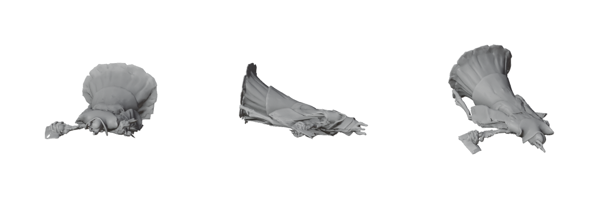
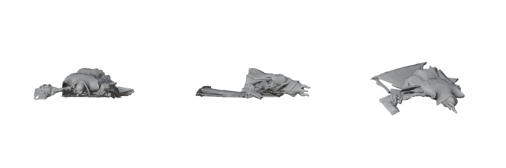
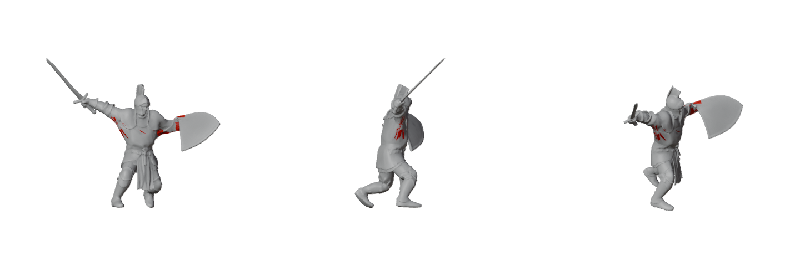
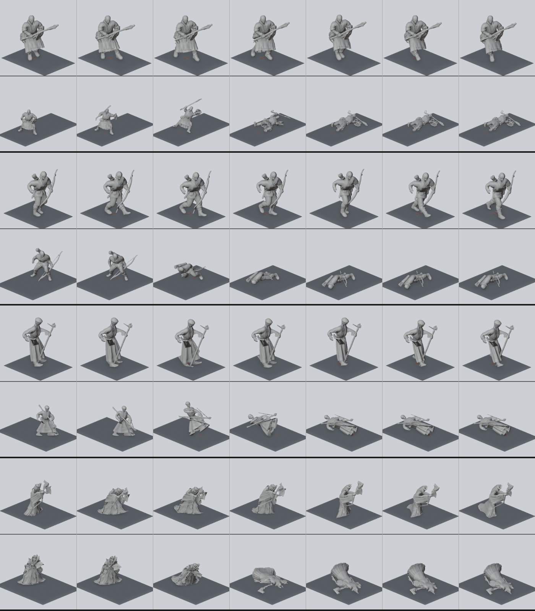
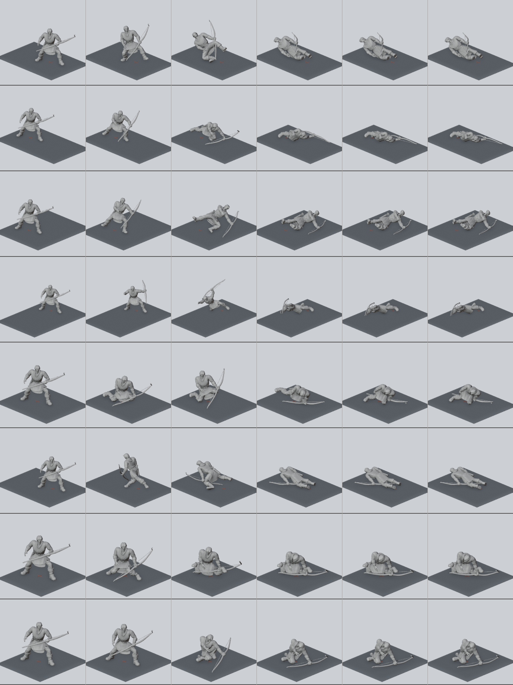
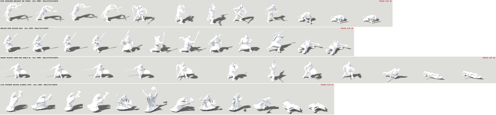

# Модуль motion_style — своя манера движения и разные смерти (11.10.2026)

Требование владельца: все персонажи «Врат» разные — каждый ходит по-своему, смерти разные, каждый
уникален. В библиотеке 38 клипов Mixamo, из них 4 разные ходьбы и 5 смертей; на 79 концептов этого мало.
Шаг `motion_style` делает из одного клипа много: поверх клипов `retarget` накладывает манеру персонажа
(темп, шаг, руки, наклон, сутулость, покачивания, хромота, развязность, скованность) и заменяет смерть
процедурной (8 вариантов, у каждого свой разброс от зерна). Пакетный скрипт `scripts/forge-concepts.mjs`
даёт каждому персонажу свою комбинацию клипов, своё зерно и свой вариант смерти.

Файлы: `scripts/blender/steps/motion_style.py` (шаг), `steps/_style_lib.py` (ядро),
`scripts/blender/tests/test_motion_style.py` (10 тестов), регистрация в `server/forge-steps.mjs`,
тесты реестра в `tests/forge-steps.test.mjs` и `tests/forge-routes.test.mjs`.

## Место в конвейере

```
cleanup → rig_humanoid → retarget → motion_style → render_sprites (heroes_gates) → godot_package
```

Вход — `animated.blend` шага `retarget` (слот `blend`); `clips.json` рядом с ним даёт категории, петли и
передвижение. Выходы — как у `retarget`: `styled.glb` (одна анимация glTF на клип, имена те же, суффикс
`-loop` сохранён), `styled.blend`, `clips.json`, `preview.png` (строка на клип). Дальше всё работает без
изменений: спрайты и пакет Godot берут `.blend` и `.glb` из цепочки.

## Как это устроено

Каждый клип читается покадрово (действия `retarget` пишут ключ на каждый кадр каждой кости) в мировые
повороты костей и положение таза. Манера накладывается в локальных поворотах (относительно родителя) и
в положении таза, потом ноги заново решаются аналитическим двухзвенным IK из `_anim_lib`: стопа идёт по
своей (при изменённом шаге — пересчитанной) траектории, ориентация стопы сохраняется, лодыжка не ниже
высоты покоя. Запись — тем же `write_action`, что у `retarget`.

| ручка | нейтраль | диапазон | что делает |
|---|---|---|---|
| `tempo` | 1.0 | 0.8–1.25 | скорость клипа; петля пересэмплируется на целое число кадров, шов закрыт; у ходьбы растёт скорость по земле |
| `stride` | 1.0 | 0.7–1.35 | длина шага: на опоре стопа = стопа источника, сдвинутая со скоростью (stride − 1) × скорость «беговой дорожки», поэтому все точки опоры (пятка, плоская стопа, подушечка) едут с одной скоростью, только быстрее; в переносе сдвиг возвращается; высота шага × √stride; если нога не достаёт — сначала поднимается пятка (до 5 см), потом опускается таз (до 7 см) |
| `arm_swing` | 1.0 | 0.2–2.0 | размах Arm/ForeArm вокруг среднего положения клипа |
| `lean` | 0 | −1…1 | наклон позвоночника: +1 = 12° вперёд, −1 = 12° назад; голова возвращает 60 % взгляда. Клип, который уже идёт согнувшись (зомби-шаг, боевая стойка), получает меньше: после 12° среднего наклона корпуса прямой наклон и сутулость затухают к 27° (`forward_knobs_scale` в отчёте) |
| `hunch` | 0 | 0…1 | круглая спина, плечи вперёд и вниз, шея вперёд, подбородок вверх |
| `head_bob` | 1.0 | 0.3–2.0 | вертикальное покачивание таза и головы вокруг среднего |
| `sway` | 1.0 | 0.2–2.5 | боковое покачивание таза вокруг среднего |
| `limp`, `limp_side` | 0, l | 0…1 | «щадящая» походка: пока больная нога под весом, таз проседает (до 4,5 см) и уходит в её сторону, корпус кренится, стопа волочится (шаг ниже на 65 %). Длина шага и ритм симметричны — иначе опорные стопы скользили бы |
| `swagger` | 0 | 0…1 | корпус назад, грудь вперёд, плечи назад, локти в стороны, больше поворот таза и боковое покачивание |
| `stiffness` | 1.0 | 0.5–1.8 | >1 гасит, <1 усиливает все движения позвоночника, шеи, головы, плеч и рук (амплитуда 1/stiffness) |

**Зерно.** `seed` — число или строка (пакет передаёт имя файла концепта). Ручки, не заданные явно,
выбираются из него детерминированно (`_style_lib.style_from_seed`): каждая где-то в правдоподобной полосе,
хромота у ~16 % и развязность у ~25 % персонажей, остальные ходят здорово. `build` сдвигает выбор:
`heavy` медленнее и скованнее, `armored` чуть медленнее и с меньшим махом рук, `robed` с коротким шагом,
`light` быстрее, `skeleton` скованный и сутулый, `zombie` хромает и сутулится. Без зерна ручки
нейтральные. Явные значения важнее зерна. Итоговая манера и источник каждой ручки (`param` / `seed` /
`neutral`) пишутся в `clips.json`.

**Веса категорий** (`CATEGORY_WEIGHTS`): ходьба берёт всё; покой — без шага, с половиной маха рук и
хромоты (вес на здоровую ногу); атака и каст сохраняют руки и ноги клипа, берут 60 % наклона и
сутулости, темп на 60 %; удар — похоже; смерть не трогается (у неё свой тайминг). `clips` задаёт
значения у отдельного клипа (по имени или категории) или `false` — не трогать; `apply` — какие категории
вообще получают манеру.

**Предметы в руках** (`hold_props`). Предмет, жёстко привязанный к кисти (вес ≥ 0,99, дальше 12 см от
запястья), находится по весам `rig_humanoid`. Если он в покое смотрит вверх и поднимается выше кисти на
0,3 м (посох, знамя, копьё, лук) — в покое, ходьбе и ударе он остаётся почти вертикальным: кисть гасит
мах предплечья, который 22-костные клипы militia/angel/zombie без ключей кисти передали бы предмету
(тест: наклон посоха в ходьбе с `arm_swing` 1,8 без коррекции заметно больше и падает до < 25°). Во всех
клипах ни одна из ~100 точек предмета не уходит под пол — кисть доворачивает предмет, пока точка не ляжет
на пол (посох упирается в землю, меч лежит рядом с телом).

## Смерти

`death`: `library` (смерть из библиотеки как есть) | `auto` (вариант из зерна; `crumble` только при
`undead: true`) | вариант явно. `death_blend` < 1 смешивает процедурную смерть с библиотечной (повороты
через slerp, тело потом снова кладётся на пол). Начальная поза — первый кадр библиотечной смерти (стойка,
из которой персонаж умирает).

| вариант | что происходит |
|---|---|
| `fall_back` | отдача от удара спереди (корпус и голова назад, руки вперёд/вверх/вниз — по зерну), колени подгибаются, тело опрокидывается назад, удар о землю с отскоком, голова хлёстко откидывается и ложится набок, руки раскидываются по полу |
| `fall_forward` | удар сзади, падение лицом вниз, руки вперёд или вдоль тела, голова повёрнута набок |
| `fall_left`, `fall_right` | удар сбоку, падение на бок, верхняя нога согнута сильнее (как «поза восстановления») |
| `kneel_collapse` | ноги подкашиваются — колени ударяются о пол (свободное падение таза), секунда покачивания на коленях, затем падение вперёд с перекатом на бок; голени остаются на полу |
| `spin_fall` | удар в плечо разворачивает тело на 110–200°, потом падение назад |
| `slump_sit` | ноги отказывают, персонаж садится (удар тазом о пол с отскоком) и обмякает вперёд набок или заваливается на спину |
| `crumble` | нежить: шатание с затухающей дрожью («магия уходит из костей»), затем обрушение вниз через колени и позвоночник, куча на полу |

Физика тайминга. Опрокидывание — уравнение перевёрнутого маятника θ'' = (3g / 2L)·sin θ с толчком от
удара: медленное начало, быстрый конец; удар о землю через 0,8–1,0 с после начала падения (на коленях
— 1,4 с), затухающий отскок 3–4°, хлёст головы, оседание; после — 0,25 с неподвижности. Всё разбросано
от зерна: направление ±18°, сила толчка, тайминг ±10 %, поза рук, поворот головы, какое колено сильнее.

Пол. 1) Туловище, голова и бёдра (их вершины по доминирующей кости) после удара лежат ровно на полу:
опрокинутое тело, ушедшее под пол, доворачивается назад вокруг той же точки опоры (стопы остаются на
месте, тело лежит под меньшим углом), остаток — подъём; до удара тело только поднимается, если ушло в
пол. 2) Запястья, локти, лодыжки, колени — двухзвенным IK над полом; затем каждый сегмент конечности
(бедро, голень, стопа, пальцы, плечо, предплечье, кисть) по своим вершинам доворачивается вокруг своего
сустава, пока самая низкая не ляжет на пол. 3) Предмет в руке после удара ложится плашмя и не уходит в
пол. 4) Что-то ещё ниже пола (наплечник, плащ) поднимает весь кадр. Проверка `death_on_floor_death`
(ошибка): самая низкая вершина последнего кадра в пределах ±2 см от z = 0.

## Мантия после смерти: `robe_settle` (11.10, ночь)

Под линейным скиннингом мантия/юбка лежащего тела — жёсткий конус, который несут таз и бёдра: после падения он
торчит «колоколом» (пилот: лич). Дешёвое исправление без симуляции — **корректирующая форма**:

1. На последнем кадре смерти каждая вершина ткани (маска ткани: несёт Hips ≥ 0,25 ниже тазобедренных суставов
   — та же, что у посадки смерти на пол) выше того, что под ней лежит (не-ткань тела в 4 см по горизонтали, иначе
   пол), опускается на эту опору с сохранением 20 % своей высоты над ней: роба ложится на ноги и на пол.
2. Мировые смещения переводятся в смещения формы в позе покоя через якобиан скиннинга этого кадра, измеренный
   численно (три единичных смещения через модификатор Armature), — форма даёт ровно эту фигуру на лежащем теле.
3. Форма `imaginarium_death_settle` управляется драйвером от свойства кости Hips; клип смерти поднимает его 0 → 1 между
   ударом о землю и оседанием (от ¼ до ⅔ пути после удара), все остальные клипы держат 0 (иначе после смерти
   свойство осталось бы в следующем клипе). В Blender её видят `render_sprites` и превью; экспортёр glTF
   сэмплирует формы, управляемые арматурой, в анимацию весов морфа: в `styled.glb` морф `imaginarium_death_settle`,
   у смерти веса 0 → 1, у остальных клипов 0 (проверено чтением GLB).
4. Форма не создаётся, если ткани нет или «колокол» ниже 10 см. Отчёт: `death_info.robe_settle`
   (`bell_height_cm` до, `bell_height_after_cm` после, `max_drop_cm`, вершины, кадры рампы).
   `robe_settle: false` — выключить.

Лич (fall_forward): колокол 107 см → 21,5 см (опущено 7 214 вершин, до 86 см); тело по-прежнему на полу
(`death_on_floor`). На робе-манекене теста — то же поведение и морф в GLB. Ограничение: это не ткань — роба не
сминается складками и не учитывает столкновения, просто ложится на опору; в первых кадрах падения конус
остаётся конусом.




## Разрывы на настоящих клипах: `deform_qa` (11.10, ночь)

Проверка позами `rig_humanoid` (руки прямо вверх и вперёд, глубокий присед, длинный шаг) — заместитель: таких
поз в клипах «Врат» почти нет. `motion_style` меряет то же самое на **итоговых клипах персонажа** (после
`retarget` и манеры), `_style_lib.ClipDeformQA`:

- каждый `deform_every`-й кадр (по умолчанию 2-й и всегда последний) каждого клипа вычисляется настоящей сеткой
  (Armature + формы, включая `imaginarium_death_settle`); «порвано» — как в проверке позами: доля **площади позы**,
  занятая треугольниками, выросшими больше чем в 3 раза; заглушки у пола и щепки исключены;
- пороги — те же, что у проверки позами: **1 %** в кадре, где обе руки не выше 90° от «висят вниз» (опорная
  точка «руки вперёд»), **8 %** при руке, поднятой на 170° (опорная «руки вверх»), между ними — линейно по
  самой поднятой руке (`clip_limit`); у ткани робы — своя доля, **4 %**;
- на клип: худший кадр относительно его порога, доля, класс кадра (`main` / `raised_<угол>` / `arms_up`),
  кости, на которых рвётся, число кадров над порогом (`clips.json` → `deform`, `stats.deform_qa`); проверки
  `clip_torn_<клип>` с важностью `deform_gate` (`error` по умолчанию: персонаж, у которого рвутся настоящие
  клипы, не проходит шаг с числами; `warning` — только отчёт). `deform_limits` меняет пороги.

**Политика пакета** (`forge-concepts --qa clips`, по умолчанию): риг идёт с `deform_gate: warning` (числа поз —
в отчёт), решает `deform_qa`. Честный итог пилота: клипы **не мягче** поз. В них есть то, чего в позах нет:
сгиб локтя (слитый с предплечьем щит рвётся у плеча), повороты корпуса, смерти. Из пяти пилотных персонажей
клипы не прошёл ни один (таблица в «Пилот 11.10, поздняя ночь»): Healing monk, пока булава была на весах тепла, проходил
позы (0,56 / 1,68 / 0,73 / 0,15 %), а в idle уже 2,8 % (щит у плеча рвётся при сгибе локтя); с жёсткой булавой
(финал) — позы 5,1 / 11,8 / 2,9 / 0,7 %, idle 5,4 % (кулак слит с робой). Порванные треугольники видны на кадрах (красным — кадр атаки рыцаря #3, 5 %:
подмышка поднятой руки и предплечье за щитом):



Чтобы видеть такие персонажи, пакет умеет `--qa-render-failed`: клипы меряются тем же порогом, но цепочка не
останавливается — спрайты и превью делаются для просмотра, персонаж помечается `failed_qa` (превью
`<имя>.failed.png`, числа в отчёте). `--clip-limits main,arms_up,robe` — другие пороги, если владелец решит,
что 1 % на клипах слишком строго (по умолчанию — пороги проверки позами, как требовалось).

## Замеры на лучнике HG (Blender 5.0.1)

Риг `rig_humanoid` (лук жёстко в левой руке), клипы militia-idle / angel-walk / archer-attack / militia-hit /
militia-death через `retarget`, затем `motion_style`: весь шаг — 4 с на 5 клипов.

| что | вход (`retarget`) | после `motion_style` |
|---|---|---|
| ходьба, темп 1,15, шаг 1,25: скольжение стоп / скорость по земле | 2,6 см / 1,19 м/с | 2,6 см / 1,49 м/с (= × 1,25) |
| ходьба: ниже пола | −4,4 см (носки на отрыве пятки) | −1,4 см (пальцы сгибаются вверх) |
| атака: ниже пола | −16,7 см (нижнее плечо лука) | +0,1 см (кисть доворачивает лук) |
| смерть: ниже пола | −61 см (militia-death на этом риге проваливается) | процедурная: конец на полу (±0,3 см), 8 вариантов разные |
| шов петель | 0° / 0 мм | 0° / 0 мм |

Посох манекена в ходьбе militia (без ключей кисти, `arm_swing` 1,8): без `hold_props` наклоняется заметно,
с ним — меньше 25° (тест `test_real_staff_stays_upright_in_the_walk`); посох послушника в ходьбе — 21°
против 100–107° на входе, в покое 7° против 32°.

## Проверки и `clips.json`

Ошибки: NaN; шов петли ≤ 0,5° и ≤ 1 мм; имена анимаций в GLB; сокеты; NaN в GLB; скин;
`death_on_floor_*`; `clip_torn_*` (важность — `deform_gate`). Предупреждения: `foot_skate_*` (скольжение больше max(2 см, 1,3 × вход)) и
`floor_body_*` (тело ниже пола больше 2 см).

У клипа: `mode` (`styled` / `procedural_death` / `untouched`), `style` (итоговые ручки клипа),
`frames_in` → `frames`, `tempo_real`, `foot_skate_cm` и `foot_skate_in_cm` (скольжение по кадрам контакта
входа; для ходьбы на месте — в системе, где игра двигает персонажа), `foot_plant_drift_cm`,
`ground_speed_mps` и `ground_speed_in_mps` (скорость, с которой игра должна двигать персонажа),
`hips_drop_max_cm`, `ik_unreached_frames`, `prop_fixes`, `clip_trunk_lean_deg` и `forward_knobs_scale`, `floor` (самая низкая точка тела по 16 кадрам),
`seam_rot_deg`/`seam_pos_mm`; у смерти — `death`, `death_info` (`impact_s`, `impact_frame`, `arms`,
`direction_deg`, `tilt_back_deg`, `trunk_lift_cm`, `limb_floor_fixes`, `prop_floor_fixes`,
`mesh_floor_correction_cm`, `settled_trunk_low`), `death_final_lowest_m` (без ткани робы) и `death_cloth_lowest_m`. На верхнем уровне — `style`, `style_source`, `seed`, `build`, `death`,
`held_props`.

## Параметры

```json
{"step": "motion_style",
 "inputs": {"blend": "abs/animated.blend"},
 "params": {"seed": "Knight_holding_sword_and_shield_20261010233748_2.jpg", "build": "armored",
            "tempo": null, "stride": null, "arm_swing": null, "lean": null, "hunch": null, "head_bob": null,
            "sway": null, "limp": null, "limp_side": null, "swagger": null, "stiffness": null,
            "clips": {"walk": {"stride": 1.2}, "attack": false}, "apply": null,
            "death": "auto", "death_blend": 1.0, "undead": false, "hold_props": true, "floor": true,
            "floor_tolerance_m": 0.02, "floor_samples": 16, "ground_samples": 2000,
            "preview": true, "preview_cols": 6, "preview_tile": 220,
            "robe_settle": true, "deform_qa": true, "deform_every": 2, "deform_gate": "error", "deform_limits": null},
 "out_dir": "abs/out"}
```

Запуск: `blender -b --factory-startup --python scripts/blender/imaginarium_run.py -- motion_style request.json`.
Тесты: `blender -b --factory-startup --python scripts/blender/tests/run_tests.py -- motion_style`.

## Пакет «Врат»: `scripts/forge-concepts.mjs`

1. **Роли — из `roles.json`** в папке концептов (`{файл: {role, hand_weapon, hand, shield, faction, build,
   notes}}`, составлен по каждой картинке), иначе по имени файла (обрезанные имена учтены: `…sta…` —
   посох, `…sword an…` — со щитом). Роли: `melee_shield`, `melee`, `melee_spear`, `ranged`, `caster`,
   `zombie`, `creature`, `skip`.
2. **Клипы по кругу.** Для каждой роли — все подходящие клипы библиотеки (покой, шаг, атака или каст,
   удар, смерть; нежить дополнительно получает зомби-шаг, -покой, -удар, -смерть). В каждом слоте берётся
   наименее использованный по всему пакету вариант, не такой, как у предыдущего персонажа и у предыдущего
   персонажа той же роли; вся пятёрка новая внутри роли. На 77 гуманоидов — 75 разных пятёрок (2 совпадения
   между разными группами, у них всё равно разные зерно и смерть).
3. **`motion_style` после `retarget`**: `seed` = имя файла, `build` из `roles.json`, вариант смерти по кругу
   внутри стороны (`order`: 7 процедурных + библиотечная; `undead`: те же + `crumble` дважды в круге).
   У лука в правой руке клипы лучника играются зеркально.
4. Остальное как было: чистка, риг, перенос, спрайты `heroes_gates`, пакет Godot с эффектами по роли.
5. Комбинация (клипы, вариант смерти, зерно, сложение) и итоговая манера пишутся в state и в отчёт.
6. **Проверка** `--qa clips` (по умолчанию) | `pose` | `off` (= `--no-rig-qa`): см. «Разрывы на настоящих клипах»;
   `--qa-render-failed`, `--clip-limits`. Числа поз, клипов, мантии, ячейки — в state (`qa`, `qa_fail`) и в
   колонке «Проверка» отчёта.
7. **`--watch`** — сборка вслед за генерацией: свой `--state`, идентификаторы генераций каждые `--watch-poll` с
   (60) перечитываются из состояния папки (только чтение; повтор генерации в standard подхватывается), готовые
   персонажи сразу идут в кузницу, ещё не готовые ждут. Наблюдение кончается, когда у каждой картинки (кроме
   `skip`) генерация завершена, — тогда дожидается кузницы и пишет отчёт. Если состояние папки не меняется
   `--watch-stall` мин (45), наблюдение останавливается с отметкой в отчёте. Нужен `--direct` (студия держит
   старый реестр); GPU-шаги берут общий мьютекс `Global\HG_GPU_RENDER`, поэтому рендеры спрайтов идут между
   генерациями.
8. **Превью**: каждому готовому персонажу — `<папка>/previews/<имя>.png`: строка кадров шага, атаки/каста и
   смерти из листов «Врат» (вид base, масштаб листа, все кадры обрезаны одним окном по телу — линия земли и
   размер сравнимы, подпись: имя, ячейка, клипы); не прошедшему проверку клипов — сетка клипов
   `motion_style` или (с `--qa-render-failed`) та же строка как `<имя>.failed.png`; с отчётом — лист
   `previews/_contact_sheet.png`. PNG читаются и пишутся прямо в Node (zlib), без зависимостей. `--previews-only` пишет превью,
   лист и отчёт заново из `--state`, ничего не собирая.
9. В `roles.json` у файла можно задать `"rig": {"front": "-Y", "fix_yaw": false, "markers": {...}}` — параметры
   `rig_humanoid` этого персонажа (плащ, сбивающий определение лица).
10. `--state <файл>` — отдельное состояние (пилот); идентификаторы генераций берутся из состояния папки
   только для чтения. `--no-gen` — никогда не запускать генерацию. `--direct` — кузница в этом процессе
   (тот же движок `server/forge-pipeline.mjs`, та же библиотека; замок GPU общий с генерацией через
   мьютекс Windows), нужен, пока работающая студия держит старый реестр шагов без `motion_style`.
   `--dry` печатает роли и комбинации.

Студия загружает `server/forge-steps.mjs` при старте: чтобы `motion_style` был виден в мастере и в
HTTP-режиме пакета, студию нужно перезапустить (после того как закончится текущая генерация).

## Пилот на генерациях пакета (11.10, ночь)

Пока пакет генерировал модели (по одной, ~3–5 мин), пилот собирался тем же скриптом из готовых генераций:
`node scripts/forge-concepts.mjs --dir C:\Imaginarium\incoming\hg_concepts_2026-10-11 --state
C:\Imaginarium\incoming\pilot\pilot<N>.state.json --direct [--no-rig-qa] --only "<regex>"` (студия не
перезапускалась, генерации не запускались, задачи не отменялись). Состояния и отчёты пилота —
`C:\Imaginarium\incoming\pilot\pilot*.state.json` / `*.report.md`, сравнительный лист —
`C:\Imaginarium\incoming\pilot\compare_walk_death.png` (копия: `img/motion_style/pilot_walk_death.png`).

**Главная находка: риг генераций.** До `motion_style` доходит мало персонажей — `rig_humanoid` с
проверками по умолчанию на 18 готовых гуманоидах пакета:

| итог `rig_humanoid` | персонажи |
|---|---|
| ok полностью | Healing monk |
| ориентиры в порядке, не прошла проверка позами (роба/плащ сросшиеся, рвутся) | Acolyte, Chaplain, Cleric, Hierophant, Archer captain, Archer holding tall longbow (только присед 1,3 %), Inquisitor, Lich sorcerer |
| отказ по ориентирам: меч вперёд или в сторону сросся с рукой («рука» 0,6–0,95 H) | Armored warrior, Bone swordsman, Forest warden, Knight ×3 (из пяти проверены три) |
| отказ по ориентирам: лук горизонтально | Arcane archer, Huntsman |

Поэтому пилот собран с `--no-rig-qa` (риг без проверки позами — только для пилота; в отчёте помечено)
везде, кроме Healing monk. Мечи, направленные вперёд, — следующий разрыв авторига на пакете (детектор
предметов не видит клинок, который в срезах вдоль Y толще 0,032 H); это отдельная работа (сделано той же ночью:
`find_blades`, humanoid.md → «Мечи, булавы и древки под углом»; «колокол» робы — `robe_settle` выше).

| персонаж (роль, сторона) | клипы: покой / шаг / атака или каст / удар / смерть библиотеки | манера из зерна (имя файла) | смерть | шаг: скольжение цель/вход, скорость по земле | итог цепочки |
|---|---|---|---|---|---|
| Healing monk (caster, order) | militia-idle / angel-walk / knight-rider-cast / militia-hit / militia-death | темп 1.14, шаг 0.87, руки 1.22, вбок 1.52 | fall_left, удар 0,96 с, конец 0,3 см над полом | 2,7 / 2,6 см; 1,04 м/с (вход 1,19) | риг **с** проверкой позами, `motion_style` без предупреждений; спрайты «Врат» не прошли `cell_fit`: широкая стойка с булавой и щитом касается края ячейки 320 px уже в покое и шаге (не из-за смерти) |
| Archer holding tall longbow (ranged, order) | militia-idle-lookaround / militia-walk / archer-shoot-aim-recoil / militia-hit-head / archer-death | темп 1.03, шаг 1.17, наклон 0.22, скованность 0.91 | fall_right, 0,89 с, на полу | 2,6 / 2,6 см; 1,81 м/с (вход 1,55) | готово: спрайты «Врат» и пакет Godot (риг без проверки позами) |
| Acolyte holding staff and book (caster, order, роба) | archer-idle / militia-walk / necro-rider-cast / militia-hit / militia-death | темп 0.91, шаг 0.83, руки 0.38, вверх-вниз 1.45, скованность 1.21 | fall_back, 0,98 с, на полу; роба уходит под пол до 10 см | 5,1 / 5,2 см; 1,14 м/с (вход 1,36) | готово: спрайты и Godot (риг без проверки позами) |
| Lich sorcerer (caster, undead, скелет в робе) | zombie-idle / zombie-walk / necro-rider-cast / zombie-hit / zombie-death | темп 1.12, наклон 0.77 → 0 (зомби-шаг уже наклонён на 28°), сутулость 0.31 → 0, скованность 1.48 | fall_forward, 1,06 с | 10,3 / 10,2 см (волочение зомби); 0,38 м/с | `motion_style` ok; в смерти роба торчит «колоколом» (жёсткий конус) |

Ближнего боя в пилоте нет: ни один готовый мечник пакета не прошёл ориентиры (таблица выше); копейщик
(Conscript), крестоносец и культист (pilot3) на момент отчёта застряли в чистке — долгий запекающий проход
ждёт свободной видеокарты между генерациями.

Что видно на листе (две строки на персонажа: шаг, смерть; 7 кадров): шаги разные по клипу, темпу, длине
шага и посадке; посох и лук в шаге стоят вертикально; смерти разные по варианту и направлению, тела в
конце лежат на полу.




Найдено пилотом и исправлено по ходу: посох, упиравшийся в пол, наклонялся (теперь рука приподнимает
кисть, посох стоит); тело в робе после падения оставалось полусидя — роба под линейным скиннингом —
жёсткий конус (теперь роба не держит тело над полом, её уход под пол пишется в `death_cloth_lowest_m`);
опрокинутое тело «поднималось» углом вместо подъёма (теперь точка опоры — край тела, доворот назад не
больше 12°); проверка пола по выборке 2000 вершин пропускала тонкие части (теперь последняя треть смерти
выравнивается по настоящей сетке). Спрайты «Врат» с длинным посохом выходили из фиксированной ячейки
320 px — рука с предметом длиннее 1,2 м в смерти теперь опускается вдоль тела.

## Пилот 11.10, поздняя ночь: мечники и производственная проверка

Тот же скрипт, состояние `C:\Imaginarium\incoming\pilot2\pilot2d.state.json` (отчёт `pilot2d.state.report.md`),
`--direct --qa-render-failed` (клипы меряются, но спрайты делаются для просмотра; рендеры ждали общий мьютекс
видеокарты между генерациями; рыцарь #5 добавлен как ближайший к порогу). `--watch` проверен отдельным прогоном (`pilot2.state.json`): «Necromancer warrior
holding sword» ещё генерировался, сборка подхватила его в 19:06:46 через полминуты после конца генерации и
завершилась, когда у всех выбранных картинок генерация закончилась.

| персонаж | риг (позы, %: вперёд / вверх / присед / шаг; только отчёт) | клипы: худший кадр, % (idle / walk / атака или каст / hit / death) | мантия, % | ячейка, масштаб | смерть | итог |
|---|---|---|---|---|---|---|
| Bone swordsman wielding two swords | 2,77 / 7,3 / 0,56 / 0,19 | 1,68 / 7,51 / 5,7 / 3,61 / 5,8 | — | 448 (из 320), 100,82 px/м | crumble | failed_qa (спрайты для просмотра) |
| Healing monk holding mace | 5,13 / 11,81 / 2,87 / 0,65 | 5,4 / 7,29 / 11,61 / 8,53 / 13,09 | — | 384 (из 320), 100,89 px/м | fall_left | failed_qa (спрайты для просмотра) |
| Knight holding sword and shield #3 | 2,47 / 5,05 / 0,03 / 0,01 | 3,33 / 3,74 / 5,01 / 3,19 / 5,45 | 0 | 448 (из 320), 100,92 px/м | fall_forward | failed_qa (спрайты для просмотра) |
| Knight holding sword and shield #5 | 2,5 / 5,92 / 0,11 / 0,08 | 2,24 / 1,36 / 2,94 / 1,85 / 1,23 | — | 448 (из 320), 100,83 px/м | fall_right | failed_forge: render_sprites checks failed: cell_fit, frames_body_inside_cell |
| Lich sorcerer holding glowing staff | 9,26 / 28,21 / 3,55 / 1,23 | 11,33 / 19,88 / 32,83 / 17,93 / 34,09 | 50,69 | 320, 100,85 px/м | fall_forward; роба 107,3 → 21,5 см (колокол) | failed_qa (спрайты для просмотра) |

Ни один не прошёл проверку клипов с порогами проверки позами. Где рвётся (кости худшего кадра): лич — роба,
сросшаяся между ног (RightUpLeg / LeftUpLeg, мантия до 51 %); рыцарь #3 — предплечье за щитом и подмышка
поднятой руки (LeftForeArm, LeftHand, Spine1); Healing monk — кулак с булавой, слитый с робой (RightForeArm,
RightUpLeg); костяной мечник — рваный табард и подмышки (Spine, LeftUpLeg, LeftArm). Превью (строки кадров шага,
атаки/каста и смерти) — `C:\Imaginarium\incoming\hg_concepts_2026-10-11\previews\<имя>.failed.png`, лист —
`previews\_contact_sheet.png` (копия: `img/motion_style/pilot2_contact_sheet.png`).



## Честные ограничения

- Это не захват движения: манера — деформация существующих клипов. Сильные значения (сутулость 1, наклон
  1, хромота 1) дают карикатуру; пакет держит их в правдоподобных полосах.
- Хромота сделана просадкой таза, креном и волочением стопы при симметричном ритме: настоящая хромота
  с укороченной опорой на больную ногу дала бы скольжение стоп при постоянной скорости игры.
- `stride` > 1 у коротконогих персонажей упирается в длину ноги: сначала поднимается пятка, потом
  опускается таз (до 7 см) — видно как присед на ходу.
- Атаки и касты меняются только темпом, наклоном и скованностью: другой удар — это другой клип.
- Каст в библиотеке один подходящий (`necro-rider-cast`, записан для всадника; ноги держит IK), второй
  (`knight-rider-cast`, горизонтальный взмах) идёт только безоружным и с короткими предметами.
- `deform_qa` меряет всю площадь, в том числе скрытую (за щитом, под робой) и щепки, выросшие из очень мелких
  треугольников: доля над порогом не всегда видна на спрайте 100 px/м. Пороги — те же, что у проверки позами;
  мягче их пакет не делает без явного `--clip-limits`.
- `robe_settle` — одна корректирующая форма на конец смерти, а не ткань: в падении роба остаётся конусом, на
  полу лежит без складок и столкновений; в GLB это морф с анимацией весов (Godot его импортирует).
- Процедурная смерть — ключевые позы с физическим таймингом, а не симуляция: тело не сталкивается само с
  собой (рука может пройти через бедро), одежда не падает отдельно, щит и плащ не отлетают.
- Пол проверяется по выборке из 2000 вершин; итоговая проверка — по всей сетке последнего кадра. Плащи,
  опущенные ниже стоп, могут поднять тело на 1–5 см (`extra_lift_cm`).
- Предмет в руке остаётся жёстким: лук не ломается, но при падении может лечь поверх тела.
- Лук в правой руке (11 концептов): пакет играет клипы лучника зеркально (`mirror: true`). Зеркало
  просмотрено на выстреле лучника HG: руки меняются ролями, стойка разворачивается в другую сторону; на
  персонаже с луком в правой руке в пилоте не проверялось.
- Генерации Hunyuan часто не проходят `rig_humanoid` (длинный меч в сторону, сросшиеся рукава, плащ) —
  тогда до `motion_style` дело не доходит. См. пилот.

## Что докачать с Mixamo для разнообразия

Имена — как их помню в каталоге mixamo.com, это **примеры для поиска**, точное название на сайте может
отличаться. Качать FBX, Without Skin, 30 fps; для ходьбы и бега включить In Place. Всё — на одном
персонаже (Y Bot), затем `node scripts/forge.mjs clips import <папка>`.

**Ходьбы (самое важное — сейчас их 4):** «Walking», «Standard Walk», «Female Walk», «Old Man Walk»,
«Drunk Walk», «Injured Walk», «Walking With Limp» / «Limping», «Sneak Walk» / «Sneaking Forward»,
«Crouched Walking», «Swagger Walk», «Cocky Walk», «Strut Walking», «Sad Walk», «Happy Walk», «Brutal
Walk», «Orc Walk», «Mutant Walking», «Zombie Walk» (другие варианты), «Sword And Shield Walk», «Great
Sword Walk», «Rifle Walk» (для арбалета), «Walking Backwards».

**Смерти (сейчас 5):** «Dying», «Falling Back Death», «Falling Forward Death», «Standing Death Left 01/02»,
«Standing Death Right 01/02», «Standing Death Backward 01», «Standing Death Forward 01», «Sword And Shield
Death», «Great Sword Death», «Two Handed Sword Death», «Zombie Dying», «Shot And Fall Backwards»,
«Headshot», «Knocked Down» / «Knocked Out».

**Атаки по оружию:** меч и щит — «Sword And Shield Slash», «Sword And Shield Attack», «Sword And Shield
Kick», «Sword And Shield Casting»; двуручный — «Great Sword Slash», «Great Sword High Spin Attack»,
«Great Sword Jump Attack»; одноручный — «Standing Melee Attack Horizontal», «Standing Melee Attack
Downward», «Standing Melee Attack Backhand»; древковое — «Standing 2H Melee Attack», «Spear Thrust»
(если найдётся); лук — «Standing Aim Recoil», «Standing Draw Arrow», «Standing Aim Walk Forward»;
арбалет — «Rifle Aiming Idle», «Shooting» (пистолетные/винтовочные клипы как основа); без оружия —
«Punching», «Hook Punch», «Mma Kick»; нежить — «Zombie Attack», «Zombie Punching», «Zombie Scream».

**Касты:** «Standing 1H Magic Attack 01/02/03», «Standing 2H Magic Attack 01–05», «Standing 2H Magic
Area Attack 01/02», «Standing 2H Cast Spell 01», «Spell Casting», «Magic Heal», «Casting Spell»,
«Wide Arm Spell Casting», «Two Hand Spell Casting», «Kneeling Pointing» (благословение).

**Покой и удары (меньше, но для разнообразия):** «Breathing Idle», «Happy Idle», «Bored», «Looking
Around», «Warrior Idle», «Sword And Shield Idle», «Great Sword Idle», «Standing Idle 03»; «Hit Reaction»,
«Standing React Large From Front / Back / Left / Right», «Head Hit», «Stomach Hit», «Big Hit To Head».

Каждый новый клип умножает разнообразие пакета: ротация в `forge-concepts.mjs` подхватывает всё, что
есть в библиотеке, если id добавить в пул роли (`poolsFor`).
