# Некромант на кузнице: сборка улучшенной модели (10.10.2026)

Модель некроманта после замены черепа (`work/skull_roi/runs/seed1234/replaced.glb`) доведена до
игрового персонажа шагами кузницы. В неё вошли костяные кисти из `bone_kit` вместо слитых «лопат»,
четыре объёмные застёжки, костяной посох как отдельный сменный предмет, риг, пять клипов, пакет
Godot 4.5.1 и два набора спрайтов. Результат сравнивался с референсом
`outputs/Necromancer/Reference-original.jpg`.

**v2 (10.10, ночь)** — пересборка тем же конвейером кузницы с исправленными пробелами; риг проходит
проверку разрывов. См. раздел «v2» в конце документа и `outputs/NecromancerForge/v2/`.

Готовые файлы v1 лежат в `outputs/NecromancerForge/`. Рабочая папка с короткими путями — `C:/afn/`
(`in/` входы, `req/` запросы, `runs/` прогоны, `tools/` скрипты анализа). Все запросы финальной
цепочки скопированы в `outputs/NecromancerForge/requests/`.

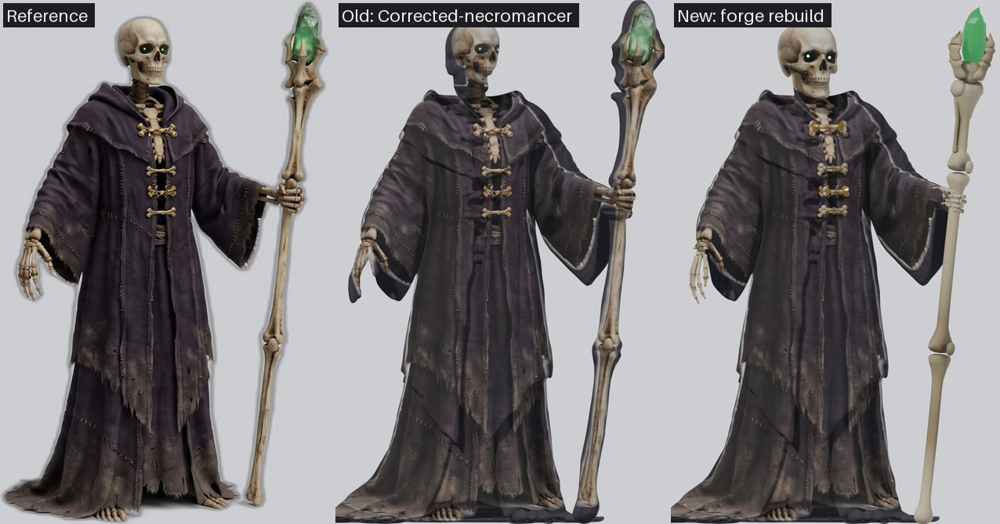

## Итог в цифрах

| | Значение |
|---|---|
| Треугольники | 75 298: тело 72 062 и посох 3 236. На входе было 133 476 |
| Кости | 25 `mixamorig:*` и `root` для root motion, в GLB 26 суставов. Пальцы не построены, см. ниже |
| Клипы, 30 к/с | `idle-loop` 154 к, `walk-loop` 37 к, `cast` 82 к, `hit` 39 к, `death` 94 к |
| Сокеты в GLB | 12: девять человеческих по §6, `socket_fx_tip_l`, `socket_grip_main_l`, `socket_grip_off_l` |
| QA рига (`rig_humanoid`) | **не проходит** проверку разрывов: «руки вперёд» 14,3 % при пороге 1 %, «руки вверх» 19,7 % при пороге 8 %. Присед 0,90 % (норма), шаг 1,21 % (порог 1 %), роба в шаге 1,79 % (порог 4 %). Невзвешенных вершин 0, не больше 4 влияний |
| Godot 4.5.1 | пакет проходит: сцена грузится, 5 анимаций, у `idle` и `walk` выставлен цикл, найдено 12 сокетов, эффект прикреплён, ошибок движка 0 |
| Спрайты | «Врата Героев», герой: 96 кадров, ячейка 448, якорь 224,384. iso8: 496 кадров при 100 px/м |
| IoU силуэта в калиброванном кадре | старая 86,4 % (студия считала 86,5 %), стартовая 86,6 %, **новая 86,1 %** (покрытие 94,9 %, точность 90,2 %). С подбором камеры новая даёт 88,4 % |

**Поправка к входным данным.** `replaced.glb` хранится не в 3,0 м, а уже в 1,8 м по габариту, потому что
`replace_part` запускался с `height_m: 1.8`. Верх габарита — кристалл старого посоха. Макушка
находится на 1,729 м, поэтому `rig_humanoid` масштабирует модель на 1,041192. Рамка до рига
переводится в рамку рига так: `x_rig = 1.041192·x + (0.054505, 0.057814, −0.000166)`. Это измерено
по совпадению вершин (`qa/prerig_to_rig_frame.json`), остаток 0.

## Порядок работы и почему он отличается от списка задачи

1. Чистка идёт **первой**. Прорежено только ИИ-тело. Детали `bone_kit` уже уложены в свои игровые
   бюджеты (кисть 3 000, посох 4 500, застёжка 600 треуг.), и их нет смысла прореживать повторно.
2. Старый посох и «лопаты» вырезаются одним вызовом `separate`.
3. Кисти ставятся новым шагом `place_parts` в режиме явной позы. `replace_part` для этого не подошёл,
   причины в разделе 3.
4. Застёжки ставятся тем же `place_parts` с привязкой к поверхности.
5. Рукав разобран в разделе 5. Честно исправить его имеющимися шагами не удалось.
6. Затем `rig_humanoid` с маркерами, `attach_prop` (посох как дочерний объект кости), `retarget`,
   `godot_package`, `render_sprites`.

Запуск любого шага:
```
"C:/Program Files/Blender Foundation/Blender 5.0/blender.exe" -b --factory-startup ^
  --python scripts/blender/af_run.py -- <step> C:/afn/req/<имя>.json
```

### 1. cleanup — 133 476 → 75 848 треуг. (`s01_clean`)
```json
{"step": "cleanup", "inputs": {"mesh": "C:/afn/in/start.glb"},
 "params": {"target_tris": 76000, "ground": false, "center": false, "name": "body"},
 "out_dir": "C:/afn/runs/s01_clean"}
```
`ground`/`center: false`: до самого рига сохраняется рамка старта. В этой рамке посчитаны все коробки,
точки застёжек и калиброванная камера. IoU до/после 0,9994, разница цвета 0,0093, карта 4K сохранена,
3,2 с.

### 2. separate — старый посох и обе «лопаты» (`s02_sep`)
Коробки старого посоха взяты из `STAFF_REGIONS` (`test_core.py`). Рядом с кулаком они заменены
узкими, чтобы не задеть предплечье. Кисти вырезаются от запястья: левая по плоскости `y = −0.205`,
где кончается предплечье и начинается кулак, правая по `z = 0.945`, у края рукава.
```json
{"mode": "regions", "ground": false, "center": false, "regions": [
 {"name": "old_staff", "min": [0.285, -0.37, -0.01], "max": [0.52, -0.17, 0.70]},
 {"name": "old_staff", "min": [0.285, -0.37, 0.70],  "max": [0.52, -0.21, 0.99]},
 {"name": "old_staff", "min": [0.40, -0.33, 0.99],   "max": [0.50, -0.21, 1.03]},
 {"name": "old_staff", "min": [0.40, -0.36, 1.20],   "max": [0.54, -0.21, 1.22]},
 {"name": "old_staff", "min": [0.38, -0.38, 1.22],   "max": [0.66, -0.16, 1.81]},
 {"name": "paddle_l",  "min": [0.36, -0.36, 1.03],   "max": [0.54, -0.205, 1.20]},
 {"name": "paddle_r",  "min": [-0.50, -0.30, 0.74],  "max": [-0.36, -0.12, 0.90]},
 {"name": "paddle_r",  "min": [-0.48, -0.27, 0.90],  "max": [-0.385, -0.12, 0.945]},
 {"name": "paddle_r",  "min": [-0.41, -0.27, 0.895], "max": [-0.375, -0.20, 0.93]}]}
```
Получились части `old_staff` (8 599 треуг., 2 куска), `paddle_l` (2 301), `paddle_r` (2 662) и
`body` (64 174). Все разрезы закрыты крышками, открытых швов нет. Старый посох ушёл целиком, кусок
древка в кулаке ушёл вместе с `paddle_l`. Коробки подбирались по горизонтальным и продольным срезам
(`tools/afn_slices.py`) и проверялись рендером тела без вырезанных частей. Первая версия оставила
навершие кулака над `z = 1.18`, вторая — щепку большого пальца. Обе ошибки исправлены.

Отдельно пробовал отрезать приросшее предплечье у самого обшлага (`y = −0.138`) и поставить вместо
него две кости предплечья из `bone_toggle`. Коробка задела ткань рукава, и плоская крышка
6 × 9 см закрыла обшлаг. Вариант отброшен, остался разрез у кулака.

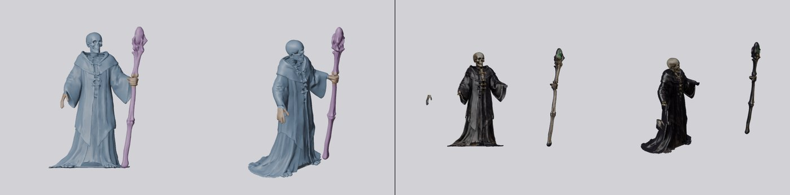

### 3. Кисти — bone_kit + place_parts (`k02`, `k03`, `s03_hands`)

**Масштаб.** Правая «лопата» тянется от выхода из рукава (z 0,955) до кончиков (z 0,77) на
0,20 м вдоль оси кисти. Это 0,117 высоты фигуры (1,729 м). На референсе кисть ещё крупнее: 0,135 H по
пикселям, рисунок стилизован. У обеих кистей выбрано `length_m: 0.21` в рамке старта, после рига это
0,219 м = 0,121 H. Откинутые пальцы позы `open` тогда дотягиваются до кончиков «лопаты».
Радиус хвата 0,020 м, после рига 0,0208 м. Под него сделан ствол посоха.

```json
{"part": "skeleton_hand", "side": "r", "pose": "open", "length_m": 0.21,
 "rings": ["thumb", "index", "middle", "ring"], "ring_at": 0.78, "style": "aged"}
{"part": "skeleton_hand", "side": "l", "pose": "grip", "length_m": 0.21, "grip_radius_m": 0.020,
 "rings": ["index", "middle"], "style": "aged"}
```
Кольца как на референсе: справа на большом, указательном, среднем и безымянном, слева на
указательном и среднем. Правая кисть 2 912 треуг., левая 2 784. С `ring_at: 0.78` левая кисть в хвате
не проходила `grip_no_penetration`: кольцо врезалось в цилиндр на 0,61 мм. Поэтому у неё оставлено
значение по умолчанию 0,66.

**Почему не replace_part.** Попытка `x01` описана в `qa/x01_*`. Выравнивание в шаге всегда
масштабирует деталь под габариты удаляемой области. Тонкая костяная кисть против толстой «лопаты»
получила масштаб **2,31** по габаритам. ICP дал 1,46, отклонил это как вне коридора 0,75–1,33 и
оставил bbox. Шаг инвариантен к начальному масштабу детали, и задать размер снаружи нельзя. Без
`texture` деталь получает один плоский материал `part_fill`, и золото колец теряется. Для черепа из
кропа так и задумано, для процедурных кистей нет. Предложение владельцу `replace_part`: добавить
`align: "none"` (поза как в файле детали) и сохранять материалы детали.

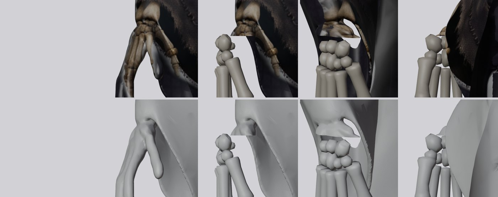

**Поза кистей** (`tools/afn_handpose.py`, результат `qa/handpose.json`). Направления сняты со
срезов:
- ось старого посоха (0,1125, −0,030, 0,9932), наклон 6,7° наружу, как на референсе;
- осевая предплечья (0,37, −0,925, −0,12);
- у правой «лопаты» направление запястье → кончики (−0,267, −0,306, −0,914), большой палец смотрит
  вперёд-внутрь.

Левая кисть поставлена так, что ось её хвата (−Y рамки кисти) идёт строго вдоль оси посоха, а ось
кисти — вдоль предплечья. Затем кисть довёрнута на 28° наружу вокруг посоха (разгибание запястья),
чтобы хват лёг на линию старого посоха. При 15° посох уходил внутрь на 2,4 см, и IoU падал до 82,2 %.
Запястье утоплено на 2 см в обрубок предплечья, так стык прячется. Правая кисть стоит в точке
выхода из рукава, на 7 мм выше крышки.

```json
{"step": "place_parts", "inputs": {"mesh": "C:/afn/runs/s02_sep/parts.glb"},
 "params": {"target_objects": ["body"], "name": "body", "join": true, "points": [
  {"name": "hand_r", "part": ".../k02_hand_r/part.glb", "snap": "none", "at": [-0.4175, -0.176, 0.952],
   "matrix": [[0.733706, -0.624921, 0.266736], [0.55028, 0.776789, 0.306252], [-0.398581, -0.07792, 0.913817]]},
  {"name": "hand_l", "part": ".../k03_hand_l/part.glb", "snap": "none", "at": [0.40874, -0.19224, 1.11161],
   "matrix": [[0.636602, -0.1125, -0.762943], [0.769643, 0.03, 0.637769], [-0.048861, -0.993199, 0.105683]]}]}}
```
`target_objects` оставляет только `body`, вырезанные части отбрасываются. Материалы кистей
(`Bone_aged` с цветами вершин и `Gold`) сохранены. Их копии `.001` слиты, атрибут цвета у тела
дополнен белым. Внутри тела по голосованию трёх лучей оказались 2,0 % вершин правой кисти
(до 8 мм) и 7,2 % левой (до 15 мм). Это кости запястья в обрубке, так и задумано.

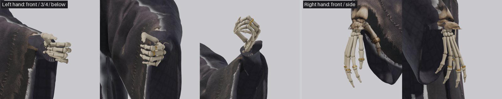

### 4. Застёжки — place_parts на поверхность (`k04`, `k05`, `s04_clasps`)
Центры застёжек сняты с альфы референса, координаты в квадрате 1768:
(864, 510), (874, 622,5), (879, 686), (875, 737,5). Через калиброванную камеру они переведены в рамку
старта: `x = 0.04431 + (u − 884)·0.001222`, `z = 0.9 + (884 − v)·0.001222`. Нарисованные в текстуре
застёжки лежат в тех же местах с точностью 2–3 px, и объёмные застёжки их закрывают. Ширины
107 / 86 / 83 / 82 px дали масштабы 1,30 / 1,02 / 1,00 / 0,975. Застёжки 1 и 3 с золотыми гильзами
(`gold: caps`), 2 и 4 с кольцами (`gold: rings`).
```json
{"step": "place_parts", "inputs": {"mesh": ".../s03_hands/placed.glb", "part": ".../k04_toggle_rings/part.glb"},
 "params": {"ray": "+Y", "contact": "footprint", "normal": "fit", "normal_patch": 2.0, "rest_percentile": 70,
  "join": true, "name": "body", "points": [
   {"name": "clasp_1_caps", "at": [0.01987, 1.3570], "part": ".../k05_toggle_caps/part.glb", "scale": 1.30, "max_tilt_deg": 25},
   {"name": "clasp_2_rings", "at": [0.03209, 1.2196], "scale": 1.02},
   {"name": "clasp_3_caps", "at": [0.03820, 1.1420], "part": ".../k05_toggle_caps/part.glb", "scale": 1.00},
   {"name": "clasp_4_rings", "at": [0.03331, 1.0790], "scale": 0.975}]}}
```

| застёжка | позиция, м | нормаль (наклон / поворот) | внутри робы |
|---|---|---|---|
| 1, гильзы, ×1,3 | (0,020, −0,145, 1,356) | 25° вверх (предел) / −3° | 2,1 % вершин, до 4,8 мм |
| 2, кольца | (0,033, −0,193, 1,220) | 11° / 13° | 0 |
| 3, гильзы | (0,040, −0,194, 1,142) | 3° / 27° | 1,3 %, до 2,8 мм |
| 4, кольца | (0,034, −0,194, 1,079) | 2° / 26° | 0,5 %, до 1,5 мм |

С одиночной нормалью грани нормали выходили на 40–50° из-за шума ИИ-поверхности у разреза ворота.
Поэтому `fit` ищет нормаль надёжной плоскостью по квадрату лучей в два размера детали
(`normal_patch: 2`) с отбросом глубоких точек в разрезе ворота. Застёжка ложится на 70-й перцентиль
контактов: одиночный край капюшона не поднимает её в воздух. У верхней застёжки на вороте наклон
ограничен 25°.

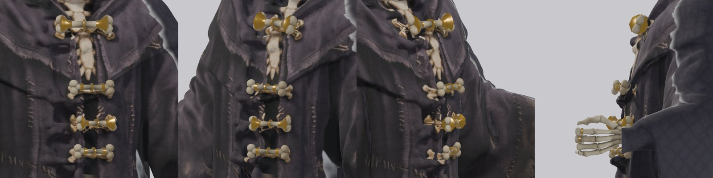

### 5. Правый рукав и проверка разрывов — не исправлено

Внутренняя сторона правого колокольного рукава срослась с боком робы. На горизонтальных срезах с
z 0,84 до подмышки (≈ 1,10) вместо двух контуров виден один перешеек шириной 3–4 см. Левый рукав
свободен ниже 1,08. В позах «руки вперёд/вверх» этот перешеек растягивается в лист, отсюда разрыв
по костям `RightUpLeg`/`RightForeArm`. Подол рукава висит ниже паха, и через сросшуюся ткань он
получает веса бедра.

Что пробовалось, порогов не трогал:

| вариант | «руки вперёд», % | «руки вверх», % | присед, % | шаг, % |
|---|---|---|---|---|
| старт, посох найден как предмет (`x00`) | 10,4 | 14,8 | 1,17 | 2,13 |
| перешеек вырезан `separate` лестницей из 8 коробок (`x02`) | 11,7 | 16,3 | 1,01 | 1,89 |
| рукав жёстко на `RightForeArm` правилами `rigid` (`x03`) | 15,6 | 22,2 | 1,33 | 1,29 и ошибка `rigid_rule` (утечка 1,0) |
| **финальный риг** (маркеры, без старого посоха) | **14,3** | **19,7** | 0,90 | 1,21 |

Почему `separate` не помогает. Шаг обязательно закрывает крышками все отверстия разреза
(`_fill_seams` → `holes_fill`). Перешеек переходит прямо в подмышку, поэтому край выреза на теле
получается одной петлёй: сторона рукава и сторона робы сходятся вверху. Крышка натягивается по этой
петле и снова сшивает рукав с робой плоским листом из 540 треугольников. Разрыв в `x02` даже вырос.
Отделить руку целиком тоже нельзя: выше z 1,16 плечо и торс в срезе — один сплошной контур, и в позах
открылась бы дыра в плече. В финальном риге разрыв больше, чем на старте, по двум причинам. Левое
предплечье теперь честно горизонтальное, и левый рукав в «руках вперёд» тоже тянется (`LeftArm`
0,13 м²). Посох в позах больше не оттягивает кисть.

Даже с идеальным рукавом шаг дал бы 1,21 % при пороге 1 %. На старте было 2,13 %. Причина — закрытое
«дно» робы на высоте 1,4–3,2 см (крупные треугольники между стоп) и сама роба между ногами.
`separate` здесь тоже бессилен: на месте дна он поставит новую крышку.

Чтобы пройти проверку честно, нужен разрез без крышки: удаление граней с открытым краем или сшивка
ткани с толщиной. В кузнице такого шага нет. Риг собран лучшим из возможных и помечен как
непроходящий: `necromancer_forge_rigged_NOT_PASSING_tear_gate.glb`, `qa/rig_humanoid_result.json`.

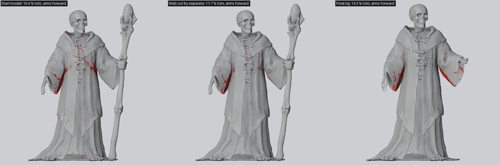

### 6. rig_humanoid (`s05_rig`)
```json
{"step": "rig_humanoid", "inputs": {"mesh": "C:/afn/runs/s04_clasps/placed.glb"},
 "params": {"height_m": 1.8, "fingers": false, "proxy_tris": 40000, "markers": {
   "l_wrist": [0.480082, -0.142343, 1.157233], "l_elbow": [0.385688, 0.093641, 1.187847],
   "r_wrist": [-0.380193, -0.125434, 0.991049],
   "joints": {"LeftHandTip": [0.556372, -0.206123, 1.146663], "RightHandTip": [-0.406863, -0.156064, 0.899669]}}}}
```
- **Маркеры нужны.** Без посоха и без маркеров левое запястье находилось на дне колокольного рукава
  (0,38; −0,05; 0,96), а не у кулака. Запястья взяты точно из поз кистей bone_kit (начало кисти —
  центр запястного сустава), локоть — на 0,256 м назад по предплечью. Длина предплечья совпадает с
  правым, отношение плечо:предплечье 1,18.
- **`proxy_tris: 40000`.** При 60 000 с маркерами тепловая карта Blender отказала на всех запасных
  вариантах: 100 % вершин без весов. При 40 000 сработал воксельный прокси, 0,4 % вершин добраны от
  соседей, в итоге невзвешенных 0. Это свойство решателя Blender, а не порог.
- **`fingers: false`.** С `fingers: true` шаг пропускает пальцы с сообщением «finger lengths
  implausible». Отдельные кости bone_kit в хвате и кости, уходящие в рукав, не проходят его оценку
  длины. Кисти работают как жёсткие (вес на `Hand`), пальцы не гнутся.
- Итог: уверенность 0,646, 25 костей, симметрия суставов 0,0071 H. Симметрия рук 0,108 H, это
  исключение по маркерам. Время 9,3 с.

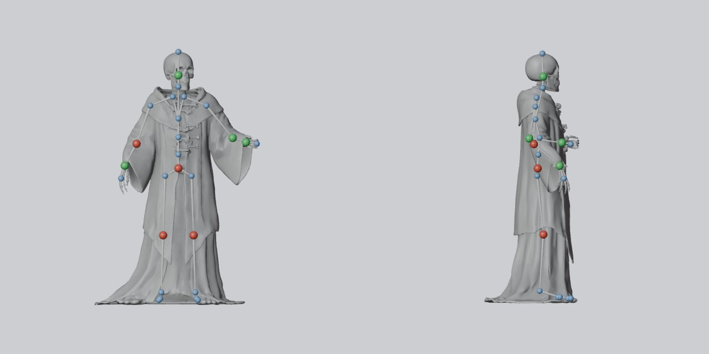
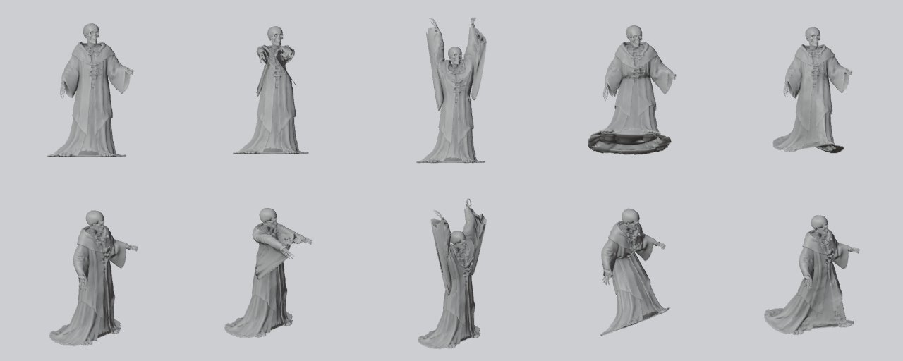

### 7. Посох — bone_staff + attach_prop bone_child (`k06`, `s06_attach`)

**Длина.** По альфе референса верх кристалла стоит на 1 457 px над землёй, макушка на 1 425 px.
Длина посоха ≈ 1,01–1,02 H, хват на 0,628 длины. Значение 1,12 H из задания с картинкой не сходится:
при хвате 0,62 L и кисти на высоте 0,64 H такой посох ушёл бы в пол на 14 см. Длина выбрана так,
чтобы нижний конец касался пола при хвате 0,62. `L = z_хвата / (0,62·cos 6,7°) = 1,863 м`, это 1,035 H.
Нижний конец получился на 1,2 мм ниже пола, верх кристалла на 1,85 м: на 2,9 % выше макушки, у
референса 2,2 %.
```json
{"part": "bone_staff", "length_m": 1.863, "grip_fraction": 0.62, "shaft_radius_m": 0.0208,
 "crystal_height_m": 0.22, "crystal_radius_m": 0.045, "talons": 4, "segments": 3, "style": "aged", "origin": "axis"}
```
3 236 треуг., кристалл 0,22 × 0,045 м (замер по референсу), четыре когтя.

**Почему bone_child после рига, а не жёстко до него.** Сменный предмет и сокет `socket_fx_tip` для
эффекта получаются только у отдельного объекта. `rig_humanoid` вплавляет всё в одну `Body` и
выбрасывает пустышки. Цена такого выбора: без найденного предмета `rig_humanoid` строит
`socket_mount_hand_l` по общей рамке кисти, где +Z смотрит вперёд персонажа перпендикулярно оси
кисти. У этой кисти ось горизонтальна, и +Z сокета на **86,5°** расходится с вертикальным посохом.
Начало сокета лежит в 4,9 см от оси. Точная посадка поэтому передаётся в `params.offset`:
```json
{"hand": "l", "mode": "bone_child",
 "offset": {"loc": [0.020758, -0.04338, 0.023129], "rot_deg": [66.7061, 81.0344, 67.8386]}}
```
offset посчитан как `H⁻¹·G` (`tools/afn_offset.py`, `qa/attach_offset.json`). H — сокет рига в покое,
G — рамка оси хвата bone_kit в рамке рига. `grip_on_mount` 0,0 мм / 0,0°, пересечений с рукой и телом
в покое 0. Ось хвата лежит на расстоянии радиуса от кисти (2,08 см). «Охват» 0,22 при пороге 0,5 —
это предупреждение: лучи проходят между тонкими костями пальцев.

Ограничение. Посох прикреплён правильно, но в `attach.json` стоит `swap_by_socket_matching: false`.
Игра, которая сменит предмет простым совмещением `socket_grip_main` с `socket_mount_hand_l`, поставит
его горизонтально. Нужна подсказка направления хвата в `rig_humanoid` (вроде `params.grip_dirs`), это
работа владельца `_humanoid_lib`. Сам файл не правился.

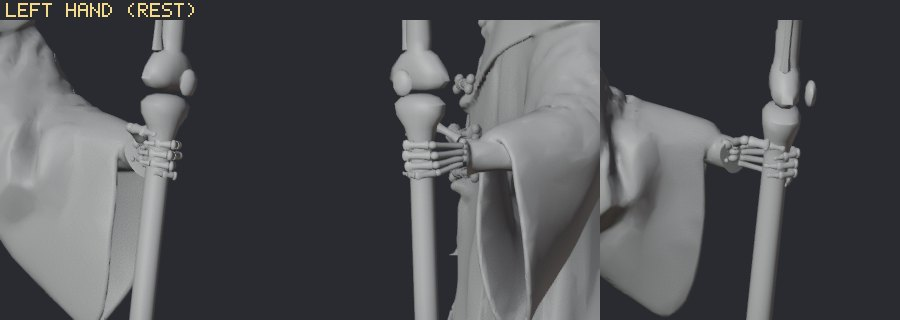

### 8. Клипы — retarget (`s07_clips`, обзоры `x03`–`x05`)
```json
{"root_motion": "extract", "clips": [
 {"source": "library:mixamo-archer-idle", "name": "idle", "loop": true},
 {"source": "library:mixamo-archer-walk", "name": "walk", "loop": true, "locomotion": true, "in_place": true},
 {"source": "library:mixamo-necro-rider-cast", "name": "cast", "loop": false},
 {"source": "library:mixamo-archer-hit", "name": "hit", "loop": false},
 {"source": "library:mixamo-archer-death", "name": "death", "loop": false}]}
```
- **Почему клипы лучника.** В 22-костных клипах (militia, angel, zombie) ключей кисти нет. Кисть
  сохраняет угол покоя к предплечью, и посох становится горизонтальным, как только рука опускается
  (обзор `x03`/`x05`). В 33-костных клипах лучника кисти анимированы, лук держится вертикально в
  левой руке, и посох в idle стоит вертикально.
- **Каст.** `necro-rider-cast` записан для всадника (тег `mounted`). На стоящем персонаже с IK ног он
  читается как стоячий каст: посох поднимается над головой, потом удар вперёд-вниз, возврат.
  `knight-rider-cast` размахивает посохом горизонтально, поэтому отброшен.
- **Ходьба.** Шаги библиотеки сняты Mixamo «In Place», хода для выноса у них нет. С `extract` у
  ходьбы скольжение выходило 71–83 см: стопы едут по дорожке, а корень стоит. Поэтому `walk` идёт с
  `in_place: true`, игра двигает персонажа со скоростью `ground_speed_mps` = 1,122 м/с. Остальные клипы
  используют `extract`, у смерти ход на `root` 1,05 м.

| клип | кадры | скольжение, см (цель / источник) | скрутка кисти Л / П, ° | заметки |
|---|---|---|---|---|
| idle-loop | 154 | 0,0 / 0,0 | 1,4 / 2,6 | шов 0° / 0 мм |
| walk-loop | 37 | **3,4 / 1,8** (предупреждение) | 1,1 / 14,2 | на месте, 1,12 м/с |
| cast | 82 | 8,4 / 7,9 | 76,1 / 50,2 (источник 80,4 / 51,7) | |
| hit | 39 | 7,8 / 7,5 | 13,3 / 49,4 | |
| death | 94 | **3,7 / 2,2** (предупреждение) | 81,3 / 100,5 | root 1,05 м |

Проверки скрутки кистей проходят у всех клипов (расхождение с источником ≤ 25°).

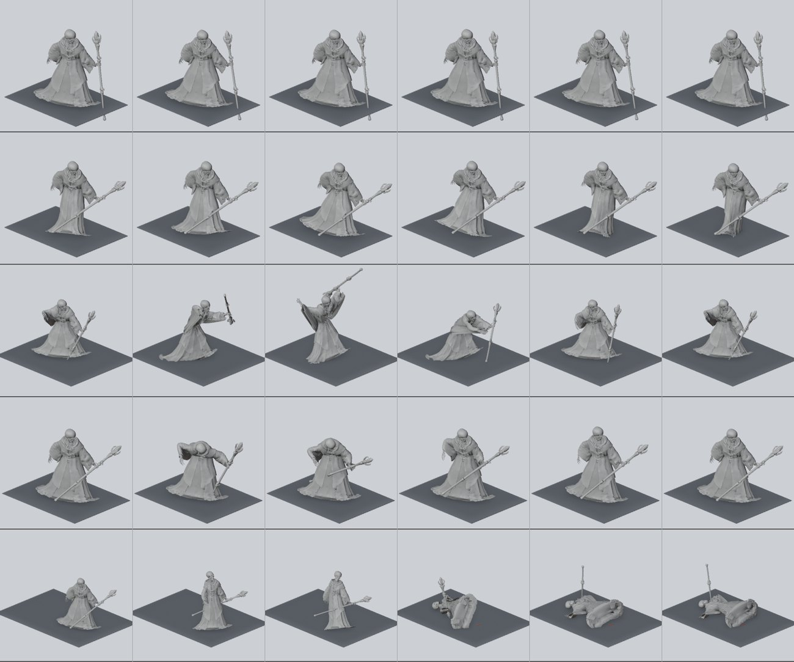

Как это выглядит. Посох в руке правдоподобен в idle, cast и hit. При ходьбе посох держится наискось,
кристаллом вперёд, комлем назад к земле. В смерти рука сжимает посох до конца, и он торчит вверх из
лежащего тела: предмет нужно ронять скриптом. Клипы писались не под эту позу:
- idle лучника поворачивает корпус примерно на 45° (стойка лучника);
- колени согнуты, таз ниже покоя на 9 см (0,88 против 0,97 м), подол робы уходит под пол на 9–18 см;
- левая рука ниже, чем в позе референса, и конец посоха уходит под пол до 26–29 см.

В спрайтах это скрыто ловцом теней Cycles (раздел 10). В Godot такие места прячет плоскость земли.

### 9. Godot 4.5.1 (`s08_godot`, `s08_godot_fx`)
```json
{"step": "godot_package", "inputs": {"glb": "C:/afn/runs/s07_clips/animated.glb"},
 "params": {"asset_id": "necromancer_forge", "profile": "godot", "kind": "humanoid", "autoplay": "idle-loop",
  "fx": [{"preset": "magic_cast", "socket": "socket_fx_tip_l", "params": {"color": [0.35, 1.0, 0.45, 1.0]}}]}}
```
Godot 4.5.1.stable.official.f62fdbde1, headless, 8,5 с:
- сцена загружена и инстанцирована;
- `idle`/`walk` с `loop_mode = 1`, `cast`/`hit`/`death` без цикла;
- найдено 12 сокетов;
- `magic_cast` висит под `socket_fx_tip_l` с масштабом 1,03 (по длинной оси ассета);
- ошибок движка 0.

На глаза эффект не ставился. Глаза светятся эмиссией материала `eye_glow`, частицы на черепе такого
размера читаются как шум. Сокеты `socket_fx_eye_l/r` из `replace_part` не дожили до рига:
`cleanup` и `rig_humanoid` пересоздают сокеты.

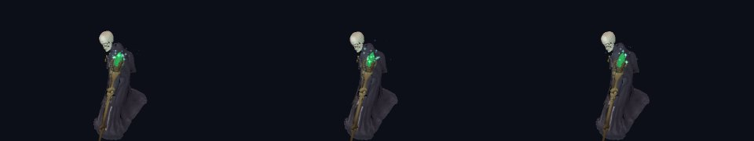

### 10. Спрайты (`s09b_hg`, `s10c_iso8`)
```json
{"profile": "heroes_gates", "kind": "hero", "asset_id": "necromancer_forge", "clips": ["idle", "cast"],
 "event_frames": {"cast": 9}, "normalize_pose": "rest"}
{"profile": "iso8", "asset_id": "necromancer_forge", "clips": ["idle", "walk"], "pixels_per_meter": 100,
 "engine": "CYCLES", "shadow": true, "samples": 48}
```
- «Врата Героев», герой: ячейка 448, якорь (224, 384), 3 вида × 16 кадров × 2 клипа = 96 кадров.
  Cycles OptiX, 124 с, 1,3 с на кадр. `event_frame` каста 9. Godot загрузил 6 анимаций `SpriteFrames`.
  `normalize_pose: "rest"` выбран вместо `first_frame` по умолчанию. При `first_frame` модель
  поднималась на 0,25 м (опора первого кадра — утонувший конец посоха), и подол висел на 12 см над
  тенью. При `rest` стопы на земле, а ушедшее под пол прячет ловец теней.
- iso8: ячейка 452 × 244, якорь (226, 170), 8 направлений, 48 кадров idle и 14 кадров walk.
  Cycles с ловцом теней, 469 с. Тот же приём: в варианте EEVEE без земли конец посоха в idle торчал
  ниже ног. Проверка `feet_on_ground` — это предупреждение, она видит минимум z −0,26 м
  (посох под полом).

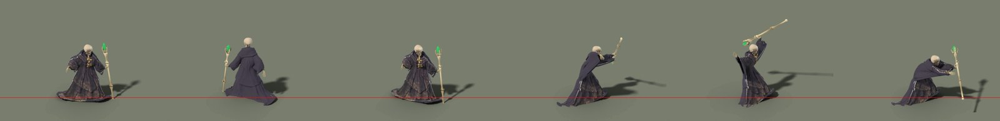
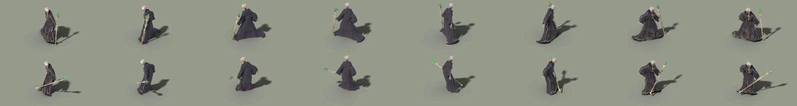

### 11. Сравнение с референсом
**Камера.** Калиброванный кадр восстановлен из `ReferenceFidelity/FINAL-VALIDATION.json`. Это
ортокамера спереди, `span` 3,60081 и центр (0,00237; 1,5) в студийных единицах 3,0 м, квадрат 512.
Код студии (`src/reference-core.js`) повторён в `tools/afn_compare.py`. На
`Corrected-necromancer.glb` он даёт 86,42 % против 86,52 % у студии, разница в сглаживании краёв. Для
новой модели кадр пересчитан в рамку рига: центр (0,10064; 0,93691), `span` 2,24948.

| модель | IoU | покрытие референса | точность |
|---|---|---|---|
| старая `Corrected-necromancer.glb` | 86,4 % | 96,9 % | 88,9 % |
| старт (`replaced.glb`, новый череп) | 86,6 % | 97,2 % | 88,8 % |
| **новая, калиброванный кадр** | **86,1 %** | 94,9 % | 90,2 % |
| новая, первая поза левой кисти (15°) | 82,2 % | 92,6 % | 88,0 % |
| новая + подбор камеры как в студии | 88,4 % | 95,8 % | 91,9 % |

Подбор камеры: `span` +0,6 %, сдвиг −1,6 см по высоте, поворот −4,2°. Это подгонка кадра, а не
геометрии. Прежние 86,5 % получены после TPS-деформации силуэта, у новой модели её нет. В
калиброванном кадре новая модель почти догнала старую по IoU и выше по точности: лишнего меньше.
Покрытие ниже, потому что тонкие кости кистей и ствол посоха 4 см закрывают меньше пикселей, чем
толстые «лопаты» и раздутый ИИ-посох.

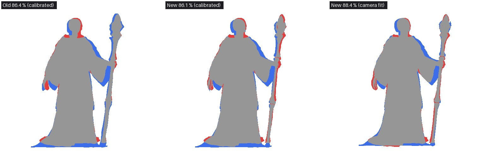
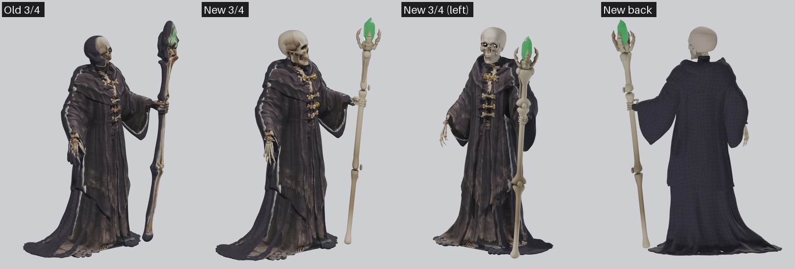
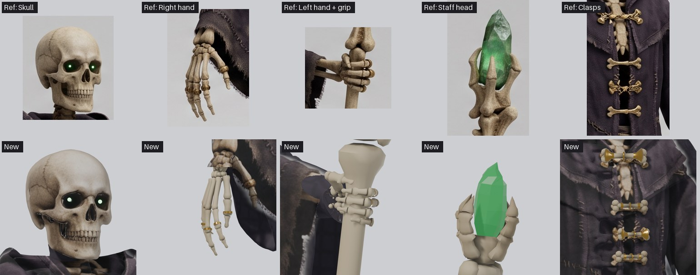
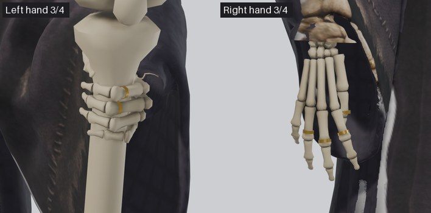

Оценка по картинкам:
- **Кисти** стали настоящими костями: 27 костей, раздельные пальцы, золотые кольца. Правая висит
  раскрытой с чуть согнутыми пальцами, как на референсе, левая обхватывает ствол, большой палец
  сверху, костяшки смотрят на зрителя.
- **Посох**: три длинные кости с шишковатыми суставами, лапа с четырьмя когтями и гранёный зелёный
  кристалл на месте старой оплывшей «головы».
- **Застёжки** — объёмные, золото металлическое.

Хуже референса:
- кости процедурные и чистые, нет сколов и бороздок;
- кость посоха светлее и ровнее по цвету, чем состаренная кость референса;
- кристалл непрозрачный;
- у когтей навершия маленькие «надколенники» перед суставами висят отдельно, в 3/4 они читаются как
  точки рядом со стволом (особенность `bone_kit`);
- торец обрубка левого предплечья (плоская крышка 6 × 5 см) виден спереди за кулаком;
- у правой кисти виден прямой срез нарисованных костей у обшлага.

## Новый шаг place_parts

`scripts/blender/steps/place_parts.py` ставит копии детали на поверхность или в заданную позу. Шаг
общий: застёжки, пуговицы, заклёпки, камни, шипы, а также деталь в явной позе, как кисть у запястья.

- **Входы.** `inputs.mesh|blend` — цель. `params.target_objects` оставляет нужные объекты, остальные
  отбрасываются. `inputs.part` — деталь по умолчанию, у точки можно задать свою (`points[].part`).
- **Рамка детали** как у `bone_toggle`: начало в центре задней грани, −Y — наружная нормаль, +Z —
  «верх».
- **Точки**: `[x, z]` вида спереди (луч `+Y` из-за габарита) или `[x, y, z]` (ближайшее попадание на
  прямой через точку). Параметры точки: `scale`, `roll_deg`, `standoff_m`, `name`; `snap: "none"` с
  `rot_deg`/`matrix` даёт явную позу.
- **Посадка.** `contact: "footprint"`: лучи по отпечатку детали, деталь лежит на `rest_percentile`
  контактов (100 — на самом выступающем) и перекрывает щель, а не проваливается в неё.
- **Нормаль.** `normal: "fit"`: начинает против луча, затем строит надёжную плоскость по квадратному
  пятну (`normal_patch` × длинная сторона детали) с отбросом глубоких точек, не дальше
  `max_tilt_deg` (45°) от луча. Есть также `hit` (нормаль грани) и `axis` (строго против луча).
- **Объединение.** `join` по умолчанию сливает всё в один меш. Материалы детали сохраняются, копии
  `.001` с одинаковыми узлами сливаются, UV переименовывается под цель, атрибуты цвета дополняются
  белым.
- **Сокеты (10.10, вечер).** Сокеты цели сохраняются, например `socket_fx_eye_l/r` от `replace_part`. Сокеты
  детали (`part_sockets`, по умолчанию true) ставятся с каждой копией, повторное имя получает `_2`, `_3`.
  Так `socket_mount_hand_l` кисти bone_kit — точка на оси её хвата — доходит до `rig_humanoid`, и посох
  садится без offset. `points[].sockets: false` пропускает сокеты одной копии. Деталь по умолчанию можно
  задать и в `params.part`.
- **Регистрация на сервере.** `place_parts` пока не внесён в `server/forge-steps.mjs`: файл сейчас правит
  другой агент. Нужная запись приведена в разделе v2. До неё шаг запускается через `af_run.py`.
- **Выходы**: `placed.glb`, `placed.blend`, `preview.png` (спереди, 3/4 и крупный план каждой точки).
- **Проверки**: `points_hit` и `no_nan_verts` — ошибки; `part_frame` (геометрия за задней гранью) и
  `penetration` (вершины внутри цели по голосованию трёх лучей, порог 30 % толщины) —
  предупреждения.

Тесты `scripts/blender/tests/test_place_parts.py` — **8/8 PASS, ≈5,3 с** (10.10, вечер: + `test_part_and_target_sockets_survive`):
- рамка и поворот;
- наклонная плоскость, задняя грань ложится точно на поверхность;
- «канавка»: `footprint` лежит на гребнях, `center` проваливается, и проверка проникновения это
  ловит;
- масштаб, поворот, имена, слияние, белый `COLOR_0` у цели и сохранённый цвет детали;
- `target_objects`, явная поза, промах луча и ошибки параметров;
- предупреждение `part_frame` и 3D-точка;
- реальные застёжки на `replaced.glb`, пропускается без файлов.
```
"C:/Program Files/Blender Foundation/Blender 5.0/blender.exe" -b --factory-startup ^
  --python scripts/blender/tests/run_tests.py -- place_parts
```

## Честные ограничения
- **Риг не проходит проверку разрывов** («руки вперёд» 14,3 %, «руки вверх» 19,7 %, шаг 1,21 %).
  Причины: сросшийся с робой правый рукав, натягивающийся левый рукав и закрытое дно робы. В
  кузнице нет шага, который режет сетку без крышек (раздел 5). Рукава в больших позах тянутся листом.
- **Сокет левой кисти** не совпадает с посохом на 86,5°. Посадку несёт `offset`, замена совмещением
  сокетов поставит предмет горизонтально (раздел 7).
- **Пальцы без костей.** Кисти bone_kit жёсткие на `Hand`, пальцы не гнутся.
- **Клипы не для этой позы**: поворот корпуса в idle, подол и конец посоха под полом, посох в
  смерти торчит вверх (раздел 8).
- **Скрытая спина и затылок робы** — догадка генератора Hunyuan. Цвет робы — проекция фотографии с
  запечённым светом, не PBR. Металл и шероховатость робы условны. Детали bone_kit имеют свои
  Principled-материалы, состаривание только в цветах вершин.
- **Стыки кистей**: торец обрубка левого предплечья и прямой срез правого видны на крупных планах.
- **Сравнение** — один ракурс. IoU не процент точности 3D. Подобранная камера включает поворот −4,2°.
- `qa.reviewed` не ставится. Принятие модели — решение владельца.

## Файлы (`outputs/NecromancerForge/`)

| файл / папка | что |
|---|---|
| `necromancer_forge.glb`, `.blend` | итог: риг, 5 клипов, посох на `socket_mount_hand_l`, 12 сокетов |
| `necromancer_forge_equipped_no_clips.glb` | риг и посох без клипов |
| `necromancer_forge_rigged_NOT_PASSING_tear_gate.glb` | выход `rig_humanoid` (QA не пройден), без посоха |
| `godot/necromancer_forge/` | пакет Godot (GLB, `.tscn`, `af_fx_mount.gd`, `fx/magic_cast.tscn`, README); `godot_check.json`, `fx_preview.png` |
| `sprites/heroes_gates/` | `idle*.png`, `cast*.png`, `.tres`, `sprites.json`, запись `heroes_gates_sprites_entry.json` |
| `sprites/iso8/` | `idle.png`, `walk.png`, `.tres`, `sprites.json` |
| `parts/` | кисти, посох, две застёжки из bone_kit с `part.json` |
| `qa/` | результаты всех шагов: риг, маркеры, позы, разрывы, клипы, attach, offset, перевод рамки, IoU, опыты `x00`–`x03` |
| `requests/` | запросы всех шагов; `requests/tools/` — скрипты анализа (поза кистей, offset, сравнение, срезы, рендеры) |
| `img/` | картинки этого документа |

Повторить можно по порядку: `s01_clean` → `s02_sep` → `k02`..`k06` → `s03_hands` → `s04_clasps` →
`s05_rig` → `s06_attach` → `s07_clips` → `s08_godot` → `s09b_hg` → `s10c_iso8`. Поза кистей
(`tools/afn_handpose.py`) и offset посоха (`tools/afn_offset.py`) считаются скриптами между шагами.
Числа для запросов `s03` и `s06` берутся из `qa/handpose.json` и `qa/attach_offset.json`.


## v2: пересборка через конвейер кузницы (10.10, ночь)

v2 собран заново из того же `replaced.glb`, на этот раз шагами кузницы, а не ручными запросами. Перед
этим исправлено шесть общих пробелов гуманоидного конвейера, найденных в v1 (ниже). Риг **впервые
проходит** проверку разрывов честно, пороги не менялись. Посох меняется совмещением сокетов, сокеты глаз
доживают до Godot, клипы больше не уводят робу и посох под пол.

Готовые файлы — `outputs/NecromancerForge/v2/`. Рецепт для повторного прогона — `v2/recipe/` (`recipe.json`,
`run_recipe.mjs`, шаги `*.json`). Рабочая папка — `C:/afn2/` (`lib3/` — библиотека кузницы финального
прогона, `runs3/` — запросы и выходы `af_run`, `exp/` — опыты, `tools/` — анализ).

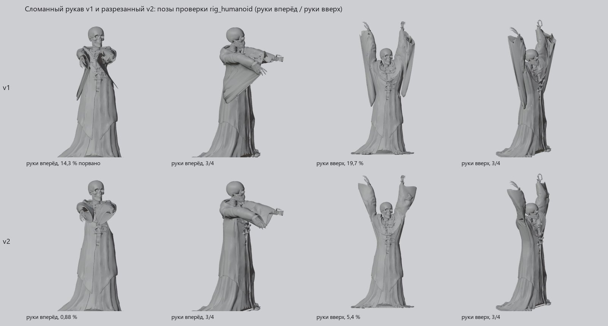

### Итог v1 → v2

| | v1 | v2 |
|---|---|---|
| QA рига, «руки вперёд / вверх / присед / шаг», % | **14,3 / 19,7** / 0,90 / **1,21** — не проходит | **0,88 / 5,42 / 0,21 / 0,74** — проходит (пороги 1 / 8 / 1 / 1); роба в шаге 1,14 % (порог 4) |
| Тепловая карта весов | основной прокси оставлял 7,2 % вершин без весов, сработал только воксельный | основной прокси 60 000, 0 % без весов; 16 мелких кластеров жёстко на костях |
| Посох в левой руке | `offset` 66,7/81,0/67,8°, сокет рига на 86,5° от посоха, `swap_by_socket_matching: false` | сокет кисти bone_kit на оси хвата, без offset, `grip_on_mount` 0,0 мм / 0,0°, **`swap_by_socket_matching: true`** |
| Сокеты в GLB / пакете | 12, `socket_fx_eye_l/r` потеряны | **13**, `socket_fx_eye_l/r` на кости `Head` |
| Нижняя точка тела в клипах (idle / walk / cast / hit / death), см | −13,5 / −17,6 / −18,9 / −12,8 / **−47,8** | −3,5 / −7,5 / −2,6 / −3,7 / −4,1 |
| Нижняя точка посоха, см | −26,0 / +10,8 / −28,7 / −13,1 / −66,5 | **+0,8** / +44 / −2,0 / +5,9 / −62,9 (смерть) |
| Поворот корпуса в idle | ~62° (стойка лучника) | 0° (`facing: rest`, снято −61,8°) |
| Треугольники | тело 72 062 + посох 3 236 | тело 72 585 + посох 3 236. Разница +523: крышки слэбов и рассечений минус удалённое дно робы |
| Godot 4.5.1 | 5 анимаций, 12 сокетов, эффект | 5 анимаций (циклы idle/walk), 13 сокетов, `magic_cast` на `socket_fx_tip_l`, ошибок 0 |
| Спрайты | HG 96 кадров, iso8 496 кадров | те же профили: HG 448 × 448, якорь 224,384; iso8 492 × 260, якорь 246,193 (48 idle + 14 walk × 8) |

Нижние точки v1 измерены той же функцией `floor_report` на `C:/afn/runs/s07_clips/animated.blend`.

### Рецепт и как он прошёл через кузницу

`node C:/afn2/recipe/run_recipe.mjs C:/afn2/recipe/recipe.json` (копия — `v2/recipe/`). Каждый шаг идёт через
CLI кузницы `scripts/forge.mjs --direct`: паспорта, версии, журналы. Исключение — `place_parts`, он не
внесён в реестр сервера. `server/forge-steps.mjs` во время работы правил агент кораблей: незакоммиченные
правки до коммита `440d3c4` в 23:11. Движок отклоняет незарегистрированные шаги (`unknown_step`). `place_parts` идёт через `af_run.py`, его
запросы пишутся из шаблонов. Сводка прогона — `runs3/recipe_run.json`.

> Обновление 11.10: `place_parts` внесён в реестр сервера (23 шага, параметры `part_asset` и `points[].asset`), так что шаги 3 и 4 рецепта теперь тоже идут через кузницу (`create`/`run` с `--steps`), без `af_run.py`.

| # | шаг | через | ассет / параметры |
|---|---|---|---|
| 1 | 5 × `bone_kit`: правая кисть `open`, левая `grip` R 20 мм, две застёжки, посох 1,863 м | forge | 5 отдельных ассетов (`bk_*.json`, те же параметры, что k02–k06 v1) |
| 2 | `cleanup` → `separate` | forge | ассет «Некромант v2» из `replaced.glb` (`a1_prerig.json`): 76 000 треуг.; `delete` старого посоха и «лопат» с крышками; **слэбы 12 мм по кривой** в местах срастания рукавов с робой (правый z 0,845–1,15, левый 1,035–1,13 в рамке старта); `delete` дна робы без крышек (`facing [0, 0, −1]`) |
| 3 | `place_parts` кисти (явные позы v1) | **af_run** | `p1_hands.json`: части — GLB ассетов шага 1, их `socket_mount_hand_l/r` идут с кистями |
| 4 | `place_parts` застёжки (на поверхность) | **af_run** | `p2_clasps.json` |
| 5 | `rig_humanoid` → `attach_prop` → `retarget` | forge | ассет «Некромант v2 — риг и экспорт» из выхода шага 4 (`b1_rig_clips.json`); посох — `attachments: [{asset: <UUID посоха>, hand: l}]`, без offset |
| 6 | `render_sprites` iso8 → `render_sprites` heroes_gates → `godot_package` | forge | `b2_export.json`, `run --from latest` |

Для другого персонажа меняются числа персонажа: коробки и кривые разрезов, позы кистей, маркеры рига, клипы.
Сами шаги и порядок остаются. Позы кистей и кривые разрезов всё ещё снимаются анализом срезов
(`C:/afn2/tools/afn_slices.py`, `afn_corners.py`).

**Нужная запись реестра** (её внесёт владелец `server/forge-steps.mjs`, поля по образцу `replace_part`):
`{step: 'place_parts', module: 'core', title: 'Детали на поверхность', kinds: ALL_KINDS, inputs: {slots:
['mesh', 'blend', 'part'], required: true, formats: [...MESH_FORMATS, 'blend']}, outputs: ['glb', 'blend', 'preview'],
timeoutSec: 15 * 60, params: {part_asset: str(server), part_file: str(server, path), points: arr (обязателен;
points[].part — путь, только CLI, или points[].asset — UUID детали), target_objects, ray (+Y|-Y|+X|-X|+Z|-Z),
contact (footprint|center), normal (fit|hit|axis), footprint_grid, footprint_fill, rest_percentile, normal_patch,
max_tilt_deg, up, search_m, join, name, part_sockets, height_m, rotate_z_deg, ground, center, preview,
preview_size}}`. В `forge-pipeline.mjs` нужен вход `inputs.part` из `part_asset`, как у `replace_part`, и
подстановка `points[].asset`.
Там же надо расширить уже зарегистрированные шаги:
- `replace_part.align` — добавить `none`, новые параметры `part_transform`, `keep_materials`, `cut_part`;
- новые параметры `rig_humanoid`: `grip_dirs`, `keep_input_sockets`, `socket_bones`, `replace_sockets`,
  `island_max_frac`, `surface_aware`, `surface_margin_h`, `arm_bleed`;
- `attach_prop`: `refit_socket`, `grip_dir`;
- `retarget`: `facing`, `facing_bone`, `hips_drop`, `hips_height_m`, `floor`, `hand_floor`, `ground`,
  `ground_tolerance_m`, `ground_samples`, `floor_tolerance_m`, `floor_samples` (и те же ключи у клипов);
- `separate`: `caps`, `slit_gap_m`, `mode: slit`.

Сейчас неизвестные параметры проходят с предупреждением. Значение вне перечисления (`align: none`) реестр
отклонит.

### Исправления (общие, с тестами)

**1. Разрез без крышек** (`separate`, `_mesh_lib.slit`, `docs/forge/core.md`).
- Причина. Регион всегда закрывался `holes_fill`. Край выреза в сросшейся перемычке — одна петля,
  которая проходит по рукаву и по робе, и крышка сшивала их обратно листом.
- Решение. Виды регионов `part` / `delete` / `slit`, `caps: false`, фильтр `facing`. У `slit` два режима:
  разрыв (`split_edges`, щель `gap_m`) и слэб (полоса `width_m`), каждая сторона закрывается своей крышкой.
  Поверхность разреза — плоскость или кусочно-линейная кривая.
- Почему понадобился слэб. Плоскостной разрыв не разделил рукав: линии защемления у некроманта уходят от
  плоскости на 2–7 мм, и верхний угол складки оставался по одну сторону с рукавом. Опыт `C:/afn2/exp/e1`:
  путь по поверхности от подола рукава до бока робы после разрыва 0,70 м против 0,21 м до, но в месте, где
  кривая проходит мимо угла, связь оставалась. Слэб 12 мм накрывает угол на всех высотах.
- Крышки. Сначала крышки шли ngon. Длинные косые треугольники соединяли вершины у локтя и у плеча и
  рвались: «руки вперёд» 1,64 %. Полоса по высоте разреза дала 0,88 %.
- Подол открыт удалением дна (2 619 граней, 0,29 м²). Шаг: 1,21 → 0,74 %.
- В покое щель не видна (`v2_sleeve_zoom.jpg`). Цена — тёмная изнанка открытого подола в низких ракурсах,
  когда край робы приподнимается.

**2. Сокет кисти и посох** (`_items_lib.grip_dir_vector` + `hand_socket_frame`, `rig_humanoid.grip_dirs`,
`attach_prop.refit_socket`, `place_parts` сокеты деталей).
- Реализация рамки кисти одна: `grip_dir` в `hand_socket_frame`.
- В v2 сработал третий путь, самый точный. Сокет `socket_mount_hand_l` кисти bone_kit лежит на оси её
  хвата, `place_parts` ставит его вместе с кистью, `rig_humanoid` берёт его как есть, `attach_prop`
  совмещает посох без offset.
- `refit_socket` (запечь offset в сокет) и `grip_dirs: {"l": "up"}` покрыты тестами для персонажей без
  такой детали.

**3. Сокеты входа** (`_mesh_lib.socket_records/restore_sockets` в `cleanup`, `separate`, `place_parts`,
`replace_part`; `_humanoid_lib.load_body/prepare_body`, `rig_humanoid`). `socket_fx_eye_l/r` прошли всю
цепочку: в риге они дети `Head` (по весам ближайших вершин) и дошли до пакета Godot.

**4. `replace_part`** — `align: none`, `part_transform`, `keep_materials`, `cut_part`, сохранение сокетов тела и
детали (`docs/forge/replace_part.md`). В рецепт v2 не вошёл: на сервере перечисление `align` ещё без
`none`, кисти поставлены `place_parts`. Шаг покрыт синтетическим тестом.

**5. Перенос клипов на робу и посох** (`retarget`, `_anim_lib`, `docs/forge/mixamo.md`).
- Причины:
  1. Idle лучника повёрнут на 62° (средний поворот таза).
  2. Колени согнуты, таз ниже покоя: idle 10, walk 12, hit 10, каст всадника 22 см в рамке цели. Подол
     взвешен на таз и бёдра.
  3. Кисть с посохом ниже покоя.
  4. Лежащая роба толще источника.
- Высота бёдер под робой оказалась ни при чём: `k` = 1,05–1,08, как у любого персонажа такого роста.
  Для явной высоты есть `hips_height_m`.
- Решения: `facing: rest`, `hips_drop: 0` для стоячих клипов, `hand_floor: {l: 0.03}` (IK руки, кисть
  сохраняет мировую ориентацию), `ground: mesh` для смерти, проверка `floor` в `clips.json`.
- Клипы библиотеки сравнивались, лучше набора v1 не нашлось. Все пять смертей уводят робу на 0,39–0,60 м
  под пол (`C:/afn2/exp/deaths`). Idle и walk без анимированных кистей (22 кости) кладут посох
  горизонтально. Набор v1 оставлен, его недостатки снимают новые параметры.

**6. Реестр сервера.** `place_parts` не внесён. Пока шла работа, у `server/forge-steps.mjs` были
незакоммиченные правки агента кораблей: в 22:10 они были, коммит `440d3c4` — в 23:11. Кроме того, запись
требует обновить `tests/forge-routes.test.mjs` (ждёт ровно 22 шага) и `forge-pipeline.mjs` (вход `part`),
а это вне моей зоны: `npm test` покраснел бы. Нужная запись приведена выше.

Обнаружено по ходу и исправлено (`_humanoid_lib`):
- Решатель тепла отказывал на всей сетке из-за мелких островов (кисти из 27 костей) и рёбер с тремя
  гранями. Острова вынесены и жёстко посажены на кости, прокси ремонтируется.
- Чистка весов рук стала учитывать поверхность: труба подрезала колокольный рукав, а разделение рука/нога
  по прямому расстоянию отдавало подол рукава бедру.
- Добавлено подавление утечки скрытой руки в бок робы.
- На ассетах HG регресса нет (таблица в `humanoid.md`). Подавление утечки сначала подняло «руки вверх» у
  зомби с 0,14 до 0,96 %, поэтому теперь оно работает только для скрытых рук.

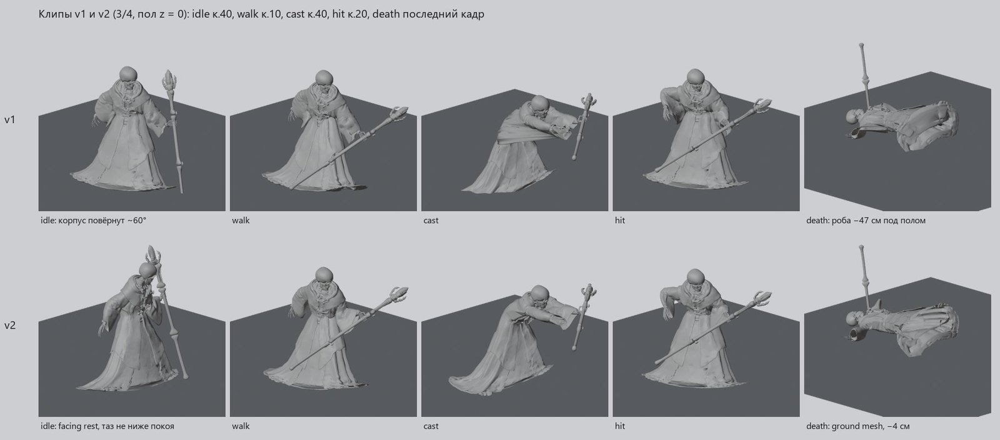
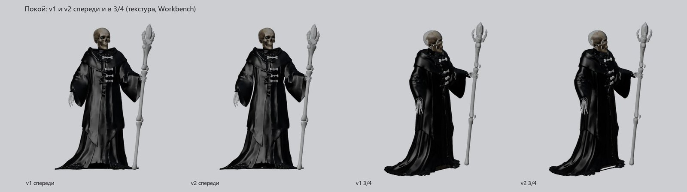
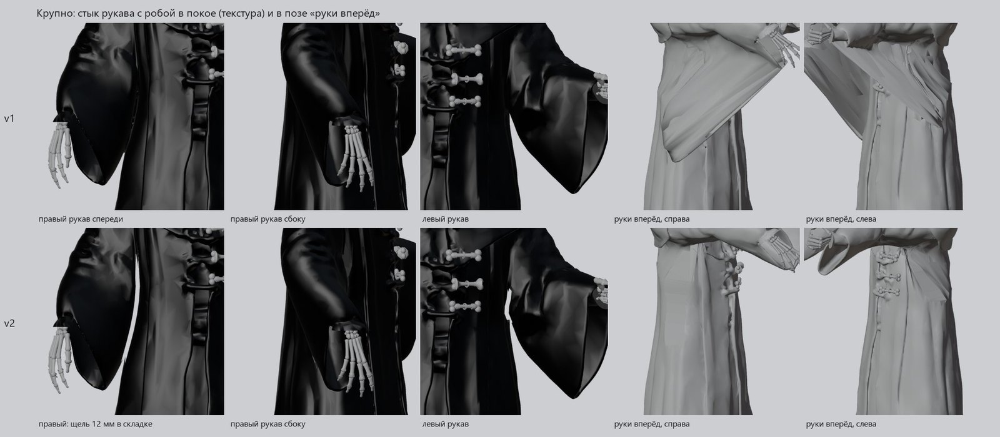
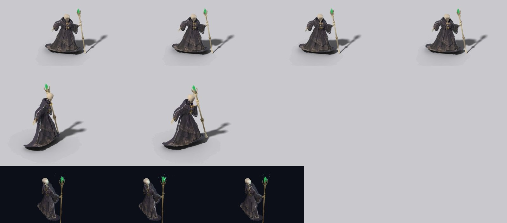

### Проверки

- `rig_humanoid`: ok. Уверенность 0,646, 25 костей, 0 вершин без весов, ≤ 4 влияния, симметрия суставов
  0,0071 H, 9 с. Проверка разрывов: «руки вперёд» 0,88 %, «руки вверх» 5,42 %, присед 0,21 %, шаг 0,74 %,
  роба 1,14 %. Предупреждения прежние: `deform_max_edge_stretch` и `p999` (длинные рёбра крышек и подола),
  `new_self_intersections`.
- `attach_prop`: хват в 2,08 см от кисти (радиус ствола), `grip_on_mount` 0,0 / 0,0°, пересечений в покое 0,
  охват 0,22 (предупреждение, как в v1: тонкие кости пальцев).
- `retarget` (`clips.json`): швы петель 0°.
  - Скольжение стоп, см (цель / источник): idle 0,0 / 0,0; walk 3,3 / 1,8 (предупреждение, как в v1);
    cast 8,4 / 7,9; hit 7,8 / 7,5; death 3,6 / 2,2.
  - Скрутка кистей в пределах 25° от источника. Каст: левая 96,5° против 80,4° у источника — IK руки.
  - `floor_body_*` и `floor_props_*` — предупреждения с допуском 2 см. Числа в таблице выше.
- Godot 4.5.1.stable: сцена грузится, 5 анимаций, у idle и walk цикл, 13 сокетов, `magic_cast` на
  `socket_fx_tip_l`, ошибок 0 (`v2/godot/godot_check.json`).
- Тесты модулей: core 32/32, place_parts 8/8, replace_part 9/9, items 23/23, mixamo 18/18, humanoid 35/35
  (вместе с `test_real_necromancer_v2_tear_gate`); `npm test` 132/132.

### Что осталось

- Позы кистей, коробки и кривые разрезов пока задаются числами, снятыми срезами. Автоматического поиска
  линии срастания нет: детектор углов (`afn_corners.py`) находит только часть углов.
- Запас по «рукам вперёд» маленький (0,88–0,97 % при порогах прокси 40 000–72 000). Остаток — подмышки у
  концов разрезов и крышки.
- Открытый подол показывает тёмную изнанку, когда край робы приподнимается в низком ракурсе. При
  закрытом дне не проходит шаг.
- Роба при ходьбе уходит под пол до 7,5 см: подол взвешен на бёдра. Плоскость земли в Godot это прячет.
- В смерти посох уходит под пол на 63 см и остаётся в руке. Его нужно ронять скриптом игры, как и в v1.
- `hand_floor` держит левую кисть у высоты покоя во всех клипах. В idle посох стоит у головы ближе, чем на
  референсе.
- `place_parts` не в реестре сервера. `replace_part.align = none` и новые параметры шагов сервер пока
  принимает только с предупреждением или отклоняет (см. выше).
- Пальцы кистей по-прежнему жёсткие (`fingers: false`).
- `qa.reviewed` не ставится.

### Файлы v2 (`outputs/NecromancerForge/v2/`)

| файл / папка | что |
|---|---|
| `necromancer_forge_v2.glb`, `.blend` | итог: риг, 5 клипов, посох на `socket_mount_hand_l`, 13 сокетов |
| `necromancer_forge_v2_equipped_no_clips.glb` | риг и посох без клипов |
| `necromancer_forge_v2_rigged.glb` | выход `rig_humanoid`, проверка разрывов пройдена, без посоха |
| `pre_rig/` | `clean.glb`, `separated.glb` (разрезы, открытый подол), `hands_placed.glb`, `placed.glb`/`.blend` — вход рига |
| `parts/` | 5 деталей bone_kit с `part.json` |
| `godot/necromancer_forge_v2/` | пакет Godot; `godot_check.json`, `fx_preview.png` |
| `sprites/heroes_gates/`, `sprites/iso8/` | листы, `.tres`, `sprites.json`, проверка Godot |
| `qa/` | результаты всех шагов, `poses.png`, `markers.*`, `clips.json`, `attach.json`, `floor_v1_vs_v2.json`, `humanoid_regression_hg_assets.txt` |
| `recipe/` | `recipe.json`, `run_recipe.mjs`, шаги `*.json`, `resolved/` — запросы этого прогона и `recipe_run.json`, `tools/` — скрипты анализа |
| `img/` | сравнения v1/v2: покой, позы проверки, крупный план рукава, клипы, спрайты и эффект |
