# Модуль paint — покраска сетки по концепту (`paint_from_concept`, 11.10.2026)

Hunyuan3D 2.1 в собственном ComfyUI даёт **только геометрию**: без этого шага все 79 персонажей «Врат» из пакета
концептов выходили бы белыми — в GLB для Godot и на спрайтах. Шаг берёт картинку, из которой сделана сетка, и
запекает по ней карту цвета (и при ярких цветных пятнах — карту свечения).

**Обновление 13.10.2026** — текстура «не плывёт» и проверяется: спина по референсу вида сзади, нежёсткое выравнивание
концепта по силуэту модели (`align: warp`), плоская покраска по граням (`flat`) и контроль качества: лист `qa_sheet.png`,
метрики и отзыв локальной vision-модели (Ollama). Всё новое включается параметрами; без них результат прежний
(проверено: текстуры рыцаря и скелета-мечника совпадают с прежними байт в байт). Раздел
[«Спина, выравнивание, плоский режим, проверка»](#спина-выравнивание-плоский-режим-проверка-13102026).

Файлы: `scripts/blender/steps/paint_from_concept.py`, `scripts/blender/steps/_paint_lib.py`, новые
`_paint_align.py` (выравнивание), `_paint_flat.py` (плоский режим, палитра), `_paint_qa.py` (лист, пороги, модель),
`scripts/blender/tests/test_paint_from_concept.py`, регистрация — `server/forge-steps.mjs`, вход `inputs.concept` —
`server/forge-pipeline.mjs` (`_conceptInputs`), пакет — `scripts/forge-concepts.mjs`, картинки — `docs/forge/img/paint/`.

## Входы

- Модель: `inputs.blend` (после `cleanup` — его `clean.blend`; все объекты и сокеты остаются) или `inputs.mesh`
  (GLB/FBX/OBJ/.blend).
- `inputs.concept` — картинка-концепт. Лучше всего — **опорная картинка генерации** студии
  (`job.preparedConcept.reference`: квадрат, исходный RGB + альфа rembg, объект по центру). Картинка без прозрачности
  тоже подходит: фон вырезается по цвету края.
- `inputs.concept_original` (необязательно) — `{image, crop, content_rect}`: исходная загрузка и кадрирование опорной
  картинки. Опорная PNG хранит цвет, **умноженный на альфу** (замер: у знамени рыцаря `RGB 4,4,5` при альфе 11 из 255),
  поэтому там, где rembg оставил слабую альфу (тонкое знамя, дымка магии), цвет потерян. Шаг кладёт прямой RGB исходника
  на место и делит остальное обратно на альфу (без этого край силуэта темнеет).
- `inputs.concept_back` (необязательно; CLI — `params.concept_back_file`) — тот же концепт **сзади**: картинка вида
  сзади в тех же соглашениях (RGBA, альфа = объект; кадр может отличаться от переднего). Спина модели красится по ней,
  а не угадывается по переду. Сервер пока сам этот вход не заполняет (см. «Подключение к серверу»).

Сервер находит концепт сам (`resolveInputs`): `concept_file` (путь, только CLI `--direct`) > `concept_asset`
(UUID картинки студии) > опорная картинка задания генерации, из которого сделан ассет (`source.type: job`; у копии
ассета кузницы — задание её источника). Задание без опорной картинки — его исходная загрузка. Нет ничего — 400
`no_concept` до запуска Blender.

## Как работает

1. **Маски концепта.** Для подгонки камеры — альфа > 0,5 (мелкие крошки < 2 % крупнейшего куска отбрасываются).
   Для цвета ещё и бледные, но явно цветные пиксели (альфа ≥ 0,04, насыщенность выше фона на 0,15, далеко от цвета
   фона, рядом с фигурой): так знамя, которое rembg почти стёр, получает свой цвет, а серая тень на полу — нет.
2. **Лёгкое снятие освещения** (`delight` 0,25): крупный перепад яркости (размытие 12 % роста фигуры) подтягивается к
   медиане, множитель ограничен 0,85…1,2. Это не PBR-делайтинг: свет, нарисованный в концепте, остаётся в альбедо.
3. **Камера по силуэту.** Модель Hunyuan развёрнута лицом в −Y, даже если концепт нарисован в три четверти (рыцарь со
   знаменем: камера на рыскании −23°). Перебор рыскания вокруг фронта (±60°, у существ ±180°, шаг 5°) и наклона
   (±15°) с подгонкой масштаба и сдвига по площади и центру силуэта; при почти равенстве выигрывает меньшее рыскание
   (силуэты спереди и сзади зеркальны). Затем Нелдер — Мид по IoU на 200 и 400 px (точки поверхности, выборка по
   площади). Последний этап добавляет **перспективу** (обратное расстояние до камеры): концепты — перспективные рендеры,
   щит и меч ближе к камере крупнее. Перспектива остаётся, только если IoU растёт на 0,005 и больше. IoU в полном
   разрешении считается точным z-буфером треугольников; тот же проход помечает, какой связный кусок сетки виден в
   каждом пикселе (куски — по сварке вершин по положению: glTF режет сетку на швах).
   **3б. Камера спины** (`concept_back`): вторая камера подгоняется к силуэту заднего референса тем же алгоритмом вокруг
   рыскания 180° (±15°, наклон ±6°), свой z-буфер по всем сеткам. IoU спины (`stats.back.iou`) ниже 0,5 — задний
   референс игнорируется и проверка `concept_back_iou_min` падает (не тот вид или сломанная сетка).
   **3в. Выравнивание** (`align: warp`, ниже): после жёсткой камеры концепт (цвет, альфа, обе маски) изгибается так,
   чтобы его силуэт лёг на силуэт модели; дальше шаг работает уже с изогнутым концептом. То же — для заднего референса
   против заднего силуэта модели.
4. **Развёртка.** Пригодная (один слой, без наложений, в 0..1) остаётся; у сетки Hunyuan её нет — Smart UV (66°) и
   переупаковка AABB с поворотом: 30 % квадрата → 37 % за миллисекунды (`uv_pack: concave` — 45 %, но ~10 с).
5. **Тексели** (2048²): положение и нормаль угла по барицентрическим координатам. Тексель **видим**, если смотрит на
   камеру (`facing` > 0,1), проходит z-буфер (допуск 0,4 % роста + поправка на наклон грани) и попадает в маску цвета.
   Видимые берут цвет концепта (билинейно) с весом `smoothstep(0,1; 0,4; facing)` × затухание в полосе 0,4 % высоты
   фигуры у края силуэта: скользящие грани не размазывают пиксель концепта в полосы, ореол удаления фона не попадает.
   **С задним референсом** тот же вес `w_b` считается для камеры спины, и цвет текселя =
   `w_f · перед + w_b·(1 − w_f) · спина + (1 − w_f)(1 − w_b) · заливка`: заливка (она же догадка) остаётся только там,
   где не видит ни одна камера (бока под скользящим углом, подмышки, изнанка плаща). Вершины, видимые только сзади,
   становятся опорными точками заливки наравне с видимыми спереди.
6. **Заливка скрытого** (размытый концепт, 1,5 % высоты фигуры; по вершинам, со сглаживанием по рёбрам и интерполяцией
   по треугольникам; «насквозь» — по текселям):
   - закрытые **спереди** места, у которых зеркальная (по плоскости симметрии плеч) точка видна, — её цвет: тело за щитом;
   - иначе — концепт **«насквозь»**: если пиксель перед точкой показывает тот же кусок сетки, спина берёт цвет переда
     (табард синий и сзади). Кроме **затылка** (верх колонны тела, 13 % роста): там лицо насквозь не берётся;
   - иначе — «насквозь» для зеркальной точки (спина за щитом берёт перед другой стороны);
   - иначе — зеркальная видимая точка, иначе ближайшая видимая вершина **того же куска** (меч, щит, плащ — свои цвета),
     иначе любая ближайшая (KD-дерево в 3D).
   Края островов: 4 px расширения, потом pull-push (заполнение пирамидой) — швов нет, mip-уровни чистые.
   **6б. Плоская покраска** (`flat: true`): каждому треугольнику — **один** цвет, взвешенная медиана цветов его текселей
   (веса — доля цвета из концепта; если у треугольника есть уверенные тексели, чистая заливка не участвует). С
   `flat_palette: N` цвета треугольников притягиваются к палитре из N цветов (k-means по пикселям объекта на концепте
   в Lab, детерминированно). Выходит «граненый» low-poly, как на плоско-затенённом референсе, без размазывания.
7. **Свечение** (`emission: auto`): пятна, которые выделяются из соседства **и** насыщенностью (+0,15), **и** яркостью
   (×1,35), холодного тона (зелёный — голубой — синий — фиолетовый): глаза, кристаллы, руны. Золото, кожа, кровь,
   красная ткань не светятся; тёплые тона — только раскалённые (огонь). Карта свечения × `emission_strength` (3).
8. **Материал**: Principled, Base Color (и Emission) из картинок, шероховатость 0,75, металл 0 — экспортируется в glTF
   (`KHR_materials_emissive_strength`), картинки упакованы в `.blend`. Светящиеся сетки (глаза `replace_part`) не
   перекрашиваются, сокеты и прочие объекты остаются.
9. **Проверка (QA, всегда)**: лист `qa_sheet.png`, числа в `stats.qa` и `qa.json`, отзыв локальной vision-модели
   (если она установлена и GPU свободен). Подробно — ниже.

## Параметры

| Параметр | По умолчанию | Что делает |
|---|---|---|
| `size` | 2048 | сторона карты цвета (512/1024/2048/4096) |
| `uv`, `uv_pack` | `auto`, `aabb` | развёртка: оставить пригодную / заново; упаковка после Smart UV |
| `camera` | `fit` | или `{yaw_deg, pitch_deg, px_per_m, offset_px, k_per_m, centre}` из `paint_camera.json` прошлого прогона |
| `yaw_range_deg`, `yaw_step_deg`, `pitch_range_deg` | пусто (60, существа 180), 5, 15 | поиск камеры |
| `perspective` | true | этап с расстоянием до камеры |
| `facing_min`, `facing_full` | 0,1 / 0,4 | скользящие грани: только заливка → полный цвет концепта |
| `depth_tolerance` | 0,004 | допуск z-буфера, доля роста |
| `edge_fade_px` | пусто | полоса затухания у края силуэта (0,4 % высоты фигуры, ≥ 2) |
| `delight` | 0,25 | сила снятия крупного перепада яркости, 0 — выкл. |
| `fill_blur`, `fill_smooth` | 0,015, 10 | размытие цвета заливки (доля высоты фигуры), проходы сглаживания |
| `back_fill` | `through` | `none` — спина только по ближайшей видимой точке |
| `head_guard`, `head_fraction` | пусто (да, кроме существ), 0,13 | затылок без лица насквозь |
| `mirror`, `mirror_tolerance` | `auto`, 0,03 | плоскость симметрии (`x` — плоскость X), допуск зеркальной точки (доля роста) |
| `concept_back_file` | — | путь к референсу вида сзади (CLI); сервер передаёт `inputs.concept_back` |
| `camera_back` | `fit` | или камера из `paint_camera_back.json` |
| `back_yaw_deg`, `back_yaw_range_deg`, `back_pitch_range_deg` | 180, 15, 6 | поиск камеры спины |
| `align` | `none` | `warp` — нежёсткое выравнивание концепта (и заднего референса) по силуэту модели |
| `align_max` | 0,06 | наибольшее смещение, доля высоты фигуры |
| `align_smooth` | 2 | жёсткость сплайна: больше — глаже (0,3 уже повторяет каждую неровность контура) |
| `align_iters`, `align_points` | 4, 450 | итераций ICP; точек контура каждой маски (опорных точек сплайна ≈ 2×) |
| `flat` | false | один цвет на треугольник |
| `flat_palette` | 0 | с `flat`: палитра из N цветов (k-means), 0 — выкл. |
| `qa_vlm` | `auto` | `auto` — отзыв модели, если она есть; `off` — только метрики |
| `qa_model` | `qwen3-vl:8b` | env `ASTRA_QA_VLM` |
| `qa_url` | `http://127.0.0.1:11434` | Ollama; env `ASTRA_OLLAMA_URL` |
| `qa_min_score` | 6 | ниже — предупреждение `texture_qa` (оценка 0–10) |
| `qa_free_comfy` | true | перед отзывом `POST /free` ComfyUI (env `ASTRA_COMFY_URL`, `http://127.0.0.1:8190`) |
| `qa_wait_comfy_s` | 0 | ждать занятую очередь ComfyUI столько секунд; иначе отзыв пропускается |
| `qa_size`, `qa_timeout_s` | 384, 300 | плитка листа, px; таймаут вызова модели |
| `emission`, `emission_strength` | `auto`, 3 | карта свечения |
| `roughness`, `metallic` | 0,75, 0 | постоянные материала |
| `objects`, `material_name` | все, кроме светящихся; `<объект>_painted` | что красить |
| `concept_asset`, `concept_file` | — | серверные: UUID картинки студии или путь (CLI) |

## Выходы и отчёт

`painted.glb`, `painted.blend` (картинки внутри), `paint_basecolor.png`, `paint_emission.png` (если свечение
найдено), `paint_camera.json`, `paint_camera_back.json` (с задним референсом), `qa_sheet.png`, `qa.json`, `compare.png`:
верхний ряд — концепт | модель через подогнанную камеру | 3/4 | спина
(Workbench, ровный свет + cavity: студийный свет Workbench затемнял превью настолько, что серебро выглядело серым);
нижний ряд — совпадение силуэтов (зелёный — оба, красный — только концепт, синий — только модель) и те же виды, где
заливка подкрашена: **голубой — «насквозь»** (перед, видимый сквозь тело), **пурпурный — зеркало или ближайшая точка**
(догадка), **зелёный оттенок — цвет из заднего референса**. Дальше строки появляются по условиям: с `align: warp` — изогнутый
концепт | совпадение силуэтов после изгиба | тепловая карта смещения (синий — нет, красный — предел `align_max`); с
задним референсом — его строка (референс | модель через камеру спины | совпадение силуэтов | 3/4 сзади) и
такая же строка выравнивания.

`stats`: `camera` (рыскание, наклон, `px_per_m`, `k_per_m`, расстояние), `camera_perspective` (IoU без и с перспективой),
`iou`, `texels` (покрыто, из концепта, смешано, заливка, из них «насквозь»), `fill` (доли способов, полоса головы,
плоскость зеркала), `emission`, `color_mae` (плоский рендер через камеру против концепта на общем силуэте, sRGB),
`resolution` (мм на пиксель концепта против мм на тексель), `mask` (умножен ли вход на альфу, взят ли исходный RGB),
`timings_s`. Новое: `iou_aligned` (IoU после изгиба; `iou` остаётся IoU жёсткой камеры), `color_mae_orig` (то же против
исходного концепта: после изгиба цвет едет вместе с геометрией, поэтому против оригинала число выше — это не ухудшение),
`align` (`front` / `back`: IoU до и после, смещение среднее / p95 / максимум в % высоты фигуры, якобиан, число опорных
точек, секунды), `back` (камера, IoU, MAE, доля текселей из спины), `flat` (палитра, доля уверенных треугольников,
средняя дельта Lab при притягивании), `qa` (метрики, проблемы, ответ модели).
Проверки: `concept_iou_min` (ошибка, IoU < 0,5 — не тот концепт или сломанная сетка), `concept_back_iou_min` (то же для
заднего референса), `glb_base_color_texture` (ошибка, в GLB нет карты цвета), предупреждения `concept_iou`
(< 0,8; после изгиба — по `iou_aligned`), `projected_share` (< 8 % текселей из концепта; с задним референсом считается и
он), `color_mae` (> 0,1), `texture_qa` (оценка модели ниже `qa_min_score` или метрика за порогом), а в `warnings` ещё
`qa_vlm_unavailable: <причина>`, когда отзыв модели не получен (шаг от этого не падает).

## Спина, выравнивание, плоский режим, проверка (13.10.2026)

**Откуда дрейф.** Проекция одного переднего концепта через жёсткую камеру *с камеры проекции всегда выглядит идеально*:
по передней картинке дрейф не увидеть. Он виден сбоку, сзади и в 3/4: сетка Hunyuan3D не жёстко отличается от концепта (угол
руки, размер шлема, длина рукава), и цвет одной детали попадает на соседнюю — рукав на кисть, лицо на край шлема, полосы на
скользящих гранях, угаданная спина. Три средства: задний референс (спина — знание, а не догадка), изгиб концепта по силуэту
модели (цвет ложится на ту деталь, на которую смотрит), плоская покраска (грани без размазанных полос). Четвёртое —
проверка, которая показывает остаток.

### Спина по референсу

`inputs.concept_back` (CLI — `params.concept_back_file`). Камера спины подбирается тем же `fit_camera` вокруг рыскания 180°;
вес `w_b` и вес переда `w_f` считаются одним и тем же классом (лицом к камере, глубина, маска цвета, затухание у края);
смешение — `w_f · перед + w_b(1 − w_f) · спина + (1 − w_f)(1 − w_b) · заливка`. Сначала считаются цвета по обеим камерам,
и только потом заливка получает то, что не видит никто. Вершины, видимые лишь сзади, участвуют в заливке как опорные —
бока и подмышки тянутся к спине так же, как и к переду. Скрипт `paint_back.py` (второй проход поверх готового
`painted.blend`) этим шагом заменяется: отличие в формуле смешения: там старый цвет (перед + заливка) домножался на `1 − w_b(1 − w_f)`, здесь веса
переда, спины и заливки дают в сумме 1.

### Выравнивание `align: warp`

1. Берутся контуры (границы масок, внешние и внутренние) модели через камеру и концепта, предварительно **замкнутые**
   морфологией (0,8 % высоты: мелкие дыры и зубцы плаща не диктуют соответствий), по ≤ `align_points` точек вдоль контура.
2. Регуляризованный **тонкопластинчатый сплайн** (TPS) отображает пиксель модели в положение на концепте. Цикл как у ICP
   (`align_iters` = 4): контур модели через текущий сплайн → ближайшая точка контура концепта (и обратно: ближайшая точка
   модели для каждой точки концепта) → веса по Хуберу (`delta` = 1 % высоты; совпадения дальше `align_max` не считаются) →
   пересчёт сплайна. Жёсткость идёт от грубой к тонкой (×27, ×9, ×3, ×1 от `align_smooth`): сначала поза, потом контур.
3. **Опорные точки внутри**: 250 точек глубже 4 % высоты от контура модели закреплены с нулевым смещением. Без них сплайн
   выдавал пузыри смещения в середине торса и бёдер (контуры плаща слева и справа тянули туда в одну сторону); теперь
   смещение живёт у силуэта, а тонкие части (руки) двигаются целиком, потому что их середина не глубже 4 %.
4. Сплайн считается на грубой сетке (1/8 разрешения), поле смещения поднимается билинейно, модуль смещения ограничен
   `align_max × высота фигуры` (6 % по умолчанию), концепт пересэмплируется билинейно: `warped(p) = concept(p + d(p))`.
   Цвета перед пересэмплированием расширены за маску на 6 px, поэтому на новом краю нет фона. Альфа и обе маски изгибаются
   тем же полем; всё остальное (маска цвета, расстояние до края, снятие освещения, заливка, свечение) считается уже по
   изогнутой картинке.
5. Если IoU после изгиба ниже, чем до, изгиб отбрасывается (`align.front.applied: false`, предупреждение).

Статистика: `align.front.iou_before` → `iou_after`; `displacement` — среднее / p95 / максимум смещения в % высоты фигуры
(большое — сетка заметно отклоняется от концепта: предупреждение метрики `warp_*_p95_pct` > 4 %); `jacobian_min`,
`squeezed_share` — сжатие и складки поля (< 0,1 и > 5 % площади — предупреждение). Время (CPU, замер): 5,4–5,9 с на картинку 2048² (сплайн 2,6–2,8 с: 1100 точек,
сетка 258²; пересэмплирование цвета, альфы и масок 2,8–3,0 с), ~2,8 с при 1504².

### Плоская покраска

`flat: true` — один цвет на треугольник: по текселям треугольника берётся покомпонентная взвешенная медиана
(`_paint_flat.triangle_colors`); тексели с долей концепта ≥ 0,5 — вес по доле, а когда такие есть, чистая заливка не
участвует. `flat_palette: N` — притягивание к палитре k-means (Lab, k-means++ с фиксированным зерном, ≤ 40 000 выборок
пикселей объекта, у обоих референсов вместе). Растр каждого треугольника в его UV-треугольнике — прежним `raster_uv`;
расширение и pull-push — прежние. Карта свечения от режима не зависит. Треугольник без текселей (меньше текселя в
развёртке) остаётся без цвета и не рисуется: режим рассчитан на сетку после `cleanup` (10 000 треугольников даёт ~130
текселей на треугольник при 2048²).

### Проверка (QA)

Всегда, без параметров: лист `qa_sheet.png` (плитки с подписями, плоский свет, 384 px: концепт спереди | модель спереди
(камера проекции) | концепт сзади | модель сзади | 3/4 слева | 3/4 справа | сбоку; без заднего референса «модель сзади» —
обычный вид сзади, плитки концепта сзади нет), числа в `stats.qa.metrics` и в `qa.json`:

| Метрика | Что показывает | Порог |
|---|---|---|
| `iou_front`, `iou_back` | IoU силуэта модели и концепта (жёсткая камера) | — |
| `iou_front_aligned`, `iou_back_aligned` | то же после изгиба | < 0,8 |
| `color_mae_front`, `color_mae_back` | плоский рендер через камеру против концепта, общий силуэт | > 0,1 |
| `warp_front`, `warp_back` | смещение: среднее / p95 / максимум, % высоты; якобиан | p95 > 4 %; якобиан < 0,1; сжато > 5 % |
| `texels` | доли текселей из концепта / смешано / заливка / из спины | заливка > 60 % при заднем референсе |
| `grazing_share` | доля текселей из концепта на гранях под углом > 60° к камере (риск полос) | > 0,35 |

Пороги — `_paint_qa.THRESHOLDS`, они же в `qa.json`. Метрика `color_mae` не ловит дрейф сама по себе (она считается на общем
силуэте через ту же камеру), поэтому рядом IoU, смещение и доля скользящих граней.

**Отзыв локальной модели** (`qa_vlm: auto`). Лист уходит в Ollama `POST {qa_url}/api/chat` (`stream: false`,
`temperature: 0`, `keep_alive: 0` — модель сразу выгружается): модели объясняется раскладка листа и просится строгий JSON
`{"issues": [{view, part, problem}], "score": 0–10, "verdict": "ok"|"fix"}` с проверкой: цвет референса на своих деталях
(лицо, кисти, шлем, рукава, пояс, сапоги, плащ), нет размазывания и полос, спина совпадает с задним референсом, нет перетекания
цвета между деталями. Порядок ключей — сначала проблемы, потом оценка. Перед вызовом:

1. `GET {qa_url}/api/tags` — нет Ollama или модели `qa_model` → отзыв пропущен (предупреждение `qa_vlm_unavailable`), без
   обращения к ComfyUI.
2. `GET {comfy}/queue` — GPU делит ComfyUI (генерация сеток): идёт или стоит в очереди задача → отзыв пропущен («ComfyUI занят»,
   можно задать `qa_wait_comfy_s`); `/free` в этом случае не вызывается. ComfyUI не запущен — просто нет `/free`.
3. `POST {comfy}/free {"unload_models": true, "free_memory": true}` (`qa_free_comfy`, ошибки игнорируются), потом вызов модели
   (до `qa_timeout_s`).

**Важное про модель.** `qwen3-vl:8b` — «думающая»: без вмешательства она рассуждает тысячи токенов по каждой плитке и ответа не
доходит (замер: 8000 токенов, пустой ответ, 94 с; `think: false` сервер игнорирует). Поэтому ответ **предзаполнен**
(`{"issues":` — последним сообщением роли assistant), рассуждение пропускается: отзыв за 2–6 с при уже загруженной модели
(холодная загрузка с диска до ~80 с). Разбор ответа терпим (ограды ```, текст вокруг, оценка вне 0–10 зажимается), любой сбой —
предупреждение, шаг не падает. Другая vision-модель (`qa_model`) работает так же: предзаполнение — обычное продолжение JSON.

### Подключение к серверу

Реестр `server/forge-steps.mjs` этим обновлением не менялся: новые параметры доходят до Blender «как есть» (реестр пишет
предупреждение «параметр отсутствует в реестре»), а `concept_back_file` как обычный параметр передаётся без проверки пути сервером. Чтобы шаг
запускался из студии без предупреждений, нужны: записи параметров (`concept_back_file` с `server: true, path: true`, `camera_back`,
`align`, `align_max`, `align_smooth`, `align_iters`, `align_points`, `flat`, `flat_palette`, `back_yaw_*`, `qa_*`), выходы
`camera_back`, `qa_sheet`, `qa`, а в `_conceptInputs` — заполнение `inputs.concept_back` (из `concept_back_file` / `concept_back_asset`).

### Замеры C01: скелет с красным плащом (13.10, CPU; сетка Hunyuan 703 → `cleanup` 10 000 тр.; референсы 1504² `ref_front.png`, `ref_back.png`)

| Прогон | IoU перед / спина | MAE перед / спина | Смещение перед / спина (среднее, p95, макс., % роста) | Из концепта / смешано / заливка | Шаг | Отзыв модели |
|---|---|---|---|---|---|---|
| (a) по-старому, только перед | 0,840 / — | 0,025 / — | — | 22,6 / 5,6 / 71,8 % | 10,4 с | 4/10 fix |
| (b) спина + `align: warp` | 0,840 → 0,893 / 0,795 → 0,886 | 0,024 / 0,015 | 0,53 · 1,7 · 4,7 / 0,67 · 2,3 · 5,7 | 46,1 / 9,3 / 44,5 % (из спины 26,6 %) | 20,9 с | 6/10 fix |
| (c) (b) + `flat`, палитра 12 | то же | 0,056 / 0,053 | то же | то же (доля уверенных треугольников 54 %) | 21,9 с | 6/10 fix |

Время без отзыва модели (он 6 с при тёплой модели): (a) 10,4 с; (b) 20,9 с и (c) 21,9 с, из них выравнивание обоих видов 5,7 с, камера спины 1,7 с.
«MAE» после выравнивания считается против изогнутого концепта (его проецировали); против исходного (b): 0,050 / 0,041.

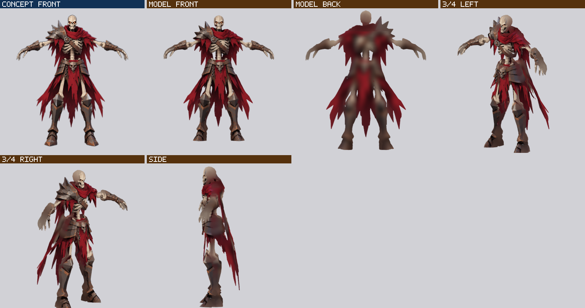
(a) Только перед: спина — размытый перед «насквозь», бока и 3/4 — размазанные красное и серое.

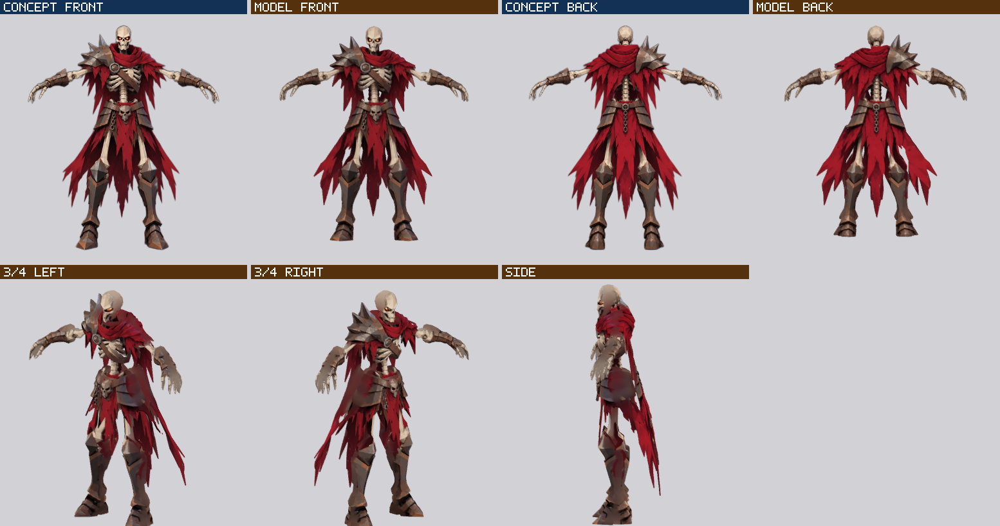
(b) Спина резкая (позвоночник, цепь, лопатка с шипами по заднему референсу). Боковые виды всё ещё гадают (их не видит ни
одна камера): у отзыва модели замечания именно к плащу сбоку.

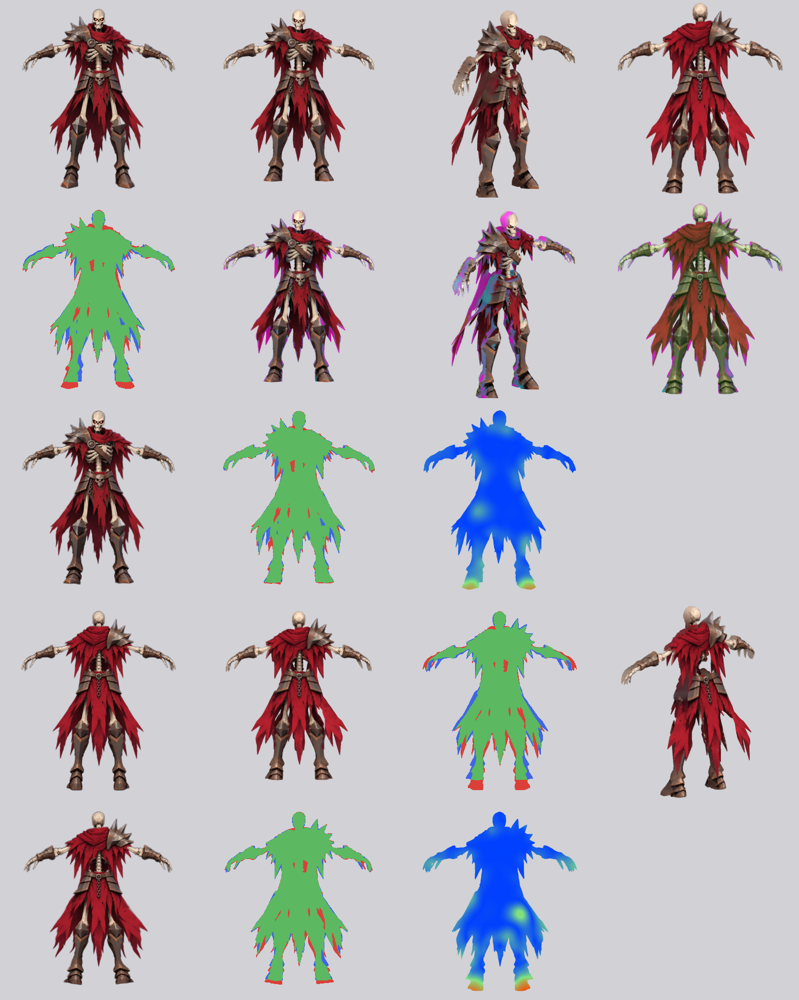
`compare.png` прогона (b): строки перед (концепт, модель, 3/4, спина), заливка с подкраской (зелёный — из заднего референса),
изогнутый перед (концепт после изгиба, совпадение силуэтов после, тепловая карта смещения), спина и её изгиб.

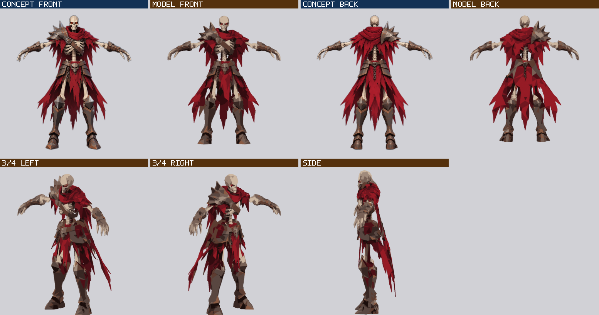
(c) Плоские грани, 12 цветов. Глаза (мельче грани) в цвет черепа усреднены — светящиеся глаза нужно ставить `replace_part`
(`eyes`) или картой свечения.

**Как отзыв модели соотносится с метриками.** Модель 8B — грубый судья: на этих листах 4 / 6 / 6 — «спина размыта» (4) она отличила от «спина
по референсу» (6), но (b) от (c) не отличила; на листе с намеренно сбитой камерой (смещение 70 px, рыскание +12°, IoU 0,49)
она тоже даёт 4 — этот случай ловят числа (`concept_iou_min` — ошибка, `texture_qa`: IoU 0,49). Поэтому порог оценки — один из
сигналов, а не замена метрик.

## Конвейер и пакет

- Реестр: шаг `paint_from_concept` (модуль paint, все виды, CPU, слоты `blend, mesh, concept`). Шагов 25.
- `scripts/forge-concepts.mjs`: у каждого гуманоида и существа `paint_from_concept` сразу после `cleanup`;
  `--no-paint` — по-старому белые модели; `roles.json` → `"paint": {...}` — параметры для файла.
- Текстура доходит до конца цепочки: `rig_humanoid` и `retarget` берут `painted.blend` (материал и UV на месте),
  `motion_style` экспортирует GLB с картинкой, `render_sprites` (Cycles, `grade_materials` добавляет к карте только
  узел насыщенности), `godot_package` — GLB пакета Godot содержит `paint_basecolor` (проверено, см. замеры).

Полная сборка (как была, теперь с покраской):
```
node scripts/forge-concepts.mjs --dir C:\AstraForge\incoming\hg_concepts_2026-10-11 --state C:\AstraForge\incoming\build\build.state.json --direct --watch --qa-render-failed
```
Прогон отдельного шага:
```
"C:/Program Files/Blender Foundation/Blender 5.0/blender.exe" -b --factory-startup ^
  --python scripts/blender/af_run.py -- paint_from_concept request.json
```
```json
{"inputs": {"blend": "C:/.../01_cleanup/clean.blend", "concept": "C:/.../data/assets/<reference>.png",
            "concept_original": {"image": "C:/.../data/assets/<original>.jpg", "crop": [286, 28, 1044, 759],
                                 "content_rect": [76, 89, 758, 731]}},
 "params": {}, "asset": {"kind": "humanoid"}, "out_dir": "C:/.../02_paint_from_concept"}
```

## Замеры (Blender 5.0.1, CPU, 11.10)

Время шага — 9–14 с на персонажа (40 000 тр., текстура 2048², CPU): подгонка камеры 3–5 с (с перспективой),
растр и текстура 4–5 с, превью 1–2 с; память — сотни МБ. Пакет из 79 персонажей получает ~15 минут сверх прежнего.

**Пилот (опорные картинки генерации пакета 11.10, прогон `forge-concepts.mjs --direct --qa-render-failed`).**
«Из концепта / смешано / заливка» — доли покрытых текселей; в скобках — доля заливки «насквозь».

| Персонаж | IoU | Камера | Разница цвета | Из концепта / смешано / заливка | мм на пиксель / тексель | Время |
|---|---|---|---|---|---|---|
| Рыцарь с мечом и щитом №3 | 0,923 | орто, рыскание −1,1°, наклон −1,4° | 0,027 | 25,9 / 5,4 / 68,7 % (88 %) | 2,52 / 1,66 | 9,6 с |
| Маг с посохом (мантия) | 0,870 | орто, рыскание +20,0° | 0,026 | 17,3 / 5,4 / 77,3 % (63 %) | 2,43 / 1,75 | 10,1 с |
| Скелет-мечник (нежить) | 0,845 | перспектива 9,0 м, рыскание −34,9° (орто 0,830) | 0,040 | 21,8 / 5,7 / 72,5 % (79 %) | 2,48 / 1,98 | 9,4 с |
| Рыцарь со знаменем (отдельно) | 0,815 | перспектива 4,0 м, рыскание −11,8°, наклон −11,3° (орто 0,790) | 0,044 | 13,9 / 7,5 / 78,7 % (78 %) | 2,60 / 2,21 | 10,7 с |
| Грифон (существо, отдельно) | 0,857 | орто, рыскание −41,2° | 0,029 | 20,1 / 8,0 / 71,9 % (89 %) | 1,62 / 1,94 | 11,5 с |
| Синтетика (тест) | 0,982 | орто, рыскание 16,0° при истинных 15° | 0,020 | 26,7 / 7,8 / 65,6 % | 4,3 / 4,6 | 1,8 с |

«Разница цвета» — средняя |RGB| плоского рендера через подогнанную камеру против концепта на общем силуэте (sRGB, 0–1).

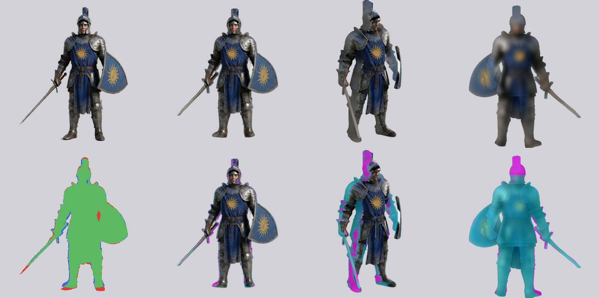
Рыцарь №3: концепт | модель через камеру | 3/4 | спина; снизу — силуэты и заливка (голубое — «насквозь», пурпурное —
догадка). Перед совпадает с концептом (эмблема, ремни, лицо), спина — синий табард с размытой эмблемой, затылок шлема —
серебро (защита головы), обратная сторона щита — его лицевой цвет насквозь.

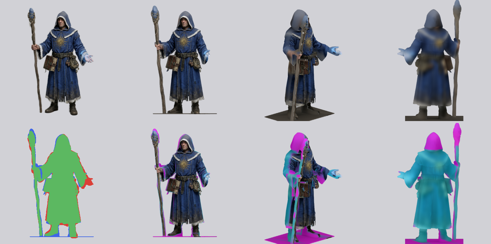
Маг: мантия, книга, мешочек, посох на месте; спина — синяя мантия с размытым поясом, капюшон сзади — ближайший цвет
капюшона (чуть серее спереди из-за белой оторочки). Плита под ногами — геометрия Hunyuan, не покраска.

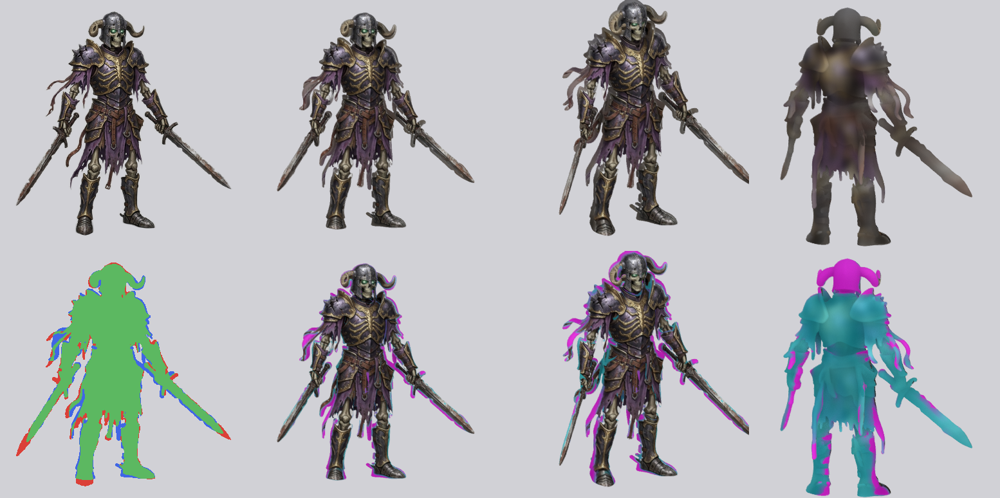
Скелет-мечник: фиолетово-золотая броня, ленты, кости ног, два меча; зелёные глаза — в карте цвета (светиться не стали,
см. ограничения).

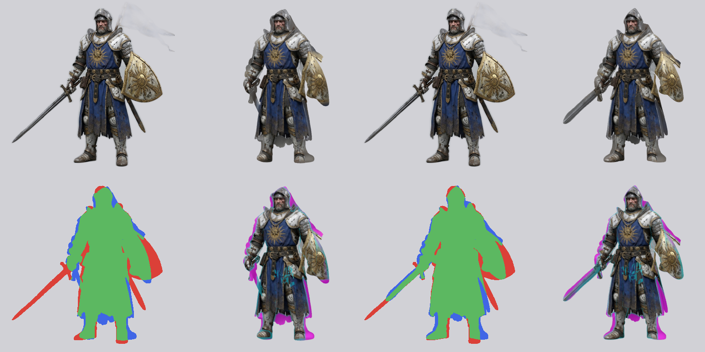
Рыцарь со знаменем: слева ортокамера (наклон ±8°, IoU 0,777), справа перспектива с наклоном ±15° (0,815): меч Hunyuan
смотрит на камеру, и только перспектива укладывает его по диагонали концепта — меч получает свой стальной цвет.

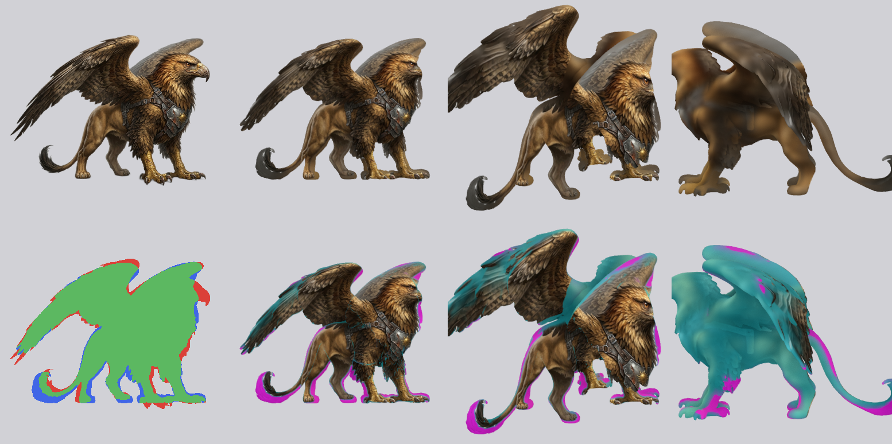
Грифон (существо: поиск рыскания ±180°, без защиты головы): перья, львиное тело, ремни; светящийся камень на
нагруднике — единственное найденное свечение (21 тексель).

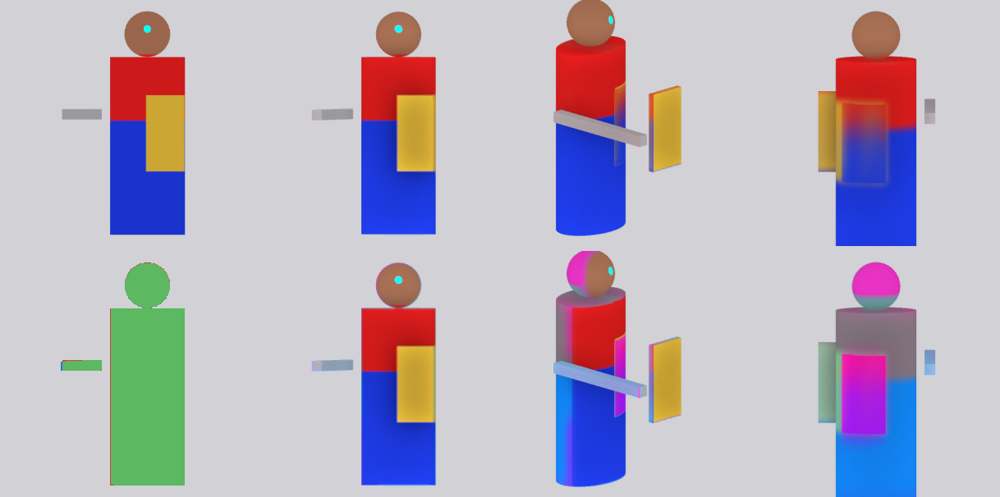
Синтетический тест: цилиндр-тело (красное/синее), голова, щит (отдельный кусок) перед левым боком, меч на камеру,
голубой глаз. Спина красная/синяя «насквозь», тело за щитом — по зеркалу (не золото щита), затылок — цвет головы,
глаз светится.

**Цвет доходит до конца цепочки.** Спрайты «Врат» (Cycles, `render_sprites`) у всех трёх пилотов цветные во всех
клипах и трёх ракурсах; GLB пакета Godot содержит картинку `paint_basecolor` (PNG, 1 материал `Body_painted` с
`baseColorTexture`, 5 анимаций, ~4,7–4,9 МБ), проверка Godot 4.5.1 пройдена.

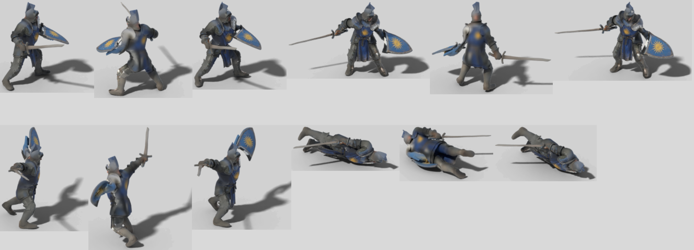
Рыцарь №3, кадры спрайтов (покой, шаг, атака, смерть × базовый / nw / se), увеличено ×2: табард, эмблема, щит, сталь;
вид со спины — табард с размытой эмблемой «насквозь».

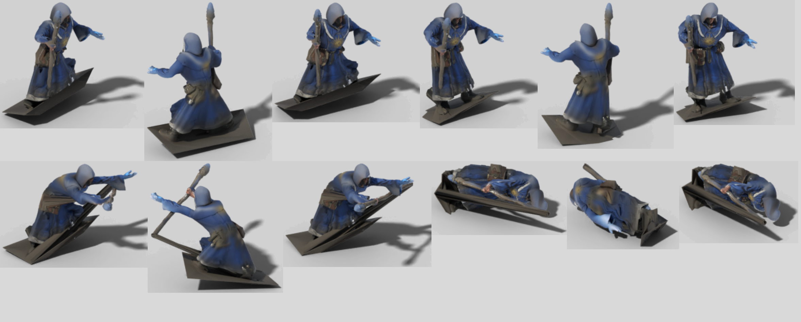
Маг: синяя мантия, пояс с книгой и мешочком, посох, голубоватая «светящаяся» ладонь (цвет концепта, не emission). Тёмная
плита под ногами — **плоское основание, которое Hunyuan прилепил к ступням**: `cleanup` его оставляет, риг привязывает к
стопам, и оно наклоняется вместе с ними (отсюда и 16,7 % разрывов на клипах мага). Это задача чистки или рига.

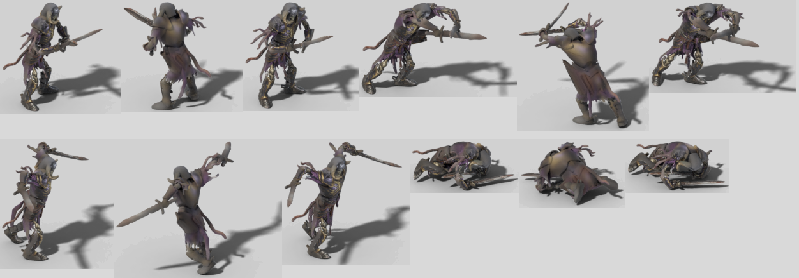
Скелет-мечник: фиолетово-золотая броня и ленты; сзади — коричнево-серая броня с фиолетовыми лентами. Под светом Cycles
и `grade_materials` (насыщенность ×1,1) броня выглядит бронзовее фиолетово-серой брони концепта.

Статусы пилота — не про цвет: все трое помечены `failed_qa` проверкой разрывов на клипах (idle: рыцарь 3,3 %, скелет
1,7 %, маг 16,7 % порванной поверхности при пороге 1 %) — это риг и веса (у мага ещё и плита под ногами), спрайты
отрисованы для просмотра (`--qa-render-failed`), превью — `previews/<имя>.failed.png` папки концептов, отчёт —
`C:/AstraForge/incoming/pilot3/p.state.report.md`.

Тесты: `run_tests.py -- paint_from_concept` — 8 тестов, все PASS, 17 с (синтетика, сокеты и светящиеся сетки,
повтор с камерой из `paint_camera.json`, уменьшение концепта, растр/z-буфер/pull-push, маска свечения, развёртка и
деление на альфу, реальные рыцарь и скелет с диска); `npm test` 144/144; `npm run build` — без ошибок.
**13.10:** 17 тестов, все PASS, ~55 с. Добавлены: сплайн на синтетических силуэтах (IoU вверх, цвета рук и рукавов на своих
местах, предел смещения, нет складок); шаг с рукой модели, опущенной на 22° против горизонтальной руки концепта (без изгиба
цвет рукава ложится на кисть — 0,75/0,09/0,09, с изгибом кисть кожаного цвета 0,57/0,33/0,25); спина по референсу (зелёная
спина против красной, и через `concept_back_file`); плоский режим (один цвет на каждый треугольник, ≤ 5 цветов палитры, красная
грудь на месте); k-means / Lab / медиана; лист и метрики QA; пороги и разбор ответа модели; вызов модели **с подменой**
`_paint_qa._request` (порядок tags → queue → free → chat, тело запроса, оценка и предупреждения, пропуск при недоступной
Ollama / отсутствующей модели / занятой очереди ComfyUI / сбое вызова / нечитаемом ответе, без сети). Тестовый хелпер
`_run` по умолчанию ставит `qa_vlm: off`.

## Честные ограничения

- **Разрешение.** Концепты 1376 × 768, фигура ~700 px в высоту — **2,5–2,6 мм на пиксель** при росте 1,8 м. Тексель
  2048² на развёртке AABB — 1,7–2,2 мм: тексель чуть мельче пикселя концепта, текстура лишь интерполирует его. Мелочь (глаза черепа,
  гравировка, заклёпки) видна ровно настолько, насколько её видно на концепте в этих пикселях. 4096 смысла не имеет.
- **Одна картинка.** Прямо из концепта берётся 14–26 % покрытых текселей (сетки Hunyuan имеют много внутренних и задних поверхностей:
  7,6 м² у рыцаря при «человеческих» ~2 м²). Остальное — **догадка**: спина — размытый перед «насквозь» (эмблема табарда
  повторяется сзади размытой; книга на поясе мага — тоже), затылок и плюмаж — ближайшая видимая точка. Это правдоподобно
  для одежды, но не знание.
- **Геометрия не концепт.** Hunyuan ошибается в положении тонких предметов (меч рыцаря со знаменем смотрит в камеру,
  а не вниз-вбок; щит уже). Где сетка вылезает за силуэт концепта, цвета нет — там заливка (пурпурное на
  `compare.png`). IoU 0,8–0,92 типичны; ниже 0,8 — предупреждение.
- **Свечение консервативно.** Глаза скелета в концепте тусклые (яркость 0,54, насыщенность 0,36 на 3–6 пикселях) и
  не проходят порог; пятна, которые светятся явно, — проходят (синтетический тест). Ложное свечение хуже пропущенного:
  глаза можно поставить `replace_part` (`eyes`). У трёх пилотных персонажей свечение не найдено.
- **Не PBR.** Свет концепта остаётся в альбедо (снимается только крупный перепад), шероховатость и металл —
  постоянные. Cycles-спрайты поверх добавляют свой свет, поэтому модель на спрайтах темнее и контрастнее концепта.
- **Развёртка Smart UV** на шумной сетке — тысячи мелких островов; швы закрыты расширением и pull-push, но при сильном
  уменьшении (mip) соседние острова могут чуть подмешиваться.
- **Плоскость симметрии** берётся по полосе плеч (75–85 % роста); у сильно асимметричных фигур зеркальная заливка
  срабатывает реже (допуск 3 % роста) — тогда работает «ближайшая того же куска».
- Риг рыцаря со знаменем (`Knight_holding_sword_and_shield_20261010233748.jpg`) не строится и **без покраски** (знамя
  сбивает ориентиры: «правая рука 0,95 H», с `front: -Y, fix_yaw: false` риг строится, но кисть уходит на знамя) — это
  задача модуля humanoid, к цвету не относится.
- **Выравнивание по силуэту — не по смыслу.** Изгибаются контуры, а не детали: что внутри силуэта (кисть против рукава на руке
  той же ширины), сплайн знает только через соседние контуры. Если поза отличается так, что силуэт ложится «не на ту руку»,
  изгиб это не исправит; за пределом `align_max` соответствия отбрасываются (у C01 до предела не доходит: p95 ≈ 2 %).
  Лишняя геометрия, которой нет в концепте (плоское основание Hunyuan), дальше `align_max` пары не находит, а ближе —
  может потянуть контур.
- **Боковые виды всё ещё догадка.** С передом и спиной три четверти и профиль красятся из заливки (бока видны обеим камерам
  только под скользящим углом); `grazing_share` 12 % у C01 — это не размазывание, а доля концепта на наклонных гранях, остальное —
  заливка. Для настоящего знания боков нужен третий референс.
- **Задний референс обязан быть тем же персонажем** в том же кадре; расхождение цветов спереди и сзади на боках видно швом
  (специальной метрики нет: при противоположных камерах ни один тексель не получает оба веса).
- **Плоский режим** стирает детали мельче грани (глаза, цепь, гравировка) и на 10 000 треугольниках Hunyuan даёт «шумные» грани —
  граней больше, чем деталей рисунка; на сетке после `cleanup` с меньшим `target_tris` выглядит чище. Свечение остаётся картой на
  текселях.
- **Отзыв модели — грубый.** 8B vision-модель с предзаполненным ответом различает крупное («спина размыта») и мало — мелкий
  дрейф (рукав на кисти) на листе 384 px она не отличает; оценки на одном и том же листе повторяются, а замечания часто
  формульны. Решения принимаются по метрикам и по глазам, модель — третий сигнал. Отзыв не выполняется, пока ComfyUI занят.
- **Сервер** не знает новых параметров и входа `concept_back` (см. «Подключение к серверу»).
