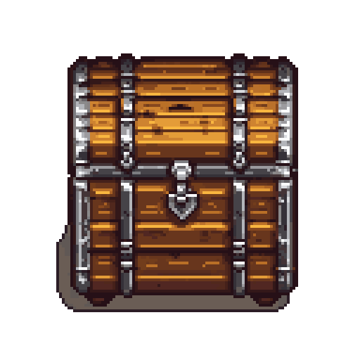
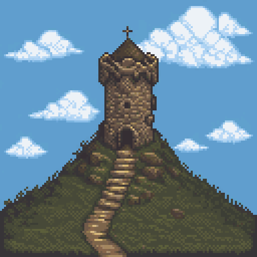
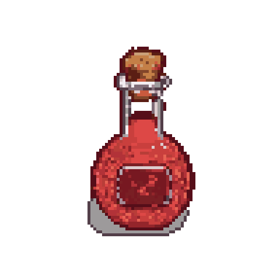

# Pixel Art: спрайты из 3D, картинки по тексту, редактор

Три связанные части (27.10.2026). Всё локальное, без облачных сервисов.

| Часть | Что делает | Где |
|---|---|---|
| А. Профиль `pixel` | спрайт-листы из 3D-модели в настоящем пиксель-арте | шаг `render_sprites`, [export.md](export.md#профиль-pixel-2710) |
| Б. Генерация по тексту | сцены и предметы: SDXL + LoRA pixel-art-xl в ComfyUI, затем уменьшение в пиксели | `scripts/pixel/pixel_gen.mjs` |
| В. Pixelorama | редактор пикселей и покадровой анимации (MIT), внешняя программа | вкладка «VFX» → Pixelorama |

Общее ядро А и Б — `scripts/pixel/pixelize.py`: детерминированная постобработка на numpy (уменьшение, палитра,
дизеринг, контур). Тот же модуль работает из командной строки для любой картинки.

## Б. Картинка по тексту

Нужен основной ComfyUI владельца на `http://127.0.0.1:8188` (папка `D:\ComfyUI`), чекпойнт
`models/checkpoints/sd_xl_base_1.0.safetensors` и LoRA `models/loras/pixel-art-xl.safetensors` (скачана 27.10,
170 543 052 байта; источник `https://huggingface.co/nerijs/pixel-art-xl`). Если LoRA нет, скрипт скажет об этом до
постановки в очередь. После копирования LoRA ComfyUI перезапускать не нужно, достаточно обновить список узлов (скрипт
спрашивает `/object_info`).

```
node scripts/pixel/pixel_gen.mjs "medieval wooden chest with iron bands, closed, three-quarter view" --item ^
     --out chest.png --size 128 --colors 32 --outline auto --seed 11 --preview 4
node scripts/pixel/pixel_gen.mjs "stone watchtower on a grassy hill, blue sky, small clouds" ^
     --out tower.png --size 128 --colors 40 --seed 5 --preview 4
```

Промпт пишется по-английски (SDXL и LoRA понимают его лучше всего; русский скилл переводит сам). Скрипт печатает одну
строку JSON: путь, размер, число цветов, палитра, seed.

Что делает скрипт:

1. Собирает граф API-формата: `CheckpointLoaderSimple` → `LoraLoader` (сила 1.0) → два `CLIPTextEncode` → `KSampler`
   (20 шагов, cfg 7, `euler_ancestral`) → `VAEDecode` → `SaveImage`. К промпту добавляется префикс «pixel art, pixel, » и
   суффикс «clean pixel art, flat colors, crisp pixels, limited palette»; негатив «blurry, realistic, photo, 3d render,
   smooth gradient, anti-aliasing, noisy, jpeg artifacts, text, watermark».
2. Ставит граф в `/prompt`, ждёт `/history/<id>`, забирает PNG из `/view` (рендер 1024×1024).
3. Зовёт `pixelize.py`: уменьшает до `--size` по длинной стороне, строит палитру и при `--outline` обводит.

| Параметр | По умолчанию | Что |
|---|---|---|
| `--size` | 128 | длинная сторона результата: 64, 96, 128 |
| `--colors` | 32 | размер авто-палитры (для сцен 40–48 сохраняют мелкие детали) |
| `--palette` | `auto` | `auto`, `none` или файл `.gpl`/`.hex`/`.png`: общая палитра нескольких картинок |
| `--outline` | `none` | `dark` (самый тёмный цвет палитры) или `auto` (затемнённый цвет края) |
| `--mode` | `dominant` | как уменьшать: `dominant` — самый частый цвет блока (чистые цвета, без мути усреднения; картинка LoRA уже нарисована пикселями), `box` — среднее по площади, `nearest` |
| `--dither` | выкл. | упорядоченный Bayer 4×4; `--saturation`, `--levels` — тон до палитры |
| `--item` | выкл. | предмет: к промпту добавляется «single isolated object, plain flat light background, no shadow», в негатив — тень и пол; фон по цвету углов вырезается в прозрачность (`--remove-bg`, допуск `--bg-tol`, 24) |
| `--seed`, `--steps`, `--cfg`, `--lora-strength` | случайный, 20, 7, 1.0 | параметры выборки; одинаковый seed и параметры дают ту же картинку |
| `--negative`, `--no-suffix` | — | дополнить негатив; не добавлять суффикс стиля |
| `--preview N` | выкл. | рядом записать `<out>_xN.png`, увеличенный nearest |
| `--keep-raw`, `--render`, `--comfy`, `--checkpoint`, `--lora`, `--timeout` | — | исходный рендер 1024; сторона рендера; адрес ComfyUI; имена моделей; таймаут, с |

Время: 10–20 секунд на картинку (рендер 1024 px, 20 шагов; первая после запуска ComfyUI дольше из-за загрузки моделей).

Примеры (увеличены в 4–5 раз, `chest` и `potion` с прозрачным фоном):

| Предмет, 128 px, `--item --outline auto` | Сцена, 128 px, 40 цветов | Предмет, 96 px, `--item --outline auto`, 24 цвета |
|---|---|---|
|  |  |  |

Промпты: «medieval wooden chest with iron bands, closed, three-quarter view» (seed 11); «stone watchtower on a grassy
hill, blue sky, small clouds, medieval fantasy landscape» (seed 5); «red health potion bottle with cork, glass flask,
glowing red liquid» (seed 7).

### pixelize.py отдельно

```
py -3 -I scripts/pixel/pixelize.py in.png out.png --size 64 --colors 32 --outline auto --dither --palette-out pal.png
```

Любая картинка в пиксель-арт: `--size` или `--factor` (целое уменьшение), `--mode box|nearest|dominant`,
`--palette auto|none|файл`, `--colors`, `--dither`, `--dither-strength`, `--outline none|dark|auto`, `--alpha-threshold`,
`--saturation`, `--levels`, `--remove-bg`, `--preview N`. Результат зависит только от пикселей и параметров.

Правила, общие для А и Б: цвет только из палитры, альфа только 0 или 255, контур 1 px снаружи по 4-соседству и цвета
из палитры (при авто-палитре под тёмный контур резервируется один цвет), дизеринг упорядоченный, поэтому
результат повторяем.

## В. Pixelorama

Pixelorama 1.2.3 (MIT, `github.com/Orama-Interactive/Pixelorama`, Godot): слои, кадры анимации, палитры, экспорт
PNG и листов спрайтов. Лежит в `C:\Imaginarium\tools\vfx\apps\pixelorama\Pixelorama.exe`, запись `pixelorama`
в `server/vfx-tools-catalog.json` (вид `desktop`), запускается кнопкой во вкладке «VFX» студии. Если её нет —
`scripts/vfx/Install-VfxTools.ps1 -Only pixelorama`. Палитра из `palette.gpl` (профиль `pixel`) открывается в
Pixelorama через панель палитр: так ручная доводка листа остаётся в тех же цветах.

## Лицензии и ограничения

- LoRA pixel-art-xl — CreativeML OpenRAIL-M (допускает коммерческое использование с оговорками о недопустимых
  применениях, перечисленными в лицензии); в сборку и установщик не входит, скачивается в ComfyUI владельца;
  запись есть в `THIRD_PARTY_NOTICES.md`. Базовая модель SDXL 1.0 — OpenRAIL++-M.
- Pixelorama — MIT, запускается как отдельная программа, в студию не встроена.
- Тень под предметом остаётся, если она темнее фона (`--item` вырезает только фон по цвету углов): поднимите
  `--bg-tol` или уберите тень в Pixelorama. Однотонные фоны вроде «solid magenta» модель не соблюдает.
- Картинки LoRA уже «рисуются пикселями», но сетка не выровнена по границам блоков, поэтому на 64 px мелкие
  детали (пробка зелья, надписи) грубеют: для мелких предметов берите 96–128.
- Тусклые тёмные модели в профиле `pixel` без `levels` дают грязную палитру; для моделей с очень тонкими деталями
  (копья, древки) без сглаживания тонкое пропадает: поднимите `pixels_per_meter` или `supersample`.
- Профиль `pixel` в API студии: перечень `profile` в `server/forge-steps.mjs` нужно дополнить значением `pixel` и новыми
  параметрами, пока шаг можно запускать напрямую через `imaginarium_run.py`.
