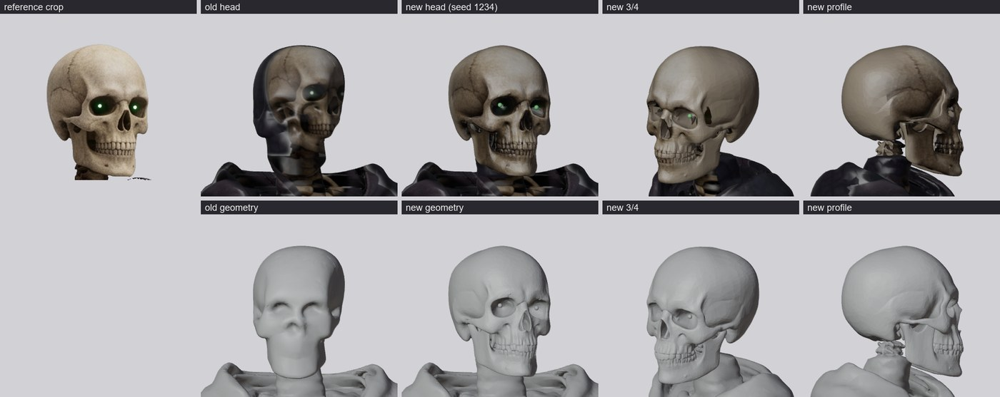
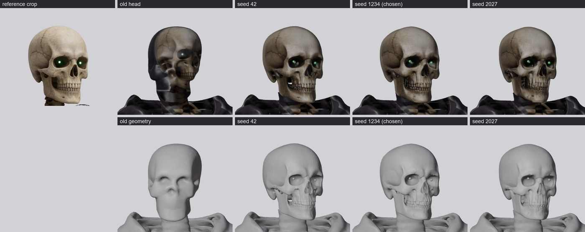
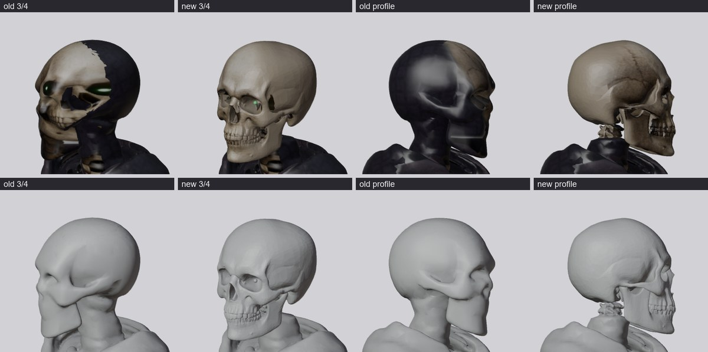

# Модуль replace_part — замена части сетки по ROI-реконструкции

Шаг Blender `replace_part`: убирает из готовой сетки область (например, сглаженный череп) и ставит
на её место деталь, сгенерированную отдельно из кропа высокого разрешения. Нужен для мелких, но
заметных деталей, которые во входе генератора полной фигуры получили слишком мало пикселей: череп
некроманта во входе Hunyuan занимал около 120 пикселей, в ROI-кропе он заполняет почти весь кадр.

Файлы: `scripts/blender/steps/replace_part.py`, `scripts/blender/steps/_replace_lib.py`,
`scripts/blender/tests/test_replace_part.py`, картинки в `docs/forge/img/replace_part/`.
`_mesh_lib.py` используется только на чтение.

## Порядок работы шага

1. **Тело.** Импорт, слияние мешей, необязательная нормализация (`height_m`, `rotate_z_deg`,
   `ground`, `center` — как в `separate`), сварка `merge_distance` (glTF режет вершины по UV-швам;
   без сварки разрез шеи даёт 14 обрывков вместо одного кольца), сглаживание по углу 40°.
2. **Удаление области.** Плоскость `cut_plane` рассекает сетку только под отпечатком `region`
   (бокс, расширенный на 50 %). Грани над плоскостью собираются в куски, связанные без пересечения
   плоскости; кусок удаляется, если не меньше `min_inside` (0.5) его площади внутри бокса. Так чуть
   тесный бокс всё равно забирает голову целиком, а край капюшона, заходящий в бокс, остаётся.
   Куски под плоскостью, которые касаются её только там, где касалось удалённое, и свисают не
   глубже `hang_m`, тоже удаляются — это старая нижняя челюсть, уходящая ниже разреза шеи. Шея
   продолжается в торс и остаётся. Открытые петли тела на плоскости запоминаются.
3. **Деталь.** Импорт, сварка, удаление крошек (`part_min_island`), рабочая децимация до
   `max(4·part_tris, 100 000)`. Если включены глаза, в рабочем кадре ищутся глазницы, и мелкие
   отдельные острова внутри них (генератор лепит светящийся глаз шаром) удаляются.
4. **Выравнивание.** Начальное подобие без поворота по устойчивым габаритам верхних 60 % обеих
   поверхностей (верх, ширина и глубина по процентилям 2–98) — шейный обрубок и «подставка» снизу
   на него не влияют. Затем симметричный ICP с обрезкой худших 15 % пар и общим масштабом (Умеяма
   в замкнутой форме); точки детали ниже плоскости разреза не участвуют. Поворот по умолчанию
   выключен: кроп и тело сняты одной камерой, деталь уже ориентирована как на референсе, а поворот
   к старой поверхности тянет её к ошибкам старой головы (замер ниже). Отчёт — RMS «точка —
   поверхность» в обе стороны, без пола от шага выборки.
5. **Разрез детали** плоскостью, поднятой на `seam_gap`. Куски ниже разреза: если сечение лежит
   внутри петли тела (или ближе 0.3 её радиуса) — это собственный обрубок шеи детали, вместе с
   приклеенной к нему подставкой, он удаляется; кусок, вообще не касающийся разреза, — плавающий
   обломок подставки, удаляется; остальные, свисающие не глубже `keep_hang`, остаются — это новая
   нижняя челюсть, она не обрезается плоско. Потом крошки и финальная децимация до `part_tris`
   (весь бюджет уходит на сам череп), граничные вершины возвращаются на плоскость.
6. **Текстура `front_projection`.** Деталь временно возвращается в свой кадр генератора, где камера
   кропа смотрит вдоль +Y. Кроп совмещается с деталью по силуэту: начальное приближение по верхнему
   краю и ширине верхних 60 %, затем поиск масштаба и сдвига по IoU плотной выборки поверхности с
   маской кропа (альфа или, для JPG, ключ по цвету рамки). Грани, смотрящие в камеру, получают UV в
   кроп (слот `part_front_projection`), остальные — слот `part_back_fill` с медианным цветом
   внешней полосы объекта. Во внешних 5 % ширины объекта фото плавно переходит в этот цвет: эти
   пиксели попадают на скользящие грани, поэтому стык слотов не виден ступенькой. Пиксели фона
   никогда не берутся: цвет объекта растягивается наружу. `occlusion: true` дополнительно требует
   прямой видимости камеры; на черепе это дало больше рваных светлых пятен в складках, поэтому
   выключено.
7. **Глаза.** Для каждого поворота камеры −45…45° с шагом 15° строится ортографическая карта
   глубины лучами по BVH; впадина = морфологическое закрытие высоты минус высота, окно 0.34
   ширины силуэта. В полосе 35–92 % высоты выбирается пара пятен: обе глубокие, на одном уровне,
   разнесены на 0.15–0.75 ширины, похожего объёма; нос и одиночные ямы отсекаются. Взгляд —
   перпендикуляр к линии глаз (точнее сетки поворотов). Сфера радиусом `radius_factor` × радиус
   глазницы ставится в середину глубины, не дальше задней стенки. С текстурой сфера сдвигается на
   зелёное пятно свечения в кропе внутри своей глазницы — туда же, где оно на референсе. Материал
   `eye_glow` с эмиссией, сокеты `socket_fx_eye_l` (+X, левый глаз персонажа) и `socket_fx_eye_r`,
   локальная +Z наружу (контракт §6).
8. **Шов.** Деталь и сферы объединяются с телом. Самая длинная петля тела на плоскости и самая
   длинная петля детали на поднятой плоскости соединяются `bridge_loops` (разное число рёбер
   допускается); остальные петли закрываются. Грани моста берут материал тела и UV ближайшей
   вершины кромки тела, ориентация граней согласуется с соседями.
9. **Сравнение.** Старое тело и результат рендерятся Workbench в одинаковом кадре: спереди (камера
   референса), 3/4 и профиль относительно взгляда нового черепа, с отсечением геометрии вне
   области головы (посох не заслоняет). Кроп пересчитывается в тот же кадр; IoU силуэта и средняя
   ошибка цвета считаются по строкам выше разреза. Глубина глазниц меряется одинаковыми лучами в
   точках новых глаз на старой и новой поверхности.

## Параметры

| Параметр | По умолчанию | Что делает |
|---|---|---|
| `inputs.mesh` / `inputs.blend` | — | тело |
| `inputs.part` | — | новая деталь в кадре генератора (вперёд −Y, как тело) |
| `height_m`, `rotate_z_deg`, `ground`, `center` | нет, 0, true, true | нормализация тела до всего; `region` и `cut_plane` — в этих метрах |
| `merge_distance`, `shade_auto_smooth_deg` | `1e-5 × рост`, 40 | сварка тела и сглаживание |
| `region` | обязателен | `{"min": [x,y,z], "max": [x,y,z]}` вокруг заменяемой части |
| `cut_plane` | z-плоскость через `region.min` | `{"axis": "z", "value": 1.5}` или `{"point", "normal"}`; деталь на стороне +normal, `"side": "-"` меняет сторону |
| `min_inside` | 0.5 | доля площади куска внутри бокса, при которой он удаляется |
| `hang_m` | 0.25 × высоты бокса | глубина свисания старых кусков под разрезом, которые удаляются вместе с областью |
| `align` | `icp` | `icp`, `bbox` (только начальное подобие) или `none`: деталь остаётся в своей позе (после `part_transform`) без масштабирования под удаляемую область |
| `part_transform` | нет | `{"location": [x,y,z], "rot_deg": [x,y,z] \| "matrix": 3×3 строки, "scale": s}` — поза детали до всего остального (кисть bone_kit: запястье в нуле → к запястью) |
| `keep_materials` | false | true: без `texture` деталь сохраняет свои материалы (золото колец, `Bone_aged` с цветами вершин); имя UV и атрибуты цвета согласуются с телом (белый, где их нет) |
| `cut_part` | true | false: деталь не режется плоскостью и не сшивается мостом, отверстие тела на плоскости закрывается крышкой (у кисти из отдельных костей нет «шеи» для моста) |
| `keep_rig` | false | true: тело со скелетом сохраняет его — арматура, модификатор ARMATURE и веса незатронутых вершин переживают замену, новые вершины (деталь, глаза, шов) получают веса переносом со снятой старой поверхности, `replaced.glb` экспортируется со скиннингом. Нет арматуры в теле — обычная статическая замена и предупреждение |
| `icp_rotation` | false | разрешить ICP поворот |
| `icp_iters`, `icp_trim`, `samples` | 60, 0.85, 6000 | итерации, доля оставляемых пар, точек на поверхность |
| `max_rotation_deg`, `max_rms_rel` | 30, 0.04 | порог отката ICP к `bbox`; предупреждение по RMS / диагональ бокса |
| `part_tris` | 20 000 | бюджет детали после разреза (0 — без децимации) |
| `part_min_island`, `crumb_fraction` | 0.0005, 0.002 | крошки до децимации и после разреза (доля вершин) |
| `part_rotate_z_deg` | 0 | поворот детали до всего |
| `seam_gap` | 0.02 × высоты бокса | на сколько выше плоскости режется деталь (длина моста) |
| `keep_hang` | = `hang_m` | глубина свисания куска детали, который остаётся (челюсть) |
| `texture` | нет | `{"image", "crop_px": [l,t,r,b], "mode": "front_projection", "facing_min": 0.12, "fade": 0.05, "occlusion": false}` |
| `eyes` | нет | `{"auto": true, "color": [0.25, 1.0, 0.35], "strength": 6, "radius_factor": 0.22, "remove_inner_islands": true, "snap_to_glow": true}`; цвет линейный |
| `name` | `replaced` | имя объекта результата |
| `preview`, `preview_size` | true, 384 | `compare.png`, `compare_views.png` |

**Процедурные детали (10.10, вечер).** Почему понадобились новые параметры, описано в
`docs/forge/necromancer.md`, раздел 3. Выравнивание всегда масштабировало кисть bone_kit под толстую «лопату»
(×2,31), а без текстуры золото колец заменялось плоским `part_fill`. Теперь
`{"align": "none", "part_transform": {...}, "keep_materials": true, "cut_part": false}` ставит деталь в
заданную позу как есть. Остаётся только удаление области с крышкой на плоскости. Проверка `align_rms` при
`align: none` не считается: старая поверхность здесь не цель.

**Сокеты.** Сокеты тела вне удаляемой области сохраняются: они проходят нормализацию тела и экспортируются.
Сокеты внутри области (на стороне детали) уходят вместе с ней и попадают в `region.sockets_dropped`. Сокеты
детали (например, `socket_mount_hand_l` кисти bone_kit) переносятся с ней через `part_transform`, поворот
и подобие выравнивания. Тест `test_replace_align_none_keeps_part_pose_materials_and_sockets`.

Выходы: `replaced.glb` (один меш и сокеты глаз), `replaced.blend`, `part_aligned.glb` (деталь
отдельно, выровненная и обрезанная), `part_projection.png`, `compare.png` (кроп | старая голова |
новая спереди | новая 3/4 | новая в профиль; ряд с текстурой и ряд геометрии), `compare_views.png`
(старая и новая в 3/4 и профиль). Проверки: `region_removed`, `part_nonempty`, `no_nan_verts`
(ошибки); `align_icp_sane`, `align_rms`, `texture_registration_iou` (≥ 0.8), `eyes_found`,
`seam_closed` (предупреждения).

## Некромант: результат

**Кроп.** `Reference-original.jpg` (2752×1536), область x 1335–1505, y 82–288 (170×206 px): череп
с небольшим полем и коротким обрубком шеи, низ — на верхнем крае воротника. Увеличение Lanczos
×4.97 до 845×1024 (системный Python + Pillow). Альфа — rembg u2net на CPU, тот же инструмент и те же
веса, что в студии; тёмные пиксели мантии в нижних 10 % кадра вырезаны. Файлы в
`work/skull_roi/`: `skull_crop_a.png`, `skull_crop_a_rgba.png`, `crops.json`.

**Генерация** в собственной студии (ComfyUI 8190, Hunyuan3D 2.1, `quality: high` — 45 шагов,
октодерево 512³, `meshLevel: 0`, RTX 4070). Загруженный кроп — ассет
`87a0f28a-b000-4919-b195-844fa1cad76b`.

| Задача | Seed | Время | Итог |
|---|---|---|---|
| `72061d5e-19a3-4134-a344-ae0fce722a76` | 42 | 3 мин 11 с | 2 830 428 треуг., 50.9 МБ; студия пометила `failed`: технический предел 2.5 млн треуг. |
| `121ed081-64c8-4fec-8ac6-461da8f28b87` | 1234 | 3 мин 01 с | 2 871 202 треуг., 51.7 МБ; тоже `failed` по пределу 2.5 млн |
| `6dd18792-ccdf-4546-b0b6-bf8b4b398493` | 2027 | 3 мин 00 с | 1 999 890 треуг., 36.0 МБ, `completed`, ассет `b0106765-ab2b-4d36-a2f2-e67191cb3f48` |

Предел 2.5 млн рассчитан на полную фигуру; ROI-деталь заполняет всю сетку 512³, и треугольников
получается больше. Для двух задач исходные GLB взяты копией из выходной папки собственного Comfy
(`data/runtime/output/imaginarium/`), серверные файлы не менялись. Все три сетки — чёткие черепа:
глубокие глазницы с шарами-глазами, отдельные зубы, скуловые дуги, обрубок позвонков и плоская
«подставка» из полоски мантии внизу кропа.

**Замена** (одинаковые параметры, `height_m: 1.8`, бокс x −0.17…0.07, y −0.22…0.10,
z 1.50…1.78, разрез z = 1.50, `part_tris: 20000`, текстура из кропа, глаза авто):

| | Seed 42 | **Seed 1234** | Seed 2027 |
|---|---|---|---|
| IoU силуэта спереди с кропом, старая → новая | 0.866 → 0.980 | **0.873 → 0.981** | 0.884 → 0.982 |
| Ошибка цвета спереди, старая → новая | 0.256 → 0.152 | **0.258 → 0.149** | 0.257 → 0.158 |
| Глубина глазниц в точках глаз, старая → новая (Л / П), мм | 16 / 1 → 33 / 29 | **25 / −3 → 38 / 40** | 16 / −3 → 28 / 32 |
| RMS до старой поверхности, мм (bbox → ICP) | 12.6 → 12.1 | 11.8 → 11.2 | 11.1 → 10.6 |
| Совмещение текстуры по силуэту, IoU | 0.944 | 0.951 | 0.954 |
| Поворот лица по линии глаз | 29.7° | 21.4° | 23.1° |
| Треугольники тела, до → после | 119 949 → 133 532 | 119 949 → 133 476 | 119 949 → 133 546 |
| Шов | мост 201 гр. + 44 крышки, открытых рёбер 0 | мост 188 гр., открытых 0 | мост 259 гр., открытых 0 |

Старые значения в каждом столбце свои: кадр сравнения и точки глаз зависят от выравнивания этого
seed. «Старая» глубина около нуля значит, что на месте глаз референса у старой головы впадины нет.
RMS — расстояние до **старой** сглаженной головы; это мера совмещения, а не качества: меньшая
похожесть на старую поверхность здесь не недостаток.

**Выбран seed 1234.** Лучшая ошибка цвета, самые глубокие глазницы в точках свечения референса,
самая крепкая нижняя челюсть и отчётливые верхний и нижний ряды зубов. У seed 2027 IoU выше на
0.001, но череп в кадре генератора меньше (подставка растянула габарит), глазницы уже, а в 3/4
у носа тёмный артефакт. У seed 42 нижняя челюсть уже, чем на референсе. Все три заметно лучше
старой головы; оставлять исходную причин нет.







Оценка по картинкам: глазницы стали глубокими, тёмными, со свечением на месте пятен референса.
Раньше это были мелкие ямки, у правой глазницы впадины почти не было. Зубы — отдельная геометрия
двумя рядами, а не рисунок на гладкой коробке. Есть скуловые дуги, грушевидное отверстие носа,
вырезка нижней челюсти. Пропорции совпадают с кропом: поворот головы около 21–30° влево персонажа,
как на референсе. Затылок вместо фиолетовой проекции мантии получил цвет кости. Шов на шее спереди
закрыт воротником; в профиль видны позвонки генератора над старой шеей. Свечение в Workbench
выглядит просто зелёным шаром: эмиссия видна в EEVEE, Cycles и Godot.

**Варианты выравнивания** (seed 1234):

| | RMS до старой, мм | Поворот | IoU спереди с кропом | Цвет | Глаза |
|---|---|---|---|---|---|
| `bbox` | 11.8 | 0° | 0.981 | 0.149 | найдены |
| `icp` (по умолчанию) | 11.2 | 0° | 0.981 | 0.149 | найдены |
| `icp` + `icp_rotation` | 8.9 | 14.6° | 0.890 | 0.191 | правый найден мимо глазницы (глубина −11 мм) |

Поворот уменьшает расстояние до старой головы, но разворачивает новый череп к её ошибочной
ориентации: силуэт с референсом расходится, правая глазница уходит. Поэтому он выключен.

**Совместимость с `rig_humanoid`** (`height_m: 1.8`). На исходном GLB и на результате получено
одно и то же: взгляд −Y, роба, уверенность ориентиров 0.549, 25 костей, 0 вершин без весов. Зона
головы взвешена на `mixamorig:Head`, верх посоха — жёстко на кисть. Обе сетки не проходят
`deform_torn_area`: 11.6 % на старой и 10.4 % на новой. Это известная проблема правого рукава,
сросшегося с мантией, а не головы.

**Время шага** около 46 с, из них 37 с — децимация сырой сетки в 2.87 млн треугольников.

Итоговые файлы: `work/skull_roi/runs/seed1234/replaced.glb` (+ `.blend`, `compare*.png`); запросы
и прогоны других seed и вариантов — `work/skull_roi/runs/`. Сырые GLB — `work/skull_roi/gen/`,
копия выбранного черепа в 100 тыс. треугольников для тестов — `work/skull_roi/skull_seed1234_100k.glb`.
Исходные файлы ReferenceFidelity и сохранённые сцены не изменялись.

## Запуск

```
"C:/Program Files/Blender Foundation/Blender 5.0/blender.exe" -b --factory-startup ^
  --python scripts/blender/imaginarium_run.py -- replace_part request.json
```
```json
{"step": "replace_part",
 "inputs": {"mesh": "C:/.../Corrected-necromancer.glb", "part": "C:/.../skull_seed1234_raw.glb"},
 "params": {"height_m": 1.8,
            "region": {"min": [-0.17, -0.22, 1.50], "max": [0.07, 0.10, 1.78]},
            "cut_plane": {"axis": "z", "value": 1.50}, "part_tris": 20000,
            "texture": {"image": "C:/.../skull_crop_a_rgba.png", "mode": "front_projection"},
            "eyes": {"auto": true, "color": [0.25, 1.0, 0.35], "strength": 6}},
 "out_dir": "C:/.../out"}
```

Как подбирать бокс и плоскость: срезы тела по высоте (`separate` в `core.md` делает так же).
Плоскость кладётся выше верхнего края капюшона и ниже основания черепа — у некроманта это
z 1.49–1.50, где в сечении остаются только шея и подкова старой челюсти. Нижнюю часть челюсти ниже
плоскости шаг уберёт и восстановит сам.

## Тесты

`blender -b --factory-startup --python scripts/blender/tests/run_tests.py -- replace_part` —
**9/9 PASS, около 21 с** (10.10, вечер: + `test_replace_align_none_keeps_part_pose_materials_and_sockets`):

- `test_umeyama_recovers_similarity` — подобие в замкнутой форме, разбор `cut_plane`;
- `test_icp_recovers_offset_and_scale` — сфера с «носом», масштаб 0.2 и сдвиг находятся с точностью
  ±0.004 и 6 мм, RMS не выше пола выборки при истинном решении;
- `test_replace_synthetic_sphere_man` — у человечка из сфер заменяется голова. Деталь вдвое больше
  и сдвинута, у неё есть обрубок шеи, челюсть ниже разреза и плавающая подставка. Найдены масштаб
  0.499 и сдвиг с ошибкой до 2.3 мм. RMS / диагональ 0.006, старая челюсть под разрезом удалена,
  обрубок и подставка детали удалены, челюсть оставлена, мост замкнул сетку (0 граничных рёбер);
  результат — один меш, верх 1.75 м;
- `test_replace_bbox_mode_and_errors` — режим `bbox`, ошибки на плохой бокс и без `inputs.part`;
- `test_eye_detection_synthetic` — полая сфера, повёрнутая на 20°, с двумя сквозными глазницами и
  меньшей носовой дырой: найдены обе глазницы на оси лучей, левая на +X, взгляд 20 ± 6°, нос не
  взят; глубина в точке глаза больше 5 см, у целого шара меньше 1 см;
- `test_eyes_and_spheres_in_step` — сферы, материал `eye_glow`, сокеты с `game_socket` и +Z наружу
  в выходном GLB;
- `test_front_projection_synthetic` — диск «красная левая и синяя правая половина» на шаре: цвета
  попадают на свои стороны, скрытые грани — во второй слот;
- `test_real_necromancer_skull` — некромант и сохранённый череп seed 1234 (пропускается без
  файлов): IoU с кропом лучше старого больше чем на 0.05, цвет лучше, глазницы глубже 25 мм и
  глубже старых больше чем на 8 мм, шов замкнут, челюсть оставлена, менее 140 тыс. треугольников.

## Ограничения

- Одна фотография: затылок и скрытые стороны — догадка генератора; текстура взята только с
  граней, смотрящих в камеру, остальное — один цвет без трещин. `qa.reviewed` не ставится,
  проверка скрытых поверхностей по-прежнему не выполнена.
- Проекция — это фото с запечённым светом, не PBR. На скользящих гранях она растянута; там цвет
  плавно уходит в заливку, но рваные пятна в складках у скулы видны в 3/4.
- Без поворота шаг предполагает общую камеру кропа и тела, то есть деталь из той же картинки. Для
  детали с другого ракурса нужен `icp_rotation` или `part_rotate_z_deg`, а мера сравнения с кропом
  поворот не учитывает.
- Поиск глаз — эвристика для черепа и лица, видимых спереди: нужны две впадины рядом,
  поворот до ±45°. Профиль и одноглазые существа не поддерживаются.
- Шов — мост между кольцом шеи тела (82 ребра, радиус около 4.6 см) и сечением позвонков детали:
  почти плоская лента, спереди её закрывает воротник. Локальной voxel-сварки и перезапекания цвета
  у шва нет: грани моста растягивают цвет кромки шеи. Позвонки генератора над старой шеей
  выглядят комковато.
- Деталь не встроена в атлас тела: добавлены материалы `part_front_projection` (своя картинка
  845×1024), `part_back_fill` и `eye_glow`. Для игрового экспорта может понадобиться общее
  перезапекание.
- Сетка: +13.5 тыс. треугольников, 6 отдельных частей вместо 4 (две сферы глаз). Тело сварено
  (UV по петлям сохраняются), custom normals заменены сглаживанием по углу 40°.
- (исправлено 10.10, вечер) `socket_fx_eye_*` теперь переживают `cleanup`, `separate`, `place_parts` и
  `rig_humanoid` (там они становятся детьми кости `Head`) и доходят до пакета Godot.
- В студии предел 2.5 млн треугольников отклоняет ROI-генерации качества `high`. Сырые GLB
  пришлось брать из выходной папки Comfy; это решение для интегратора: отдельный предел для ROI или
  `quality: standard`.
- Все числа сходства — один ракурс. Они показывают, что новая голова ближе к референсу спереди, но
  не являются процентом точности 3D.
