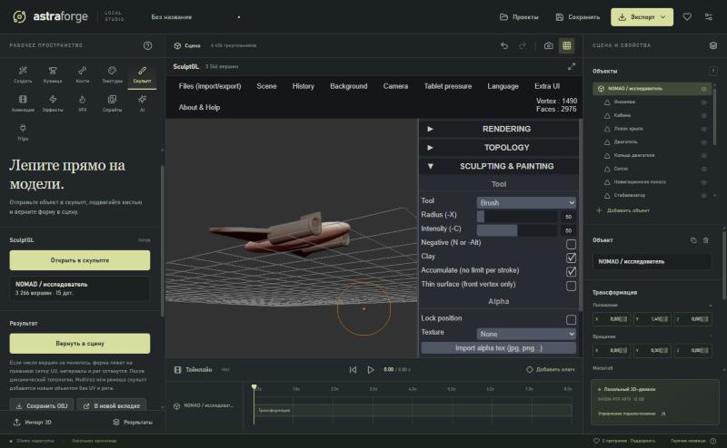

# Скульпт: SculptGL над моделью из сцены

Вкладка «Скульпт» в студии (28.10.2026). Браузерный скульптинг [SculptGL](https://github.com/stephomi/sculptgl)
(MIT) работает прямо над выбранным объектом сцены: объект уходит в скульпт, форма возвращается обратно.
Всё локальное, без облачных сервисов и без видеокарты.



## Как пользоваться

1. Выберите объект в дереве сцены (модель целиком или одну деталь; кость выбрать нельзя).
2. Вкладка «Скульпт» → «Открыть в скульпте». SculptGL откроется в центре на месте 3D-вида; «Развернуть» (стрелки в
   правом верхнем углу) растягивает его на всё окно, «Свернуть» возвращает обратно. Смена вкладки скульпт не
   закрывает: модель в нём остаётся до следующего «Открыть в скульпте».
3. Лепите: левая кнопка по модели — кисть, по фону — вращение камеры, правая — вращение, колесо — масштаб, средняя —
   сдвиг, Shift при мазке — сглаживание, Ctrl+Z — отмена. Справа меню SculptGL: кисть, радиус, симметрия, Multires,
   динамическая топология, маски.
4. «Вернуть в сцену» кладёт форму в сцену. Результат попадает в историю отмены студии (Ctrl+Z), копия OBJ — в ассеты.
5. «Сохранить OBJ» скачивает текущий скульпт файлом, «В новой вкладке» открывает SculptGL отдельным окном (обмен
   с студией продолжает работать).

## Что происходит с моделью

В скульпт уходит **склеенная сетка из одних положений** в системе координат объекта: у моделей студии вершины
раздвоены по швам UV и нормалей, а SculptGL такие швы раскрыл бы при первом же мазке. Вернувшаяся форма раскладывается
обратно на **все исходные вершины**, поэтому:

| Что делали в скульпте | Что получаете |
|---|---|
| Кисти, маски, смещение, симметрия (число вершин не менялось) | Форма ложится на прежнюю сетку: UV, материалы, текстуры, **веса костей и риг сохраняются**. Нетронутые вершины остаются в точности прежними, нормали пересчитываются только вокруг правки. Жёсткие рёбра остаются жёсткими, гладкие швы не раскрываются |
| Динамическая топология, Multires на более высокий уровень, ремеш, прореживание (число вершин изменилось) | Скульпт становится **новым объектом** без UV и рига. Если оригинал без рига, он заменяется (то же имя и трансформ, карты материала снимаются, ведь UV нет); если с ригом, оригинал остаётся на месте, а скульпт добавляется рядом как «<имя> · скульпт» |

Повторный «Вернуть в сцену» после возврата на прежнюю сетку работает: можно лепить дальше и возвращать снова.

## Ограничения

- SculptGL не знает риг и UV. Для ригованной модели не меняйте число вершин, тогда риг сохранится. Если топология
  изменилась, форму надо переносить на оригинал шагом Blender `sculpt` (операция `transfer`); в панели для этого стоит
  заготовка кнопки «Перенести форму на оригинал» (пока неактивна, шаг подключается отдельно).
- В скульпте не видны текстуры и цвета материала: он показывает только форму (matcap).
- Морфы (shape keys) объекта скульпт не учитывает: детали с морфами в скульпт не отправляются.
- Одинаковые копии (после «Дублировать») используют одну геометрию: при возврате она размножается, чужая деталь
  не меняется.
- Кнопки Sketchfab, Sculpteo и Materialise в меню SculptGL отправляют модель в интернет. Для работы в студии они не
  нужны, не нажимайте их.

## Устройство и безопасность

```
студия (http://127.0.0.1:3210)          веб-порт (http://127.0.0.1:3211, IMAGINARIUM_VFX_WEB_PORT)
 ├ вкладка «Скульпт» (SculptPanel.jsx)   └ /sculpt/  ← SculptGL + мост (bridge.js), сторонний код
 ├ iframe → /sculpt/?studio=<origin>
 └ postMessage ⇄ мост
```

- Сторонний JS живёт на **другом origin** (веб-порт генераторов VFX): API студии ему недоступен, студия отбивает
  запросы с чужим `Origin` и без заголовка `x-imaginarium-client`.
- Единственное исключение: `GET`/`HEAD /api/assets/<uuid>` с `Origin` страницы скульпта получает
  `Access-Control-Allow-Origin` именно для этого origin (`server/sculpt.mjs`). По нему SculptGL скачивает OBJ,
  который студия положила в ассеты. Запись, остальные пути и другие origin по-прежнему получают 403.
- Обмен только через `postMessage`: мост принимает сообщения лишь от origin студии (он обязан быть loopback, его
  передаёт параметр `?studio=`) и только от окна, открывшего страницу; студия проверяет `event.origin` и `event.source`.
  Адрес для загрузки обязан быть того же origin, что и студия.
- `GET /api/sculpt/status` → `{available, url, bridge, hint?, webError?}`.

### Протокол моста (`scripts/sculpt/bridge.js`)

| Студия → скульпт | Ответ |
|---|---|
| `{type:'load', url, name, id}` | `{type:'loaded', id, name, vertices, meshes}` |
| `{type:'export', format:'obj'\|'ply'\|'stl', id}` | `{type:'exported', id, format, name, bytes, vertices, meshes}` |
| `{type:'status'}` | `{type:'ready', started, bridge, version, vertices, meshes, name, edits, loaded}` |
| — | сам шлёт `ready` при старте, `edited` при правках, `error` при сбое |

SculptGL читает OBJ, STL, PLY (GLB не читает: студия шлёт OBJ). При загрузке он нормирует размер и центрирует
сцену матрицей объекта; мост убирает эту матрицу при экспорте, поэтому координаты возвращаются те же, что ушли.
Мост выключает статический флаг `Mesh.OPTIMIZE` (SculptGL иначе переставляет вершины для кэша видеокарты) и
восстанавливает порядок мешей при экспорте (SculptGL пересортировывает их по глубине), без этого форму нельзя
вернуть на исходную сетку. Исходники SculptGL не правятся.

## Установка и сборка

SculptGL собирается из исходников на машине владельца, в архив студии не входит:

```powershell
powershell -ExecutionPolicy Bypass -File scripts\vfx\Install-VfxTools.ps1 -Only sculptgl
```

Скрипт скачивает ветку `master` в `<IMAGINARIUM_VFX_TOOLS>\web\sculptgl-src`, ставит зависимости (`npm ci --ignore-scripts`,
затем webpack 5.97 вместо 5.21 из lock-файла: старый не работает на Node 17+), собирает `webpack --env release`,
удаляет `node_modules` и запускает `scripts/sculpt/assemble.mjs`. Тот копирует `app/` в `web/sculptgl/`, убирает
внешние обращения (Google Fonts, страница авторизации Sketchfab), подключает мост и кладёт `LICENSE.txt`.
Сборка около 5 МБ (скрипт 0,5 МБ, остальное маткапы и окружения). Правка `scripts/sculpt/bridge.js` попадает в
сборку повторным запуском того же скрипта (сборка webpack при этом не повторяется).

## Файлы

| Файл | Назначение |
|---|---|
| `src/SculptPanel.jsx`, `src/sculpt.css`, вкладка в `src/App.jsx` | панель и iframe поверх центрального вида |
| `src/sculpt-tools.js` | `StudioScene.sculptExport()` / `sculptApply()`: отправка объекта и возврат формы |
| `src/sculpt-core.js` | склейка вершин, OBJ, раскладка формы по исходным вершинам, нормали с порогом излома |
| `scripts/sculpt/bridge.js`, `assemble.mjs` | мост и сборка страницы |
| `server/sculpt.mjs` | `/api/sculpt/status`, CORS ассетов; маршрут `/sculpt/` — в `server/vfx-tools.mjs` |
| `tests/sculpt.test.mjs`, `tests/sculpt-core.test.mjs` | проверки |

## Лицензия

SculptGL © 2019 Stéphane Ginier, MIT; текст лицензии лежит в сборке (`web/sculptgl/LICENSE.txt`) и в
`THIRD_PARTY_NOTICES.md`. Мост и вкладка принадлежат Imaginarium.
