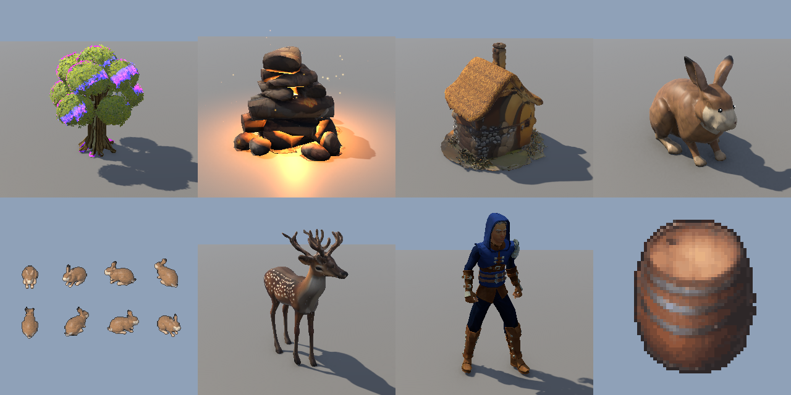

# Модуль «unity»: пакеты для Unity и импортёр `com.astraforge.unity`

Экспорт в Unity устроен как экспорт в Godot: студия собирает **пакет**, движок сам собирает из него рабочий
**префаб**, а проверка в настоящем движке без окна подтверждает результат.

- Шаг Blender **`unity_package`** (профиль экспорта **`unity`**): FBX, текстуры PNG и паспорт `af_unity.json`.
- Пакет Unity **`com.astraforge.unity`** (`unity/com.astraforge.unity`, UPM, MIT): импортёр сам собирает префаб из
  паспорта — без ручной правки.
- Пакетная проверка: `Unity -batchmode -executeMethod AstraForge.Editor.AFBatch.Validate` на проверочном
  URP-проекте студии `C:\AstraForge\unity\AFUnityCheck`. Результат — JSON-отчёт и скриншоты префабов.
- Отправка в проект владельца **одной командой**: `forge.mjs export … --profile unity --to-unity <проект>`,
  `scripts/unity/af_unity_send.mjs` или MCP-инструмент `unity_send`.

Unity по умолчанию — **6000.0.64f1 (Unity 6 LTS)**, рендер — **URP 17.0**. Built-in и HDRP поддержаны
импортёром: он берёт шейдеры активного пайплайна, оговорки см. ниже. Unity 6000.3 тоже найдётся, если LTS нет.

## Быстрый старт

```
node scripts/forge.mjs export <assetId> --profile unity                                  # пакет + проверка в Unity
node scripts/forge.mjs export <assetId> --profile unity --to-unity "D:/Games/MyGame"     # + положить в проект
node scripts/forge.mjs export <assetId> --profile unity --to-unity "D:/Games/MyGame" --build   # + собрать префаб сразу (проект закрыт)
node scripts/unity/af_unity_send.mjs --project "D:/Games/MyGame" <папка пакета | unity-v00N.zip> [--build]
py scripts/unity/unity_check.py <папка пакета> [...] --out <папка>                      # проверка набора пакетов одним запуском Unity
```

В Unity (меню **AstraForge**): «Пересобрать все пакеты», «Пересобрать выбранный пакет», «Импортировать папку
пакета…», «Проверить все пакеты». Открытый редактор собирает префаб сам, как только файлы пакета появились или
обновились (`AFImportPostprocessor` → `AFPrefabBuilder`).

## Шаг `unity_package`

Запуск как у остальных шагов (`af_run.py -- unity_package request.json`). На входе `inputs.glb` (или только
`inputs.sprites`), необязательный `inputs.manifest`. Если раньше в той же цепочке был `render_sprites`, сервер
сам передаёт `inputs.sprites`. Маски сокетов в `fx` сервер разворачивает так же, как для `godot_package`.

| Параметр | По умолчанию | Что |
|---|---|---|
| `asset_id` | из паспорта | snake_case ASCII |
| `pipeline` | `urp` | подсказка для README; шейдеры импортёр берёт по активному пайплайну проекта |
| `unity_forward` | `+Z` | префаб смотрит вдоль `transform.forward`; `keep` — как пришло из FBX |
| `rig` | `auto` | кости Mixamo (Hips, Spine, LeftUpLeg … — не меньше 14 из 15) → **Humanoid**, иначе **Generic** |
| `collider` | `auto` | имена-коллизии важнее примитивов: меши `*-colonly`, `*-convcolonly`, `COL_*` становятся UCX-оболочками в FBX (см. ниже) и никогда не рендерятся; без них — со скелетом капсула по габариту, дерево (есть листва) — капсула ствола, остальное — коробка; `box`, `capsule`, `convex`, `mesh`, `none` |
| `lod`, `lod_min_tris`, `lod_ratios`, `lod_screen` | да, 3000, [0.5, 0.2], [0.5, 0.18, 0.04] | LOD1/LOD2 — копии с Decimate у статичных моделей; листовые карточки общие для всех уровней |
| `wind`, `wind_strength`, `wind_speed`, `flutter` | `auto`, 0,07, 1,4, 0,025 | материалы `Leaves`/`Leaf`/`Foliage` (или со свойством `af_wind`) — шейдер `AstraForge/Foliage` с ветром |
| `fx`, `fx_auto_scale` | паспорт, да | пресеты `fx_presets.json` на сокетах, масштаб как у `godot_package` |
| `autoplay` | idle, иначе первая петля | первое состояние Animator Controller |
| `validate` | да | проверка в Unity; `unity`, `unity_project` — пути вместо умолчаний (`ASTRA_UNITY`, `ASTRA_UNITY_PROJECT`) |

### Коллизионные оболочки

Модель может нести коллизии, названные по соглашению кузницы: `*-colonly`, `*-convcolonly` (боковина
из мира Godot) и hulls с префиксом `COL_*`. В пакет для Unity они попадают не как содержимое, а как
коллизия — так, как это понимает сама Unity:

* меш-источник **исключается** из набора рендера: не попадает в FBX, не даёт материалов, не
  раздувает габарит и не участвует в LOD;
* на его месте строится **выпуклая UCX-оболочка** `UCX_<имя-модели>_##` (выпуклая оболочка +
  Decimate в бюджет 64 треугольников) — штатное соглашение коллизий FBX для Unity; она едет в том
  же FBX с той же мировой матрицей, то есть ориентация оболочки всегда совпадает с родителем;
* в паспорте это `collider: {"type": "ucx", "hulls": [{mesh, ucx, source, kind, triangles}]}` —
  видно, какая оболочка к какой модели привязана;
* импортёр подстраховывается: `AFPrefabBuilder` для `ucx` гасит рендер уцелевших UCX-мешей и вешает
  convex `MeshCollider`, а `AFBatch` в проверке ставит галочку только если коллайдеры есть **и** ни
  одна оболочка не светится на экране.

Явный `collider=box|capsule|convex|mesh` уважается: hulls всё равно не будут отрисованы, но
примитив строится по рендер-мешам (шаг предупредит, что авторские оболочки отменены). При
`collider=none` от hulls не остаётся ничего. Проверено тестом `test_unity_colonly_hulls_never_render`
(Blender-набор); поведение самого Unity — на уровне данных, как и весь C#-импортёр.

Пакет `<asset_id>/`:

| Файл | Что |
|---|---|
| `<asset_id>.fbx` | модель, метры, Y вверх; клипы — отдельные дубли (takes) `Armature|<клип>`; поза покоя без активного клипа |
| `textures/*.png` | базовый цвет; нормали; маска (R металл, G затенение = 1, A гладкость — подходит и URP, и HDRP); свечение |
| `fx/textures/*.png` | процедурные текстуры частиц (те же, что в Godot) |
| `sprites/*.png` | листы `render_sprites` |
| `af_unity.json` | паспорт `astraforge-unity-package/1`: материалы, клипы с петлями, сокеты (позиции в осях Unity), LOD, коллайдер, эффекты с осями, спрайты, размер |
| `README.md` | что соберёт импортёр и итог проверки |

**Оси (измерено 31.10 на Unity 6000.0.64f1).** FBX уходит с `axis_forward=-Z`, `axis_up=Y`, без
`bake_space_transform`. Импортёр включает `bakeAxisConversion` и `useFileScale`, масштаб 1. Вектор Blender
(x, y, z) приходит в Unity как **(x, z, y)**: персонаж (лицо к −Y в Blender, +Z в glTF) смотрит в Unity в
**−Z**, нос корабля или реквизита (glTF −Z) — в **+Z**. Поэтому при `unity_forward: +Z` узел `model` у
персонажей, существ и предметов повёрнут на 180°. Реквизит и корабли не поворачиваются. Глазами: на
скриншотах лучник и олень смотрят в камеру, которая стоит со стороны +Z.

**Материалы.** Principled BSDF после импорта GLB разбирается в паспорт: текстура базового цвета (через узлы
Mix и вершинный цвет), альфа (вырез — если в цепочке есть Math или альфа почти двоичная, иначе
полупрозрачность), металл и шероховатость (G/B glTF → маска), нормали с силой, свечение, двусторонность.
Импортёр создаёт материал под пайплайн: URP — `Universal Render Pipeline/Lit` (ключевые слова через
`BaseShaderGUI.SetMaterialKeywords`), Built-in — `Standard`, HDRP — `HDRP/Lit`
(`HDShaderUtils.ResetMaterialKeywords`). Затем материал привязывается к слоту FBX через `AddRemap` по имени.
Вершинный цвет и листва идут на шейдер `AstraForge/Foliage URP` / `Foliage Built-in` (в пакете лежит в
`Shaders~` и копируется в `Assets/AstraForge/_Shaders` только при нужде — проект без URP не ловит ошибок
компиляции). Ветер повторяет `leaves_wind.gdshader` Godot: UV2.x — вес ветра, UV2.y — фаза, COLOR — оттенок.
Если у листвы нет UV2, шаг пишет его сам (вес по высоте кроны, фаза — хэш позиции).

**Анимации.** `OnPreprocessAnimation` сопоставляет дубль FBX `Armature|idle-loop` с клипом паспорта, задаёт
имя `idle` и `loopTime`. У Humanoid поворот и высота корня запечены в позу, у петель — ещё и XZ: клипы
играются на месте. Avatar создаётся из модели. Контроллер `<id>_Animator.controller` получает по состоянию на
клип; при пересборке очищается, а не пересоздаётся, поэтому GUID и ссылки в сценах сохраняются. Компонент
`AFAnimations.Play("walk")` переключает клипы.

**Сокеты и эффекты.** `AFSockets` хранит сокеты по именам (`Get`, `Attach`). Сокеты на костях едут вместе с
анимацией. Пресеты эффектов Godot превращаются в Particle System (`AFFxBuilder`) по таким правилам:

| Пресет Godot | Particle System |
|---|---|
| `amount` / `lifetime` | rate (разовые — burst) |
| `velocity` / `spread` | Cone по оси излучения |
| `scale × quad_size` | размер частицы |
| `scale_curve` | Size over Lifetime |
| `color_ramp` | Color over Lifetime |
| `gravity` | Force over Lifetime в мире |
| `damping` | drag |
| `angle` / `angular_velocity` | поворот |
| `turbulence` | Noise |
| `light` | точечный свет |
| `blend add/mix` | материал URP Particles Unlit, аддитивный или альфа |

Объект эффекта ставится на сокет. Его +Y — ось «наружу» сокета (у сопел — ось выхлопа, как в Godot), +Z — «вперёд» дула. `AFFxMount.Trigger(сокет)`
перезапускает разовые эффекты.

**Спрайты.** Листы режутся по прямоугольникам `sprites.json`: `TextureImporter.spritesheet`, без зависимости от
пакета 2D Sprite. Pixels Per Unit = `px_per_meter`, то есть 1 м = 1 единица, как у 3D. Опорная точка — якорь
ячейки (земля под моделью). Пиксель-арт получает фильтр Point без сжатия. Дальше строятся клипы по каждому
направлению (`sprites/anim/<клип>_<N>.anim`) и контроллер: на клип одно состояние с 2D-деревом направлений
(параметры `DirX`/`DirY`; S = (0, −1), N = (0, 1), E = (1, 0)). Итог — префаб `<id>_sprite.prefab`
(SpriteRenderer + Animator + `AFSprite8Dir`: `SetDirection`, `SetWorldDirection(вектор, камера)`, `Play`).

## Проверка в Unity (batchmode)

`_unity_lib.validate()` делает следующее:

1. Если проверочного проекта нет, создаёт его из шаблона редактора «Universal 3D» (`-cloneFromTemplate`, без
   сети) и подключает импортёр ссылкой `file:` на эту папку репозитория.
2. Копирует пакеты в `Assets/AstraForge/<id>/` и одним запуском Unity выполняет `AFBatch.Validate`.
3. Проект на это время запирается файлом `.af_unity_check.lock`. Если проект открыт в редакторе — понятное
   предупреждение. Если Unity Hub вышел из аккаунта — предупреждение «нет лицензии».

Проверки для каждого ассета (в шаге — `unity_<имя>`):

- `prefab_exists`;
- `materials_no_pink` — каждый слот заполнен шейдером, который рисует активный пайплайн;
- `materials_remapped`;
- `size_matches_godot` — размер по осям против `size_m` (допуск 1 %);
- `placement_axes` — углы габарита (ловит разворот и зеркало);
- `avatar_humanoid|generic`;
- `clips_and_loops`, `animator_controller`;
- `animation_plays` — кости сдвигаются за полклипа, `AnimationMode`;
- `sockets_found` — позиции сокетов в bind pose скина;
- `fx_attached` — ось +Y и материал эффекта;
- `collider`, `lod_group` — треугольников по уровням всё меньше; у `ucx` — число оболочек и ни одной светящейся (UCX-меш с включённым рендером = брак);
- для спрайтов: `sprites_sliced`, `sprites_ppu`, `sprites_point_filter`, `sprite_prefab`, `sprite_animator`, `sprite_clips_frames`;
- `console_errors` — ошибки консоли во время сборки.

Скриншоты (`AFShots`) рендерятся через активный пайплайн (`RenderPipeline.SubmitRenderRequest`): вид 3/4
спереди, клип по умолчанию на 35 % длины, частицы прогнаны на 1,5 с. Спрайты — сетка 4 × 2 по направлениям.
Всё это сводится в `contact_sheet.png`.

### Прогон 31.10.2026 (Unity 6000.0.64f1, URP 17.0.4)

Ассеты из «AstraForge — уровень с нуля» и библиотеки: дерево `tree_oak_1` (листовые карточки, ветер, LOD
5274 / 4335 / 3771, капсула ствола); костёр (`fire` + `sparks` на `socket_fx_fire`); дом (LOD 14970 / 7485 /
2994, сокет трубы); заяц и олень (Generic, 3 клипа с петлями); заяц ещё и спрайтами pixel (192 спрайта,
64 px/м); лучник Q (Humanoid, Avatar valid, 6 клипов, 2 сокета на руках); бочка — только спрайт. **7 из 7
OK, 71 проверка, 19,5 с на весь набор.** Размеры совпадают с паспортом Godot (glTF) в пределах 1 %.
Сквозной путь `forge.mjs export … --profile unity --to-unity … --build` (костёр из библиотеки) положил
пакет в новый проект и собрал префаб в batchmode. Тесты: `run_tests.py -- unity` — 4 PASS и 1 SKIP; с
`AF_UNITY_TESTS=1` пятый тест (настоящий Unity) — PASS за 13,9 с.

Тот же набор в проекте **Built-in** (`unity_check.py --pipeline builtin --project C:/AstraForge/unity/AFUnityCheckBuiltIn`, пустой проект без URP): **7 из 7 OK, 71 проверка, 13,4 с**. Материалы — `Standard`, листва — `AstraForge/Foliage Built-in`, частицы — `Mobile/Particles/Additive`. С `Legacy Shaders/Particles/Additive` огонь костра на снимке не был виден, поэтому эти шейдеры заменены.



## Управление редактором Unity из Claude Code (MCP for Unity)

Владелец разрешил 31.10.2026: **MCP for Unity** (CoplayDev, MIT, **v10.3.0**). Ставится две части:

- Unity-пакет `com.coplaydev.unity-mcp` из GitHub, закреплён тегом `#v10.3.0`.
- Сервер `mcpforunityserver==10.3.0` из PyPI, запускается через `uvx`.

| Что | Где |
|---|---|
| Рабочий Unity-проект студии | `C:\AstraForge\unity\AstraForgeUnity`: URP, импортёр `com.astraforge.unity` (встроенный), MCP for Unity, пример — костёр из библиотеки |
| Сервер в Claude Code | `UnityMCP`, scope user (во всех проектах): `uvx --from mcpforunityserver==10.3.0 mcp-for-unity --transport stdio`, переменные `UNITY_MCP_DISABLE_TELEMETRY=true`, `UNITY_MCP_TRANSPORT=stdio` |
| Режим | **stdio**: Claude Code запускает сервер, сервер подключается к мосту открытого редактора (TCP `127.0.0.1:6400`, мост стартует вместе с редактором) |
| Настройка редактора | меню **AstraForge → MCP for Unity: режим stdio для Claude Code** или `AFSetup.ConfigureUnityMcp`: `MCPForUnity.UseHttpTransport=false`, телеметрия выключена (по умолчанию сервер шлёт события на api-prod.coplay.dev) |

Подключить MCP к другому своему проекту:
`node scripts/unity/af_unity_send.mjs --project <проект> --with-mcp`. Команда добавит пакет в
`Packages/manifest.json` и переключит режим stdio, если проект закрыт; можно сразу вместе с пакетами ассетов.

Инструментов **48**: сцены, объекты, компоненты, префабы, ассеты, материалы, шейдеры, текстуры, скрипты
(создание, правки, проверка), анимация, камеры, физика, UI, VFX, пакеты, сборка, профайлер, тесты, консоль,
пункты меню, `execute_code`. Инструменты генерации (`generate_image`, `generate_model`, `generate_audio`)
обращаются к облачным сервисам — для 3D у нас AstraForge, облачные генераторы только по решению владельца.

Проверено 31.10 тестовым MCP-клиентом через тот же `uvx`-сервер:

- `tools/list` — 48 инструментов;
- `manage_scene get_hierarchy` — живая сцена;
- `execute_menu_item "AstraForge/Пересобрать все пакеты"`;
- `manage_gameobject create prefab_path=…/campfire_fx_ea2f91ab.prefab` — костёр в сцене;
- `read_console` — 0 ошибок.

Сцену не сохранял. Новая сессия Claude Code видит сервер `UnityMCP` сама. Редактор Unity с проектом должен
быть открыт, иначе инструменты отвечают, что Unity не подключён.

## Ограничения (честно)

- **Эффекты** — только Particle System. VFX Graph не используется: нужен отдельный пакет и compute на целевой
  платформе. Перевод пресетов Godot приблизительный: затухание, тангенциальное и радиальное ускорение,
  кольцевой излучатель передаются примерно. Пресеты проверены структурно и на скриншотах, под арт-дирекцию
  игры не настраивались.
- **Ветер листвы** — URP и Built-in. В HDRP листва идёт на `HDRP/Lit` с вырезом, без ветра и вершинного
  цвета. Частицы в HDRP — `HDRP/Unlit` без цвета частицы. Шейдер URP рассчитан на URP 17 (Unity 6): основной
  и дополнительные источники, Forward+, тени, туман; SSAO-нормали упрощённые.
- **Поза по умолчанию** ригованного префаба в Unity — не поза покоя Blender: экспортёр FBX пишет узлы костей
  в позе кадра. На работу это не влияет — Animator ставит клип с первого кадра. Проверка сокетов и размера
  поэтому идёт в bind pose скина.
- **LOD** только у статичных моделей (у ригованных нет). Упрощение — Decimate; на «рваных» сетках Pixal3D
  дальние уровни грубые.
- **Root motion** выключен (`applyRootMotion = false`): клипы студии играются на месте. Для выпадов с ходом
  корня включите его на Animator вручную.
- **Ткань `cloth_sim`** приходит обычным скиннингом, без запечённой симуляции. Связки «всадник + конь» не
  проверялись.
- **Built-in `Standard`** не умеет двусторонние материалы — их там рисует `AstraForge/Foliage Built-in`.
  HDRP пакетной проверкой не прогонялся (проверены URP и Built-in).
